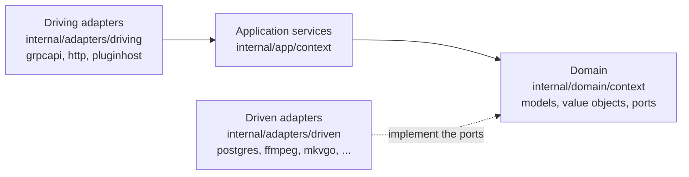
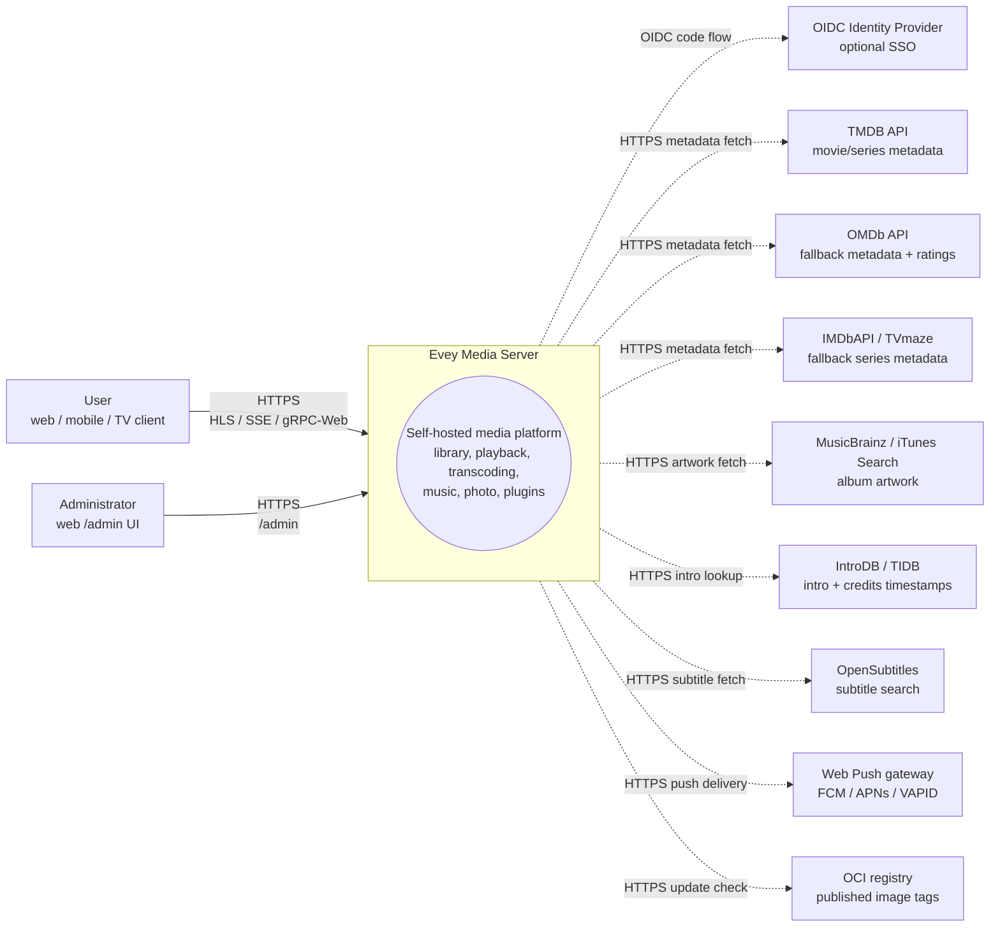
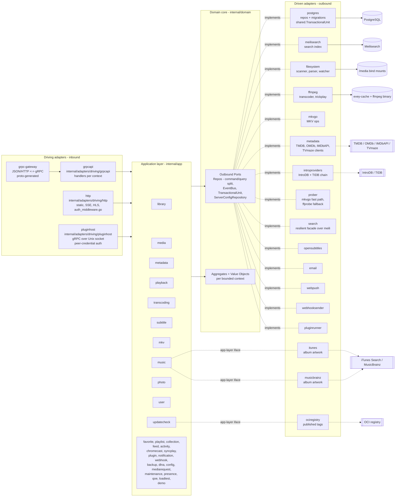
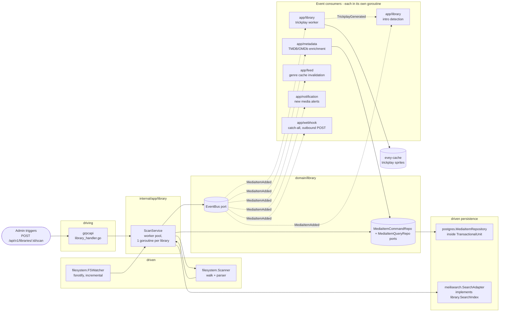

# Architecture

How the server is put together: the hexagonal layering under `internal/`,
the bounded contexts, the events that connect them, and the static guards
that keep the code on those rails. The code lives in `internal/domain`,
`internal/app`, `internal/adapters/{driving,driven}` and is wired in
`cmd/evey/wire*.go`; the layout is decided by [ADR-0001](adr/0001-hexagonal-architecture.md),
the repository split by [ADR-0009](adr/0009-cqrs-repo-split.md) and the event
bus by [ADR-0010](adr/0010-event-bus.md). For building and running, read
[DEV.md](../DEV.md); for which files to touch for a given change, read the
[Codebase map](CODEBASE_MAP.md).

Backend is Go; the web, mobile and TV clients are a TypeScript/React monorepo
under `frontend/` (React Native / Expo for mobile and TV).

## Layering

| Directory | Holds | Rule |
| --- | --- | --- |
| `internal/domain/<context>/` | models, value objects and the **ports** (interfaces) | no framework import, no import of another context |
| `internal/app/<context>/` | application services that orchestrate the ports | IO goes through a port; `dlna` (SSDP / UPnP AVTransport) and `loadtest` (its own HTTP client) are the two deliberate exceptions that reach the network directly |
| `internal/adapters/driven/` | outbound adapters implementing the ports: `postgres`, `meilisearch`, `ffmpeg`, `mkvgo`, `filesystem`, `prober`, `opensubtitles`, `email`, `webpush`, `webhooksender`, `pluginrunner`, `metadata`, `introproviders`, `search` | three more satisfy an app-layer interface rather than a domain port: `itunes` and `musicbrainz` (`app/music.AlbumArtFetcher`), `ociregistry` (`app/updatecheck`) |
| `internal/adapters/driving/` | inbound adapters: `grpcapi` (+ grpc-gateway HTTP), `http` (static, auth middleware, SSE, HLS, plugin iframe assets), `pluginhost` (gRPC server on a Unix socket, authenticated by peer credentials, the host API sandboxed plugins call back into) | |
| `internal/pkg/` | the shared technical kernel: auth, logger, eventbus, i18n, metrics, tracing, ratelimit, procfork, ssrf, cache, ... | |
| `internal/config/` | server configuration | |
| `gen/` | generated proto code | |

Dependency rule: `adapters -> app -> domain`. The domain never imports the
app or the adapters. Composition is hand-written (not google/wire) in
`cmd/evey/wire.go` and its siblings `wire_infra.go`, `wire_services.go`,
`wire_adapters.go`, `wire_events.go`, `wire_helpers.go`. Tests bypass the
adapters by injecting fakes that implement the same domain ports: 20 of the
21 domain packages ship a `fakes/` subpackage.

## Bounded contexts

Thirty-two context packages live under `internal/domain/` and `internal/app/`:
19 exist in both layers, 2 are domain-only (`ratings`, `shared`), 11 are
app-only. They collaborate partly through domain events on a shared bus; the
app layer also reads a neighbouring context's domain package directly (see
[Relations](#relations)).

| Context | Responsibility |
| --- | --- |
| `user` | accounts, auth, sessions, preferences |
| `library` | libraries, folders, scan jobs, media index, people, collections, a profile's favorites and thumbs (thumbs have no app service: the rating RPC stores and reads `UserRatingRepository` as is), trickplay, intro/credits detection |
| `media` (app only) | share links and stream tokens |
| `mediarequest` | user-submitted media requests |
| `metadata` | TMDB / OMDb enrichment, artwork |
| `playback` | streams, progress, remote control, now-playing |
| `transcoding` | ffmpeg jobs, HLS segments |
| `subtitle` | embedded + external + opensubtitles |
| `mkv` | MKV container ops (via [mkvgo](playback/mkvgo.md)) |
| `music` | audio-specific playback + tagging |
| `photo` | photo libraries |
| `favorite` (app only) | per-profile favorites; the model and `FavoriteRepository` live in `domain/library` |
| `playlist` | user playlists, smart playlists |
| `collection` (app only) | admin-curated collections; its ports live in `domain/library` |
| `ratings` (domain only) | maps country classifications (CSA, FSK, MPAA, BBFC, ACB) onto one minimum-age axis |
| `feed` | activity feed / discover |
| `activity` | user activity timeline |
| `chromecast` | cast session lifecycle |
| `syncplay` | multi-device sync sessions |
| `plugin` | plugin registry, sandbox tokens, lifecycle |
| `notification` | in-app + webpush notifications |
| `webhook` | outbound webhooks |
| `backup` | DB + config backup/restore |
| `config` (app only) | persisted server settings, written by both the REST and the gRPC entry points |
| `dlna` (app only) | SSDP discovery and UPnP AVTransport control |
| `loadtest` (app only) | simulates viewers against the server's own HTTP stack: HLS, or the raw file when a client's verdict is a direct play |
| `maintenance` (app only) | admin-triggered media maintenance: seek-index rebuild, repair journal, undo, audio integrity |
| `presence` (app only) | in-memory, non-persisted registry of who is connected right now |
| `qoe` (app only) | CMCD (CTA-5004) playback telemetry ingest and aggregation |
| `demo` (app only) | the public demo instance (`EVEY_DEMO=1`): seeds its accounts, libraries and freely licensed media through the product's own services, and resets itself |
| `updatecheck` (app only) | compares the running build with what the registry publishes and tells the administrator; it never updates anything |
| `shared` (domain only) | cross-cutting ports (`EventBus`, `TransactionalUnit`, `ServerConfigRepository`, `ShareLinkRepository`), typed ids, cursors, stream tokens |

### Relations

| Emitter | Events | Consumed by |
| --- | --- | --- |
| `library` | `LibraryCreated` / `LibraryDeleted`, `LibraryScanStarted` / `LibraryScanCompleted`, `MediaItemAdded`, `MediaItemRemoved`, `TrickplayGenerated` | `media.item.added`: `notification`, `metadata` (auto-enrich), `library` itself (trickplay worker + intro detection), `feed` (genre-cache invalidation) |
| `playback` | `PlaybackStarted` / `PlaybackStopped` | no dedicated subscriber today; only `webhook`'s `"*"` catch-all receives them |
| `user` | `UserCreated`, `user.password.reset_requested` | the first has no subscriber; the second is consumed by the `email` driven adapter |
| `pluginrunner` | `plugin.error` / `plugin.started` | `app/plugin` for its security dashboard, `notification` for the administrator |
| `shared` | `ServerConfigChanged` | the services that apply a setting saved in the admin panel without a restart (SMTP, timezone, CPU budget, ...) |

- Search indexing is **not** event-driven: `library.ScanService` calls the
  `library.SearchIndex` port directly.
- There is no bridge feeding domain events into plugins: plugins reach the API
  with scoped JWTs ([ADR-0003](adr/0003-plugin-scoped-tokens.md)). The bus
  itself is [ADR-0010](adr/0010-event-bus.md).
- `shared.TransactionalUnit` wraps multi-aggregate writes ([ADR-0002](adr/0002-transactional-unit-port.md)).

No package under `internal/domain` imports another context's domain package,
a rule enforced by `internal/contractguard/domain_imports_test.go` (see
[Architecture guards](#architecture-guards)). The app layer is not bound by
it: 15 app packages import a neighbouring context's domain package today.

## Typical data flow - "user plays a media"

1. Mobile/web client calls `POST /api/v1/playback/start` (grpc-gateway route).
2. `internal/adapters/driving/http` runs its auth middleware (`auth_middleware.go`, `httpAuthMiddleware`), extracts session.
3. `internal/adapters/driving/grpcapi` (`playback_handler.go`) validates proto, calls `app/playback.CommandService.StartStream` (command/query split, see [ADR-0009](adr/0009-cqrs-repo-split.md)).
4. `app/playback.CommandService` calls domain ports: `user.UserRepository`, `playback.SessionQueryRepo` (idempotency + device cap), `playback.SessionCommandRepo`, then `shared.EventBus.Publish(PlaybackStarted)`.
5. Driven adapters execute: `postgres` persists the session inside a `shared.TransactionalUnit.Do` scope; the in-process bus (`internal/pkg/eventbus`) dispatches asynchronously.
6. `PlaybackStarted` has no dedicated subscriber today: only the `webhook` `"*"` catch-all receives it.
7. Response streams back through grpc-gateway as JSON; progress updates flow over SSE / gRPC streams.

What happens once the player asks for the manifest and the segments is the
subject of [Playback pipeline](playback-serving.md).

## Architecture guards

The rules above are not documentation-only. `internal/contractguard/` holds
58 static tests across 30 files that fail the build when the codebase drifts
from them.

The hexagonal rule itself is `TestDomainContextsDoNotImportEachOther`
(ADR-0001), in `domain_imports_test.go`. It walks `internal/domain` and
enforces exactly this: a context may import `internal/domain/shared` and its
own package tree, nothing else from `internal/domain`, and never
`internal/app` or `internal/adapters`. Its scope stops at `internal/domain`:
it says nothing about the app layer.

The rest guard contracts that cross a language or a process boundary, among them:

| Guard | What it refuses |
| --- | --- |
| `TestNoClientReadOfAFieldTheServerNeverWrites` | a proto response field a client reads that no server code writes |
| `TestRegisteredHandlersGetEveryPortTheyDeclare`, `TestBootInstallsItsSilentWirings` | wiring that would otherwise fail silently |
| `TestPostgresRepositoriesBoundTheirQueries` | a Postgres repository query without a timeout |
| `TestProcfork_EveryForkGoesThroughCommand` | a subprocess fork that bypasses `internal/pkg/procfork` |
| `TestEverySortFieldTheAPIAcceptsHasASQLColumn`, `...CanBuildACursorValue` | a sort field missing from the SQL column map or the cursor encoder |
| `TestEveryWebSurfaceReachingAnAdminRPCIsClassified`, plus its native counterpart for mobile and TV | a UI surface calling an admin-only RPC without deciding who sees it |
| `TestEveryAllowedSlotIsMountedOnWebAndMobile`, `TestPluginBridgeParityWebMobile` | a plugin UI slot or bridge message present on one client only |
| `TestImageSubtitleCodecsAgreeAcrossServerAndClients` | a second list of bitmap subtitle codecs on a player |
| `TestHandWrittenClientTypesMatchTheEndpointTheyCall` | a hand-written mobile/TV response type that drifts from its endpoint |
| `TestOnlyThePlanDecidesPlayback`, `TestNoCallerDerivesDownstreamOfThePlaybackPlan` | a playback decision taken outside the plan resolver ([ADR-0030](adr/0030-one-plan-one-decision.md)) |
| `TestRestartExitCodeAgreesWithTheEntrypoint` | a Go exit code and `docker/entrypoint.sh` disagreeing on what a restart means |
| `TestServerEmittedI18nKeysExistInCatalogue`, `TestI18nPlaceholdersAgreeAcrossLocales` | a server-emitted key missing from the catalogue, placeholders that differ between locales |

## C4 diagrams

Four diagrams document Evey at decreasing zoom levels following the
[C4 model](https://c4model.com/). Node names are the actual Go package names
under `internal/`. Container names come from `docker-compose.yml` for
`evey-server`, `evey-postgres` and `evey-caddy`; `evey-web`,
`evey-meilisearch`, `evey-mobile` and `evey-mailcatcher` are declared in
`docker-compose.override.yml` and exist in the dev topology only.

### Level 1 - System Context

Who talks to Evey, and which third parties Evey reaches out to.

### Level 2 - Container

The deployable units brought up by `docker compose --env-file .env.dev up`.
Solid arrows are runtime traffic; dashed arrows are outbound to third parties.

!!! note "Production differs from this dev topology"
    The install compose declares one service, `evey`. There is no separate
    `evey-web` container (nor the dev-only mailcatcher and Metro bundler):
    the binary serves the built web UI from `/srv`, so a reverse proxy
    forwards *everything*, UI and API, to it on `:9091`. Postgres and
    Meilisearch run inside the same container, supervised by
    `docker/entrypoint.sh`: PostgreSQL 17 with its data under
    `/data/postgres`, and the Meilisearch binary (`Dockerfile`,
    `meili-download` stage, pinned to 1.12.8) with its index under
    `/data/meili`. The repository's own `docker-compose.yml` keeps separate
    `postgres` and `caddy` services, described in
    [Advanced deployments](operations/advanced-deployments.md). See
    [Install](installation.md) and [Reverse proxy](reverse-proxy.md).

### Level 3 - Component (zoom on `evey-server`)

Hexagonal layering inside the Go binary. Driving adapters call application
services through their interfaces; application services depend only on domain
ports; driven adapters implement those ports.

Goroutine notes:

- gRPC server (`grpc.Server.Serve`) and HTTP server (gateway + static) each run in their own goroutines off the main wire-up in `cmd/evey`.
- `app/library` scan jobs run on a worker pool (one goroutine per active library scan, see `library.ScanService`).
- ffmpeg jobs are forked through `internal/pkg/procfork` by the driven `ffmpeg` adapter (`ffmpeg.Transcoder.Start`), one supervising goroutine per job draining the process stderr.
- `shared.EventBus` dispatches subscribers asynchronously: each subscriber runs in its own goroutine so a slow consumer never blocks publishers. The bus opens no transaction of its own; that is the handler's job.
- `pluginrunner` spawns one subprocess per plugin; iframe plugins live inside the user browser and talk back via signed tokens issued by `app/plugin`.

### Level 3 (bonus) - Component zoom on the scan pipeline

The hot path that turns files on disk into searchable, enriched media. Solid
arrows are direct calls; dashed arrows are domain events on the bus. Search
indexing is a direct port call from `ScanService`, not an event.

Read this with the "Typical data flow" section above: the playback path is the
symmetric read path; the scan pipeline is the write path that primes the media
index the read path serves from.

## Further reading

- [DEV.md](../DEV.md) - build, run, migrations, proto generation
- [Codebase map](CODEBASE_MAP.md) - which files to touch for common changes
- [Playback pipeline](playback-serving.md) - the HLS video-serving read path, in depth
- [API reference](api/) - generated API reference
- [Decision records](adr/) - architectural decision records

<!-- sources
layering: internal/domain ; internal/app ; internal/adapters/driven ; internal/adapters/driving ; internal/pkg ; internal/config ; gen ; cmd/evey/wire.go, wire_infra.go, wire_services.go, wire_adapters.go, wire_events.go, wire_helpers.go
app-layer interfaces: internal/app/music/album_art_chain.go - AlbumArtFetcher ; internal/adapters/driven/ociregistry (app/updatecheck)
network exceptions: internal/app/dlna/service.go ; internal/app/loadtest/runner.go
events and subscribers: internal/app/notification/command_service.go ; internal/app/metadata/command_service_enrich.go ; internal/app/library/trickplay_service.go ; internal/app/library/intro_detection_service.go ; internal/app/feed/genre_cache.go ; internal/app/webhook/service.go ; internal/adapters/driven/email/password_reset_emailer.go ; internal/app/plugin/security_dashboard_service.go ; internal/app/config/smtp.go, timezone.go, cpu_budget.go
guards: internal/contractguard/*_test.go - TestDomainContextsDoNotImportEachOther, TestOnlyThePlanDecidesPlayback, TestNoCallerDerivesDownstreamOfThePlaybackPlan, TestServerEmittedI18nKeysExistInCatalogue, TestI18nPlaceholdersAgreeAcrossLocales
topology: docker-compose.yml ; docker-compose.override.yml ; Dockerfile - MEILI_VERSION, postgresql-17 ; docker/entrypoint.sh - PG_MAJOR
-->
