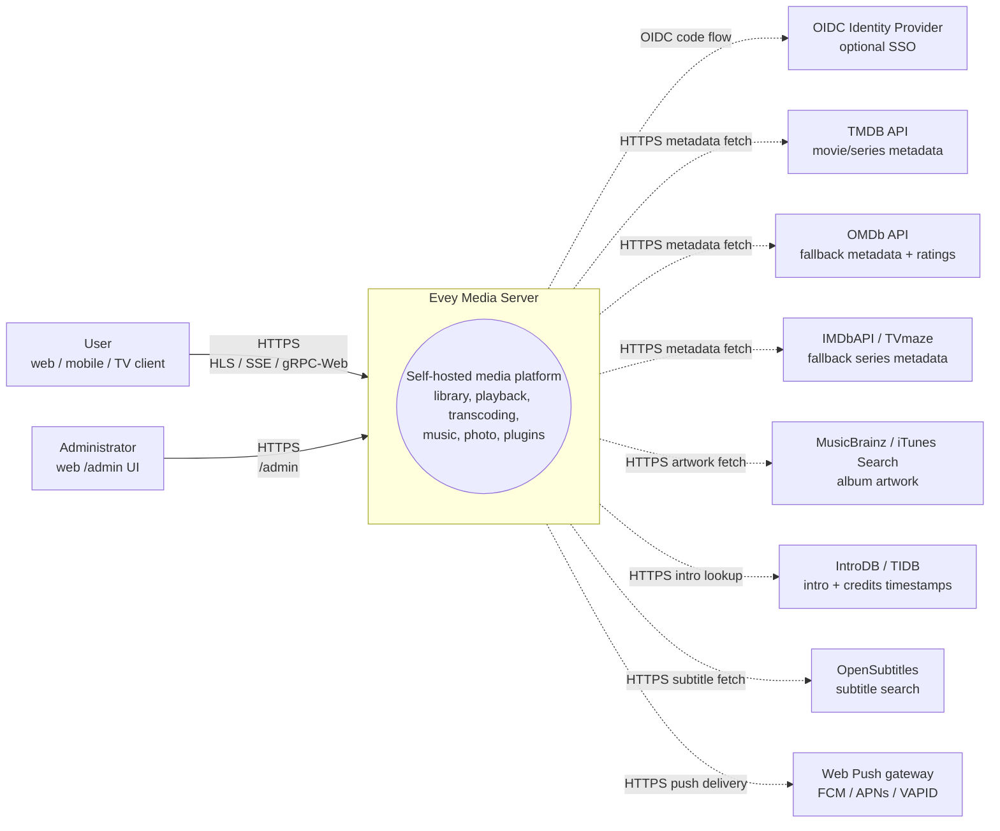
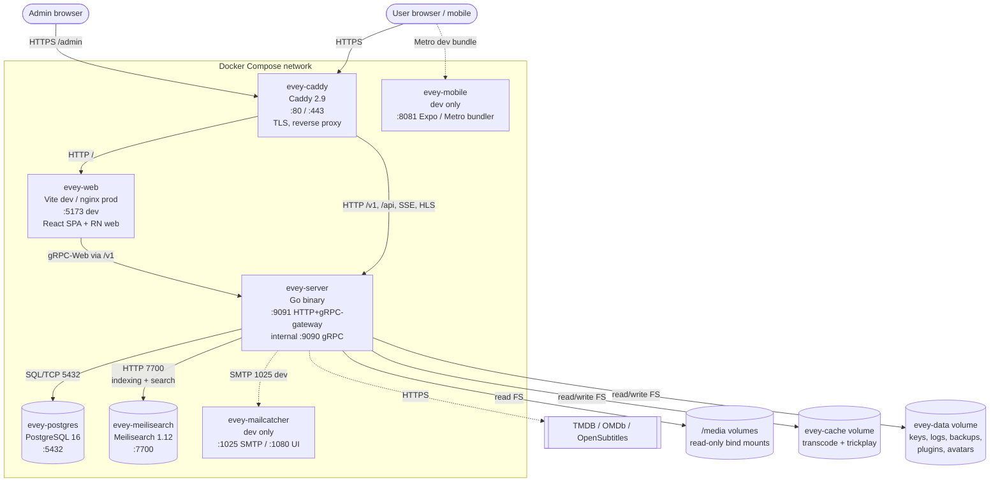
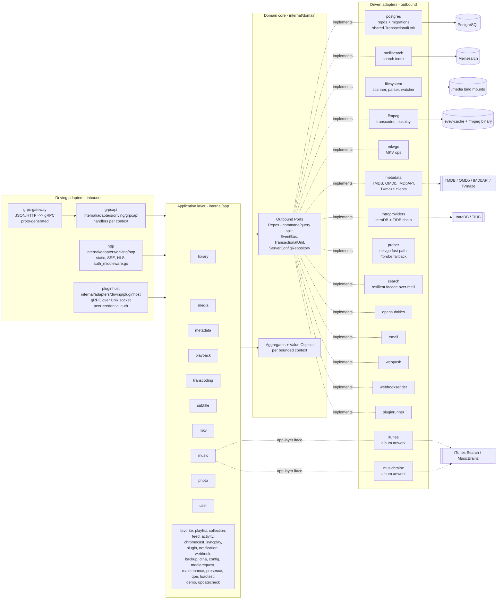

# Architecture

Evey is a self-hosted media server. Backend is Go (hexagonal / DDD), frontend is a TypeScript/React monorepo, mobile is React Native / Expo. See [DEV.md](../DEV.md) for setup and deeper internals.

## Layering

Strict ports-and-adapters layout under `internal/`:

- `internal/domain/<context>/` - pure domain: models, value objects, **ports** (interfaces). No framework imports.
- `internal/app/<context>/` - application services. Orchestrate ports. IO normally goes through a port; two contexts are deliberate exceptions and reach the network directly: `dlna` (SSDP / UPnP AVTransport) and `loadtest` (its own HTTP client).
- `internal/adapters/driven/` - outbound adapters implementing domain ports: `postgres`, `meilisearch`, `ffmpeg`, `mkvgo`, `filesystem`, `prober`, `opensubtitles`, `email`, `webpush`, `webhooksender`, `pluginrunner`, `metadata`, `introproviders`, `search`. Two more live here but satisfy an app-layer interface rather than a domain port: `itunes` and `musicbrainz`, both `app/music.AlbumArtFetcher`.
- `internal/adapters/driving/` - inbound adapters: `grpcapi` (+ grpc-gateway HTTP), `http` (static, auth middleware, SSE, HLS, plugin iframe assets), `pluginhost` (gRPC server on a Unix socket, authenticated by peer credentials - the host API that sandboxed plugin subprocesses call back into).
- `internal/pkg/` - shared technical kernel reused across contexts (auth, logger, eventbus, i18n, metrics, tracing, ratelimit, procfork, ssrf, cache, ...). Server configuration lives in `internal/config/`; generated proto code lives in `gen/`.

Dependency rule: `adapters -> app -> domain`. Domain never imports app or adapters. Composition happens in `cmd/evey/wire*.go` - hand-written wiring, not google/wire: `wire.go`, `wire_infra.go`, `wire_services.go`, `wire_adapters.go`, `wire_events.go`, `wire_helpers.go`.

## Bounded contexts

Thirty-two context packages live under `internal/domain/` and `internal/app/`: 19 exist in both layers, 2 are domain-only (`ratings`, `shared`), 11 are app-only. Collaboration happens partly via domain events published through a shared bus; the app layer also reads a neighbouring context's domain package directly (see [Relations](#relations)).

| Context | Responsibility |
| --- | --- |
| `user` | accounts, auth, sessions, preferences |
| `library` | libraries, folders, scan jobs, media index, people, collections, a profile's favorites and thumbs (thumbs have no app service: the rating RPC stores and reads `UserRatingRepository` as is), trickplay, intro/credits detection |
| `media` (app only) | share links and stream tokens |
| `mediarequest` | user-submitted media requests |
| `metadata` | TMDB / OMDb enrichment, artwork |
| `playback` | streams, progress, remote control, now-playing |
| `transcoding` | ffmpeg jobs, HLS segments |
| `subtitle` | embedded + external + opensubtitles |
| `mkv` | MKV container ops (via `mkvgo`) |
| `music` | audio-specific playback + tagging |
| `photo` | photo libraries |
| `favorite` (app only) | per-profile favorites; the model and `FavoriteRepository` live in `domain/library` |
| `playlist` | user playlists, smart playlists |
| `collection` (app only) | admin-curated collections; its ports live in `domain/library` |
| `ratings` (domain only) | maps country classifications (CSA, FSK, MPAA, BBFC, ACB) onto one minimum-age axis |
| `feed` | activity feed / discover |
| `activity` | user activity timeline |
| `chromecast` | cast session lifecycle |
| `syncplay` | multi-device sync sessions |
| `plugin` | plugin registry, sandbox tokens, lifecycle |
| `notification` | in-app + webpush notifications |
| `webhook` | outbound webhooks |
| `backup` | DB + config backup/restore |
| `config` (app only) | persisted server settings, written by both the REST and the gRPC entry points |
| `dlna` (app only) | SSDP discovery and UPnP AVTransport control |
| `loadtest` (app only) | simulates HLS viewers against the server's own HTTP stack |
| `maintenance` (app only) | admin-triggered media maintenance: seek-index rebuild, repair journal, undo, audio integrity |
| `presence` (app only) | in-memory, non-persisted registry of who is connected right now |
| `qoe` (app only) | CMCD (CTA-5004) playback telemetry ingest and aggregation |
| `demo` (app only) | the public demo instance (`EVEY_DEMO=1`): seeds its accounts, libraries and freely licensed media through the product's own services, and resets itself |
| `updatecheck` (app only) | compares the running build with what the registry publishes and tells the administrator; it never updates anything |
| `shared` (domain only) | cross-cutting ports (`EventBus`, `TransactionalUnit`, `ServerConfigRepository`, `ShareLinkRepository`), typed ids, cursors, stream tokens |

### Relations

- `library` → emits `LibraryCreated` / `LibraryDeleted`, `LibraryScanStarted` / `LibraryScanCompleted`, `MediaItemAdded`, `MediaItemRemoved`, `TrickplayGenerated`. `media.item.added` is consumed by `notification`, `metadata` (auto-enrich), `library` itself (trickplay worker + intro detection) and `feed` (genre-cache invalidation).
- Search indexing is **not** event-driven: `library.ScanService` calls the `library.SearchIndex` port directly.
- `playback` → emits `PlaybackStarted` / `PlaybackStopped`. Neither has a dedicated subscriber today; only `webhook`'s `"*"` catch-all receives them.
- `user` → emits `UserCreated`, which has no subscriber, and `user.password.reset_requested`, consumed by the `email` driven adapter.
- `plugin` → `pluginrunner` publishes `plugin.error` / `plugin.started`, and `app/plugin` consumes them for its security dashboard. There is no bridge feeding domain events into plugins: plugins reach the API with scoped JWTs (see ADR-0003). The bus itself is ADR-0010.
- `shared.TransactionalUnit` wraps multi-aggregate writes (see ADR-0002).

No package under `internal/domain` imports another context's domain package - a rule enforced by `internal/contractguard/domain_imports_test.go` (see [Architecture guards](#architecture-guards)). The app layer is not bound by it: 15 app packages import a neighbouring context's domain package today.

## Typical data flow - "user plays a media"

1. Mobile/web client calls `POST /api/v1/playback/start` (grpc-gateway route).
2. `internal/adapters/driving/http` runs its auth middleware (`auth_middleware.go`, `httpAuthMiddleware`), extracts session.
3. `internal/adapters/driving/grpcapi` (`playback_handler.go`) validates proto, calls `app/playback.CommandService.StartStream` (command/query split, see ADR-0009).
4. `app/playback.CommandService` calls domain ports: `user.UserRepository`, `playback.SessionQueryRepo` (idempotency + device cap), `playback.SessionCommandRepo`, then `shared.EventBus.Publish(PlaybackStarted)`.
5. Driven adapters execute: `postgres` persists the session inside a `shared.TransactionalUnit.Do` scope; the in-process bus (`internal/pkg/eventbus`) dispatches asynchronously.
6. `PlaybackStarted` has no dedicated subscriber today: only the `webhook` `"*"` catch-all receives it.
7. Response streams back through grpc-gateway as JSON; progress updates flow over SSE / gRPC streams.

## Composition root

Wire graphs live in `cmd/evey/wire.go` and its siblings (`wire_infra.go`, `wire_services.go`, `wire_adapters.go`, `wire_events.go`, `wire_helpers.go`). Tests bypass adapters by injecting fakes that implement the same domain ports - 20 of the 21 domain packages ship a `fakes/` subpackage. See [ADR-0001](adr/0001-hexagonal-architecture.md).

## Architecture guards

The rules above are not documentation-only. `internal/contractguard/` holds 54 static tests across 29 files that fail the build when the codebase drifts from them.

The hexagonal rule itself is `TestDomainContextsDoNotImportEachOther` (ADR-0001), in `domain_imports_test.go`. It walks `internal/domain` and enforces exactly this: a context may import `internal/domain/shared` and its own package tree, nothing else from `internal/domain`, and never `internal/app` or `internal/adapters`. Its scope stops at `internal/domain` - it says nothing about the app layer.

The rest guard contracts that cross a language or a process boundary, among them:

- `TestNoClientReadOfAFieldTheServerNeverWrites` - every proto response field a client reads must be written somewhere on the server.
- `TestRegisteredHandlersGetEveryPortTheyDeclare` and `TestBootInstallsItsSilentWirings` - wiring that would otherwise fail silently.
- `TestPostgresRepositoriesBoundTheirQueries` - every Postgres repository bounds its queries with a timeout.
- `TestProcfork_EveryForkGoesThroughCommand` - every subprocess fork goes through `internal/pkg/procfork`.
- `TestEverySortFieldTheAPIAcceptsHasASQLColumn` and `...CanBuildACursorValue` - sort fields exist both in the SQL column map and in the cursor encoder.
- `TestEveryWebSurfaceReachingAnAdminRPCIsClassified`, plus its native counterpart for mobile and TV - any UI surface calling an admin-only RPC decides who sees it.
- `TestEveryAllowedSlotIsMountedOnWebAndMobile` and `TestPluginBridgeParityWebMobile` - plugin UI slot parity across clients.
- `TestImageSubtitleCodecsAgreeAcrossServerAndClients` - one list of bitmap subtitle codecs, server and players.
- `TestHandWrittenClientTypesMatchTheEndpointTheyCall` - the hand-written mobile/TV response types match the endpoint they call.
- `TestRestartExitCodeAgreesWithTheEntrypoint` - the Go exit code and `docker/entrypoint.sh` agree on what a restart means.
- i18n guards - server-emitted keys exist in the catalogue, placeholders agree across locales.

## Further reading

- [DEV.md](../DEV.md) - build, run, migrations, proto generation
- [docs/CODEBASE_MAP.md](CODEBASE_MAP.md) - which files to touch for common changes
- [docs/playback-serving.md](playback-serving.md) - the HLS video-serving read path, in depth (decision, ladder, fingerprint, CMAF/HLS/DASH, mkvgo vs ffmpeg)
- [docs/api/](api/) - generated API reference
- [docs/adr/](adr/) - architectural decision records

## C4 diagrams

These four diagrams document Evey at decreasing zoom levels following the [C4 model](https://c4model.com/). All diagrams render with Mermaid; no binary assets. Node names are the actual Go package names under `internal/`. Container names come from `docker-compose.yml` for `evey-server`, `evey-postgres` and `evey-caddy`; `evey-web`, `evey-meilisearch`, `evey-mobile` and `evey-mailcatcher` are declared in `docker-compose.override.yml` and exist in the dev topology only.

### Level 1 - System Context

Who talks to Evey, and which third parties Evey reaches out to.

### Level 2 - Container

The deployable units brought up by `docker compose --env-file .env.dev up`. Solid arrows are runtime traffic; dashed arrows are outbound to third parties.

> **Production differs from this dev topology.** The install compose declares
> one service, `evey`. There is no separate `evey-web` container (nor the
> dev-only mailcatcher and Metro bundler): the binary serves the built web UI
> from `/srv`, so a reverse proxy forwards *everything* - UI and API - to it on
> `:9091`. Postgres and Meilisearch run inside the same container, supervised
> by `docker/entrypoint.sh`: PostgreSQL 17 with its data under `/data/postgres`,
> and the Meilisearch binary (`Dockerfile`, `meili-download` stage, pinned to
> 1.12.8) with its index under `/data/meili`. The repository's own
> `docker-compose.yml` keeps separate `postgres` and `caddy` services, described
> in [Advanced deployments](operations/advanced-deployments.md). See
> [Install](installation.md) and [Reverse proxy](reverse-proxy.md).

### Level 3 - Component (zoom on `evey-server`)

Hexagonal layering inside the Go binary. Driving adapters call application services through their interfaces; application services depend only on domain ports; driven adapters implement those ports.

Goroutine notes:
- gRPC server (`grpc.Server.Serve`) and HTTP server (gateway + static) each run in their own goroutines off the main wire-up in `cmd/evey`.
- `app/library` scan jobs run on a worker pool (one goroutine per active library scan, see `library.ScanService`).
- ffmpeg jobs are forked through `internal/pkg/procfork` by the driven `ffmpeg` adapter (`ffmpeg.Transcoder.Start`), one supervising goroutine per job draining the process stderr.
- `shared.EventBus` dispatches subscribers asynchronously: each subscriber runs in its own goroutine so a slow consumer never blocks publishers. The bus opens no transaction of its own - that is the handler's job.
- `pluginrunner` spawns one subprocess per plugin; iframe plugins live inside the user browser and talk back via signed tokens issued by `app/plugin`.

### Level 3 (bonus) - Component zoom on the scan pipeline

The hot path that turns files on disk into searchable, enriched media. Solid arrows are direct calls; dashed arrows are domain events on the bus. Note that search indexing is a direct port call from `ScanService`, not an event.

Read this with the "Typical data flow" section above: the playback path is the symmetric read path; the scan pipeline is the write path that primes the media index the read path serves from.
