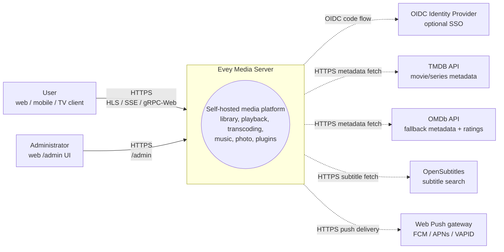
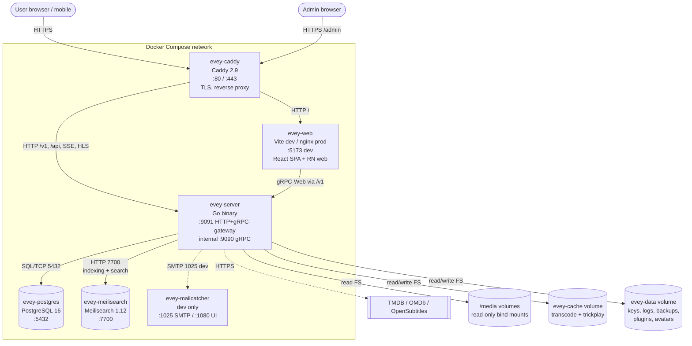
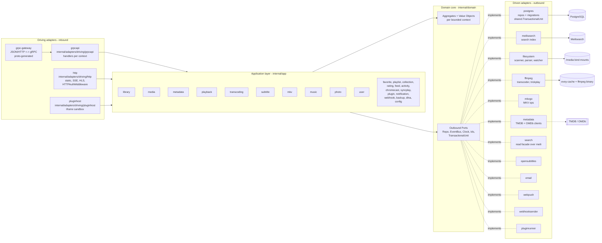
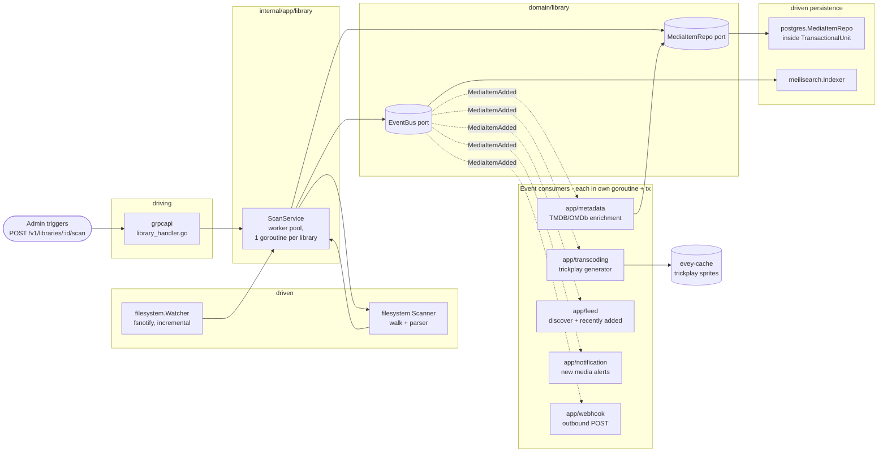

# Architecture

Evey is a self-hosted media server. Backend is Go (hexagonal / DDD), frontend is a TypeScript/React monorepo, mobile is React Native / Expo. See [DEV.md](../DEV.md) for setup and deeper internals.

## Layering

Strict ports-and-adapters layout under `internal/`:

- `internal/domain/<context>/` — pure domain: models, value objects, **ports** (interfaces). No framework imports.
- `internal/app/<context>/` — application services. Orchestrate ports. No IO.
- `internal/adapters/driven/` — outbound adapters implementing domain ports: `postgres`, `meilisearch`, `ffmpeg`, `mkvgo`, `filesystem`, `opensubtitles`, `email`, `webpush`, `webhooksender`, `pluginrunner`, `metadata`, `search`.
- `internal/adapters/driving/` — inbound adapters: `grpcapi` (+ grpc-gateway HTTP), `http` (static, auth middleware, SSE), `pluginhost` (iframe sandbox).
- `internal/pkg/` — shared kernel reused across contexts (auth, logging, proto types, config).

Dependency rule: `adapters -> app -> domain`. Domain never imports app or adapters. Composition happens in `cmd/.../wire.go`.

## Bounded contexts

Twenty contexts live under `internal/domain/` and `internal/app/`. Most are independent; collaboration happens via domain events published through a shared bus, not direct imports.

| Context | Responsibility |
| --- | --- |
| `user` | accounts, auth, sessions, preferences |
| `library` | libraries, folders, scan jobs, media index |
| `media` (app only) | unified media read model over library |
| `metadata` | TMDB / OMDb enrichment, artwork |
| `playback` | streams, progress, remote control, now-playing |
| `transcoding` | ffmpeg jobs, HLS segments |
| `subtitle` | embedded + external + opensubtitles |
| `mkv` | MKV container ops (via `mkvgo`) |
| `music` | audio-specific playback + tagging |
| `photo` | photo libraries |
| `favorite` | per-user favorites |
| `playlist` | user playlists |
| `collection` | admin-curated collections |
| `rating` | user ratings |
| `feed` | activity feed / discover |
| `activity` | user activity timeline |
| `chromecast` | cast session lifecycle |
| `syncplay` | multi-device sync sessions |
| `plugin` | plugin registry, sandbox tokens, lifecycle |
| `notification` | in-app + webpush notifications |
| `webhook` | outbound webhooks |
| `backup` | DB + config backup/restore |
| `shared` | cross-cutting ports (transactions, clock, ids, events) |

### Relations

- `library` → emits `MediaItemAdded` / `MediaItemUpdated` / `MediaItemRemoved`; `metadata`, `feed`, `search` consume.
- `playback` → emits `PlaybackStarted/Stopped`; `activity`, `notification`, `syncplay` consume.
- `user` → emits `UserCreated`; `favorite`, `playlist`, `notification` bootstrap per-user state.
- `plugin` → consumes domain events through a scoped bus bridge (see ADR-0003).
- `shared.TransactionalUnit` wraps multi-aggregate writes (see ADR-0002).

No context imports another context's domain package directly. Cross-context reads go through the `media` app-layer read model or through exposed app-service interfaces.

## Typical data flow — "user plays a media"

1. Mobile/web client calls `POST /api/v1/playback/start` (grpc-gateway route).
2. `internal/adapters/driving/http` runs `HTTPAuthMiddleware`, extracts session.
3. `internal/adapters/driving/grpcapi` (`playback_handler.go`) validates proto, calls `app/playback.Service.StartSession`.
4. `app/playback.Service` calls domain ports: `MediaRepo.Get`, `SessionRepo.Create`, `EventBus.Publish(PlaybackStarted)`.
5. Driven adapters execute: `postgres` persists the session inside a `shared.TransactionalUnit.Do` scope; `eventbus` dispatches asynchronously.
6. Consumers (`activity`, `notification`, `syncplay`) react via their own subscribers, each in its own transaction.
7. Response streams back through grpc-gateway as JSON; progress updates flow over SSE / gRPC streams.

## Composition root

Wire graphs live in `cmd/evey/wire.go` (and friends). Tests bypass adapters by injecting fakes that implement the same domain ports — see [ADR-0001](adr/0001-hexagonal-architecture.md).

## Further reading

- [DEV.md](../DEV.md) — build, run, migrations, proto generation
- [docs/api/](api/) — generated API reference
- [docs/adr/](adr/) — architectural decision records

## C4 diagrams

These four diagrams document Evey at decreasing zoom levels following the [C4 model](https://c4model.com/). All diagrams render with Mermaid; no binary assets. Names match the actual Go packages under `internal/` and the container names in `docker-compose.yml`.

### Level 1 — System Context

Who talks to Evey, and which third parties Evey reaches out to.

### Level 2 — Container

The deployable units brought up by `docker compose --env-file .env.dev up`. Solid arrows are runtime traffic; dashed arrows are outbound to third parties.

> **Production differs from this dev topology.** The install compose has no
> separate `evey-web` container (nor the dev-only mailcatcher): the `evey-server`
> binary serves the built web UI from `/srv`, so the reverse proxy forwards
> *everything* — UI and API — to it on `:9091`. See
> [installation.md](installation.md) and [reverse-proxy.md](reverse-proxy.md).

### Level 3 — Component (zoom on `evey-server`)

Hexagonal layering inside the Go binary. Driving adapters call application services through their interfaces; application services depend only on domain ports; driven adapters implement those ports.

Goroutine notes:
- gRPC server (`grpc.Server.Serve`) and HTTP server (gateway + static) each run in their own goroutines off the main wire-up in `cmd/evey`.
- `app/library` scan jobs run on a worker pool (one goroutine per active library scan, see `library.ScanService`).
- `app/transcoding` ffmpeg jobs are supervised by a per-session goroutine that pipes ffmpeg stdout/stderr.
- `shared.EventBus` dispatches subscribers asynchronously: each subscriber runs in its own goroutine + transaction so a slow consumer never blocks publishers.
- `pluginrunner` spawns one subprocess per plugin; iframe plugins live inside the user browser and talk back via signed tokens issued by `app/plugin`.

### Level 3 (bonus) — Component zoom on the scan pipeline

The hot path that turns files on disk into searchable, enriched media. Solid arrows are direct calls; dashed arrows are domain events on the bus.

Read this with the "Typical data flow" section above: the playback path is the symmetric read path; the scan pipeline is the write path that primes the read model.
