# Plugin sandbox and threat model

What the server does to contain a plugin: the checks at install, the layers
at run time, the sandbox modes, and what each still cannot stop. The code
lives in `internal/adapters/driven/pluginrunner` (install analysis, sandbox),
`cmd/evey-plugin-launcher` (Landlock and the kernel seccomp filter),
`sandbox/sandbox.c` (the `LD_PRELOAD` filter) and
`internal/adapters/driving/pluginhost` (the host API plugins call); the
design is decided by [ADR-0012](adr/0012-plugin-token-deny-by-default.md),
[ADR-0013](adr/0013-userspace-plugin-resource-monitor.md) and
[ADR-0014](adr/0014-landlock-plugin-sandbox.md). If you are writing a plugin
and want to know what you may declare and what will be refused, read
[Permissions and slots](plugins/security-model.md); to know which sandbox
your machine gets, read [Plugin sandbox setup](plugins/sandbox-deployment.md).

## Threat model

Plugins run as separate processes that talk to the server over gRPC on Unix
sockets. The server trusts no plugin code by default. The risks it defends
against, from the most to the least severe:

1. **Impersonation** - a plugin pretends to be another plugin to use its permissions.
2. **Privilege escalation** - a plugin escapes its sandbox and runs commands as the server.
3. **Filesystem access** - a plugin reads or writes outside its own directory, in particular the server's secrets.
4. **Network exfiltration** - a plugin sends data to a host of its choosing.
5. **Resource abuse** - mining, fork bombs, memory or disk exhaustion.
6. **Supply chain** - obfuscated or compiled code the analysis cannot read.

```mermaid
flowchart LR
    zip[Package] --> ex[ZIP extraction<br/>limits, no symlink, no setuid]
    ex --> man[Manifest<br/>permissions]
    man --> an[Static analysis<br/>CRITICAL refuses]
    an --> sig[Signature<br/>cosign policy]
    sig --> prev[Administrator preview<br/>accepts or refuses]
    prev --> run[Run time]
    subgraph run[Run time - every mode]
        fs[Filesystem<br/>own directory only]
        net[Network<br/>no IP socket, Fetch broker]
        sys[System calls<br/>seccomp denylist]
        uid[Separate user<br/>or user namespace]
        sock[Host socket<br/>SO_PEERCRED identity]
        res[Resource monitor<br/>memory, PIDs, disk, nice]
    end
```

## At install

### ZIP extraction

Before any file is written (`pluginrunner/zip.go`):

- at most 5,000 entries, 100 MB per file, 500 MB uncompressed in total, and a
  compression ratio of 100:1 above 1 MB uncompressed (decompression bombs);
- entries whose path leaves the archive (`..`) are refused;
- symbolic links are refused;
- setuid, setgid and sticky bits are removed.

### Manifest and permissions

The manifest declares the permissions a plugin requests. An unknown permission
refuses the install. They are then enforced:

- **`subprocess`** allows child processes. Without it, process creation is
  refused by the kernel (`-deny-fork`), and the `LD_PRELOAD` filter also
  refuses `execve` for interpreted plugins.
- **`native-binary`** allows shipping compiled code or archives, which the
  analysis cannot read.
- **API permissions** (`api.library`, `api.user`, `api.metadata`,
  `media.read`, `media.write`, `notification.sender`...) are checked on every
  call to the host by
  [`PluginPermissionInterceptor`](../internal/adapters/driving/grpcapi/plugin_interceptor.go).

The full list is in [Permissions and slots](plugins/security-model.md#permissions-catalog).

### Static analysis

Every file of the package is scanned by
[`pluginrunner.AnalyzePlugin`](../internal/adapters/driven/pluginrunner/analyzer.go),
after a normalisation pass that undoes common obfuscation (aliases, string
concatenation, f-strings):

| Category | Severity | Examples |
|---|---|---|
| `shell_exec` | WARNING / CRITICAL | `os.system`, `subprocess.run`, `child_process.exec`, PHP `system()`/`shell_exec()`/`proc_open()`, `preg_replace /e`, Ruby `Kernel.exec`/`system`, `open('\|cmd')` (CRITICAL); Ruby backticks (WARNING) |
| `network` | WARNING / CRITICAL | `requests.get`, `fetch`, reverse and bind shells |
| `filesystem` | WARNING / CRITICAL | `/etc/passwd`, `.ssh/`, `rm -rf`, symlink operations |
| `obfuscation` | WARNING / CRITICAL | `eval`, `__builtins__`, `base64 -d \| bash` and other decode-pipe-to-shell forms (CRITICAL); base64 decoding, hex sequences (WARNING) |
| `privilege` | CRITICAL | `setuid`, `chmod 4777`, `sudo`, signalling PID 1 |
| `cryptomining` | CRITICAL | `stratum+tcp`, `xmrig`, `cryptonight` |
| `runtime_install` | CRITICAL | `pip install`, `npm install`, `curl ... \| sh` |
| `dynamic_import` | CRITICAL | `__import__()`, `importlib.import_module` |
| `sandbox_escape` | CRITICAL | `vm.runIn*`, `process.binding`, `new Function`, `__subclasses__()`, `__mro__` |
| `deserialization` | CRITICAL / WARNING | `pickle.loads`, `marshal.loads`, `__reduce__`; WARNING: `yaml.load()` without a Loader |
| `native_code` | CRITICAL / WARNING | `ctypes.CDLL`, `ffi.Library`; WARNING: Go `unsafe` |
| `compiled_binary` | WARNING, then BLOCK | `.so`, `.dll`, `.exe`, `.wasm`, `.jar` |
| `embedded_archive` | WARNING, then BLOCK | `.zip`, `.tar.gz` |
| `mime_mismatch` | treated as CRITICAL | an extension that claims an image, with other content |
| `suspicious_url` | WARNING | a non-HTTP scheme in a URL literal |
| `unvendored_deps` | WARNING | `requirements.txt` or `package.json` without vendored modules |

A CRITICAL finding or a `mime_mismatch` refuses the install. `compiled_binary`
and `embedded_archive` refuse it unless the manifest declares `native-binary`.

!!! note "What the analysis cannot guarantee"
    It works on patterns. It resolves known obfuscation classes (string
    concatenation into a callable over several steps, builtin lookup by name,
    `Function.constructor` escapes), each with a regression fixture in
    `tests/fixtures/plugins/malicious/`, but it cannot follow every
    transformation done at run time (`strrev("metsys")`, decoding a payload
    read from a file). Comments are stripped before the analysis. **The enforcement boundary is the
    run-time sandbox, not the analysis**: a plugin that slips a pattern past
    it still cannot read the server's data, call a denied system call, exceed
    its resource limits, or call a host method it has no permission for.

### Signature

A package can be signed with cosign (`cosign sign-blob --key`, ECDSA P-256
over the SHA-256 of the ZIP). The author's public key travels inside the
package as `cosign.pub`; Evey verifies the detached `.sig` against it, in
process and offline (`pluginrunner/cosign.go`), and computes the key's
fingerprint (`sha256:` over the DER public key). Three facts follow from it:

- **Trust**: the fingerprint is, or is not, in the instance's **Trusted
  publishers** list (`Admin → Plugins`, or seeded by
  `EVEY_PLUGINS_COSIGN_PUBLIC_KEY` at boot). A trusted key shows the
  publisher's name; an unknown one shows its fingerprint and a **Trust this
  key** action.
- **Continuity**: the fingerprint is pinned to the plugin at install. An
  update signed by another key (`publisher-changed`) or no longer signed
  (`signature-lost`) is refused, whatever the policy, until the administrator
  accepts the new publisher in the update dialog (`accept_new_publisher`).
- **Policy**: `EVEY_PLUGINS_COSIGN_POLICY` sets what the verdict does.

| Policy | Effect |
|---|---|
| `off` | The signature is not checked and nothing is recorded. |
| `warn` (default) | The verdict is recorded and shown; unsigned, untrusted and invalid packages install. |
| `enforce` | Only a package signed by a trusted publisher installs or updates. |

What a signature proves is that the package is the one its publisher
released, and that an update comes from the same publisher. It says nothing
about the code, which the analysis, the permissions and the sandbox judge.

### Administrator preview

`POST /api/v1/admin/plugins/preview` runs the analysis without installing.
The administrator sees the requested permissions, every finding with its
file, line and category, the URLs found in the code, and the SHA256 of the
package; the hash the administrator acknowledged is checked on update, and a first
install can be pinned by a `#sha256:` fragment on the URL, so the package
analysed is the package installed. An update shows the difference in
permissions, slots and hosts, and a new permission requires an explicit
acknowledgement.

The administrator is the trust boundary for elevated permissions: Evey shows
the surface, the administrator accepts or refuses.

## At run time

Six layers hold in every [sandbox mode](#sandbox-modes); how the first two
are enforced depends on the mode.

### Filesystem

A plugin sees its own directory and its socket directory, and not the server's
data, through a Landlock allowlist (`landlock`) or a bubblewrap mount
whitelist (`bubblewrap`, `strict`). In `basic` mode on a kernel without
Landlock there is no per-path confinement: the separate user and file
permissions are then what protect the server's secrets.

### Network

A plugin has **no direct network access**, whatever it declares: every IP
socket is refused (`-deny-inet` in `landlock` and `basic`, a network
namespace in `bubblewrap` and `strict`). A plugin with the `network`
permission calls the host's `Fetch` method over its Unix socket. The host, in
`internal/adapters/driving/pluginhost/fetch.go`:

- checks the target against the plugin's `external_fetch` list (exact hosts, case-insensitive; a `*.example.com` wildcard is refused at install; a port suffix is ignored);
- allows only `http` and `https`, and only `GET` and `HEAD`;
- connects through an SSRF-safe client (`internal/pkg/ssrf`) that refuses
  private, reserved and link-local addresses after DNS resolution, so DNS
  rebinding and redirects are checked again (a redirect to a host off the
  list is refused);
- adds none of the server's credentials, caps the response body at 8 MiB and
  the request headers at 8 KiB, and gives up after 20 s.

This closes the paths direct egress left open (IP literals such as
`169.254.169.254`, a plugin's own resolver). What remains: the broker controls
*where* a call goes, not *what* it carries. See [Known limits](#known-limits).

!!! tip "Recommended for operators"
    The broker moves the SSRF surface to the host. An egress rule on the
    `evey-server` container, independent of the code, adds a second protection:
    drop `169.254.0.0/16` and restrict the internal network to the database
    and search endpoints.

### System calls

Two seccomp filters refuse the same dangerous system calls:

1. **The kernel filter**, installed by
   [`evey-plugin-launcher`](../cmd/evey-plugin-launcher) just before it starts
   the plugin ([`seccomp_linux.go`](../cmd/evey-plugin-launcher/seccomp_linux.go)).
   It is inherited by the plugin and its children and **also covers compiled,
   static binaries**. A mismatched architecture in a system call kills the
   process. Applied in `landlock` and `basic`.
2. **The `LD_PRELOAD` filter**, [`sandbox/sandbox.c`](../sandbox/sandbox.c),
   loaded into interpreted plugins that do not declare `subprocess`. It also
   refuses `execve`/`execveat`, and marks the plugin non-dumpable. Applied in
   `landlock`, `basic` and `strict`. If the library is missing, such a plugin
   is refused start (`plugin.error`).

Refused system calls:

| Category | System calls |
|---|---|
| Debugging | `ptrace`, `process_vm_readv`, `process_vm_writev` |
| Signals | `tgkill`, `rt_sigqueueinfo`, `rt_tgsigqueueinfo` towards any process but the plugin itself (both filters); `kill` likewise in the kernel filter, towards any target in the `LD_PRELOAD` filter; `tkill` in the kernel filter (the `LD_PRELOAD` filter allows it towards the plugin itself); `pidfd_send_signal`, `pidfd_getfd` (steals a file descriptor). A runtime re-raising a signal or preempting its own threads keeps working. On Landlock ABI 6+, a plugin also cannot signal a process outside its sandbox |
| Signal owner of a file descriptor (kernel filter) | `fcntl` `F_SETOWN` towards any process but the plugin itself, `F_SETSIG` to any signal but the default `SIGIO`, `F_SETOWN_EX`, and `ioctl` `FIOSETOWN`/`SIOCSPGRP`: without this, an fd owned by the server with `SIGKILL` as its signal would kill the server on the next write |
| Mounts | `mount`, `umount2`, `pivot_root`, `chroot` |
| Namespaces | `unshare`, `setns`, and `clone` carrying a `CLONE_NEW*` flag (unshare by another name), for every plugin |
| Kernel modules | `init_module`, `finit_module`, `delete_module` |
| BPF, perf | `bpf`, `perf_event_open` |
| Hardware I/O | `ioperm`, `iopl` (x86-64 only, where they exist) |
| Swap | `swapon`, `swapoff` |
| System control | `syslog`, `reboot`, `settimeofday`, `clock_settime`, `clock_adjtime`, `adjtimex` |
| Kexec | `kexec_load`, `kexec_file_load` |
| Kernel exploit primitives | `io_uring_setup`, `io_uring_enter`, `io_uring_register`, `userfaultfd` |
| Identity | `setuid`, `setgid`, `setreuid`, `setregid`, `setresuid`, `setresgid`, `capset` |
| Keyring | `add_key`, `request_key`, `keyctl` |

For a plugin without `subprocess`, the kernel also refuses process creation
(`fork`, `vfork`, `clone` without `CLONE_THREAD`; `clone3` answers `ENOSYS`
so the C library falls back to `clone`); threads keep working.

This is a **denylist**: `open`, `read`, `write`, `mmap`, Unix `socket` and
`connect` stay allowed. Paths are confined by the filesystem layer, not by
seccomp. In `bubblewrap` the launcher is not used: a static binary gets no
seccomp filter there, and is contained by the namespaces and the mount
whitelist.

### A separate user

A plugin can run as user 1001 (`evey-plugin`), distinct from the server
(1000), so the server's secrets are unreadable to it by file permissions
alone. `EVEY_PLUGINS_UID_SEPARATION` controls it:

| Value | When the switch happens |
|---|---|
| `auto` (default) | only when the sandbox resolves to `basic`, the one case where file permissions are the only protection of the secrets |
| `on` | always, as an extra layer |
| `off` | never |

The switch is made by the launcher, which holds `cap_setuid`; the server
itself runs without privileges or capabilities. The launcher refuses any
target below 1000. If it cannot switch, a plugin in `basic` is refused (the
user is the only protection there), while in `landlock` it runs as the server's
user with a warning. In `bubblewrap` and `strict`, the user namespace plays
this role.

When active, the signing key (`0600`) and the backups (`0700` directory,
`0600` files) are owner-only at run time, which holds even on a bind-mounted
`/data`. All plugins share user 1001: they are isolated from each other by
the filesystem layer, not by the user.

### Host socket authentication

Each plugin has its own socket, `/tmp/evey/plugins/<plugin_id>/host.sock`,
served by its own gRPC server. On every call, the server reads the caller's
PID from the kernel (`SO_PEERCRED`, which user space cannot forge) and
compares it with the PID recorded when the plugin started. The plugin's
identity comes from the socket, never from a header. A plugin therefore
cannot impersonate another, call another plugin's socket, or route calls
through a child process. A PID mismatch is logged as a warning.

### Resource limits

A monitor in user space (cgroups are unavailable in an unprivileged
container) reads `/proc/<pid>` every 2 seconds and stops a plugin that
exceeds a limit ([ADR-0013](adr/0013-userspace-plugin-resource-monitor.md)):

| Limit | Default | Checked |
|---|---|---|
| memory (RSS) | 256 MiB | every sweep |
| processes and threads | 64 | every sweep (the main process's thread count only) |
| disk used by its directory | 100 MiB | every 15th sweep, about 30 s |
| CPU priority | `nice` 10, applied at start | - |

The same sweep flags a plugin that keeps a CPU pegged above 90% for about
30 s, and stops a plugin granted `hardware.gpu` that keeps a graphics engine
pegged the same way. One set of resource limits, set in **Admin → Plugins →
Resource limits**, applies to every plugin; the environment variables `EVEY_PLUGINS_MEMORY_MB`,
`EVEY_PLUGINS_PIDS_MAX`, `EVEY_PLUGINS_DISK_MAX_MB` and
`EVEY_PLUGINS_CPU_NICE` set the boot defaults.

### Interface isolation

A plugin's interface runs in an `<iframe sandbox="allow-scripts">`, without
same-origin access, forms or popups, under a Content-Security-Policy that
allows connections only to its `external_fetch` hosts. The bridge
(`frontend/packages/client/src/plugins/hostProtocol.ts`) limits what it can
ask of the page: `toast` at most 3 per second, 200 characters, no HTML;
`navigate` accepts only `/home`, `/library`, `/media`, `/player`,
`/settings` and `/search`; `resize` between 50 px (60 on mobile and TV) and
800 px. Slots are checked at install.

### Server hardening

At startup the server marks itself non-dumpable (`PR_SET_DUMPABLE=0`,
[`hardening_linux.go`](../cmd/evey/hardening_linux.go)): a process running
as the same user cannot read its memory or environment through `/proc`,
which protects the signing key in memory and the database and search
passwords, even on a kernel without Landlock.

### Crash notification

The runner publishes a `plugin.error` event when the sandbox library is
missing for a plugin that needs it, or when a plugin exits with an error.
The notification service forwards it to the administrator through the
configured channels, and the **Security Dashboard** records it.

## Sandbox modes

The mode selects how the filesystem and the network are confined.
`EVEY_PLUGINS_SANDBOX_MODE` sets the initial value (default `auto`); it can
be changed in **Admin → Plugins → Resource limits → Sandbox mode**. The
runner applies it in
[`applySandbox`](../internal/adapters/driven/pluginrunner/runner_sandbox.go).
In every mode: no direct IP egress, the resource monitor, and the host
socket authentication.

| Layer | landlock | basic | bubblewrap | strict |
|---|---|---|---|---|
| Filesystem | Landlock allowlist | none without Landlock (file permissions only) | mount whitelist | mount whitelist |
| Network | `-restrict-net` + `-deny-inet` | `-deny-inet` | network namespace | network namespace |
| Kernel seccomp (static binaries too) | yes | yes | no | no |
| `LD_PRELOAD` seccomp (interpreted plugins without `subprocess`) | yes | yes | no | yes |
| Separate user | with `on` | yes (`auto`) | user namespace | user namespace |
| Resource limits | yes | yes | yes | yes |

### `auto` (default)

Resolves, once at the first plugin start, to the strongest mode the host
supports: **landlock** when the kernel enforces Landlock *and* the
`evey-plugin-launcher` binary is found (next to the server binary, on
`$PATH`, or at `EVEY_PLUGIN_LAUNCHER`); otherwise **bubblewrap** when a test
sandbox actually builds
([`ProbeSandbox`](../internal/adapters/driven/pluginrunner/sandbox_probe.go)),
which in practice means bare metal or a privileged container; otherwise
**basic**. Landlock comes first because it needs no privilege and runs under
Docker's default security profile. The resolved mode is logged, and shown on
the **Host sandbox** line of **Admin → Plugins → Security Dashboard**.

| Deployment | What `auto` gives |
|---|---|
| Docker on a recent kernel | `landlock`: per-path confinement, no direct egress, dangerous system calls refused including static binaries. The normal case. |
| Docker on an old kernel without Landlock, e.g. an old NAS | `basic`: secrets protected and network cut, but world-readable files visible. See [Plugin sandbox setup](plugins/sandbox-deployment.md). |
| Bare metal | `bubblewrap`: the strongest filesystem and process isolation, without a seccomp filter for static binaries. |

### `landlock`

- **Filesystem:** a Landlock allowlist applied by the launcher. System
  directories (`/usr`, `/lib`, `/lib64`, `/bin`, `/sbin`, `/etc`, `/app`)
  read-only; of `/dev`, only `null`, `zero`, `full`, `random` and `urandom`,
  so graphics card nodes and the server's terminal stay out of reach; the
  plugin's directory and socket directory read-write; everything else,
  including `/data` and other plugins, denied. A plugin granted
  `hardware.gpu` gets its render node as the one exception.
- **Network:** `-restrict-net` and `-deny-inet`; egress only through `Fetch`.
- **System calls:** the kernel filter and the `LD_PRELOAD` filter.
- **Requires:** a kernel 5.13 or newer with Landlock in the active LSM list,
  and the launcher (both are the case on the official image with a recent
  host). An explicit `landlock` refuses to start a plugin it cannot confine.

### `bubblewrap`

- **Filesystem and processes:** six unshared namespaces (`user`, `pid`,
  `uts`, `ipc`, `cgroup`, `net`) and a mount whitelist; nothing else exists
  inside (`buildBwrapCmd` in `pluginrunner/runner_bwrap.go`).

  | Path | Access |
  |---|---|
  | `/usr`, `/bin`, `/sbin`, `/lib`, `/lib64` | read-only |
  | `/etc/ssl`, `/etc/ca-certificates`, `/etc/resolv.conf`, `/etc/nsswitch.conf`, `/etc/{alpine,os}-release` | read-only (never `/etc` as a whole: no `passwd`, `shadow`, `ssh`) |
  | the plugin's directory, its socket directory | read-write |
  | `/proc` | its own mount |
  | `/dev` | a minimal synthetic set (null, zero, random, urandom, tty, pts) |
  | `/tmp` | an empty tmpfs |

  `/data`, `/var`, `/home`, `/root`, `/run` and other plugins' directories do
  not exist inside. A canary plugin
  (`tests/fixtures/plugins/canary-sandbox-runtime/`) checks this layout
  against a running stack.
- **Network:** the network namespace, for every plugin.
- **System calls:** no seccomp filter; the namespaces provide the isolation.
- **Requires:** the `bwrap` binary and the `mount`/`unshare` system calls.
  In Docker that needs a relaxed security profile, so this is effectively a
  bare-metal mode.

### `strict`

`bubblewrap` plus the `LD_PRELOAD` filter (interpreted plugins only).

### `basic`

The last resort of `auto`: the separate user, the kernel filter, the
`LD_PRELOAD` filter, `-deny-inet`, and Landlock if the kernel has it. On a
kernel without Landlock there is no per-path confinement: a plugin can read
non-sensitive world-readable files and see the process list. The server's
secrets stay protected by the separate user and `PR_SET_DUMPABLE`, the
network is cut, and dangerous system calls are refused, compiled binaries
included.

## Configuration

| Variable | Default | Effect |
|---|---|---|
| `EVEY_PLUGINS_SANDBOX_MODE` | `auto` | `auto`, `landlock`, `bubblewrap`, `strict` or `basic`. Also editable in **Admin → Plugins**. |
| `EVEY_PLUGINS_UID_SEPARATION` | `auto` | `auto`, `on` or `off`. Incompatible with `no_new_privs` on the container. |
| `EVEY_PLUGINS_COSIGN_POLICY` | `warn` | `off`, `warn` or `enforce`. |
| `EVEY_PLUGINS_COSIGN_PUBLIC_KEY` | none | Optional: a PEM public key added to the trusted publishers at boot. |
| `EVEY_PLUGINS_MEMORY_MB`, `EVEY_PLUGINS_PIDS_MAX`, `EVEY_PLUGINS_DISK_MAX_MB`, `EVEY_PLUGINS_CPU_NICE` | 256, 64, 100, 10 | Boot defaults of the resource limits; the panel overrides them, for every plugin at once. |

The official image ships `evey-plugin-launcher` (Landlock and the kernel
filter) and `bubblewrap`. bubblewrap also needs unprivileged user namespaces
on the host. Which setup fits which machine, in plain terms:
[Plugin sandbox setup](plugins/sandbox-deployment.md).

## Known limits

| Limit | Impact | What limits it today |
|---|---|---|
| No per-path confinement in `basic` on a kernel without Landlock | A plugin can read non-sensitive world-readable files and other plugins' directories | Secrets protected by the separate user and `PR_SET_DUMPABLE`; `auto` prefers Landlock or bubblewrap |
| All plugins share user 1001 | In `basic` mode, a plugin can read files its siblings own | Signalling other processes is blocked (seccomp, `LD_PRELOAD` and bubblewrap all block it); `PR_SET_DUMPABLE` blocks reading other processes through `/proc`; Landlock and bubblewrap isolate plugin directories |
| Seccomp is a denylist | File and Unix socket calls stay allowed | Paths are confined by Landlock or bubblewrap; IP sockets are refused |
| The broker moves the SSRF surface to the host | A flaw in the broker's validation could reach an internal address | Allowlist and SSRF-safe client in Go; an egress rule on the container as an independent layer |
| The broker controls where a call goes, not what it carries | Data can leave towards a host on the plugin's list | Allow only hosts you trust with that data |
| The analysis works on patterns | Deliberate obfuscation can hide code | Administrator preview; the sandbox, not the analysis, is the boundary |
| `LD_PRELOAD` only covers dynamic, interpreted plugins | A static binary in `basic` without the launcher escapes it | The official image always ships the launcher, whose kernel filter covers static binaries |

## Network exposure (outside the plugin threat model)

Two invariants govern who can reach the server at all:

- **Only the HTTP port is meant to be published.** The gRPC port
  (`EVEY_SERVER_PORT`, default 9090) is an internal transport whose only
  client is the HTTP gateway in the same process; the HTTP API is that port
  plus one. gRPC binds to loopback by default (`EVEY_GRPC_BIND=127.0.0.1`)
  because the remote-access gate is HTTP middleware and does not cover it.
  Widening the bind logs a warning; firewalling it is then the operator's job.
- **The remote-access gate decides from the one client address validated at
  the trusted proxy boundary**, never from a request header. A client cannot
  claim `127.0.0.1` through `X-Forwarded-For`, and a request that never
  crossed that boundary counts as remote. This is a deployment control, not
  authentication.

See [Remote access and HTTPS](administration/remote-access.md) and the
[Configuration reference](environment/server.md#remote-access).

## What the logs may contain

The server log feeds **Logs & Debug**, bug reports and backups, so
credentials are scrubbed when a line is written
(`internal/pkg/logger/redact.go`): an attribute whose key names a secret
(`authorization`, `token`, `api_key`, `password`, `pin`, `secret`...) is
replaced whole, and any string carrying a bearer token, a JWT or a
`secret=value` pair is scrubbed. The log routes apply the same rule to older
lines on the way out. For code: never log a non-secret value under a secret
key name (it will be masked), and add a new kind of credential to that list
before it is ever logged.

## Reporting a vulnerability

Report privately, never in a public issue: `security@eveyproject.org`, the
address of the repository's [security policy](../SECURITY.md). It covers
plugin authentication, permissions and sandbox escapes like anything else.
Do not test against Evey instances that are not yours.

<!-- sources
install checks: internal/adapters/driven/pluginrunner/zip.go ; internal/adapters/driven/pluginrunner/analyzer.go ; internal/adapters/driven/pluginrunner/cosign.go ; internal/app/plugin/install.go ; internal/adapters/driving/grpcapi/plugin_interceptor.go - PluginPermissionInterceptor
runtime: internal/adapters/driven/pluginrunner/runner_sandbox.go - applySandbox ; internal/adapters/driven/pluginrunner/runner_landlock.go - resolveAutoMode, launcherPath, systemReadOnlyDirs, safeDevNodes ; cmd/evey-plugin-launcher/seccomp_linux.go - deniedSyscalls, selfSignalSyscalls, cloneNamespaceFlags, appendDenyForkRules ; cmd/evey-plugin-launcher/droppriv_linux.go ; sandbox/sandbox.c ; internal/adapters/driven/pluginrunner/runner_bwrap.go - buildBwrapCmd ; internal/adapters/driven/pluginrunner/sandbox_probe.go - ProbeSandbox ; internal/adapters/driving/pluginhost/fetch.go - Fetch, maxFetchBytes, maxFetchHeaderBytes, fetchTimeout ; cmd/evey/hardening_linux.go
resource monitor: internal/adapters/driven/pluginrunner/runner_resmon.go - defaultMemBytes, defaultPIDsMax, resMonInterval, resMonDiskEveryN, resMonCPUPegPct, resMonGPUPegPct ; internal/app/plugin/resource_config.go - ResolveResourceConfig
bridge: frontend/packages/client/src/plugins/hostProtocol.ts - ALLOWED_NAV_PREFIXES, SLOT_MAX_HEIGHT, TOAST_MAX, TOAST_WINDOW_MS, TOAST_MAX_LENGTH ; frontend/packages/client/src/web/PluginIframe.tsx - MIN_SLOT_HEIGHT ; frontend/packages/client/src/native/PluginWebView.tsx
config: internal/config/config.go - EVEY_PLUGINS_SANDBOX_MODE, EVEY_PLUGINS_UID_SEPARATION, EVEY_PLUGINS_COSIGN_POLICY, EVEY_PLUGINS_COSIGN_PUBLIC_KEY, EVEY_PLUGINS_MEMORY_MB, EVEY_PLUGINS_PIDS_MAX, EVEY_PLUGINS_DISK_MAX_MB, EVEY_PLUGINS_CPU_NICE, EVEY_SERVER_PORT, EVEY_GRPC_BIND
logs: internal/pkg/logger/redact.go
i18n: admin.nav.plugins ; admin.plugins.resourceLimits.title, sandboxMode ; admin.plugins.security.title, sandboxHost ; admin.nav.logs
-->
