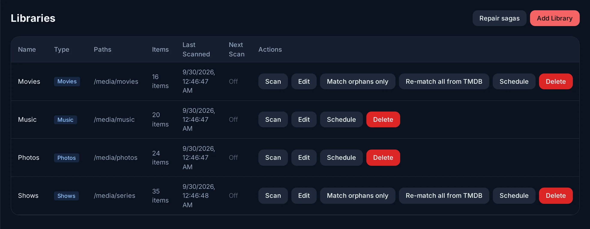

# Libraries and metadata

A library is a type and a set of folders. Evey scans the folders, recognises
each file from its name, and fetches its metadata: titles, summaries, posters,
cast, ratings. Libraries are managed in **Admin → Libraries**.

<figure class="evey-shot" markdown="span">
  { loading=lazy }
  <figcaption><strong>Admin → Libraries</strong>: one row per library, with its folders, its item count and its last scan.</figcaption>
</figure>

## Types

| Type | Recognised as | Metadata from |
| --- | --- | --- |
| **Movies** | One film per file (or per folder) | TMDB, completed by OMDb when a key is set |
| **Shows** | Series, seasons, episodes | TMDB |
| **Music** | Artists, albums, tracks | The files' tags; covers from the files, the album folder, Cover Art Archive (MusicBrainz), then iTunes |
| **Photos** | Albums, pictures with their shooting details | The files |

Keep films and series in separate libraries: the type tells the scanner what to
look for.

## Folders are paths inside the container

The folder picker lists what the container sees. With the installation's
compose file, your media folder is `/media`, so a folder `/srv/media/films` on
the host is `/media/films` for Evey. A second mounted folder (`/media2`) is
added the same way.

## Naming files

The scanner recognises names like these:

```text
/media/films/The Mirror (1999)/The Mirror (1999) 1080p.mkv
/media/films/Lantern.2010.1080p.BluRay.x264.mkv
/media/series/The Outpost/Season 01/The.Outpost.S01E05.720p.mkv
/media/series/Quiet Storm/Quiet.Storm.03x10.mkv
```

For a film, the year matters most. For an episode, `S01E05` or `1x05`. Release
tags (resolution, source, codec, audio, language tags such as `VOSTFR` or
`MULTI`, editions such as "Director's Cut") are removed before the search. If
your files carry a tag the parser does not know, add it in **Admin → Server
Config → Parser tokens**; it applies from the next scan.

## Music libraries

The scanner reads MP3, FLAC, M4A, OGG, Opus, WAV and AAC files, and takes each
track from its tags: title (the file name when it is missing), artist, album
artist, album, year, track and disc numbers, genre. Artists are grouped by
album artist, or by artist when that tag is empty.

**An album is a folder.** Tracks are grouped by the folder they sit in, not by
their album tag: two folders sharing one album tag are two albums, and an album
split into `CD1` and `CD2` subfolders shows as two. Keep each album in one
folder; its tracks are ordered by disc number, then track number, and the album
takes the name most of its tracks carry.

The cover is the picture embedded in the files, otherwise an image in the album
folder (`cover.jpg`, `folder.jpg` or `front.jpg`), otherwise Cover Art Archive
(found through MusicBrainz), otherwise iTunes.

## Photo libraries

The scanner reads JPEG, PNG, HEIC, WebP, GIF, TIFF and BMP files. A photo's
album is its folder, relative to the library folder; a photo at the top level
has none, and moving a file to another folder moves it to that album at the
next scan. The date taken and the camera model come from the EXIF data of JPEG
files; the other formats are listed without them. Thumbnails are resized on the
server and kept in the transcoding cache.

## How new files are picked up

Each library has three options:

| Option | Effect |
| --- | --- |
| **Realtime monitoring** | New, renamed and deleted files are picked up as they appear. A periodic check (every 2 minutes by default) catches what the file system did not report, which happens on network shares. |
| **Scan on startup** | A scan each time the server starts. |
| **Schedule** | A full scan every 6 or 12 hours, daily, weekly, or on a cron expression. |

The server also checks that its folder watcher still receives events, by
writing a probe file into the library folder for a few seconds. A library
where events stop arriving is walked more often until the watcher recovers.

## When a title is wrong or missing

- **Match orphans only** (per library) retries the files that were never
  recognised. It is fast.
- **Re-match all from TMDB** redoes the search for every title in the library.
  It is slow, and corrects old mistakes after a large renaming.
- **Edit Metadata** on a title changes its details by hand, or pastes the right
  TMDB or IMDb id. A value you edit is kept: later refreshes do not overwrite
  it. **Re-match metadata** on the title discards your edits and searches again
  from the file name.
- **Repair sagas** joins films that belong to no collection back to their saga,
  when the other films of the saga are already in the library.

## Collections

**Collections** gathers titles under one name, for every account. There are
three kinds:

- **TMDB Collections**: the sagas, filled in on their own when TMDB places a
  film in one. **Repair sagas** (above) catches films that missed theirs.
- **New collection**: a list an administrator fills by hand, with **Add to
  Collection** on a title or on a selection, and puts in order.
- **New smart collection**: rules on **Genre**, **Year**, **Type**, **Rating ≥**
  and **Library**, which a title must all meet. Its content is worked out each
  time it is opened, so new titles appear without doing anything.

Only administrators create and edit collections. Anyone can browse them, and
**Download collection** on the web gets the original files as one ZIP (up to
1000 titles), leaving out what the account's library access or age limit hides.

## Metadata keys

Evey ships with a TMDB key, so metadata works without configuration. Other
sources are optional; their keys go in **Admin → Server Config → API Keys**,
and a key set there wins over the same key given in the environment.

| Key | Adds |
| --- | --- |
| TMDB (your own) | Your own request quota instead of the shared one. |
| OMDb | A second source for films TMDB knows little about. |
| OpenSubtitles | Searching and downloading subtitles a file does not carry, through the server API (the apps do not offer it yet). See [Subtitles](../playback/subtitles.md). |
| TheIntroDB | Intro, recap and credits timings from a community database: 500 lookups a day with a key instead of 100 without. |

## Intro, recap and credits

Evey marks the intro, the recap and the credits of episodes and films so the
players can offer to skip them. The timings come from community databases
(TheIntroDB, then IntroDB) when they know the title, and from the server's own
analysis of the files otherwise. An administrator can adjust the segments of a
title by hand, or run the detection again.

Players show a **Skip** button by default. **Auto-skip intros** (**Admin →
Server Config → Server Settings**, off by default) makes every player skip them
on its own.

<!-- sources
collections: internal/domain/library/model.go Collection (TmdbID, Rules), MaxCollectionItems 1000 ; rules: internal/adapters/driven/postgres/collection_repo.go (genre, type, year eq/gt/lt/gte/lte, library_id, rating_gte, AND) ; smart evaluated per read: internal/app/collection/query_service.go GetItems ; admin-only writes: interceptors/rbac.go CollectionService ; ZIP: internal/adapters/driving/http/collection_handler.go (library access + parental filter) ; i18n media.collections.*, media.playlist.field*
music: internal/adapters/driven/filesystem/music_scanner.go (audioExts) ; internal/app/music/command_service.go - parseTrack (AlbumFolder = parent dir, title fallback) ; postgres/music_track_repo.go - GetAlbums GROUP BY album_folder, mode() display_album, ORDER BY disk_number, track_number ; GetArtists COALESCE(album_artist, artist)
album art order: internal/app/music/album_art_folder.go (folderCoverNames, embedded wins) ; cmd/evey/wire_services.go (musicbrainz then itunes)
photos: internal/adapters/driven/filesystem/photo_scanner.go (imageExts) ; internal/app/photo/command_service.go - albumOf, processOnePhoto (EXIF JPEG only) ; http/photo_handler.go - serveTranscoded (cache photos/)
types: i18n admin.libraries.types.* ; internal/adapters/driven/metadata/musicbrainz_provider.go ; internal/app/music/album_art_chain.go
options, schedules: i18n admin.libraries.realtimeMonitoring, scanOnStartup, schedule options ; internal/config/config.go - EVEY_LIBRARY_PERIODIC_SCAN_INTERVAL
watcher probe: internal/app/library/watcher_probe.go - probeOnce, UnhealthyLibraries
rematch: i18n admin.libraries.matchOrphans, refreshMetadata, relinkCollectionsTooltip ; media.detail.rematchConfirm
keys: i18n admin.serverConfig.apiKeys.* ; admin introProvidersTidbAuthed
opensubtitles folder: internal/app/subtitle/service.go
intro providers: docs/adr/0011-intro-detection-providers.md
-->
