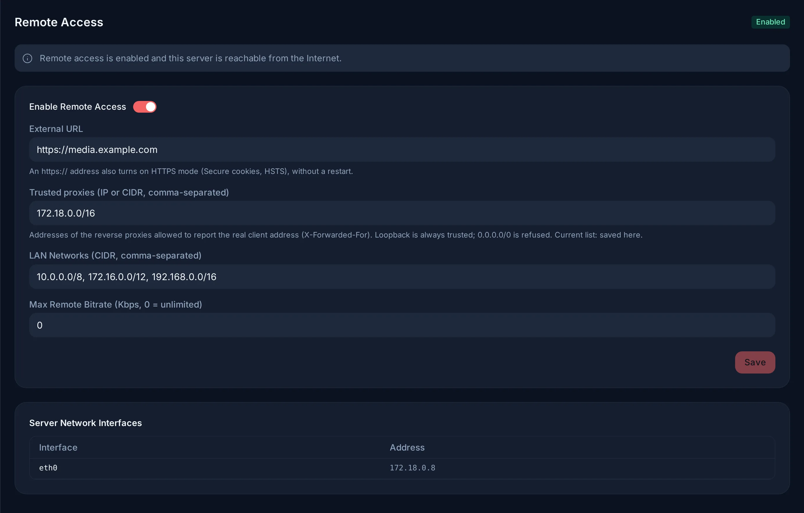

# Remote access and HTTPS

Reaching the server from outside the home involves two separate things: a
public HTTPS address in front of Evey, and Evey's own remote-access setting,
which decides whether clients outside your network are served.

## Remote access is decided from the public address

Evey decides remote access at startup unless you have chosen it yourself:

- if the server was given a public address (`EVEY_SERVER_BASE_URL` or
  `EVEY_REMOTE_ACCESS_EXTERNAL_URL`), remote access is **on**;
- otherwise it is **off**, and only clients on your local networks are served.

Once you change the setting in **Admin → Remote Access**, your choice is kept
and the server no longer infers it: a published server can stay LAN-only if
that is what you want.

When remote access is off, a client outside the local networks receives a
`403` on every page, and the apps show a message saying remote access is
disabled rather than a generic error. If the server is reachable from the
internet while remote access is off, the admin page shows **Every remote user
is locked out**, the server logs it at startup and logs each refusal with the
client address, and `evey admin doctor` reports it as a failure.

Remote access is a choice about who may reach the server, not a protection:
every page still requires signing in.

## Settings

**Admin → Remote Access**. Every setting applies without a restart: the
network ones to the next request, the bitrate to the next playback.

<figure class="evey-shot" markdown="span">
  { loading=lazy }
  <figcaption>A server published at an <code>https://</code> address behind a proxy on the Docker network.</figcaption>
</figure>

| Setting | Effect |
| --- | --- |
| **Enable Remote Access** | On: clients outside the local networks are served like any other. Off: they get a `403`. |
| **External URL** | The public address. E-mail links, single sign-on redirects and cast URLs are built from it. An `https://` address also turns on HTTPS mode (below). |
| **Trusted proxies** | The reverse proxies whose forwarded client address Evey believes. Loopback is always trusted. Empty: the list comes from `EVEY_TRUSTED_PROXIES`. |
| **LAN Networks** | The address ranges treated as home. Private ranges are listed by default. Add a VPN range (Tailscale, WireGuard) here if its clients should count as home. |
| **Max Remote Bitrate** | A bitrate ceiling for clients outside the local networks, in kbit/s (0 = none). A private address is never capped. See [How playback is decided](../playback/how-playback-is-decided.md#limits-on-the-session). |

## HTTPS: a reverse proxy in front of Evey

Evey serves plain HTTP on port 9091, API and web interface together. HTTPS is
the job of a reverse proxy, which forwards everything to `evey-server:9091`.
Evey needs to know two things about it, both in **Admin → Remote Access**:

- **External URL** in `https://`. This is what tells Evey a proxy terminates
  TLS: cookies get the `Secure` flag, HSTS is sent and the `X-Forwarded-Proto`
  header of a trusted proxy is believed.
- **Trusted proxies**, when the proxy is not on the same machine as Evey. A
  proxy in another container needs its network here, for example
  `172.16.0.0/12` for Docker's default networks. A range covering every
  address (`0.0.0.0/0`, `::/0`) is refused: any client could then choose the
  address it is seen with.

With no proxy yet, Evey's repository provides a Caddy service that obtains a
Let's Encrypt certificate on its own. Ready-made configurations for Caddy,
Nginx, Traefik and Nginx Proxy Manager, and what a proxy's defaults do to
streaming: [Reverse proxy configurations](../reverse-proxy.md).

### Setting it in the environment instead

`EVEY_SERVER_BASE_URL` and `EVEY_TRUSTED_PROXIES` give the same answers from
the compose file, which suits an installation described entirely as code or a
server that must be reachable over HTTPS from its very first start. The panel
wins when both are set: an `https://` External URL enables HTTPS mode even if
the base URL is plain HTTP, and a saved proxy list replaces the variable.
Emptying the field hands the answer back to the variable. See
[Server and network](../environment/server.md).

## The two network steps

Trusted proxies and LAN networks are two successive steps, not two ways of
saying the same thing. The trusted proxies decide whose forwarded address is
believed, and so which address each client gets; the LAN networks then
classify that address as local or remote.

## The real client address

Remote access and **Max Remote Bitrate** both depend on Evey seeing each
client's real address. A proxy that does not forward it, or that Evey does not
trust, makes every request look like it comes from the proxy's private
address: everyone counts as home, the remote-access setting has no effect and
no remote cap applies.

Fixing the proxy therefore changes who counts as remote. If remote access was
off, remote clients are refused from that moment. Check
`evey admin doctor` after changing proxy settings: it names the list in force
and where it comes from, warns about a public range and fails on a range
covering every address.

<!-- sources
inference and explicit choice: docs/adr/0026-remote-access-inferred-from-a-published-url.md ; internal/config/remote_access_resolve.go
gate, live switch and LAN list: cmd/evey/gateway.go - networkMiddleware ; cmd/evey/network_middleware_test.go - TestNetworkMiddleware_LANListChangeAppliesWithoutRestart
remote cap live: internal/adapters/driving/grpcapi/playback_remote_bitrate_test.go
labels: i18n admin.remoteAccess.*
proxy settings: docs/reverse-proxy.md
https mode and trusted proxies live: internal/config/network_live.go - EffectiveHTTPS, EffectiveTrustedProxies ; internal/adapters/driving/http/access_handler_live_test.go
doctor check: cmd/evey/admin_ops.go - checkTrustedProxies
-->
