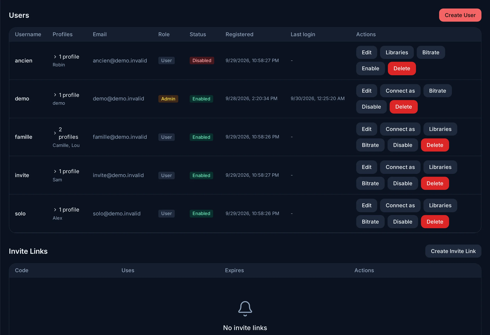

# Users, profiles and parental control

## Accounts and profiles

An **account** signs in: it has a username and a password (or a single sign-on
identity, see [OIDC](../oidc.md)), and it is either an administrator or not.
A **profile** watches: each account holds one or more profiles, each with its
own watch history, resume points, favourites, languages and home page. A
household typically shares one account, with a profile per person.

## Creating accounts

**Admin → Users** offers two ways:

<figure class="evey-shot" markdown="span">
  { loading=lazy }
  <figcaption><strong>Admin → Users</strong>: each account with its profiles, its role and its state.</figcaption>
</figure>

- **Create User**: you choose the username and the password.
- **Create Invite Link**: the person chooses their own. A link can have an
  expiry date and a maximum number of uses, restrict the libraries the new
  account sees, cap the number of profiles it may create, and create an
  administrator. **Invite Links** lists them; a link can be revoked.

## What an administrator can restrict per account

| Setting | Effect |
| --- | --- |
| **Library Access** | The libraries the account sees. Everything else is absent from its searches, home page and API responses. |
| **Max Bitrate** | A ceiling on the bitrate the account's players receive (0 = unlimited). A title above it is transcoded down to it. |
| **Max profiles** | How many profiles the account may create (0 = unlimited). |
| **Max devices per profile** | How many devices each profile may register (0 = unlimited). |

**Connect as** opens the server as that user sees it, to check a restriction
or reproduce a problem. A banner stays visible, and **Exit** returns to your
own account.

## Kids profiles and the PIN

A profile marked **Kids profile** opens without a PIN. Leaving it for a profile
that is not a kids profile asks for the **4-digit PIN**, set in **Settings →
Parental**. Setting the PIN the first time asks for the account password, and
while a kids profile exists the account must have a PIN.

Managing profiles and parental settings is only possible from a profile that is
not a kids profile.

## Age limits

Each profile can have a **Max age rating** (**Settings → Profiles → Edit**).
The rating system is the one of the country set in **Admin → Server Config →
Language & Region**.

The limit is applied by the server, not by the apps: a title above it is not
hidden in the interface, it is never sent. That holds for browsing and search,
for playback and for downloads. If the server cannot read a profile's settings
(a database error, for example), it refuses the content rather than allowing
it. Administrators are not subject to profile limits.

A film downloaded to a phone stays subject to the limit offline: a kids profile
cannot open a download made by another profile above its age limit.

## Requests

Users can search for a film, a series or an artist that is missing from the
libraries and ask for it. Requests arrive in **Admin → Media Requests**, where
an administrator approves, declines or postpones them, with a note. Who may
request is set there: everyone by default, with per-user exceptions.

## Public download links

On a film or episode page, an administrator can create a **Public download
link** (web and Android apps). It is a URL anyone can open, without an account,
to download the original file; it is copied to the clipboard.

- It expires after 48 hours. Through the server API it can last up to 72 hours
  and be limited to a number of downloads (`POST /api/v1/media/{id}/share`).
- Only administrators can create, list and revoke links. The apps only create
  them: listing and revoking go through the API (`GET /api/v1/admin/share-links`,
  `DELETE /api/v1/share-links/{id}`).
- With remote access off, the link only works from the local networks.
- Whoever holds the link can download the file until it expires: share it like
  the file itself.

<!-- sources
share links: internal/adapters/driving/grpcapi/interceptors/rbac.go (ShareService RoleAdmin) ; grpcapi/share_handler.go (48 h default) ; internal/app/media/share_service.go (max 72 h, maxViews) ; http/share_download_handler.go (no auth) ; cmd/evey/gateway.go - networkGateExempt (share not exempt) ; frontend/apps/web/src/features/library/ShareLinkButton.tsx, mobile media/[id].tsx (isAdmin) ; proto/evey/v1/share.proto
invite options: i18n admin.users.maxUsesLabel, expiresAtLabel, inviteLibraries, inviteMaxProfilesLabel, inviteIsAdmin
restrictions: i18n admin.users.libraryAccess, maxBitrateDesc, maxProfiles, maxDevicesPerProfile, impersonate
kids and pin: i18n auth.profile.fields.isKidsHelp, auth.settings.parental.*, errors.auth.pin_required_for_non_kids, errors.auth.parental_needs_non_kids ; internal/app/user/service.go - ErrPINRequired
server-side limit, fail closed, admins exempt: internal/adapters/driving/http/parental.go - BlockedByParental ; internal/adapters/driving/grpcapi/library_handler_parental.go
downloads: internal/adapters/driving/http/compat_download_handler.go (checkParental) ; frontend/apps/mobile/src/lib/offlineAccess.ts
requests: i18n admin.mediaRequests.*
-->

## The home page

The home page is a stack of rows; a row with nothing to show is hidden.

| Row | What it shows |
| --- | --- |
| **Resume Playback** | What the profile started and has not finished, most recent first. A title counts as watched at 90 %. |
| **Up Next** | For each series the profile has watched an episode of, the next unwatched episode. |
| **Collections** | The collections, with a link to the full list. |
| **Recommended For You** | Films and series in the profile's usual genres, best match first, then by rating. A genre counts when it appears in at least 3 of the profile's last 200 playbacks. |
| **Most Popular** | The films and series played most on the server over the last 90 days. |
| One row per library | The latest additions to that library, newest first. |

Recommended For You and Most Popular leave out what the profile has already
finished; a series counts as finished once every episode is watched. Plugins can
add their own rows.

**Admin → Server Config → Home feeds** sets the default for every profile:
which rows appear, in what order, and how many items each shows. Each profile
then arranges its own home with **Customize** (on the home page of the web and
mobile apps, in the header of the TV app): show or hide a row, move it, or
**Reset to Defaults**. The choice is saved on the server and follows the profile
to every device. A profile can show a row the administrator has hidden, except
a plugin's row: there the administrator's choice is final.
