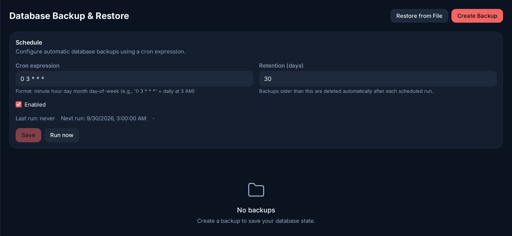

# Backups and updates

## What a backup contains

A backup is a copy of the **database**: accounts, profiles, libraries and
their metadata, watch history and resume points, collections and playlists,
settings, plugin records, webhooks and audit logs. It is a `.tar.gz` holding
the SQL dump and a manifest with the dump's SHA256.

It does **not** contain:

- your media files;
- the transcoding cache (regenerated on demand);
- the search index (rebuilt from the database);
- the keys kept in `./evey-data`: `jwt.key`, which signs sessions, and the
  `keys` folder (database password, search key);
- the installed plugin files.

A database backup therefore restores Evey's state on the same installation. To
be able to rebuild a machine, keep a copy of the whole `./evey-data` folder as
well: the database backups are inside it, in `./evey-data/backups`.

## Scheduled backups

**Admin → Database Backup → Schedule**: a cron expression (for example
`0 3 * * *`, every day at 3 AM) and a retention in days. Backups older than the
retention are deleted after each scheduled run. **Run now** makes one
immediately.

<figure class="evey-shot" markdown="span">
  { loading=lazy }
  <figcaption>A backup every day at 3 AM, kept 30 days.</figcaption>
</figure>

The server also dumps the database on its own before applying a migration
during an update, whatever the schedule (see below).

## Restoring

**Admin → Database Backup** lists the backups and restores one, or restores
from a file you upload. Restoring replaces the current database.

A backup can only be restored on a server with the same database schema: the
server checks the checksum and the schema version first, and refuses a backup
taken by a version with a different schema instead of loading it. To go back to
an older version with its data, see [Going back](#going-back) below.

When the server does not start any more, the command line restores the dumps
taken before a migration (`pre-migration-*.sql.gz`), not the `.tar.gz` backups
of this panel: see [Recovery](runbooks/recovery.md).

## Updating Evey

```bash
docker compose pull && docker compose up -d
docker compose logs -f evey
```

That is the whole update. When the new version needs to change the database,
it first writes a dump to `./evey-data/backups/pre-migration-*`, then applies
the migrations while starting; a large catalogue can take a few minutes, and
the container reports healthy once it serves again. Evey checks every 6 hours
whether a newer image is published and says so in the admin panel; it never
updates itself.

**Pin what you run.** `latest` follows the most recent release. For a server
you rely on, put a release tag (`0.2.0`) or an immutable `sha-<commit>` tag on
the `image:` line, so that two pulls a day apart run the same code. A branch
tag such as `beta-0.0.1` moves with every change.

**Which version is running.** `docker exec evey-server evey version` prints the
version and the commit of the running binary.

### Going back

Put the previous tag on the `image:` line and run `docker compose up -d`. If
the newer version had migrated the database, restore its pre-migration dump
first: `docker exec evey-server evey admin rollback` prints the exact steps
with the dump's path.

Image tags, runtime variants and GPU flavours are described in
[Advanced deployments](operations/advanced-deployments.md#image-tags).

<!-- sources
contents: internal/app/backup/service.go - CreateBackup, restore schema check ; internal/adapters/driven/filesystem/backup_store.go
schedule: i18n admin.backup.schedule.* ; cmd/evey/main.go (DB cron scheduler, env fallback)
pre-migration dump, rollback, update check: previous docs/installation.md (Updating Evey) ; i18n admin Server Config Updates
-->
