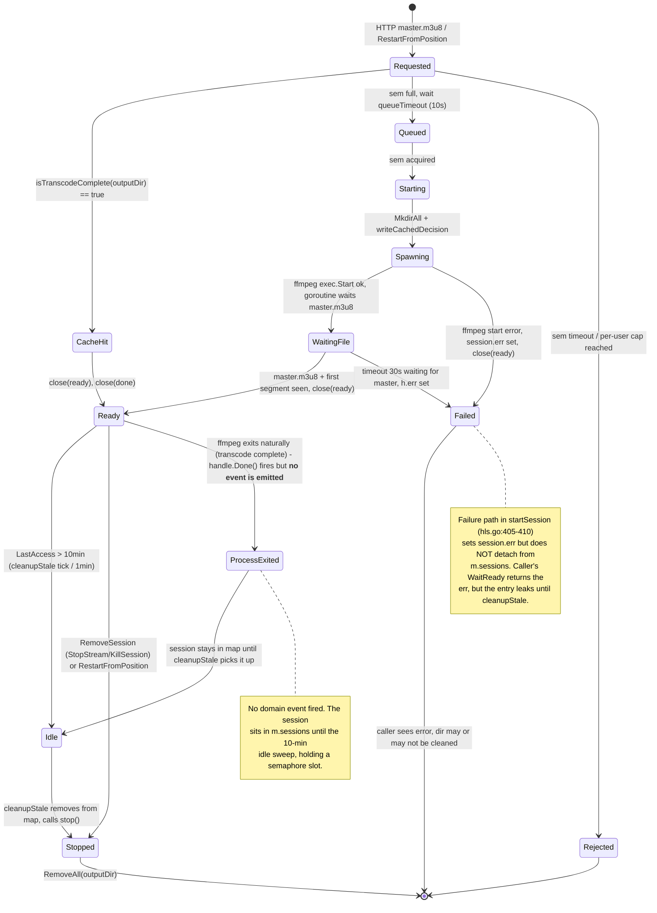

# Saga / process manager for the transcode lifecycle - design proposal

Status: **Proposal. No code has been written against it.**

> A design document, not an architecture decision record: it describes a shape
> the transcoding stack does not have. It earns an ADR the day it ships, and
> only for the parts that turn out to be expensive to reverse.
Audience: reviewer deciding go / no-go before any PR is opened
Scope: Evey HLS + direct-transcode lifecycle. No impact on photo or music transcode (single-shot, synchronous).

---

## 1. Current state

The transcode lifecycle is split across **four** in-process owners that do not share state and do not coordinate explicitly. Each owner persists or holds a partial view; no single component knows the truth.

### 1.1 Components and their authority

| Component | File | What it owns |
|---|---|---|
| `HLSManager` | `internal/app/transcoding/hls.go:122` | In-memory map of live `HLSSession`, semaphore for `maxConcurrent`, per-user count, idle cleanup loop, on-disk segment dir under `cacheDir/hls/<mediaItemID>` |
| `HLSSession` | `internal/app/transcoding/hls.go:28` | `ready`/`done` channels, ffmpeg `HLSProcessHandle`, `LastAccess` timestamp, decision-cache file `.decision` |
| `HLSTranscoder` (ffmpeg adapter) | `internal/adapters/driven/ffmpeg/hls_transcoder.go:21` | `*exec.Cmd` lifetime, watches for `master.m3u8` / first segment, emits `ready` / `done` |
| `Service` (transcoding app svc) | `internal/app/transcoding/service.go:17` | DB row in `transcode_sessions` via `TranscodeJobRepository`, publishes `transcode.started` / `failed` / `cancelled` on `EventBus`, refreshes `TranscodesActive` gauge |
| `TranscodeJobRepository` (postgres) | `internal/adapters/driven/postgres/transcode_job_repo.go:10` | Persistence for `transcode_sessions` table (`internal/adapters/driven/postgres/migrations/000001_init.up.sql:271-289`) |
| `playbackHandler` (gRPC) | `internal/adapters/driving/grpcapi/playback_handler.go:222` | Calls `hlsManager.RemoveSession` on `StopStream` |
| `adminSessionHandler` (gRPC) | `internal/adapters/driving/grpcapi/admin_audit.go:127` | Calls `hlsManager.RemoveSession` on admin `KillSession` |
| `transcodeHandler` (HTTP, direct transcode) | `internal/adapters/driving/http/transcode_handler.go:519` | Spawns `exec.Command("ffmpeg", ...)` directly, **bypasses HLSManager and Service entirely**, only protected by `TranscodeThrottle` (`internal/app/transcoding/throttle.go:6`) |
| `main.go` | `cmd/evey/main.go:94` | `defer deps.media.hlsManager.CleanupAll()` on shutdown |

> **Key divergence**: the in-memory `HLSSession` lifecycle (HLSManager) is **disjoint** from the persisted `TranscodeJob` rows (Service). `HLSManager.GetOrCreate` (`hls.go:253`) never calls `Service.StartTranscode`. The DB row is only created by `Service.StartTranscode` (`service.go:56`) - which **no production HTTP/gRPC path currently invokes** for HLS playback. Result: HLS playback never inserts a row, and `transcode_sessions` is dead-write for the HLS path. The `TranscodeQueueDepth` and `TranscodesActive` Prom gauges sourced from the Service path therefore under-report by ~100% for the HLS workload.

### 1.2 State diagram (implicit, today)



### 1.3 Direct transcode (HTTP `/transcode`) - second, parallel lifecycle

`transcodeHandler.serveHTTP` (`transcode_handler.go:524`) opens a raw `exec.CommandContext("ffmpeg", ...)` writing to the HTTP response body. No DB row, no event, no HLSManager. Lifetime is bound to the HTTP request context. On crash the ffmpeg child is reaped by the kernel via context cancellation; no record persists. This is essentially invisible to ops.

---

## 2. Problems observed

### 2.1 Orphans on disk after crash
`sweepOrphanCacheDirs` (`hls.go:162-188`) rms the entire `cacheDir/hls` tree at startup. This works because **no live session can exist before HLSManager is constructed**, so anything on disk is provably an orphan. Trade-off: a crash mid-playback throws away every active session's segments - every other user reconnecting after restart pays a full re-transcode. A coordinator with a persistent state log could discriminate "in-flight" vs "abandoned" and only sweep the latter.

### 2.2 No DB row for HLS jobs
`HLSManager.GetOrCreate` (`hls.go:253`) never calls `jobs.Create`. `transcode_sessions` only sees jobs from `Service.StartTranscode` (`service.go:82`). Searching the codebase: `Service.StartTranscode` has **zero production callers** for the HLS pipeline - confirmed by grep showing it only used in tests. Net effect:
- Admin "active transcodes" view (`internal/adapters/driving/grpcapi/admin_audit.go`) reads `transcode_sessions` for a metric that is structurally always zero in HLS-only deployments.
- `play_session_stats_repo.go:146` joins `transcode_sessions` for stats - same blind spot.
- `TranscodesActive` gauge in `service.go:113-125` measures DB rows it never writes for HLS.

### 2.3 Process exit is not signalled to the manager
`HLSSession.handle.Done()` (`hls.go:424`) is awaited inside `startSession` but the `HLSManager` map is never updated when ffmpeg exits naturally (the transcode finished writing all segments). The session sits in `m.sessions` holding a semaphore slot until `cleanupStale` (10-min idle sweep, `hls.go:497`) detects it. Real-world impact: a user who completes a 2 h film occupies one of `maxConcurrent` for up to 10 minutes after the playback ends.

### 2.4 No audit trail
There is no per-session "started → segments served → ffmpeg exited → evicted" timeline anywhere. `TranscodeStarted` / `TranscodeCompleted` events (`internal/domain/transcoding/events.go:9-42`) exist as types but the only publisher is `Service.StartTranscode` (cf. 2.2 - never called in HLS prod path). Debugging "why did this user's session die at 23:47?" requires reading logs.

### 2.5 Crash recovery is amnesia
Restart = wipe `cacheDir/hls`, lose every in-memory session, no acknowledgment to clients (next segment 404 returns `session expired, refresh playlist` from `transcode_handler.go:450`). Acceptable today because crashes are rare, but means any persistent-state outage blast radius is "all active streams die".

### 2.6 Direct transcode is invisible
`/transcode` HTTP endpoint (`transcode_handler.go:519-602`) has no observability. Concurrent direct-transcode count exists only in `TranscodeThrottle.active` (`throttle.go:8`), in-memory and lost on restart.

---

## 3. Proposed Saga / Process Manager design

### 3.1 Explicit domain states

Replace today's implicit "in-map / not-in-map / channel-closed" state with a single domain enum lifted to `internal/domain/transcoding/saga.go`:

```text
TranscodeSessionState =
    Pending        // saga row created, before any side effect
  | Acquiring     // semaphore acquire pending
  | Spawning      // ffmpeg about to be started
  | Streaming     // first segment available, serving traffic
  | Idle          // ffmpeg exited cleanly OR no LastAccess for >N
  | Stopping      // shutdown initiated (admin kill / user stop / shutdown)
  | Stopped       // ffmpeg reaped, on-disk cleanup pending
  | Failed        // terminal: ffmpeg start/wait/exit error
  | Reaped        // terminal: dir removed, semaphore released
```

Transitions are **only** legal via the coordinator (no struct field reassignment from outside). Invalid transitions (e.g. `Reaped → Streaming`) are rejected with `errInvalidTransition`.

### 3.2 Coordinator placement

New file: `internal/app/transcoding/saga.go` (app layer, NOT domain, because it orchestrates infrastructure ports - `HLSProcess`, `TranscodeJobRepository`, `EventBus`, outbox writer).

```go
type SessionSaga struct {
    repo     TranscodeSessionSagaRepository  // new port
    outbox   OutboxWriter                    // new port
    process  transcoding.HLSProcess
    bus      shared.EventBus
    sem      *semaphore.Weighted             // replaces hls.go:128 channel
    metrics  sagaMetrics
}
```

The coordinator absorbs:
- `HLSManager.GetOrCreate` semaphore + map → state-machine transitions persisted via `repo`
- `HLSManager.RemoveSession` / `cleanupStale` → coordinator `Stop` / `Reap`
- `HLSManager.startSession` → coordinator `Spawn` (still uses the `HLSProcess` port for ffmpeg)
- The orphan sweep (today `hls.go:162`) → replaced by recovery on saga rows in non-terminal state at startup (see §3.5)

`HLSManager` shrinks to a thin in-memory cache for hot lookups (`GetSession` on the segment hot path) backed by the persistent saga rows; or is deleted entirely and the coordinator owns both. **Recommended: delete HLSManager, fold into coordinator.**

### 3.3 Transactional outbox

The outbox pattern decouples "write state row" from "publish event" so a crash between the two cannot drop an event. Single SQL transaction writes both rows; a separate worker drains the outbox into the in-process `EventBus` (and optionally external sinks later: webhooks, NATS).

#### 3.3.1 Schema (proposed migration name `000085_transcode_outbox.up.sql`)

```sql
-- Replaces in-memory HLSManager.sessions with a persistent saga store.
CREATE TABLE IF NOT EXISTS transcode_saga_sessions (
    id              TEXT PRIMARY KEY,           -- session id (== mediaItemID today)
    media_item_id   TEXT NOT NULL REFERENCES media_items(id) ON DELETE CASCADE,
    user_id         TEXT NOT NULL,
    state           TEXT NOT NULL,              -- enum from §3.1
    output_dir      TEXT NOT NULL,
    decision_video  TEXT NOT NULL DEFAULT '',
    decision_audio  TEXT NOT NULL DEFAULT '',
    started_at      TIMESTAMPTZ NOT NULL DEFAULT NOW(),
    last_access_at  TIMESTAMPTZ NOT NULL DEFAULT NOW(),
    ended_at        TIMESTAMPTZ,
    error_message   TEXT NOT NULL DEFAULT '',
    pid             INTEGER,                    -- ffmpeg PID for liveness checks
    process_host    TEXT NOT NULL DEFAULT '',   -- hostname for multi-instance future
    updated_at      TIMESTAMPTZ NOT NULL DEFAULT NOW()
);
CREATE INDEX IF NOT EXISTS idx_saga_state_started ON transcode_saga_sessions(state, started_at);
CREATE INDEX IF NOT EXISTS idx_saga_user_state ON transcode_saga_sessions(user_id, state);

-- Generic outbox table; first user = transcode saga, future = others.
CREATE TABLE IF NOT EXISTS domain_event_outbox (
    id              BIGSERIAL PRIMARY KEY,
    aggregate_type  TEXT NOT NULL,              -- 'transcode_session'
    aggregate_id    TEXT NOT NULL,
    event_name      TEXT NOT NULL,              -- e.g. 'transcode.session.streaming'
    payload         JSONB NOT NULL,
    occurred_at     TIMESTAMPTZ NOT NULL DEFAULT NOW(),
    published_at    TIMESTAMPTZ,                -- NULL until drained
    attempts        INT NOT NULL DEFAULT 0,
    last_error      TEXT NOT NULL DEFAULT ''
);
CREATE INDEX IF NOT EXISTS idx_outbox_unpublished ON domain_event_outbox(occurred_at) WHERE published_at IS NULL;
```

Down migration drops both tables. Down is destructive of in-flight sessions - acceptable since the previous startup would have reaped them anyway (§3.5).

#### 3.3.2 Outbox worker

New file: `internal/app/transcoding/outbox_worker.go` - single goroutine, polling loop (1s tick) or `LISTEN/NOTIFY` for snappier delivery. Drains rows where `published_at IS NULL`, publishes via `shared.EventBus.Publish`, sets `published_at` on success, increments `attempts` and stamps `last_error` on failure. **Semantics: at-least-once.** Subscribers must be idempotent (already true for the existing `transcoding.TranscodeStarted` consumers, none of which mutate state).

Backoff: simple linear `attempts * 5s`, capped at 5 min. Hard cap at 100 attempts → mark with `last_error = 'POISON'` and stop (admin alert).

#### 3.3.3 New event types

Lifted to `internal/domain/transcoding/events.go`:

```go
TranscodeSessionRequested  // Pending → Acquiring
TranscodeSessionStreaming  // Spawning → Streaming
TranscodeSessionIdle       // Streaming → Idle
TranscodeSessionStopped    // any → Stopped
TranscodeSessionReaped     // Stopped → Reaped
TranscodeSessionFailed     // any → Failed
```

Existing `TranscodeStarted` / `TranscodeCompleted` / `TranscodeFailed` / `TranscodeCancelled` are kept for the direct-transcode (one-shot) path and the legacy `Service.StartTranscode` API.

### 3.4 Sequence diagrams

#### Start (happy path)

```mermaid
sequenceDiagram
    autonumber
    participant C as Client
    participant H as hlsMasterServe
    participant S as SessionSaga
    participant DB as Postgres (txn)
    participant OB as OutboxWorker
    participant FF as HLSProcess (ffmpeg)
    participant EB as EventBus

    C->>H: GET /api/v1/media/{id}/master.m3u8
    H->>S: Acquire(userID, mediaID, decision, opts)
    S->>DB: BEGIN; INSERT saga(state=Pending); INSERT outbox(Requested); COMMIT
    S->>S: sem.Acquire (bounded, queueTimeout)
    S->>DB: UPDATE saga SET state=Acquiring
    S->>DB: UPDATE saga SET state=Spawning
    S->>FF: Start(opts) -> handle, pid
    S->>DB: UPDATE saga SET pid=$1
    FF-->>S: handle.WaitReady ok
    S->>DB: BEGIN; UPDATE saga SET state=Streaming; INSERT outbox(Streaming); COMMIT
    S-->>H: session ready
    H-->>C: 200 master.m3u8
    OB->>DB: SELECT outbox WHERE published_at IS NULL
    OB->>EB: Publish(TranscodeSessionStreaming)
    OB->>DB: UPDATE outbox SET published_at=NOW()
```

#### Stop / Crash recovery

```mermaid
sequenceDiagram
    autonumber
    participant Sys as systemd / restart
    participant App as evey boot
    participant S as SessionSaga
    participant DB as Postgres
    participant FS as cacheDir/hls
    participant EB as EventBus

    Note over Sys,App: Process crashed mid-stream. Restart.
    App->>S: Recover(ctx)
    S->>DB: SELECT * FROM transcode_saga_sessions WHERE state NOT IN ('Reaped','Failed')
    loop each non-terminal row
        S->>S: classify (was-in-flight)
        S->>DB: BEGIN; UPDATE saga SET state=Stopped, error='process-restart'; INSERT outbox(Stopped); COMMIT
        S->>FS: RemoveAll(output_dir)
        S->>DB: BEGIN; UPDATE saga SET state=Reaped; INSERT outbox(Reaped); COMMIT
    end
    App->>App: continue normal startup; HLSManager NOT used for sweep
    EB-->>EB: subscribers (metrics/log) see clean Reaped trail
```

### 3.5 Recovery contract

On boot, before the saga starts accepting new requests:
1. `SELECT id, output_dir, pid, process_host FROM transcode_saga_sessions WHERE state NOT IN ('Reaped','Failed')`.
2. For each row: if `process_host` matches current host AND `pid` is alive AND `output_dir` exists → **adopt** (re-attach the handle is impossible without ffmpeg IPC; safer to mark `Stopping`, kill the orphan PID, then `Stopped → Reaped`). If host differs OR pid dead → straight `Stopped → Reaped`.
3. Sweep `cacheDir/hls/*` directories that have no corresponding `Reaped`-or-prior row (defensive: handles partial migrations or manual mucking).
4. Open the gate: HTTP/gRPC handlers can now create new sessions.

This **replaces** `sweepOrphanCacheDirs` (`hls.go:162`). After Phase 3, the function is deleted.

---

## 4. Migration plan (no big-bang)

### Phase 1 - Outbox infrastructure, dual-write
PR scope, no consumer change.
- Add migration `000085_transcode_outbox.up.sql` (table + outbox).
- Add `OutboxWriter` port + Postgres impl + `OutboxWorker`.
- Wire worker in `cmd/evey/wire.go` next to the existing `bus`.
- Modify `Service.StartTranscode` (`service.go:56`) and `Service.StopTranscode` (`service.go:127`) to write outbox rows in the same DB txn as `jobs.Create` / `jobs.Update`. Keep the direct `bus.Publish` call too - outbox runs side-by-side, idempotent subscribers see each event twice during the transition.
- Tests: outbox persistence, worker drain, retry/backoff, poison handling.

Risk: doubled events for ~1 release. Mitigation: every existing transcode subscriber is a fire-and-log (metrics + slog); none mutate. Verified by grep on `transcoding.TranscodeStarted`/`Completed`/`Failed`/`Cancelled` event names across `internal/`.

### Phase 2 - Saga writes, HLS path emits saga events
- Introduce `SessionSaga` in `internal/app/transcoding/saga.go`.
- `hlsMasterServe.serveHTTP` (`transcode_handler.go:258`) starts calling `saga.Acquire(...)` **in addition to** the existing `hlsManager.GetOrCreate(...)`. The saga writes saga rows + outbox; HLSManager continues to own ffmpeg lifetime as before.
- Read-only assertions: a startup check verifies that for every live `HLSSession` in the manager there is a `Streaming` saga row, and warns on drift (catches bugs before flipping the switch).
- Tests: saga state machine table-driven, dual-path consistency property test (random sequence of Start/Stop/Idle expansions matches both stores).

### Phase 3 - Saga owns ffmpeg, HLSManager retired
- Move `HLSProcess.Start` call into `SessionSaga.spawn`.
- Replace `HLSManager.GetSession` (used on the segment hot path, `transcode_handler.go:448`) with `saga.GetByMediaItemID(ctx)` + small in-memory LRU for the segment fast-path.
- Replace `HLSManager.RemoveSession` callers (`playback_handler.go:223`, `admin_audit.go:128`) with `saga.Stop(ctx, sessionID, reason)`.
- Replace `HLSManager.CleanupAll` (`main.go:94`) with `saga.GracefulShutdown(ctx)` - marks every `Streaming` row `Stopping`, kills processes, transitions to `Stopped`/`Reaped` synchronously, drains outbox before exit.
- Delete `sweepOrphanCacheDirs` and the entire `HLSManager` struct except the metric helpers (folded into saga).
- Direct-transcode path (`transcode_handler.go:519`) gets its own thin saga record (states collapse to `Streaming` / `Stopped` / `Failed`) so /transcode shows up in admin.
- Phase 1 dual-write in `Service` is removed: `Service.StartTranscode` becomes a thin wrapper around the saga.
- Update `play_session_stats_repo.go:146` join to read the saga table (or a view union'd over both during one release).

### Phase 4 - Cleanup
- Drop the direct `bus.Publish` calls in `Service` (only outbox).
- Remove `TranscodesActive` gauge's transient double-count guard (was Phase 1 mitigation).
- Document the new lifecycle in `docs/playback/transcoding.md`.
- Bump runbook in `docs/runbooks/` with the new "stuck saga" diagnostic SQL.

---

## 5. Risks

| # | Risk | Mitigation |
|---|---|---|
| R1 | **Doubled events Phase 1→2**. Subscribers re-run on the same event. | All current subscribers are read-only (slog + metrics). Add an `idempotency_key = saga_id+event_name` column on outbox; subscribers can dedupe if needed. |
| R2 | **Outbox lag** under burst - gauges and admin "active transcodes" view become eventually-consistent. | Worker tick = 1 s; for synchronous reads (admin UI) read `transcode_saga_sessions.state` directly, not the event stream. |
| R3 | **Saga row + ffmpeg PID drift** if the host crashes between `cmd.Start` and `UPDATE saga SET pid`. | Recovery (§3.5) treats any `Spawning` row older than 30 s with no PID as `Failed`. Worst case: one orphan ffmpeg whose context cancellation kills it within seconds; the dir is swept by the host-mismatch branch. |
| R4 | **Down migration** loses every in-flight session. | Acceptable: down migrations are DR-only. Document that downgrading evicts active streams. |
| R5 | **`HLSSessionsGauge`** sourced today from `len(m.sem)` (`hls.go:205`); after retirement we must source from `SELECT COUNT(*) FROM transcode_saga_sessions WHERE state='Streaming'`. | Add a Prom collector wrapping the saga repo; rate-limit to once per 10 s to avoid query storms. |
| R6 | **Test rewrite cost**. `internal/app/transcoding/hls_test.go` (~430 lines) and `hls_mutations_test.go` (~360 lines) test internal HLSManager behaviour. | Phase 2 keeps HLSManager - those tests stay green. Phase 3 rewrites them around the saga; estimated +8h. |
| R7 | **Race on `GetOrCreate` re-entrancy** today is delicate (4-phase locking, `hls.go:259-360`). The saga must preserve `videoDecision`/`audioDecision`-aware reuse to avoid invalidating warm caches. | Saga upsert keyed on `(media_item_id, decision_video, decision_audio)`; mismatch triggers `Stop` of the existing row before `Acquire`. Mirrors today's behaviour. |
| R8 | **Outbox table growth** - a busy server could write 10k+ events/day. | Add a janitor that prunes `published_at < NOW() - INTERVAL '7 days'` daily. |

---

## 6. Effort estimate

Five PRs, sequenced. Each independently revertable.

| PR | Scope | Files touched | Estimate |
|---|---|---|---|
| #1 | Phase 1 - outbox table, writer, worker. No saga yet. | migration `000085`, `internal/app/outbox/*` (new), `internal/adapters/driven/postgres/outbox_repo.go` (new), `cmd/evey/wire.go` (+ ~10 lines), `internal/app/transcoding/service.go` (dual-write). | 2 days |
| #2 | Phase 2 - `SessionSaga` skeleton, dual-emit on HLS path. HLSManager unchanged. | `internal/app/transcoding/saga.go` (new), `internal/domain/transcoding/saga_state.go` (new enum), `internal/adapters/driven/postgres/transcode_saga_repo.go` (new), HTTP handlers wire saga calls. New tests for state machine. | 3 days |
| #3 | Phase 3a - saga adopts ffmpeg lifetime; `HLSManager` becomes a hot-path facade. Recovery on boot. | `internal/app/transcoding/saga.go` (+spawn/stop/reap), `internal/app/transcoding/hls.go` (shrunk), `cmd/evey/main.go` (recovery hook), playback / admin handlers swapped. Rewrite of `hls_test.go` impacted suites. | 4 days |
| #4 | Phase 3b - direct-transcode path joins the saga. `sweepOrphanCacheDirs` deleted. | `internal/adapters/driving/http/transcode_handler.go` (transcodeHandler refactor), test additions. | 1 day |
| #5 | Phase 4 - cleanup, docs, runbook, metric collector swap. | `internal/app/transcoding/service.go`, `docs/playback/transcoding.md`, `docs/runbooks/transcode-saga.md` (new), Prom collector. | 1 day |

**Total: ~11 engineer-days**, plus 1 day buffer for review iterations = **~2.5 weeks elapsed**.

---

## 7. Go / no-go decision

**Recommendation: GO, but only after backlog item P0/P1 stabilisation work is shipped.**

Rationale for GO:
- The current state is genuinely buggy (§2.2: dead-write to `transcode_sessions`; §2.3: 10-min semaphore leak per finished playback). Fixing these incrementally inside the current architecture would re-discover the same coupling problems the saga proposal removes.
- Outbox infra has reuse value beyond transcode: webhook delivery (`internal/app/webhook/`), notification fan-out, future plugin events.
- Recovery on crash improves perceived reliability - today, a `panic` blast-zaps every active stream silently.

Rationale for NOT NOW:
- 11 engineer-days touching four major components (HLSManager, Service, gRPC handlers, ffmpeg adapter). Per the project direction ("stabiliser l'existant, plus de features"), this is a refactor, not a feature, and large refactors only pay off after the surrounding code is calm.
- The orphan-sweep is already in place (`hls.go:162`). Disk leaks are bounded in practice.
- The metric divergence (§2.2) can be fixed in a 50-line PR by having `HLSManager.GetOrCreate` create a `transcode_sessions` row - without any saga at all - closing the most visible symptom.

**Suggested sequencing**: ship the 50-line metric fix (separate ticket) immediately; queue the saga work behind the next "infrastructure" milestone, with PR #1 (outbox) acting as a dual-purpose deliverable for webhook reliability.

A reviewer who agrees with the above can proceed to PR #1 directly. A reviewer who disagrees should reject this proposal and open a follow-up that addresses §2.2 and §2.3 as targeted bug fixes.
