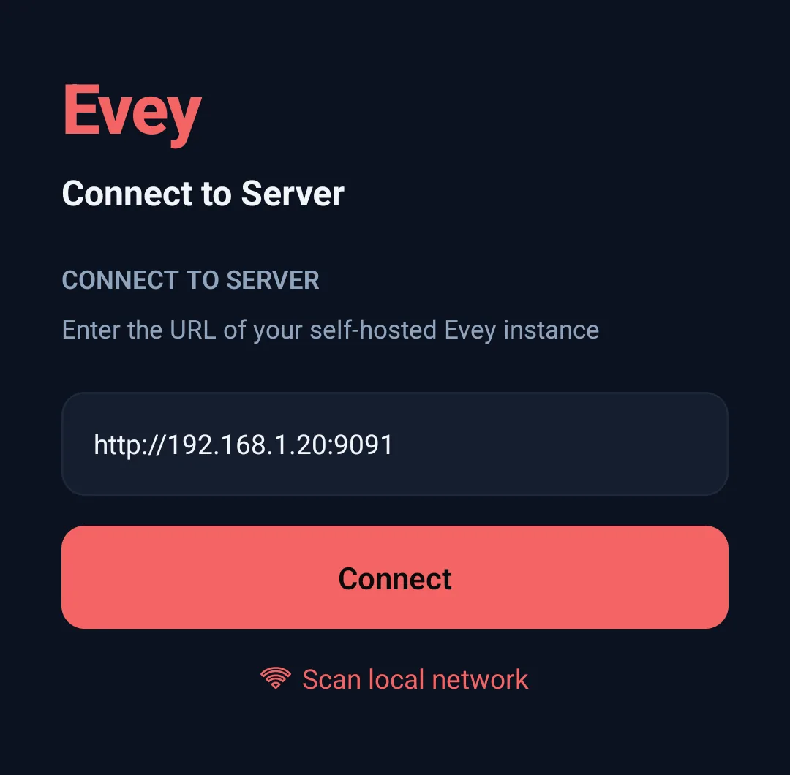
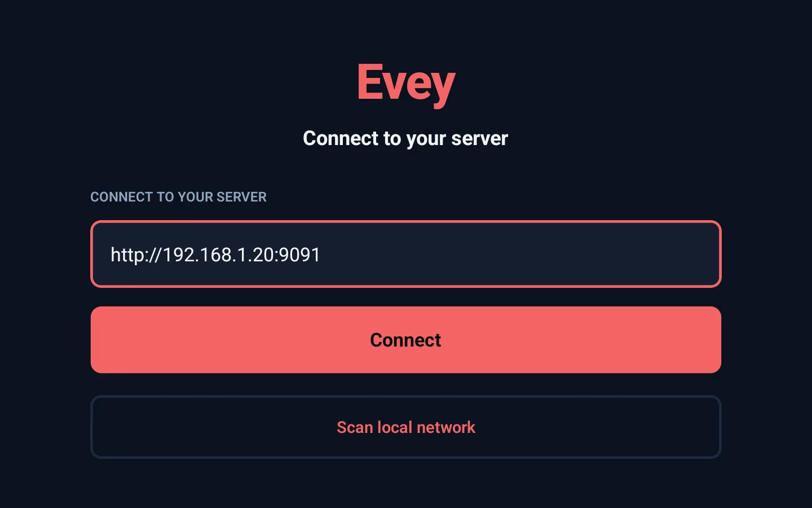

# Connect the apps

Your phone or your TV is asking for the address of your Evey server? This
page tells you what to type, and what to do when it does not work.

Each app connects to your own Evey server, at home. You type its address
once, sign in, and choose your profile. Where you stopped, what you watched
and your favourites are kept on the server, so they follow you from one
device to the next.

- **Web browser**: nothing to install. Open the server's address. The admin
  panel is there too, for administrators.
- **Android** (phone, tablet) and **Android TV**: the Evey apps. They are in
  testing and not on Google Play for everyone yet.
- **Chromecast**: no app. You cast from the web player in Chrome, or from the
  Android app.

## The server address to enter

**Ask the person who runs Evey for the address.** It looks like this:

```text
http://192.168.1.20:9091
```

Then, in the Android or Android TV app:

1. The first screen says **Connect to Server**. Type the address in the
   **Server URL** field, exactly as given: with `http://` at the start and
   `:9091` (or another number) at the end.
2. Press **Connect**.
3. Sign in with your username and password. On a TV, you can use
   [Quick Connect](#quick-connect-signing-in-a-tv-without-typing-a-password)
   instead.
4. Choose your profile.

<div class="evey-shot-pair" markdown>

<figure class="evey-shot" markdown="span">
  { loading=lazy data-gallery="connect" }
  <figcaption>The Android app: the address of the server at home, with http:// and the port.</figcaption>
</figure>

<figure class="evey-shot" markdown="span">
  { loading=lazy data-gallery="connect" }
  <figcaption>The Android TV app: the same address, typed with the remote or found by the scan.</figcaption>
</figure>

</div>

The address depends on where you are:

| Where you are | What to type |
| --- | --- |
| At home, on the same Wi-Fi as the server | The home address, for example `http://192.168.1.20:9091`. A name also works if your router knows it, for example `http://nas:9091`. |
| Away from home | The public address, starting with `https://` and usually without a port, for example `https://evey.example.org`. It exists only if the person who runs Evey has set it up. |

Type nothing after the port: no `/api`, no other path. A `/` at the end is
removed for you.

??? info "For the person who runs the server: where the address comes from"

    - **The IP** is the one of the computer or NAS running Evey, on your home
      network. Find it in your router's list of devices, or on that machine
      (`ip a` on Linux, `ipconfig` on Windows, `ifconfig` on macOS). It is
      never the phone's own IP.
    - **The port** is the number on the left of the `ports:` line in your
      compose file: `9091` with the file from
      [Install](../installation.md#the-compose-file).
    - **`http://`** is normal at home. `https://` is only for the public
      address, set in **Admin → Remote Access → External URL**: see
      [Remote access and HTTPS](../administration/remote-access.md).

As long as no server is saved, the connect screen also explains what is
asked (**Evey runs on a server someone set up for you. Enter its web
address - the same one you open in a browser.**) and offers **Where do I
find my server's address?**, which leads to this page. The phone opens it in
the browser; the TV writes the page's address on screen, to open on another
device.

### Scan local network: what it finds and what it does not

**Scan local network**, under the field, looks for an Evey server at home
for you. It can take up to a couple of minutes. Each server found is listed
with its name, its address and its version. Tap one to fill in the field,
then press **Connect**. If nothing is found, the screen says **No server
found on this network - enter the address below**: type the address
yourself.

The scan does not find a server when the phone is on mobile data, on a guest
Wi-Fi, or on another network than the server.

??? info "Exactly what the scan tries"

    It tries `http://` on every address of four common home networks
    (`192.168.1.x`, `192.168.0.x`, `10.0.0.x` and `172.16.0.x`, hosts 1 to
    254), on ports `9091`, `8096` and `8920`, fifty at a time, with a
    2-second wait each. So it also misses a server on another network range
    (`192.168.2.x`, `10.1.x.x`...), on another port, or reachable only over
    HTTPS. The apps do not use mDNS or Bonjour, and do not read the phone's
    own network range: these four ranges are fixed.

### When the connection fails

Every failure opens a box titled **Connection failed**. Find the message in
this table:

| Message (Android) | What it means | What to do |
| --- | --- | --- |
| **Start the address with http:// or https://.** | The address has no `http://`. | Type `http://` before the address. |
| **This connection is not encrypted** | You typed `http://` for an address outside your home. Your password and the video would cross the internet unprotected. | Press **Cancel** and use the `https://` public address. **Connect anyway** is there if you know what you are doing. |
| **No response from ... within 8s.** | Nothing answers at that address. | Check that the server is on, that the address and the port are right, and that the phone is on the same Wi-Fi. |
| **Couldn't reach ...** | Wrong address or port, `http`/`https` mixed up, or another network. | Same checks. At home, try `http://` instead of `https://`; for a public address, the other way round. |
| **TLS/certificate problem reaching ...** | The server's HTTPS certificate is not accepted. | At home, use `http://`. For a public address, the server needs a proper certificate. |
| **... answered "HTTP 404 ..." instead of a healthy Evey server.** | Something answers, but it is not Evey: there is a path after the port, or another program uses that port. | Remove everything after the port, and check the port number. |
| **... answered, but it is not an Evey server.** | Another page answered: a Wi-Fi login page, your internet provider's page, or another program. | Check the address. On a public Wi-Fi, sign in to its login page first. |
| **Remote access disabled** | You are outside the home, and the server does not accept connections from outside. | Ask the person who runs Evey. They turn it on in **Admin → Remote Access**: [Remote access and HTTPS](../administration/remote-access.md). |

On Android TV the messages are shorter: **Server returned 404** when
something other than Evey answers, and the raw network error when nothing
answers. The causes and the checks are the same. The TV also needs the
`http://` (a bare `192.168.1.20:9091` fails), but it does not warn about
`http://` towards a public address.

If the server does not answer when you open the app later, the app comes
back to this screen and lists the saved server. On the TV, it adds **Your
server did not answer. It may be asleep or off the network.** Once the server
is back on, choose it again.

### Changing or adding a server later

Both apps can remember several servers. The connect screen lists them under
**Your servers**, with the one in use marked **Current** (Android) or
**Active** (Android TV), and **Add another server** below. Tap a saved server
to reconnect without typing the address again. Each server keeps its own
sign-in.

- **Android.** On the connect screen, each saved server has a delete button
  (you confirm, and its sign-in is cleared). The sign-in screen has **Change
  server**. Once signed in, **Settings → Servers** opens **Manage Servers**:
  tap a server to switch to it, **Rename** it, or **Delete** it. You cannot
  delete the only saved server.
- **Android TV.** **Settings → Change server** signs the TV out and goes back
  to the connect screen; the sign-in screen has the same button. On the
  connect screen, **Manage Servers** renames or deletes a saved server.

## Quick Connect: signing in a TV without typing a password

Typing a password with a remote is slow. Quick Connect lets you approve the
TV from your phone or computer instead.

1. On the TV's sign-in screen, choose **Quick Connect** (marked **Recommended
   for TV**). The TV shows a 6-character code, a QR code, and how long the
   code is valid.
2. Approve the code from a device where you are already signed in, in one of
   these ways:
    - **In a browser**: **Settings → Quick Connect**, type the code in
      **Device Code**, press **Authorize Device**.
    - **In the Android app**: **Settings → Quick Connect**, then **Scan QR
      Code** with the camera, or type the code and press **Authorize
      Device**.
    - **With the phone's camera**: scan the QR code. It opens the server's
      Quick Connect page in the browser. If you are signed in there, the code
      is already filled in; if not, sign in first, then type the code.
3. Within a few seconds, the TV is signed in to the same account.

The Android app's sign-in screen offers Quick Connect too, for a phone where
you would rather not type your password.

## What each app adds

- **Web.** Keyboard shortcuts in the player (press `?` to list them),
  notifications in the browser (see [Notifications](../notifications.md)),
  and the admin panel.
- **Android.**
    - **Downloads**, to watch without a connection. A downloaded title stays
      playable for 30 days without contacting the server. It only opens for
      profiles allowed to see it: a kids profile cannot open a film
      downloaded by another profile if it is above its age limit. When the
      administrator turns it on, the app also offers a smaller copy, prepared
      by the server, for a film too large for the phone
      (`downloads.quality_choice`, see
      [Playback delivery and downloads](../environment/playback-delivery.md)).
    - **Casting** to a Chromecast.
- **Android TV.** A screen made for the remote.

**Play on**, in the web and Android players, sends what you are watching to
another Evey app that is open and signed in to the same account. Playback
continues there.

## Keeping the apps up to date

When your Android or Android TV app is older than the version that goes with
your server, it tells you:

- the Android app shows **Update available:** and the version at the top of
  the screen (never over the video);
- the TV shows it in its top bar.

Press it to open the app's Play Store page. The Play Store does not always
update apps by itself (only when the device is idle and on Wi-Fi, and it can
be turned off), which is why this notice exists. When the app is up to date,
or the server is older than this feature, nothing is shown. The web app never
needs an update: the server provides it.

## Which device plays what

Each app tells the server what its device can play. For each title, the
server then decides whether to send the file as it is or to adapt it. So the
same film can go untouched to a TV and be converted for an older phone. The
player's **Stream info** panel shows what was decided and why: see
[How playback is decided](../playback/how-playback-is-decided.md). Casting
has its own rules: see [Casting](../playback/casting.md).

<!-- sources
connect screen, checks and messages (Android): frontend/apps/mobile/app/server-connect.tsx - handleConnect, describeConnectError, handleSelectServer ; frontend/apps/mobile/src/lib/privateHost.ts - isPrivateHost, isCleartextToPublicHost, confirmInsecureServer ; frontend/packages/api/src/remoteAccessError.ts - remoteAccessDisabledMessage ; i18n mobile.serverConnect.*, auth.remoteAccess.*
connect screen (TV): frontend/apps/tv/app/server-connect.tsx - handleConnect (no scheme check, no cleartext warning, "Server returned N") ; unreachable banner: frontend/apps/tv/app/index.tsx
boot back to the screen: frontend/apps/mobile/app/index.tsx ; frontend/apps/tv/app/index.tsx
probe and identity: frontend/packages/client/src/native/server-config.ts - probeServerHealth ; frontend/packages/client/src/lib/serverIdentity.ts - parseEveyHealth ; internal/adapters/driving/http/health_handler.go (name, version)
scan: frontend/packages/client/src/lib/network-scan.ts - scanLocalNetwork (subnets, COMMON_PORTS, TIMEOUT_MS, BATCH) ; no mDNS anywhere in frontend/apps/mobile, frontend/apps/tv, frontend/packages/client
server list: @evey/store useServerListStore ; frontend/apps/mobile/app/(auth)/manage-servers.tsx ; frontend/apps/mobile/app/(auth)/(tabs)/settings.tsx - handleManageServers ; frontend/apps/mobile/app/login.tsx (Change server) ; frontend/apps/tv/app/(auth)/(tabs)/settings.tsx - handleChangeServer ; frontend/apps/tv/app/login.tsx ; i18n mobile.servers.*, mobile.settings.changeServer
port: docs/installation.md compose ports line ; cmd/evey/main.go - httpPort
quick connect: frontend/apps/tv/app/quick-connect.tsx (displayCode last 6 chars, qrValue /quickconnect?code=, polling) ; frontend/apps/tv/app/login.tsx (recommendedForTV) ; frontend/apps/web/src/routes/_auth/quickconnect.lazy.tsx ; frontend/apps/web/src/routes/_auth/profile/settings.lazy.tsx (quick-connect tab) ; frontend/apps/mobile/app/(auth)/(tabs)/settings.tsx (scanQr, authorize) ; frontend/apps/mobile/app/(auth)/qr-scan.tsx ; frontend/apps/mobile/app/quick-connect.tsx ; i18n auth.settings.quickConnect.*
offline window and profile check: frontend/apps/mobile/src/lib/offlineAccess.ts - OFFLINE_DOWNLOAD_TTL_MS
reduced copy (off by default): cmd/evey/http.go (downloads.quality_choice) ; i18n downloads.reduced.*
connect hint and help link, shown with no saved server: frontend/apps/mobile/app/server-connect.tsx - serverHelpUrl, WIKI_LOCALES ; frontend/apps/tv/app/server-connect.tsx - serverHelpUrl ; i18n mobile.serverConnect.hint, mobile.serverConnect.whereToFind, mobile.servers.yourServers
delete from the connect screen (Android): frontend/apps/mobile/app/server-connect.tsx - handleDeleteServer ; i18n mobile.servers.deleteConfirmTitle, mobile.servers.cantDeleteOnlyServer
update notice: internal/adapters/driving/http/health_handler.go (clients) ; scripts/client-release-ldflags.sh ; frontend/packages/client/src/native/appUpdate.ts - newerClientRelease ; frontend/apps/mobile/src/components/UpdateBanner.tsx (not on /player) ; frontend/apps/tv/src/components/TopHeader.tsx ; i18n mobile.appUpdate.available
play on: i18n player.playOn.* (used by frontend/apps/web and frontend/apps/mobile, not frontend/apps/tv)
connect screen title on both apps: i18n mobile.serverConnect.title ; frontend/apps/tv/src/i18n/offlineStrings.ts (seeded before any server answers) ; frontend/packages/client/src/native/i18n.ts - initI18n
-->
