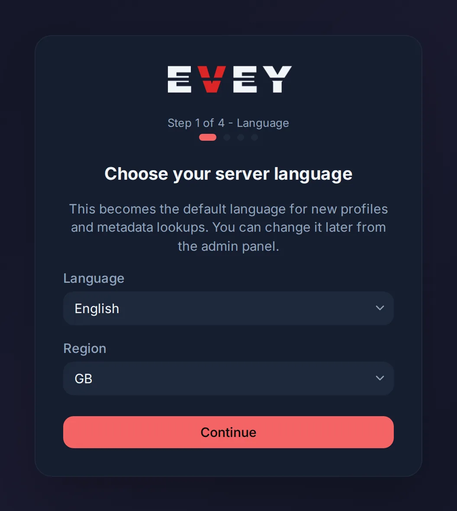
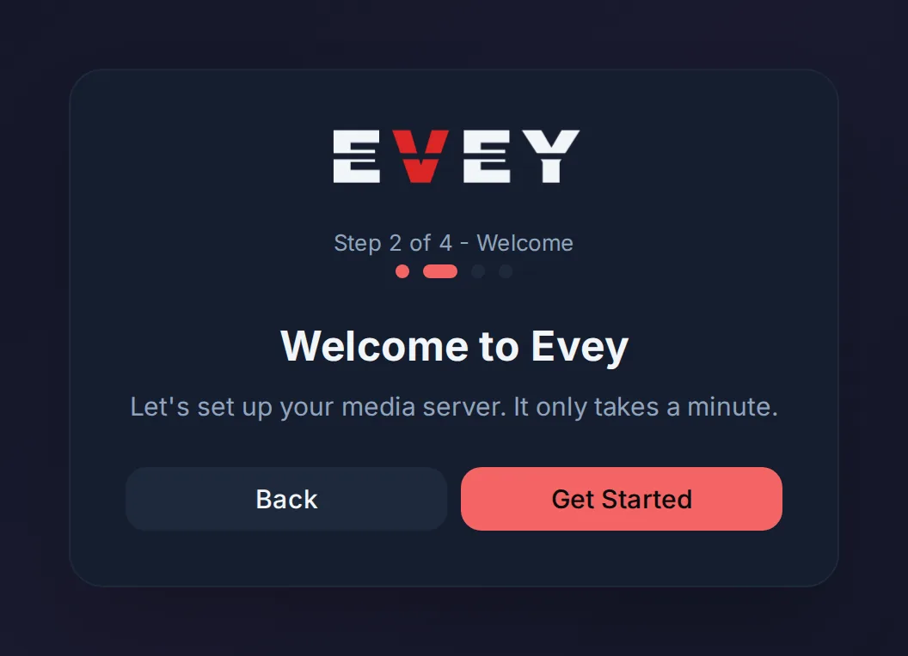
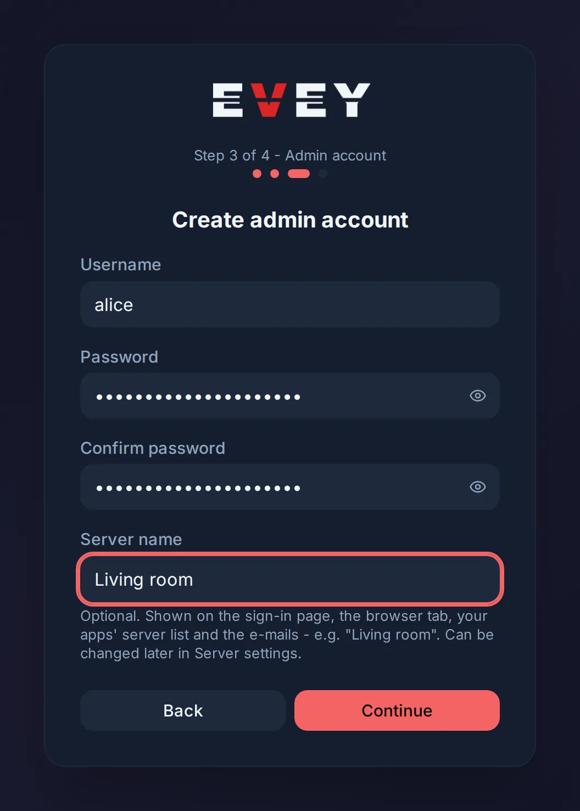
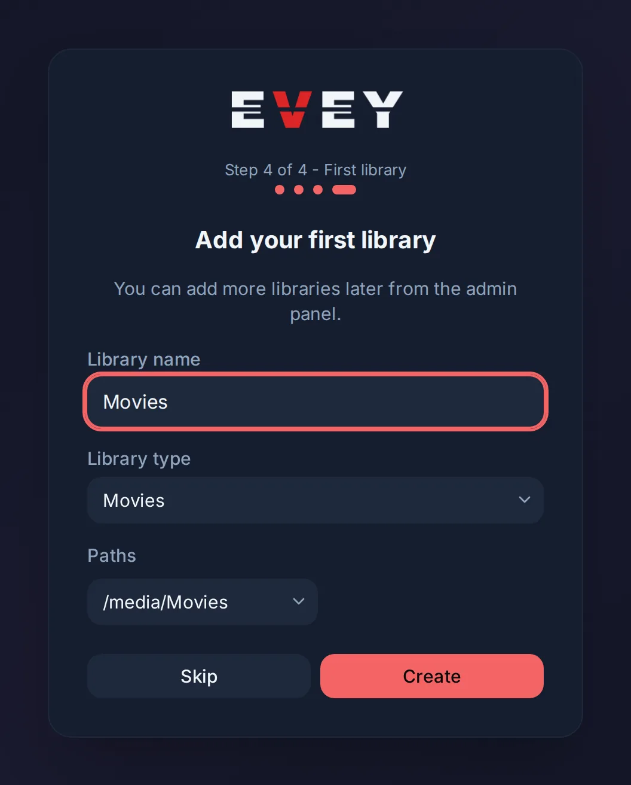
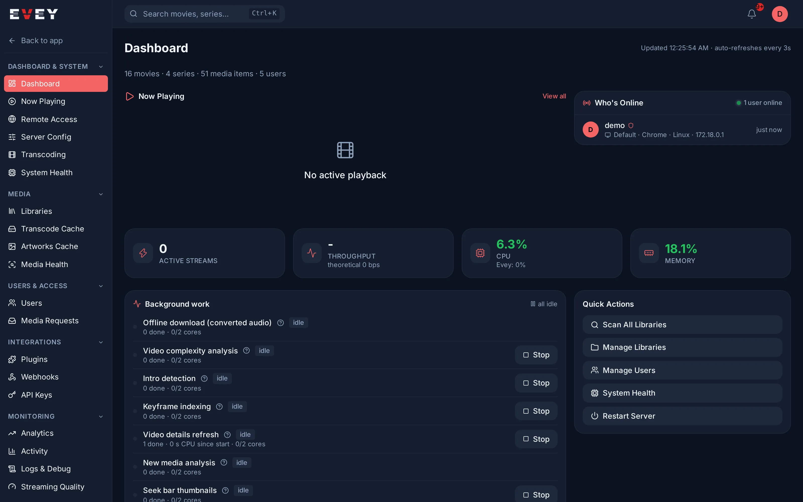

# First setup

The server is running and you opened `http://<server-address>:9091` in a
browser (which address: [The address to open next](../installation.md#the-address-to-open-next)).
Four steps remain before people can watch: the setup wizard, the libraries,
the users, and the apps.

## 1. The setup wizard

As long as the server has no administrator, every address on it opens on the
wizard: a single card with the Evey logo, a line **Step 1 of 4 - Language**
and four dots that fill in as you go. It only asks four things and takes a
minute.

### Step 1 of 4 - Language

The card is titled **Choose your server language**. Two drop-downs:

- **Language**: becomes the default language of new profiles and of the
  metadata the server fetches (titles, summaries, genres). The wizard itself
  switches to it at once.
- **Region**: pre-filled from the language; it drives content ratings and
  regional preferences. **Automatic** is available.

Both can be changed later in the admin panel. Press **Continue**.

### Step 2 of 4 - Welcome

**Welcome to Evey** and one sentence. Press **Get Started** (or **Back**).

<figure class="evey-shot" markdown="span">
  { loading=lazy data-gallery="setup" }
  <figcaption>Step 1: the language of the server, and the region used for content ratings.</figcaption>
</figure>

<figure class="evey-shot" markdown="span">
  { loading=lazy data-gallery="setup" }
  <figcaption>Step 2: nothing to fill in.</figcaption>
</figure>

### Step 3 of 4 - Admin account

The card is titled **Create admin account**:

| Field | Rule |
| --- | --- |
| **Username** | At least 3 characters. |
| **Password** | At least 8 characters. |
| **Confirm password** | Must match. |
| **Server name** | Optional. Shown on the sign-in page, in the browser tab, in the apps' server list and in e-mails, for example "Living room". Can be changed later in **Admin → Server Config → Server Name**. |

Press **Continue**. This creates the account and signs you in: from this
moment the server has an administrator and the wizard will not be offered
again.

### Step 4 of 4 - First library

The card is titled **Add your first library**:

- **Library name**, for example "Films".
- **Library type**: **Movies**, **Shows**, **Music** or **Photos**.
- **Paths**: a drop-down listing the folders mounted into the container as
  `/media`, `/media2`...; choose one, or **Enter custom path...** to type a
  path such as `/media/movies`. When no `/media` folder is mounted, the
  drop-down is replaced by a text field.

Press **Create** to start the first scan, or **Skip**: both lead to the home
page. Libraries can be added at any time from the admin panel (next section).

<figure class="evey-shot" markdown="span">
  { loading=lazy data-gallery="setup" }
  <figcaption>Step 3: the administrator account; the server name is optional.</figcaption>
</figure>

<figure class="evey-shot" markdown="span">
  { loading=lazy data-gallery="setup" }
  <figcaption>Step 4: a name, a type, and a folder seen from inside the container.</figcaption>
</figure>

??? note "Opening the address once an administrator exists"

    The same address opens on the sign-in page, and `/setup` sends you there
    too. If two people reach the wizard at the same time, the second one's
    account is refused and the browser moves to the sign-in page.

<figure class="evey-shot" markdown="span">
  { loading=lazy }
  <figcaption>The administration once signed in: the dashboard, and every section in the side menu.</figcaption>
</figure>

## 2. Add your libraries

**Admin → Libraries → Add Library**: a name, a type (Movies, Shows, Music or
Photos) and one or more folders.

The folders are paths **inside the container**. With the compose file from the
installation, your media folder is `/media`: a film folder at
`/srv/media/films` on the host is `/media/films` for Evey.

The first scan starts on its own. New files are picked up as they appear, and
posters, summaries and cast arrive in the background, so a large library fills
in over a few minutes.

How files should be named, how scans work and how to correct a wrong match:
[Libraries and metadata](../administration/libraries.md).

## 3. Add the people

**Admin → Users** creates an account with a password you choose, or an
invitation link with which the person sets their own. Each account then creates
its profiles: one per person in the household, kids profiles included.

What an administrator can restrict per account, and how profiles and parental
control work: [Users, profiles and parental control](../administration/users.md).

## 4. Connect the apps

The web app is the address you already opened. The Android and Android TV
apps open on a screen that asks for the server address: type the **same
address as in the browser**, with `http://` and the port, for example
`http://192.168.1.20:9091`, then sign in. A TV can be signed in with a code
approved from a phone instead of a password.

How to find the address, what the automatic scan does, and what each error
message means: [The server address to enter](apps.md#the-server-address-to-enter).

## What the server does by itself

None of this needs a setting:

- **Playback.** Each device reports what it can decode, and the server chooses,
  title by title, between sending the file as it is, repackaging it, or
  re-encoding only what the device cannot play. See
  [How playback is decided](../playback/how-playback-is-decided.md).
- **Capacity.** On its first quiet moment the server measures how many videos it
  can transcode at once, with the processor and with any graphics card mapped
  into the container, and never admits more. The measurement takes a few
  minutes; a playback that needs a transcode meanwhile is asked to wait. See
  [Transcoding and server capacity](../playback/transcoding.md).
- **Remote access.** It opens when the server was given a public address, and
  stays closed otherwise. See
  [Remote access and HTTPS](../administration/remote-access.md).
- **Backups.** The database is dumped before every update that changes it. A
  regular schedule is one setting away: [Backups and updates](../backups.md).

## Before you share the address outside your home

1. Put the server behind HTTPS: Evey serves plain HTTP.
   [Remote access and HTTPS](../administration/remote-access.md).
2. Set a backup schedule, and keep a copy of `./evey-data`: it holds the
   database and the key that signs every session.
   [Backups and updates](../backups.md).

<!-- sources
wizard screens, order and buttons: frontend/apps/web/src/routes/setup.tsx (STEPS, StepDots, handlePickLanguage, validateAdmin, handleAdminSubmit, handleCreateLibrary) ; i18n auth.setup.* ; common.language, common.region.*, common.continue, common.back, common.skip, common.create
every address opens on the wizard until setupComplete: frontend/apps/web/src/routes/__root.tsx ; frontend/apps/web/src/routes/index.tsx ; /setup redirects to /login once complete, 409 on the admin step goes to /login: setup.tsx
folder drop-down: GET /api/v1/admin/fs/browse ; internal/adapters/driving/http/browse_handler.go - mediaBrowseGlob "/media*" ; i18n admin.libraries.paths, selectDirectory, enterCustomPath
library types: i18n auth.setup.libraryTypes (movies, shows, music, photos)
apps ask for the address: frontend/apps/mobile/app/server-connect.tsx ; frontend/apps/tv/app/server-connect.tsx
calibration at quiet moment, wait: internal/app/transcoding/calibration_service.go
remote access inference: docs/adr/0026-remote-access-inferred-from-a-published-url.md
pre-migration dump: internal/adapters/driven/postgres/migrate.go
-->
