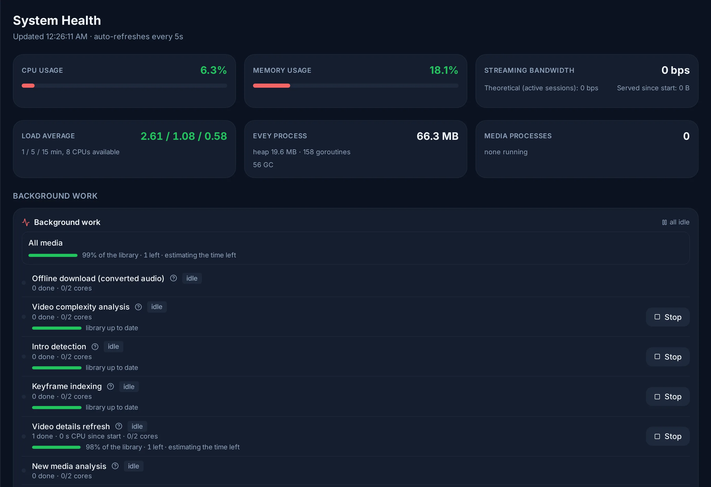

# Monitoring and logs

Where to see what the server is doing, for the administrator who wants to
check on it rather than fix something: from what plays right now to the
statistics of the month, with the logs in between. For a symptom to
investigate, start with [Troubleshooting](troubleshooting.md).

## What is playing now

**Admin → Now Playing** lists every stream in progress: who, what, on which
device, and how, track by track (copied, transcoded, and the backend encoding
it). An administrator can **Stop** a session or **Send message** to the
viewer.

The dashboard's **Who's Online** card lists who is connected right now, by
profile, with how long ago each app was last heard from. A Chromecast whose
television keeps Evey's receiver loaded stays listed after its playback has
ended and left **Now Playing**; **Stop this Chromecast** sends it a stop
command, which the television applies within 30 seconds.

**Admin → System Health** shows the processor, memory, bandwidth and storage,
and how much of the transcoding capacity is in use. It also lists the
machine's disks, each with the mean time a request waited over the last
minute, its busy share and its read and write rates. The wait is the figure
to watch: a disk can be 100 % busy and keep up, while one that makes every
request wait several times longer than it does at rest is what turns playback
into buffering, even when the processor looks idle. A disk is marked
**Saturated** when its wait is at least 20 ms and at least 2.5 times its wait
at rest, with either the disk busy or the processor waiting on it. The CPU card
says how much of the processor's time was spent waiting on disks.

**Trends** under the live cards draws the last 24 hours, 7 days or 30 days
from the samples the server records once a minute: processor and disk wait,
memory, the disk wait with its rest and saturation lines, the disks' busy
share and throughput, network in and out beside the streaming actually served,
streams and transcodes, and how full the library disks are. Processor, disk
and network figures are the whole machine's; a copy or a neighbouring service
reading the same disks shows there too. The dashboard carries a **Disks** tile
with the disk that waits the most.

<figure class="evey-shot" markdown="span">
  { loading=lazy }
  <figcaption><strong>Admin → System Health</strong>, with the background work running under it.</figcaption>
</figure>

## Logs

**Admin → Logs & Debug** searches the server's log and follows it live
(**Live**), narrowed with **Where** to one area (player and transcode, seek
index, subtitles, intro detection, Chromecast, auth, infrastructure...). It is
the first place to look when a user reports a problem.

The same log is on disk, one JSON file per day in `./evey-data/logs/`
(`/data/logs/evey-YYYY-MM-DD.log` in the container), kept 90 days by default.
`docker compose logs evey` shows only what the container prints while it
starts, which is what to read when the server does not come up. See
[Troubleshooting](troubleshooting.md#the-logs).

## How playback actually went

**Admin → Streaming Quality** is built from what the players report while they
play (buffer level, rebuffering, throughput, in the CMCD format): how often
viewers waited, the titles that stall most, and the kinds of device that
struggle, over the last day or week.

The server also acts on it. When one kind of source keeps making viewers wait,
it lowers the maximum quality for that kind of source for a while, on top of
the calibrated ceiling, then lifts the limit again on its own. The active
limits are listed under **Automatic quality limits**, with the reason and the
expiry; **Reset** drops one immediately.

## History and statistics

- **Admin → Analytics**: plays today and this week, active users, the most
  watched titles of the last 30 days.
- **Admin → Activity**: the history of plays and of administrative actions,
  and the background work in progress.

How long each kind of history is kept is set in **Admin → Server Config →
Server Settings** (play sessions, audit log, server metrics, streaming
quality). A change applies at the next daily cleanup.

## Prometheus metrics

`GET /metrics` serves the server's counters in the Prometheus text format, all
named `evey_...`. It answers an administrator session, or a fixed token set in
`EVEY_METRICS_SCRAPE_TOKEN` and sent as `Authorization: Bearer <token>`, so
that Prometheus or Grafana can scrape without signing in again
([Backups, logs and monitoring](../environment/logs-monitoring.md)). The
families worth a first chart:

| Metric | What it tells |
| --- | --- |
| `evey_transcodes_active`, `evey_transcode_queue_depth` | Background transcode jobs (outside live playback) running, and waiting for a slot. |
| `evey_hlsvod_sessions_active`, `evey_hlsvod_sessions_rejected_total` | FFmpeg processes producing playback segments, and starts refused because the server was at its limit. |
| `evey_hlsvod_cache_size_bytes`, `evey_hlsvod_cache_evicted_bytes_total` | Size of the segment cache on disk, and what the sweeper freed. |
| `evey_mkvgo_walks_in_flight`, `evey_mkvgo_plan_stats` | The in-process packager: windows being read, queued reads (`stat="slot_waits"`), see [MKVGo in Evey](../playback/mkvgo.md#load-replaced-files-and-updates). |
| `evey_http_requests_total`, `evey_http_request_duration_seconds` | Requests and latency by method and path. |
| `evey_watcher_alive`, `evey_scan_queue_depth` | Whether each library's folder watcher answered its last check (1 or 0), and files waiting to be scanned. |

## Command line

`evey admin doctor` checks the whole server in one report; the other
diagnostic commands are listed in [Command line](../runbooks/cli.md).

<!-- sources
who's online: frontend/apps/web/src/features/admin/DashboardOnline.tsx (presence heartbeat, profile names, idle, SendCastReceiverCommand) ; i18n admin.online.*
logs: internal/pkg/logger/logger.go - New (file only outside DevMode), rotatingWriter ; config EVEY_LOG_RETENTION_DAYS ; docker-compose.yml ./evey-data:/data
disks and trends: internal/pkg/sysinfo/diskio.go (DiskIO, DiskSaturated, SaturationAwaitMs) ; internal/app/activity/metrics_sampler.go (recordDisks, WithStorage) ; postgres server_metric_repo.go GetBucketed/IdleDiskAwaitMs ; proto ActivityService.ListServerMetrics, DashboardInfo.disks ; web features/admin/SystemTrends.tsx, DiskIO.tsx ; tests sysinfo diskio_test.go, SystemTrends.test.tsx
labels: i18n admin.sessions.*, admin.systemHealth.*, admin.logs.where.*, admin.logs.live, admin.qoe.*, admin.analytics.*, admin.activity.*, admin.serverSettings.*RetentionDays, retentionSweepHint
automatic limits: i18n admin.qoe.overrides.*
metrics: internal/pkg/metrics/metrics.go (names) ; internal/adapters/driving/http/auth_middleware.go - httpScrapeOrAdminMiddleware (Bearer scrape token or admin JWT) ; docs/adr/0018-cmcd-qoe-pipeline.md
-->
