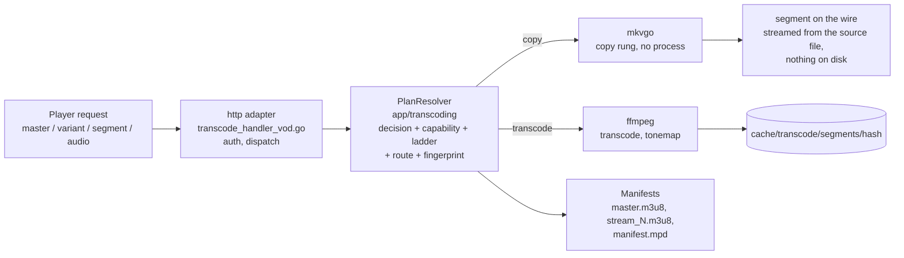

# Serving a video - the HLS playback path

What happens when a player asks for a video, from the first `master.m3u8`
request down to the bytes of a segment: the read path. The code is spread
across the `http` driving adapter (`internal/adapters/driving/http/transcode_*`),
the `app/transcoding` services and the `ffmpeg` / `mkvgo` / `prober` driven
adapters; no single function runs the whole flow, so this page is the map.
It is decided by [ADR-0030](adr/0030-one-plan-one-decision.md) (one plan, one
decision), [ADR-0024](adr/0024-playback-plan-resolver.md) (the plan resolver)
and [ADR-0029](adr/0029-transcoding-routes-are-measured-not-assumed.md)
(measured capabilities). It is the counterpart of the scan pipeline in
[Architecture](ARCHITECTURE.md) and the deep dive behind "Golden path 4" of
the [Codebase map](CODEBASE_MAP.md). For the user-facing view of the same
negotiation, read [How playback is decided](playback/how-playback-is-decided.md).

## The mental model: 3 questions, 2 engines, 1 key

Serving a video reduces to answering three questions, then packaging the
answer, with everything addressed by one hash.

| Question | Answered by | Where |
| --- | --- | --- |
| **Q1 - Can I read the file cheaply?** | probe dispatch by **file extension**: `.mkv/.webm` and `.mp4/.mov` go to [mkvgo](playback/mkvgo.md) (head-only, no process); everything else, and any fast-path failure, goes to ffprobe, the authority | `adapters/driven/prober/dispatcher.go` |
| **Q2 - Can the client play it as-is?** | the playback **decision**, taken per track: video `copy` vs `transcode`, audio `copy` vs `transcode` vs the wasm AC-3 path; video and audio are decided independently, and the common case is "copy the video, re-encode the audio to AAC" | `app/transcoding/decision.go` |
| **Q3 - How much can this host encode?** | the calibrated **capability** (measured at the first quiet moment) plus **admission** (which ladder rung fits, is there a slot) | `app/transcoding/calibration_service.go`, `admission_shaper.go` |

Two engines run through all of it:

- **mkvgo** reads and repackages (remux, on-demand) without spawning a process. Free.
- **ffmpeg / ffprobe** decode, re-encode and probe by spawning a process. Costly.

One key: everything (cache directory, ffmpeg session, segment URLs) is
addressed by the **decision fingerprint**, a hash of the decision. Same bytes,
same hash, one shared encode. The whole system's correctness rests on that
hash being **stable** between the manifest a player holds and every segment
it later fetches.

The two engines leave the server differently: a mkvgo segment is built on
request and written to the connection as it goes, so the copy path never
touches the segment cache; an ffmpeg segment is a file under the fingerprint's
directory, written once and served from there.

## Reading order - follow one request through the code

Open these in sequence to trace a single playback request end to end:

1. **Entry** - `internal/adapters/driving/http/transcode_handler_vod.go`:
   `serveHTTP` authenticates, then dispatches to master / variant / segment /
   audio.
2. **The plan** - `http/transcode_vod_plan.go` marshals the `*http.Request`
   into a transport-free `PlaybackRequest`;
   `app/transcoding/playback_plan_resolver.go` (`PlanResolver.Resolve`, the
   concrete `PlaybackPlanResolver` in `playback_plan.go`) returns one
   immutable `PlaybackPlan`: the decision (Q2), the ladder class, the shaped
   ladder, the hardware route, the packager and the fingerprint. Every
   manifest and segment of the session is served from it: manifest input,
   shed probe, stale-URL seal, producer pick and segment key all read that
   single resolution, so within a request the cache-hash invariant holds by
   construction (the segment hot path went from about 5 profile-preference
   fetches to 1). The source-fact helpers (codec, HDR, SAR, ten-bit...) live
   alongside in `source_facts.go`. `makeDecision` and `buildFingerprint` in
   `http/transcode_vod_fingerprint.go` are thin wrappers for the call sites
   without a plan (prewarm, on-demand master).
3. **Q2 - Decision** - `internal/app/transcoding/decision.go`:
   `MakePlaybackDecisionWithPrefs` (pure) is the per-track copy/transcode
   brain. The resolver layers on the request-time pins (`vd=` / `ad=`), the
   audio-resync override, etc.
4. **Q3 - Capability** - `internal/app/transcoding/calibration_service.go`:
   `Current()` returns `domain/transcoding.Derive(report, policy)`
   (`derive.go`), the host's ceilings derived from the last calibration.
5. **Ladder and admission** - the resolver shapes the ladder (complexity
   class, producer profiles, source/capability caps, CMCD/AV1 caps, admission
   route and ceiling), then **freezes it** on the admission pin
   (`admission_shaper.go`, `FreezeLadder`), read verbatim on every later call:
   the cache-hash invariant made structural. `video_session_limiter.go` holds
   the capacity slot; the route spills from hardware to software when full.
6. **Fingerprint** - a `DecisionFingerprint` (type and `Hash()` in
   `app/transcoding/segment_cache.go`), assembled by the resolver. The hash is
   the cache key.
7. **Producing the bytes** - copy: **mkvgo**, `app/transcoding/ondemand.go`
   (port) and `adapters/driven/mkvgo/ondemand.go`; transcode: **ffmpeg**,
   `adapters/driven/ffmpeg/hls_transcoder.go` (`BuildFFmpegArgs` is pure;
   segments land in `/cache/transcode/segments/<hash>/`).
8. **Packaging** - `app/transcoding/manifest_generator.go` writes
   `master.m3u8` / `stream_N.m3u8`; `manifest_generator_dash.go` writes
   `manifest.mpd`.

!!! warning "Across requests, the invariant rests on URL baking"
    Every input to the decision must be baked into the child URLs
    (`querySuffix` in `manifest_generator.go`), or a mid-play poll can flip
    the plan under the player. Per-session URLs are re-baked
    (`transcode_vod_manifest_rebake.go`) to carry the stream token, for HLS
    and DASH alike, including cookie-less Chromecast.

## The two engines, by cost

The **probe dispatcher** (`adapters/driven/prober/dispatcher.go`) is a
chain of responsibility keyed on extension: it tries mkvgo, and falls back to
ffprobe on any doubt (parse error, panic, unmappable result, a dropped MP4
media track, DoVi profile 5, unreadable colour). Both fast paths are always
on (nil gates in `wire.go`); ffprobe is the safety net, never bypassed. A
second, identical dispatcher (`keyframe_dispatcher.go`) handles the seek index.

| Operation | mkvgo (free) | ffprobe / ffmpeg (costly) |
|---|---|---|
| Metadata probe (codec, dims, HDR, bitrate, duration) | `.mkv/.webm/.mp4/.mov` head-only | everything else, or fallback |
| Frame-rate mode (cfr/vfr) | `AnalyzeFrameRateMode` | - |
| Remux MKV to MP4 (no re-encode) | `RemuxToMP4` | - |
| On-demand HLS/DASH (copy rung) | `OnDemandPackager` | - |
| Video re-encode / HDR tonemap | - | `hls_transcoder.go` |
| Interlace detect (idet), seek-landing, chromaprint, DoVi P5 | - (needs decode / side-data) | ffmpeg / ffprobe |

Three ffprobe forks still run on MKV/MP4 sources whose data mkvgo already
exposes, all in the `ffmpeg` driven adapter: the duration in `trickplay.go`,
bitrate and dimensions in `complexity_classifier.go`, the playback audio
delay in `audio_delay.go`.

## Audio is decided separately from video

`makeDecision` produces `VideoDecision` and `AudioDecision` independently.
The "copy rung" (`isCopyRequest`) is gated on the **video** only; even a
copied video usually carries a re-encoded AAC track alongside. The audio
decision has three outcomes:

| Outcome | What is served |
| --- | --- |
| copy | the source track as is |
| transcode to AAC | ffmpeg, light |
| the **wasm path**, for AC-3 / E-AC-3 on a browser that cannot decode it natively | the master is made video-only with an `#EVEY-AUDIO-URI` tag, the AC-3 is **copied** (mkvgo `od_audio` if the plan builds, else ffmpeg `-c:a copy`), and `ac3go.wasm` decodes it to PCM in the browser (`WasmAudioEngine.ts`), clock-locked to the video |

Safari is excluded from the wasm path by capability, not by name:
`canWasmDecodeAC3()` (`frontend/packages/client/src/web/codec.ts`) returns
true only when the browser reports it *cannot* play AC-3 natively, and Safari
reports it can.

## Packaging: CMAF, HLS, DASH

The container is always **CMAF** (fMP4): a per-variant `init.mp4` plus `.m4s`
segments (the MPEG-TS branch in `hls_transcoder.go` is dead:
`needsFMP4Segments` always returns true). Over the *same* segments:

- **HLS** (`master.m3u8`, `stream_N.m3u8`, `EXT-X-MAP` init + `.m4s`), both engines.
- **DASH** (`manifest.mpd`): on the mkvgo copy path the packager's own
  manifest (`OnDemandPlan.HasDASH`, byte-identical, zero storage, disabled
  under AES-128); on the ffmpeg path a manifest **declared from the plan**
  over the same fragments the HLS playlists address (`ManifestGenerator.MPD`),
  written before any fragment exists.

What makes the DASH manifest honest is the **segment grid**
(`domain/transcoding.SegmentGrid`): every transcoded rung is cut on the same
whole number of frames, `round(3 s x fps)` (72 at 23.976 fps, 75 at 25, 90
at 29.97), so a segment is exact in the video track's ticks and identical
across the switch set; the copy fallback declares its keyframe plan. A source
whose frame rate is unknown or variable stays on the legacy 3 s clock, keeps
HLS, and answers 404 on `manifest.mpd`. No client is switched to DASH: HLS
stays the default everywhere. mkvgo's `DASHFromCMAF` over the produced
fragments is the parity oracle (`internal/pkg/cmafparity`,
`TestDASHGridIntegration` at 23.976/25/29.97 fps: cold, seek, two-rung switch
set, separate audio within one AAC frame).

## Design patterns in play

| Pattern | Where |
| --- | --- |
| Ports and adapters (hexagonal) | the app layer talks to `StreamProber`, `BenchmarkRunner`, `OnDemandPackager`, `StreamProducer`; ffmpeg and mkvgo implement them, and a new engine is a new adapter |
| Strategy | `StreamProducer` (software / hardware / copy), picked by a `ProducerSelector` |
| Chain of responsibility with fallback | the probe and keyframe dispatchers (mkvgo, then ffprobe as the authority) |
| Content-addressed cache | the `DecisionFingerprint` hash keys the cache and the ffmpeg session |
| Pure core, imperative shell | `Derive`, `MakePlaybackDecision` and the cost model are pure, unit-tested without ffmpeg or a database |
| Immutable value object | `StreamPlan`, the admission decision, emitted once and never mutated, so the URLs-to-bytes invariant holds by construction |
| Graceful degradation | a safe fallback at every step: 720p default capability, hardware-to-software spill, copy-to-transcode, mkvgo-to-ffprobe |

<!-- sources
entry and plan: internal/adapters/driving/http/transcode_handler_vod.go - serveHTTP ; internal/adapters/driving/http/transcode_vod_plan.go ; internal/adapters/driving/http/transcode_vod_fingerprint.go - makeDecision, buildFingerprint ; internal/adapters/driving/http/transcode_vod_manifest_rebake.go
resolver: internal/app/transcoding/playback_plan_resolver.go - PlanResolver.Resolve ; internal/app/transcoding/playback_plan.go - PlaybackRequest, PlaybackPlan ; internal/app/transcoding/source_facts.go
decision and capability: internal/app/transcoding/decision.go - MakePlaybackDecisionWithPrefs ; internal/app/transcoding/calibration_service.go - Current ; internal/domain/transcoding/derive.go - Derive
ladder, admission, fingerprint: internal/app/transcoding/admission_shaper.go - StreamPlan, FreezeLadder ; internal/app/transcoding/video_session_limiter.go ; internal/app/transcoding/segment_cache.go - DecisionFingerprint ; internal/app/transcoding/stream_producer.go - StreamProducer, ProducerSelector
engines: internal/adapters/driven/prober/dispatcher.go ; internal/adapters/driven/prober/keyframe_dispatcher.go ; internal/app/transcoding/ondemand.go - OnDemandPackager ; internal/adapters/driven/mkvgo/ondemand.go ; internal/adapters/driven/ffmpeg/hls_transcoder.go - BuildFFmpegArgs, needsFMP4Segments ; internal/adapters/driven/ffmpeg/trickplay.go, complexity_classifier.go, audio_delay.go
packaging: internal/app/transcoding/manifest_generator.go - querySuffix, EVEY-AUDIO-URI ; internal/app/transcoding/manifest_generator_dash.go ; internal/domain/transcoding/segment_grid.go - SegmentTargetSeconds, gridFor ; internal/pkg/cmafparity ; internal/adapters/driven/ffmpeg/dash_grid_integration_test.go - TestDASHGridIntegration
wasm: frontend/packages/client/src/web/codec.ts - canWasmDecodeAC3
-->
