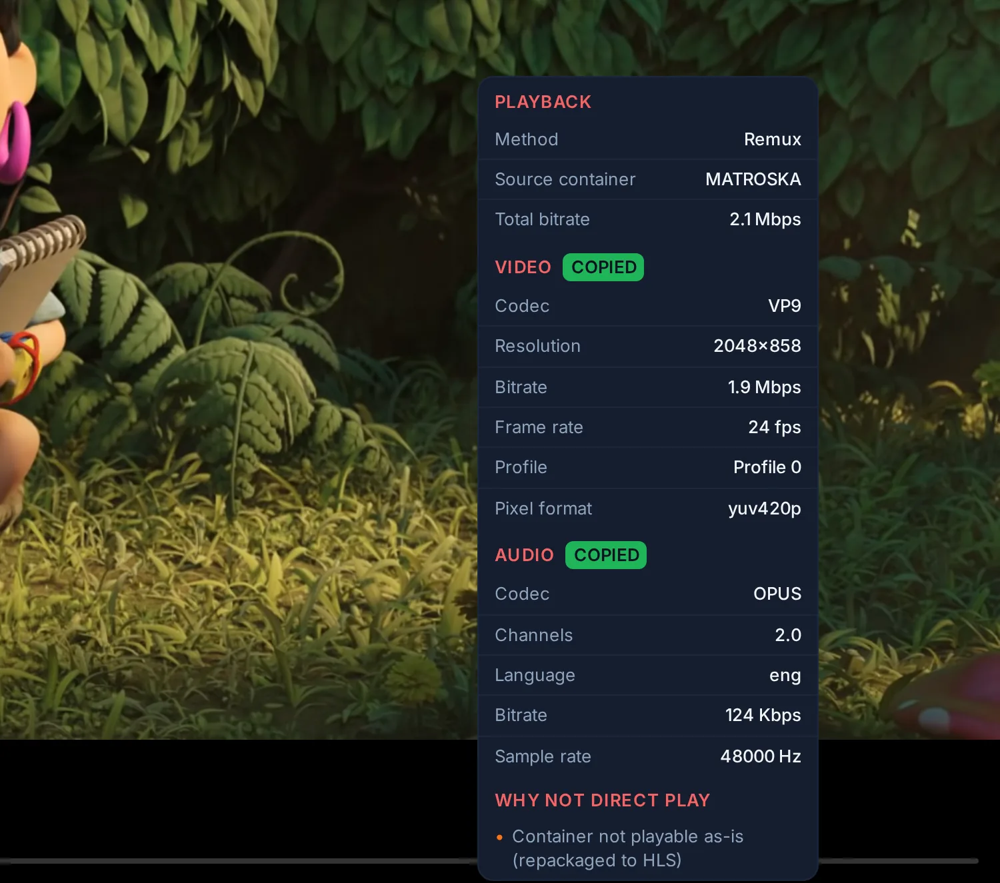

# How playback is decided

Why does a film play untouched on the TV but get converted on the phone?

**In short:**

- You never choose a quality. When you press play, the server looks at the
  file, at what your device can play, and at how busy it is. Then it picks
  the lightest way that works.
- There are three ways: **Direct Play** (the file as it is), **Remux** (the
  same picture and sound, repackaged in another file format), and
  **Transcode** (part of the film converted, often only the sound).
- So the same film can go untouched to one device and be converted for
  another, or play differently on the same device when the server is busy.
- You usually have nothing to do. To see which way you got, and why, open
  **Stream info** in the player: see [Reading Stream info](#reading-stream-info).

The three ways and how to read **Stream info** come first. The exact rules
the server applies follow, for the reader who wants to understand or tune
them.

## The three outcomes

| In Stream info | What the player receives | What it costs the server |
| --- | --- | --- |
| **Direct Play** | The original file, byte for byte. | A file read. |
| **Remux** | The original video and audio in another container. Nothing is re-encoded. | Repackaging, done by [MKVGo](mkvgo.md) inside the server where it can, by an FFmpeg copy otherwise. |
| **Transcode** | At least one track re-encoded. Often only the audio, with the video still the original. | An encode. Only a video re-encode takes a [transcoding slot](transcoding.md#sharing-the-capacity). |

The server tries them in that order, and within a transcode it re-encodes
only the tracks that need it.

## Reading Stream info

**Stream info** (the information button, (i), in the player's controls; on the
TV, in the player's options menu) shows the **Method**, then each track with
its decision (*copied*, *transcoded*, or *client-decoded* for audio the web
player decodes itself), and under **Why not direct play** the reasons.

<figure class="evey-shot evey-shot--narrow" markdown="span">
  { loading=lazy }
  <figcaption>Remux: the packaging changes, the video and audio tracks are left intact, and the panel shows the one reason the file is not played as it is. "Copied" describes the tracks, not the playback method.</figcaption>
</figure>

The reasons fall into four groups:

| Where the reason comes from | Examples as shown |
| --- | --- |
| The player cannot use the track as it is | Video codec this player cannot decode · Audio codec this player cannot decode · Resolution above the player's limit · More audio channels than this player supports · Pixel format the player cannot decode (10-bit H.264, 4:2:2) · Container not playable as-is (repackaged to HLS) |
| A limit on this session | Bitrate above the allowed limit · The line the client measured cannot carry the copy |
| A consequence for the picture or the sound | HDR converted to SDR (tone-mapping) · Subtitles burned into the picture · Audio resync requested |
| A setting or a decision already taken | Preferred video codec (profile setting) · Choice pinned for this session |

Only the audio track being played is judged. A file whose unselected
commentary track is in DTS is not transcoded because of it.

Stream info is computed when playback starts. The one case it cannot foresee
is a graphics card that is full at the moment the stream starts: the stream
then moves to the processor, and **Admin → Now Playing** shows the backend
actually used.

## What each side brings

**The file.** Codec, resolution, bit depth, HDR format, bitrate, and the audio
and subtitle tracks, read when the file was scanned.

**The player.** When playback starts, the app reports what its device can
decode: the codec families it supports, the containers it opens, its maximum
resolution, whether its screen displays HDR, how many audio channels it
outputs, and for some devices a lower ceiling or level for H.264. The web app
asks the browser; the Android and Android TV apps ask the device's decoders
and display. Evey keeps no list of supported devices: it uses what the player
reports. A cast session is described by the receiver itself when it can
report its capabilities, and by a conservative profile otherwise: see
[Casting](casting.md).

**The session.** The profile's preferences (maximum bitrate, maximum audio
channels, subtitle handling) and the limits that apply to this viewer, below.

**The server.** Whether it can encode this in real time, on its graphics card
or its processor, and whether a transcoding slot is free. This is measured,
not assumed: see [Transcoding and server capacity](transcoding.md).

## One file, three results

A 4K HEVC film in HDR10 at 70 Mb/s, with a Dolby TrueHD 7.1 track, played on
an Android TV whose decoder handles HEVC and whose screen displays HDR:

- **No bitrate limit.** The TV decodes the video and displays the HDR, so the
  video is kept as it is. It does not decode TrueHD, so only the audio is
  re-encoded. Stream info shows **Transcode**, with the video *copied*.
- **A limit of 20 Mb/s, and a graphics card that encodes HEVC 10-bit with
  HDR.** The video must be re-encoded to fit. The server re-encodes it in HEVC
  and keeps the HDR, because both the TV and the card can.
- **The same limit, with the graphics card busy or unavailable for this
  title.** The processor takes over. It encodes H.264, which carries no HDR
  here, so the picture is tone-mapped to SDR, at the quality the processor
  sustains.

The file and the TV did not change. The session limit and the server's state
did.

## Limits on the session

A title whose bitrate (video plus the audio track being played) is above the
lowest of these limits is transcoded down to it:

- the maximum the player reports;
- the account's **Max Bitrate**, set by an administrator;
- the profile's **Max Streaming Bitrate**, and its **Max Cellular Bitrate** when
  a phone reports a mobile connection;
- **Max Remote Bitrate** (**Admin → Remote Access**) and **Video bitrate
  ceiling, remote viewers** (**Admin → Transcoding**), the lower of the two,
  when the viewer's address is public and outside the **LAN Networks**. A
  private address is never capped.

The audio track being played is re-encoded when it has more channels than the
player reports or than the profile's **Max Audio Channels**. A re-encoded
track keeps up to 5.1 channels, never more: see [Audio](audio.md).

## Constraints the server applies itself

A few limits are not reported by players today and are applied by the server
as a conservative compatibility rule, the same for every player: 10-bit
H.264, and any video in 4:2:2, 4:4:4 or 12-bit, are re-encoded, while HEVC,
VP9 and AV1 up to 10-bit 4:2:0 are left to the player's codec support. Dolby
Vision is kept only in a form the player can display correctly: see
[HDR and Dolby Vision](hdr.md).

## Why the method rarely changes mid-film

The decision is taken when playback starts and kept for the session, so the
player never receives segments from two different encodings. Changing the
audio or subtitle track in a way that needs it, or restarting the title, takes
a new decision.

## Forcing a method

You cannot force a method: the server always picks it from the file and the
player. What you can hold down is quality, per device, with **Settings →
Playback → Data saver (this device)**. It caps the stream on that device only;
the account's other devices keep their own setting. **Off** sets no cap.
**Saver** asks for at most 720p, 3 Mbps and stereo sound. **Travel / low data**
asks for at most 480p, 1 Mbps and stereo sound. A title above the cap is
transcoded down to it, and Stream info shows the limit as the reason.

**Quality**, in the player's settings, is different: it chooses among the
qualities of a transcoded stream. **Auto** follows the connection; a height
(1080p, 720p...) holds that quality; **Original** removes the height limit
the player would otherwise ask for.

## Going further

- Criteria in detail: [HDR and Dolby Vision](hdr.md) · [Audio](audio.md) ·
  [Subtitles](subtitles.md) · [Casting](casting.md)
- How the server shares its capacity: [Transcoding and server capacity](transcoding.md)
- What runs inside the server without FFmpeg: [MKVGo in Evey](mkvgo.md)
- The implementation: [Playback pipeline](../playback-serving.md)

<!-- sources
decision: internal/app/transcoding/decision.go - MakePlaybackDecisionWithPrefs, evaluateVideo, pixelFormatPlayable, evaluateAudio, selectedAudioSpec, servedBitrateBps, resolveMaxBitrate, checkBitrate, applyAudioChannelTarget (aacMaxTargetChannels)

session: internal/app/transcoding/playback_plan_resolver.go - Decide, Reported, resolveDecided ; internal/app/transcoding/resolved_route.go - SpillReason (pool_full, title_blocked)
remote cap: internal/adapters/driving/grpcapi/playback_handler.go - resolvePlaybackPrefs ; internal/config/config.go - RemoteBitrateCapKbps
client caps: internal/domain/transcoding/playback_decision.go - ClientProfile ; frontend/packages/client/src/web/codec.ts ; frontend/packages/media-caps/src/castUrl.ts
example: internal/app/transcoding/testdata/route_golden.txt - "nvenc-pass | 2160p-hevc-hdr10-70m | hdr-tv{,-20m} | {plain,gpu-full,title-blocked}"
tone-map reported: internal/app/transcoding/route_tonemap_report_test.go
labels: i18n player.streamInfo.* ; player.quality.* ; auth.settings.playback.* ; admin.yaml maxBitrate (user limit) ; admin.remoteAccess.maxRemoteBitrate, lanNetworks ; admin.calibration.maxBitrateRemoteLabel
entry point: frontend/apps/web/src/features/playback/StreamInfoPanel.tsx ; frontend/apps/web/src/features/playback/PlayerSettingsPanel.tsx ; frontend/apps/mobile/src/components/player/PlayerControlsRow.tsx ; frontend/apps/tv/src/components/TrackOptionsMenu.tsx
adr: 0024, 0029, 0030
plain opening: docs/playback/transcoding.md ; i18n player.streamInfo.title
-->
