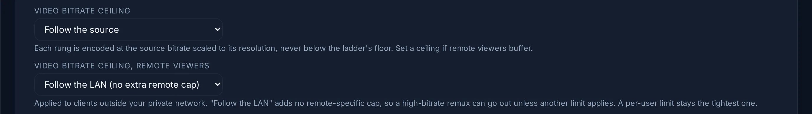

# Transcoding and server capacity

**In short:**

- **Transcoding** means converting a video into a form the device can play.
  It is the only heavy work the server does: playing a file as it is (Direct
  Play) or repackaging it (Remux) costs almost nothing. See
  [How playback is decided](how-playback-is-decided.md).
- You do not set how many people the server can serve. It measures itself
  at its first quiet moment, in a few minutes, and never accepts more.
- When it runs short, a new playback gets a lower quality, or moves from a
  busy graphics card to the processor. If neither has room, the player says
  **The server is busy transcoding other streams**.
- What you may want to do: give the server a graphics card
  ([Hardware acceleration](../administration/hardware-acceleration.md)), and
  keep free space on the disk that holds the cache
  ([The transcoding cache](#the-transcoding-cache)).

The rest of this page is for the administrator who wants the details: how
the server measures what it can encode, how it shares that capacity, and
what a viewer sees when it is full.

## The server measures itself

The capacity is not a setting you estimate. The server measures it:

- **When.** Not at startup: the server starts on what it knew before (or on a
  conservative 720p software default the first time), and runs the
  measurement at its first quiet moment, when nobody is watching and the
  processor is mostly idle. It takes a few minutes. A measurement taken under
  load is marked provisional and redone when the machine is idle.
- **What.** Real encodes of a 4K clip, in SDR and in HDR, on the processor and
  on each accelerator the server detected, in the same shape as a real
  playback. The result is the highest resolution each one sustains in real
  time, and the cost of each kind of stream.
- **Again.** After the hardware changes, or on **Recalibrate** in **Admin →
  Transcoding → Encode calibration**. The button refuses while someone is watching; only the automatic
  re-measurement waits for the server to be idle.

While the measurement runs, a playback that needs a transcode shows **The
server is calibrating itself** and is asked to try again shortly. Direct Play
and Remux are not affected.

On a processor that sustains none of the resolutions, the server still offers
720p (SDR) and 480p (HDR); how many streams that serves at once comes from
the video session limiter's budget.

The measurement uses, in this order, a clip you provide, a reference clip
downloaded once and checked by its SHA256, or a synthetic clip generated on
the spot. A real clip measures more honestly than the synthetic one, which
overstates the cost and can cap a machine lower than it deserves:

```yaml title="docker-compose.yml"
services:
  evey:
    environment:
      EVEY_BENCH_HDR_SAMPLE: /data/bench/my-4k-hdr.hevc
      EVEY_BENCH_SDR_SAMPLE: /data/bench/my-4k-sdr.hevc
```

## Sharing the capacity

**Live playback capacity** (**Admin → Transcoding**) is the number of video
streams that may be encoded at the same time. It is derived from the
measurement and adjusts on its own when the hardware changes. **Limit
simultaneous video streams** can lower it, never raise it.

- A transcode that only re-encodes the audio (video copied) uses no slot.
- A viewer changing quality keeps a single slot.
- Only the quality a viewer actually watches is encoded, not the whole ladder
  of qualities.

Each stream goes to the cheapest route that has proved it can serve it: an
accelerator measured on what the stream needs (for example HDR tone mapping,
or HEVC output), or the processor. The processor and the accelerators are two
separate pools, and a stream on the graphics card still spends a little
processor for its audio and packaging.

When room runs short, the server answers in this order:

1. **A lower quality.** A new stream whose tallest quality does not fit is
   admitted at the tallest one that does, and that ceiling holds for the
   whole stream.
2. **The processor.** When the accelerators are full, a new stream moves to
   the processor if it has room.
3. **A refusal.** When neither has room, the player shows **The server is
   busy transcoding other streams** and can retry.

A graphics card encode that fails on one title sends that title to the
processor for a while, for every viewer. The card itself is set aside only
after a test encode independent of the media fails on it too, and is tried
again later: see [Hardware acceleration](../administration/hardware-acceleration.md).

While someone watches, the server's own background work (thumbnails, intro
detection, media analysis) pauses, so that playback keeps the machine: see
[Background work and server load](../operations/background-work.md).

When one kind of source keeps making viewers wait despite all this, the server
lowers its maximum quality for a while, then lifts the limit on its own. See
[Monitoring and logs](../operations/monitoring.md#how-playback-actually-went).

## What is encoded

| | Default |
| --- | --- |
| Video codec | H.264. HEVC output when a measured route proves it and the player decodes it (the HDR passthrough route, or when the profile's **Preferred Video Codec** asks for it); AV1 when enabled (**AV1 output**, hardware only) and the player decodes it. |
| Resolution | The source's, unless a limit applies: the player's maximum, the bitrate limit, or what the server can encode in real time. |
| Bitrate | Follows the source, scaled to the resolution. **Video bitrate ceiling** caps it; **Video bitrate ceiling, remote viewers** caps it lower outside the local networks. |
| Audio | AAC. See [Audio](audio.md). |
| Delivery | HLS, in fragmented MP4 segments. |

<figure class="evey-shot" markdown="span">
  { loading=lazy }
  <figcaption>The two ceilings of <strong>Admin → Transcoding</strong>: for every viewer, and for viewers outside the local networks.</figcaption>
</figure>

## The transcoding cache

Encoded segments are kept on disk in the `evey-cache` volume and reused when
another viewer, or the same one later, plays the same title with the same
decision. **Admin → Transcode Cache** shows its size and clears it; the
**Transcode cache budget** (**Admin → Transcoding**) caps
it. **Clear All** also removes the subtitles extracted from your files,
kept in `./evey-data/subtitles`: they are extracted again on request.

**When the disk fills up.** The server keeps a margin of free space on the
disk that holds the cache: 2 GiB by default, set with
`EVEY_TRANSCODE_CACHE_MIN_FREE_MB` (`0` turns the margin off). Below it, the
oldest segments no one is watching are evicted first. If that does not free
enough, a segment that does not exist yet is refused with a delay after which
the player may ask again, instead of starting an encoder that would fail for lack
of space; segments already on disk are still served. The extracted subtitles
in `./evey-data` follow the same margin: below it, new ones are no longer
kept, each request extracts them again, and the administrators receive
**Subtitle cache full** (at most once an hour, also sent to webhooks as
`transcoding.derived_cache_full`).

!!! tip
    Clear the cache after an update that changes how videos are encoded, so
    that nobody is served segments from the previous version. Clearing it
    while someone watches makes their stream rebuffer once, then resume.

## Checking what happens

- **Admin → Now Playing**: every stream, its method track by track, and the
  backend encoding it.
- **Admin → Transcoding → Encode calibration**: the measured ceilings and the
  accelerators in use.
- **Admin → Streaming Quality**: how playback went for real viewers.
- **Load test** (**Admin → Transcoding**): simulates viewers to measure what
  the server sustains. It refuses to run while anyone is watching.

<!-- sources
disk floor: cmd/evey/wire.go (EVEY_TRANSCODE_CACHE_MIN_FREE_MB, DefaultMinFreeBytes, SetWriteFloor, SetSubtitleCacheWriteFloor, OnSubtitleCacheFloorHit) ; internal/app/transcoding/segment_cache_admit.go - AdmitWrite, tryOnDemandEvict, ErrCacheFull ; internal/adapters/driving/http/transcode_vod_admission.go (503 + Retry-After) ; internal/domain/transcoding/events.go - DerivedCacheFull ; i18n notifications.cache_full
clear all empties extracted subtitles: internal/app/transcoding/service.go - WithDerivedCachePurge ; internal/adapters/driving/http/subtitle_cache.go - SubtitleCachePurger (/data/subtitles)
calibration: internal/app/transcoding/calibration_service.go - EnsureCalibrated, Recalibrate, idleProbes, idleCPUPercent ; internal/domain/transcoding/capability.go - SafeFallback ; internal/adapters/driven/ffmpeg/benchmark.go - swBenchLadderSpecs (floors 720/480), sample order (path > url+sha256 > synthetic) ; docs/adr/0029-transcoding-routes-are-measured-not-assumed.md ; i18n player.calibrating, admin.calibration.contendedLine, transcodesActiveToast
capacity: i18n admin.transcoding.livePlaybackTitle, maxVideoSessionsDesc, videoSessionsAutoAdjusts ; internal/app/transcoding/admission_shaper.go - VideoAdmissionShaper, StreamPlan ; internal/app/transcoding/video_session_limiter.go - VideoSessionLimiter (PoolCPU, PoolGPU) ; internal/app/transcoding/resolved_route.go - SpillPoolFull, SpillTitleBlocked ; internal/app/transcoding/hw_route_blocklist.go ; CalibrationService.DemoteCapability
busy: i18n errors max_concurrent_reached
output codec: internal/app/transcoding/resolver_route.go ; internal/app/transcoding/decision.go ; internal/app/transcoding/testdata/route_golden.txt ; i18n admin.calibration.av1Label, av1Hint, maxBitrateLabel, maxBitrateRemoteLabel
single variant: internal/config/config.go (EVEY_TRANSCODING_SINGLE_VARIANT, default on)
bench samples: internal/config/config.go (EVEY_BENCH_{SDR,HDR}_SAMPLE{,_URL,_SHA256})
cache budget, clear while live: i18n admin.serverSettings.transcodeCacheMaxGB, admin.transcodeCache.clearConfirmLiveSessions ; automatic limits: admin.qoe.overrides.*
load test: i18n admin.loadtest.idleWarning, errorActiveStreams
plain opening, busy message: i18n errors max_concurrent_reached ; internal/app/transcoding/admission_shaper.go - VideoAdmissionShaper.GrantRoute
-->
