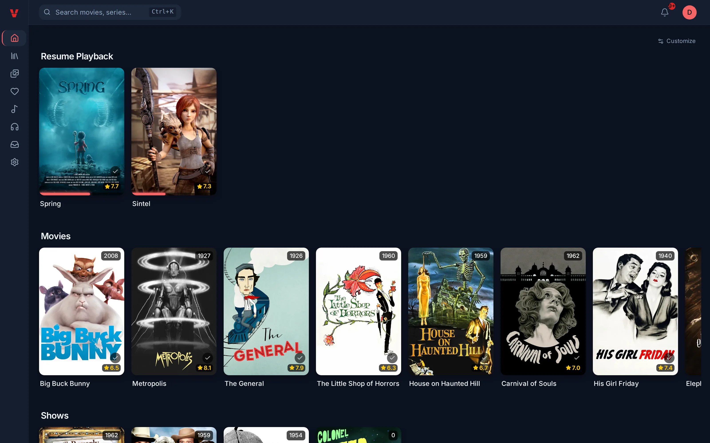
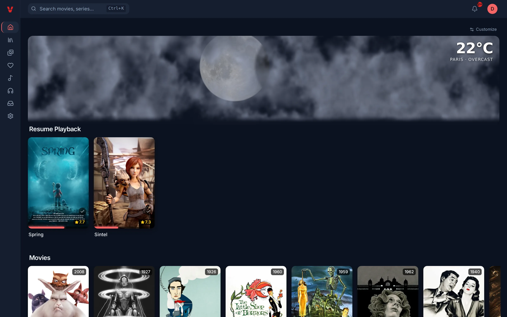
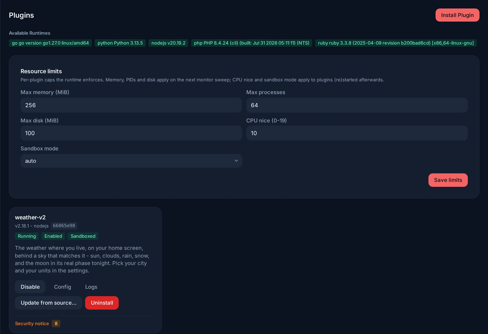
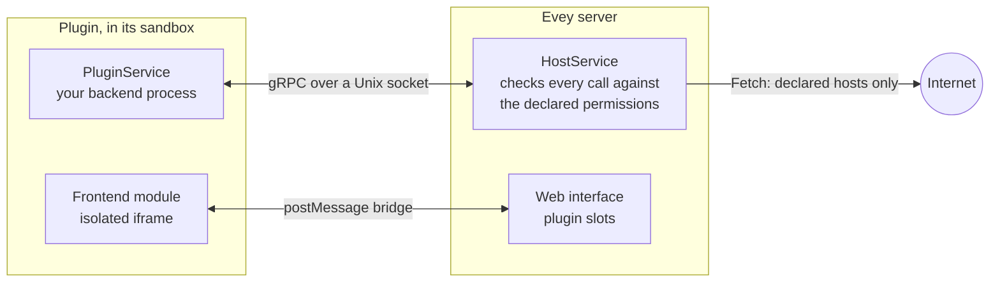

# Plugins

Plugins add to Evey what it does not do by itself: metadata sources,
notification channels, webhook receivers, home-page sections, player
overlays, and themes. Each plugin is a separate process that talks to the
server through a local socket, confined by a sandbox and limited to the
permissions its manifest declares. Its interface, if it has one, runs in an
isolated frame of the page.

<figure class="evey-shot" markdown="span">
  { loading=lazy }
  <figcaption>Without plugins.</figcaption>
</figure>

<figure class="evey-shot" markdown="span">
  { loading=lazy }
  <figcaption>With the example weather plugin: a section at the top, drawn in its own frame.</figcaption>
</figure>

## Installing and managing plugins

**Admin → Plugins** installs a plugin from its ZIP file. Before anything is
installed, the preview shows:

<figure class="evey-shot" markdown="span">
  { loading=lazy }
  <figcaption><strong>Admin → Plugins</strong>: the runtimes available, the resource limits, and one card per plugin.</figcaption>
</figure>

- the permissions the plugin declares, the slots of the interface it wants to
  appear in, and the hosts it will contact;
- what the static analysis found in its code;
- its signature, when the server checks signatures.

A plugin whose analysis finds a critical pattern is refused. An update of an
installed plugin goes through the same preview; when it asks for new
permissions, slots or hosts, you must accept the difference explicitly.

Each plugin then has, on its card: enable or disable, update, logs, and its
resource limits (memory, processes, disk, CPU priority). The **Host sandbox**
line of the **Security Dashboard** shows the sandbox mode actually in
force on this host: see
[Plugin sandbox setup](plugins/sandbox-deployment.md) if it shows `basic`.

Plugins are enabled by default. `EVEY_PLUGINS_ENABLED=false` turns the
subsystem off entirely.

## What a plugin can and cannot do

A plugin sees its own directory and not the server's data, has no direct
network access (a plugin allowed on the network reaches only the hosts it
declared, through the server), and cannot start processes unless it declares
the `subprocess` permission. The permissions a plugin can ask for are listed in
[Permissions and slots](plugins/security-model.md). How the sandbox works, and
what it still cannot prevent, is described in
[Security model and plugin sandbox](SECURITY.md).

Review a third-party plugin before installing it, as you would any software:
once a host is on a plugin's list, the server cannot inspect what the plugin
sends to it.

## Writing a plugin

A plugin can be written in any language its `entrypoint` can launch.
Generated gRPC stubs ship for Python, Node.js, PHP, Ruby, Dart, Java and
Swift; Go stubs are generated with `protoc-gen-go`; compiled binaries need the
`native-binary` permission.

| Page | Contents |
| --- | --- |
| [Writing a plugin](plugins/dev-setup.md) | Prerequisites, first plugin, the install loop, signing, distribution. Start here. |
| [Plugin API reference](plugins/api-reference.md) | The manifest, the backend calls and data store, the `evey.*` frontend bridge, capabilities. |
| [Permissions and slots](plugins/security-model.md) | What a manifest may declare, what is checked at install, the external fetch rules, the slots. |
| [Themes](themes.md) | Restyling the interface with CSS and a sandboxed script. |
| [Webhooks and API keys](webhooks-api-keys.md) | Integrating Evey with other tools without writing a plugin. |

<!-- sources
install preview, update ack: docs/plugins/security-model.md (Update workflow) ; internal/app/plugin/install.go
resource limits, security card: i18n admin.plugins.resourceLimits.*, admin.plugins.security.* ; docs/plugins/sandbox-deployment.md
languages: docs/plugins/dev-setup.md (Per language)
fetch broker: internal/adapters/driving/pluginhost/fetch.go - Fetch
-->
