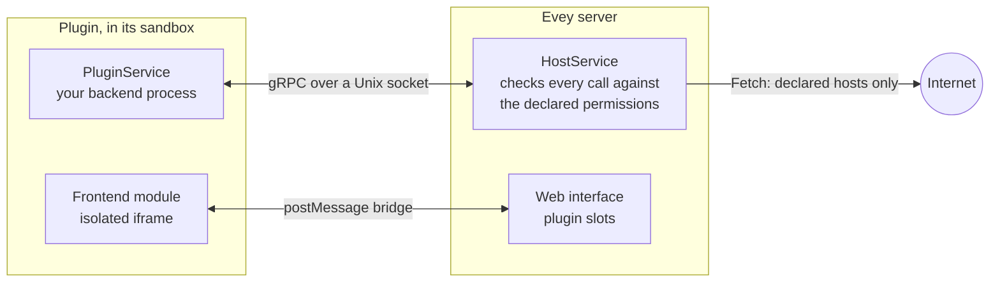

# Writing a plugin

This page takes a developer from a clone of Evey to a plugin running on a
local server, then to a signed package other administrators can install. The
tutorial in [section 3](#3-your-first-plugin-step-by-step) is the happy path;
the rest is reference you will come back to. The calls and fields themselves
are in the [Plugin API reference](api-reference.md).



A plugin is a ZIP with a `plugin.yaml` at its root and a backend process the
server starts in a sandbox. The process serves a small gRPC service on a Unix
socket and calls the server back on another one. It may also ship an interface
module, drawn in a sandboxed frame of the page, and talk to the outside world
only through the server, to the hosts it declared.

## 1. Prerequisites

| Tool | Why |
|---|---|
| Go 1.27, Node.js 22 with pnpm, Docker with Compose | The dev stack (`make dev`) builds the server and the web app. |
| `bubblewrap` (`bwrap`) | Only for the `bubblewrap` and `strict` sandbox modes. The default `auto` mode uses Landlock and needs nothing on a kernel 5.13 or later. |
| [cosign](https://docs.sigstore.dev/cosign/installation/) | To sign your package before distributing it ([section 7](#7-sign-your-plugin)). Not needed to develop. |

Pick the language of your plugin from the runtimes the server can start:
`python`, `nodejs`, `php`, `ruby`, `lua`, `bash` and `sh` need their
interpreter in the image, `go` ships a compiled binary and needs the
`native-binary` permission. The default image carries Python, Node.js, PHP, Ruby and Lua; the
`-nodejs` image keeps Python and Node.js and the `-lean` image keeps Python only. A
manifest that names a runtime the image lacks is refused at install, with the
list of the runtimes available.

The gRPC contract is one file, `proto/plugin/v1/plugin_api.proto`. Only
the Python SDK ships generated stubs; the other languages under
`sdk/<language>/` hold the `.proto`. The server copies the files of your
language next to your entrypoint when the plugin starts. The image provides
`grpcio` to Python plugins, so a Python plugin has nothing to vendor. A
Node.js plugin must vendor its `node_modules` (`@grpc/grpc-js` and
`@grpc/proto-loader`) in the package. For another language, generate stubs
with `protoc` and ship them in the ZIP:

```bash
protoc --proto_path=proto \
       --<lang>_out=OUT_DIR --grpc_<lang>_out=OUT_DIR \
       proto/plugin/v1/plugin_api.proto
```

`make plugin-sdk` regenerates the shipped stubs; each `sdk/<lang>/README.md`
names the gRPC plugin its language needs.

## 2. Bring up Evey locally

```sh
git clone git@github.com:eveyproject/evey.git
cd evey
cp .env.dev.example .env.dev   # then set MEDIA_DIR, EVEY_DB_PASSWORD, MEILI_MASTER_KEY
make setup                      # once: adds evey.test to /etc/hosts
make dev                        # postgres, meilisearch, the server (Air), the web app (Vite)
```

Open `https://evey.test`. The setup wizard creates the administrator account
on first launch, as described in [First setup](../getting-started/first-setup.md).
Plugin files land in `./evey-data/plugins/<plugin-id>/`, mounted as
`/data/plugins` in the container.

## 3. Your first plugin, step by step

The example `examples/plugins/nodejs-example` is the smallest complete plugin:
it serves `PluginService`, dials `HostService`, and writes a line in its log
when the server starts it. We copy it, change one thing, and install it.

1. **Copy the example.**

    ```sh
    cp -r examples/plugins/nodejs-example ~/hello-plugin
    cd ~/hello-plugin
    ```

2. **Give it a name.** Edit `plugin.yaml`:

    ```yaml title="plugin.yaml"
    name: hello-plugin          # unique, kebab-case
    kind: plugin
    version: 1.0.0              # semver: bump it at every upload
    description: Says hello in its log
    author: you
    language: nodejs            # the runtime the server must have
    entrypoint: node main.js    # the command line the server runs
    permissions:
      - api.library             # lets the backend read media items
    ```

    `language` tells the server which runtime to check and which stubs to
    copy; `entrypoint` is what it runs, in the plugin's directory, with the
    environment of the next step.

3. **Read `main.js`.** The server passes three variables to the process:
   `EVEY_PLUGIN_ID`, `EVEY_PLUGIN_SOCK` (the socket *your* process must listen
   on, serving `PluginService`) and `EVEY_HOST_SOCK` (the socket you dial to
   call `HostService`). The example loads `plugin_api.proto` from its own
   directory, where the server copied it, and implements the five methods of
   `PluginService`. Change the message in `Initialize`:

    ```js title="main.js (excerpt)"
    Initialize(call, callback) {
      hostLog("LOG_LEVEL_INFO", `hello from ${process.env.EVEY_PLUGIN_ID}`);
      callback(null, { success: true });
    },
    ```

4. **Zip it.** The manifest must sit at the root of the archive, not in a
   sub-directory:

    ```sh
    zip -r ../hello-plugin.zip . -x ".*"
    ```

5. **Install it.** In **Admin → Plugins**, **Install Plugin**, choose the ZIP
   and **Preview & Install**: the preview lists `api.library` and the result
   of the static analysis. Through the API, the same upload is:

    ```sh
    curl -F "plugin=@hello-plugin.zip" \
         -H "Authorization: Bearer $EVEY_TOKEN" \
         https://evey.test/api/v1/admin/plugins/upload
    ```

6. **Read the log.** On the plugin's card, **Logs** shows the line written by
   `Initialize`. `docker compose logs evey` carries the server side of the
   same start, under the plugin's id.

7. **Iterate.** Change the code, bump `version`, zip again and use **Update
   from source…** on the card. An upload with the same or a lower version is
   refused; a new permission in the manifest triggers the consent step the
   administrator must approve.

What you have is the whole backend contract. From here, a plugin grows in
three directions: calling the server (`HostService`, section 4), drawing an
interface (section 5), and reaching the outside world (section 6).

## 4. Call the server from the backend

Every `HostService` call carries the plugin's identity: the server checks the
process on the socket by its PID, and an interceptor refuses any call whose
permission the manifest does not declare. Three groups need no permission at
all:

- `Log` writes to the plugin's log, shown on its card;
- `GetConfig` reads the values the administrator set in **Config** (declared
  in `config_schema`), `SetConfig` lets the plugin keep its own keys there;
- `GetData` / `SetData` / `DeleteData` / `ListDataKeys` is the plugin's
  private key/value store, wiped at uninstall.

`GetMediaItem` and `ListMediaItems` need `api.library` or `media.read`;
`Fetch` needs `network`. The full table, with the methods declared in the
contract but not served yet, is in the
[API reference](api-reference.md#hostservice-what-the-plugin-can-call).

## 5. Add an interface

An interface is a JavaScript module the page loads in a sandboxed frame, in
one of the slots the server allows. Declare where the files are and where the
module goes:

```yaml title="plugin.yaml"
web_root: dist               # the directory served as static assets
frontend:
  - slot: home.section       # see the slot list
    src: dist/index.js       # must be under web_root
```

The module gets a `window.evey` bridge: `evey.onInit` hands it the plugin's
config, the locale, the theme and the surface it landed on; `evey.resize`,
`evey.toast` and `evey.navigate` act on the page within fixed limits; and,
when the manifest declares `prefs` or `public`, `evey.prefs.*` and
`evey.media.*` reach the server through a short-lived token the host holds for
the frame. `examples/plugins/weather` is a complete widget with a build step;
`examples/plugins/data-demo` shows `prefs`, `public` and the `admin.nav` slot.
The bridge and the slots are described in the
[API reference](api-reference.md#frontend-api).

## 6. Reach the outside world

A plugin process can open no socket to the internet, in every mode where the
launcher runs (`basic` without the launcher only denies `execve`). The
only way out is the `Fetch` call of `HostService`: the server checks the
target against the manifest, then performs the request itself.

```yaml title="plugin.yaml"
permissions:
  - network
external_fetch:
  - api.open-meteo.com       # bare hostnames: no scheme, no wildcard, no IP
```

`network` without `external_fetch` is refused at install. At run time the
broker accepts `http` and `https`, `GET` and `HEAD`, answers up to 8 MiB
within 20 seconds, and refuses private or reserved addresses even through a
redirect. The frame of the interface gets the same host list as its
`connect-src`, so a widget may call those hosts directly over `https`. The
rules are in [Permissions and slots](security-model.md#external-fetch-rules).

!!! note "Hosts are a contract with the administrator"
    The administrator sees the host list at update and on the Security
    Dashboard, and must approve any addition at update. Keep it to what the plugin needs, and say in your
    README what each host receives.

## 7. Sign your plugin

!!! info "What a signature proves"
    A signature says the ZIP the administrator installs is byte for byte the
    one **you** published, signed with the key they trust. It says nothing
    about what the plugin does: the permissions, the hosts and the analysis
    of the preview still apply. Evey checks it offline and in process (ECDSA
    P-256 over the SHA-256 of the ZIP, the format `cosign sign-blob --key`
    produces): no `cosign` binary on the server, no network, no transparency
    log.

You need [cosign](https://docs.sigstore.dev/cosign/installation/) on your
machine only.

1. **Once: generate a key pair.**

    ```sh
    # choose a real passphrase; cosign.key stays private, never commit it
    COSIGN_PASSWORD="your-passphrase" cosign generate-key-pair
    # -> cosign.key (private) and cosign.pub (the file you hand out)
    ```

2. **At each release: zip, then sign** the exact file you will distribute.

    ```sh
    cd hello-plugin && zip -r ../hello-plugin.zip . && cd ..

    COSIGN_PASSWORD="your-passphrase" cosign sign-blob \
      --key cosign.key --tlog-upload=false --yes \
      --output-signature hello-plugin.zip.sig \
      hello-plugin.zip
    ```

3. **Check it before shipping**, with the same verification the server does:

    ```sh
    cosign verify-blob --key cosign.pub --signature hello-plugin.zip.sig \
      --insecure-ignore-tlog hello-plugin.zip      # -> Verified OK
    ```

4. **Publish three files together**: `hello-plugin.zip`,
   `hello-plugin.zip.sig` and `cosign.pub`. Put the public key's fingerprint
   somewhere your users can compare it (README, release notes), so they know
   `cosign.pub` was not swapped.

On the instance that installs it, the administrator sets the key and a policy
and restarts the server:

```sh
EVEY_PLUGINS_COSIGN_PUBLIC_KEY=/etc/evey/cosign.pub
EVEY_PLUGINS_COSIGN_POLICY=warn   # or "enforce" to refuse what does not verify
```

Then, in **Admin → Plugins**, they choose the ZIP and, in **Signature file
(.zip.sig, optional)**, its `.zip.sig`; through the API, the signature is the
`sig` field of the upload. **Signed** or an invalid signature is shown at update, and the Security
Dashboard keeps the result.

Things that trip people up:

- **Any change to the ZIP breaks the signature**, even re-zipping the same
  files. Sign the file you distribute, and sign again for every version.
- **Only ECDSA P-256 keys are accepted**, which is what `cosign
  generate-key-pair` makes. Keyless signing and KMS references are not
  verified.
- The key is read from a PEM file at startup: a missing or malformed file
  stops the server instead of failing the first install. With `enforce` and
  no key, the server refuses to start.
- With the default `warn` and no public key configured, **nothing is
  verified**; the server only logs a warning at startup.
- A wrong key, a tampered ZIP and a missing `.sig` all read as a failed
  signature: under `enforce`, the install or the update is refused.

## 8. What the installer checks, in order

Every step can refuse the package; the administrator sees the reason, and the
server log carries the detail.

1. **Manifest.** `plugin.yaml` is read straight out of the ZIP: required
   fields, semver, known permissions and capabilities, slots in the allowed
   list, `external_fetch` entries that are bare hostnames, `web_root` present
   when `frontend` is declared. The declared `language` must be a runtime of
   the image.
2. **Version and escalation.** For a plugin already installed, the new
   version must be higher, and any new permission, capability, slot or host
   stops the install here until the administrator approves the difference
   (`accept_permission_changes=true` on the upload route).
3. **Signature and hash.** The signature is verified when a public key is
   configured; a failure blocks only under `enforce`. The hash of the ZIP is
   recorded, and checked again when an update previewed earlier is applied.
4. **Extraction** into a staging directory: at most 5,000 entries, 100 MB per
   file, 500 MB in total, a compression ratio of 100:1, no symbolic link, no
   path leaving the archive. An update never touches the running version
   until every later step passes.
5. **Themes only:** the stylesheet is sanitized and written back, and a
   `theme.js` that matches a forbidden pattern refuses the package.
6. **Static analysis** of every text file: a critical finding refuses the
   package; the `deserialization` and `obfuscation` warnings refuse it too,
   and `native_code`, compiled binaries and embedded archives refuse it unless
   the manifest declares `native-binary`.
7. **Persist and start.** The staging directory is swapped into place, the
   row is written, and the process is started.

What the analysis looks for is listed in
[Plugin sandbox and threat model](../SECURITY.md#static-analysis). Comments
are stripped before the analysis, so a commented-out line is not reported.

## 9. What your process runs under

The server starts the process under a lower CPU priority, with a memory
ceiling, a limit on processes and threads, and a size limit on its directory;
a monitor stops a plugin that exceeds them. The defaults are 256 MiB, 64
processes and 100 MiB, adjustable by the administrator in **Admin → Plugins →
Resource limits**. Without the `subprocess` permission, the process cannot
spawn children, whatever the language; threads work.

In every mode where the launcher runs, the sandbox confines the filesystem to
the plugin's directory and cuts every network socket (`basic` without the
launcher only denies `execve`). Which mode is in force depends on the host,
not on the plugin: [Plugin sandbox and threat model](../SECURITY.md#sandbox-modes)
describes them, and [Plugin sandbox setup](sandbox-deployment.md) tells an
administrator which to pick.

## 10. Distribute a plugin

There is no catalog: an administrator installs a plugin by uploading its ZIP
or pasting its URL in the admin panel, from wherever you publish it (a release
on a forge, your own site).

- Ship the ZIP, its `.sig` and your `cosign.pub` together (section 7).
- State the permissions and the `external_fetch` hosts in your README: the
  administrator sees the permissions at install and the hosts at update and on
  the Security Dashboard, and has to approve them; a surprise
  there is the first reason an install is refused.
- To have your plugin listed with the bundled examples, open a pull request
  against `examples/plugins/` with the source and a README. Examples are
  reviewed and built from source; a listing is not an endorsement and carries
  no signature from the project.

## 11. Troubleshooting

| Symptom | Cause | Fix |
|---|---|---|
| `plugin requires "nodejs" runtime which is not installed in this image` | The image variant lacks the interpreter. | Use the default or `-nodejs` image, or write the plugin in Python. |
| `manifest: external_fetch entry "*.tmdb.org" is a wildcard - use explicit hostnames` | Wildcards are refused at install, no exceptions. | List every hostname you need (`api.tmdb.org`, `image.tmdb.org`). |
| `manifest: frontend slot "admin.section" not allowed` | The slot is outside the allowed list. | Pick a slot from the [slot list](api-reference.md#slots); `admin.nav` is the only admin-area slot. |
| `manifest: network permission requires non-empty external_fetch` | `network` declared without hosts. | Add the hosts, or drop the permission. |
| `plugin already installed at version 1.0.0, new version must be higher` | The ZIP carries the installed version. | Bump `version`, or uninstall first. |
| `signature does not match the plugin or the configured key` | The `.sig` was made with another key, or the ZIP changed after signing. | Re-sign the exact ZIP with the right key, or fix `EVEY_PLUGINS_COSIGN_PUBLIC_KEY`. |
| `plugin blocked: theme.js contains forbidden pattern` | The theme script scanner matched a banned API. | A theme may only call `evey.theme.*`: see [Themes](../themes.md#what-the-scanner-refuses). |
| The log ends with `memory quota exceeded (... MB > ... MB)` | The monitor stopped the plugin past its memory limit. | Lower memory usage, or raise **Max memory (MiB)** in **Resource limits**. |
| `bwrap: ... permission denied` | `bubblewrap` mode inside Docker, blocked by the container's seccomp or AppArmor profile. | Keep the default `auto` mode. Otherwise see [Plugin sandbox setup](sandbox-deployment.md). |
| The interface module does not appear | The plugin is disabled, the slot is misspelled, or `src` is not under `web_root`. | Check the card's state, the slot name, and the `/api/v1/plugins/<id>/assets/...` requests in the browser's network panel. |

<!-- sources
runtimes, image variants: internal/adapters/driven/pluginrunner/runtime_availability.go - runtimeBinaries, compiledLanguages ; internal/app/plugin/install.go - parseAndValidateManifest ; Dockerfile (RUNTIMES lean/nodejs/full)
stubs copied at start, NODE_PATH: internal/adapters/driven/filesystem/plugin_fs.go - CopySDKStubs ; internal/adapters/driven/pluginrunner/runner_start.go ; sdk/python/README.md ; examples/plugins/nodejs-example/package.json
dev stack: DEV.md (Quick Start) ; Makefile - setup, dev ; docker-compose.yml (evey-data/plugins:/data/plugins)
example: examples/plugins/nodejs-example/main.js, plugin.yaml
env vars: internal/adapters/driven/pluginrunner/runner_start.go (EVEY_PLUGIN_ID, EVEY_PLUGIN_SOCK, EVEY_HOST_SOCK)
upload route, fields: internal/adapters/driving/http/plugin_asset_handler.go (plugin, sig, accept_permission_changes)
host RPC permissions: internal/adapters/driving/grpcapi/plugin_interceptor.go ; peer auth: internal/adapters/driving/pluginhost/peer_creds.go
host RPCs: internal/adapters/driving/pluginhost/host_server.go - Log, GetConfig, SetConfig, GetData ; fetch.go - Fetch (GET/HEAD, maxFetchBytes, fetchTimeout)
frame connect-src: frontend/packages/client/src/plugins/hostProtocol.ts - buildConnectSrc ; internal/adapters/driving/http/plugin_frame_handler.go - pluginFramePolicy
bridge: frontend/packages/client/src/plugins/bridgeScript.ts - EveyBridge
cosign: internal/adapters/driven/pluginrunner/cosign.go - loadP256PublicKey ; internal/config/config.go - CosignPolicy validation
install order: internal/app/plugin/install.go - installLocalZip, parseAndValidateManifest, resolveExistingPlugin, verifyPluginIntegrity, extractPluginToStaging, validateStagedPlugin, checkEscalatedWarnings, swapAndPersistPlugin ; update.go - ApplyUpdate ; zip limits: docs/SECURITY.md (ZIP extraction)
resource limits: internal/config/config.go - Plugins ; internal/adapters/driven/pluginrunner/runner_resmon.go ; i18n admin.plugins.resourceLimits.*
error texts: internal/adapters/driven/pluginrunner/manifest.go ; internal/domain/plugin/model.go ; internal/app/plugin/install.go ; cosign.go ; runner_resmon.go
-->
