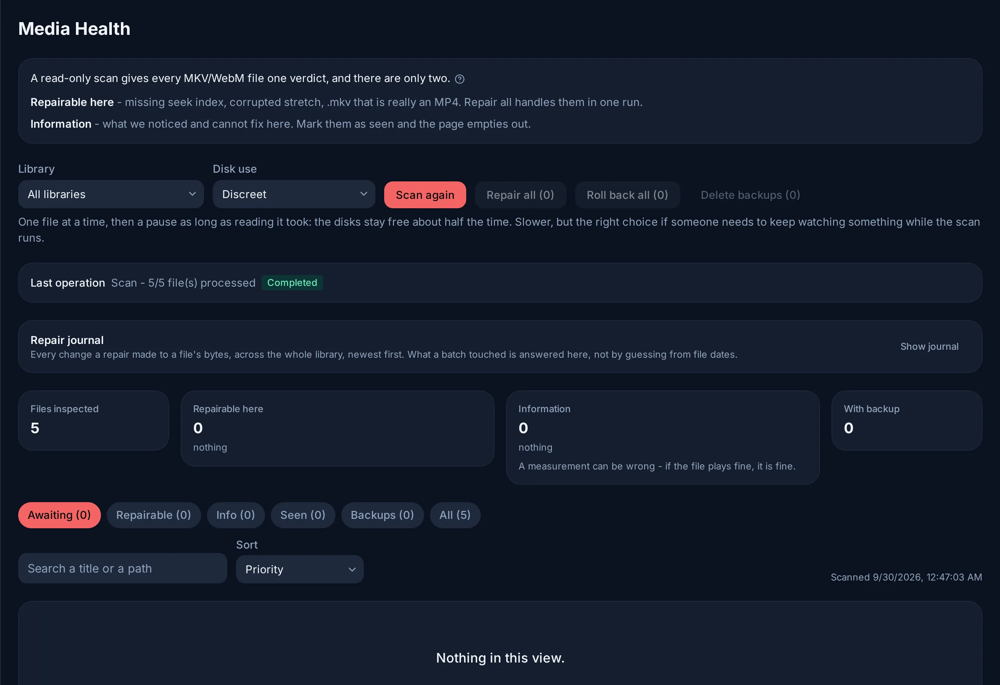

# Media health

**Admin → Media Health** reads every MKV/WebM file of your libraries and gives
each one a single answer. The aim is a page that empties out: what Evey can fix,
it fixes; the rest is mentioned once and can be marked as seen.

<figure class="evey-shot" markdown="span">
  { loading=lazy }
  <figcaption>A scan with nothing left to do: every file is healthy.</figcaption>
</figure>

## Two verdicts

| Verdict | What it means | What Evey does |
| --- | --- | --- |
| **Healthy** | Index, container, sizes and audio timing check out. | Nothing. |
| **Repairable here** | A defect Evey repairs on this server. | **Repair all** handles them in the background. |
| **Information** | Something measured about the file that Evey does not rewrite on its own. | Nothing. Mark it as seen. |

There is no third verdict that hands you a chore. A measurement Evey cannot act
on is a remark, and a measurement can be wrong: if the file plays fine, it is
fine.

### Repairable here

- **Missing seek index**, or one that cannot be used. The symptom is a slow
  seek or a slow resume. The index is rebuilt in a temporary copy, the copy is
  checked in full (tracks, duration, index), then it replaces the file.
- **Wrong container**: the `.mkv` is really an MP4 or MOV file. It is renamed to
  `.mp4` and the library follows; nothing is rewritten.
- **Damaged stretch**: a corrupted region in the middle of the file. The repair
  skips it and resynchronises what follows, so those bytes are lost for good.
  The repair dialog asks for it explicitly (**Also resync N damaged files**);
  left unticked, damaged files are not touched. The same applies to a file
  whose corruption only appears while it is rewritten (**Corruption found
  during repair**): the scan reads headers only and could not see it.
- **Tracks stored in blocks**: minutes of video, then minutes of audio, instead
  of side by side. No player gets past the first block. **Re-mux the tracks**
  rewrites them side by side without re-encoding and checks that every packet
  made it before replacing the file.

### Information

- **Incomplete download**: the end of the file never arrived. It plays up to
  the cut. No tool recovers the missing part; only the source does.
- **Coarse seeking**: the rebuilt index still has a hole, most often the final
  credits. A seek into the hole lands at its edge; everywhere else seeking is
  exact.
- **Audio at +N s**: an audio track starts after the picture. This is how a
  dub is lined up with a cut, and every player follows it. Evey never rewrites
  it.
- **Audio tracks N s apart**: the file's own audio tracks disagree, so one of
  them is in the wrong place. Nothing measured can tell which one.
- **Sound N s off the picture**: an audio track is away from where the
  subtitles, timed to the picture, place the speech.
- **Audio track pulled to 0**: the mark an earlier repair leaves when it pulled
  a track back by its declared delay. If the dub now plays early, the removed
  amount is no longer in the file.
- **Audio -N s**: an audio track ends before the picture. Playback fills the
  gap with silence.
- **Trailing bytes**: surplus bytes after the end of the file's content. It
  plays fine.
- **Unreadable**: the scan could not read the file (missing, unreadable, or a
  container the parser refused). Check the mount or the source.

## Checking the sync by eye

For the three audio remarks, **Check sync** on the file's row builds a short
clip on the server: pick a moment, a track and an offset to try, then watch it,
slowed down if needed. Comparing tracks says whether they agree, never which one
follows the picture; only watching settles it.

**Apply** moves that track by the chosen offset. The change is recorded as your
judgement, not as a measurement, and **History** can undo it.

## Marking as seen

**Seen, stop flagging** (one file) and **Mark all as seen** (a group) take an
Information remark out of the **Awaiting** view. Only remarks can be marked:
a repairable defect gets repaired. The mark belongs to the file as it is: if its
size or date changes, the next scan diagnoses it again. **Flag again** undoes
the mark.

The views above the table (**Awaiting**, **Repairable**, **Info**, **Seen**,
**Backups**, **All**) and the search box are how you work through a large
library: **Awaiting** is the to-do list.

## Scans

A scan reads the head of each file (a few kilobytes) and reuses the previous
answer for a file that has not changed. **Disk use** sets the pace:

- **Discreet**: one file at a time, then a pause as long as the read took. The
  disks stay free about half the time, so someone can keep watching.
- **Fast**: several files at once, no pause. About three times quicker on a
  library spread over several disks, but playback may stutter meanwhile.

Two things make a scan diagnose everything again: a file that changed, and a
new version of Evey whose checks changed. The first scan after such an update
is therefore long on a large library; the following ones are quick again.

## Backups, history and undo

**Keep backups** is on by default: every rewritten file keeps its original as a
`.mkvgobak` next to it. **Roll back** restores one file, **Roll back all** the
selected scope, and **Delete backups** removes them for good. Turned off, only
the last few copies exist during a run and they are removed at its end; each
repair is then verified more deeply before it replaces the file. When keeping a
copy of every file would fill the volume, the page says so before the run.

The **Repair journal** lists every change a repair made to a file's bytes,
across the library; **History** shows it for one file. Some changes can be
undone from there without any copy:

| Change | Undo |
| --- | --- |
| Audio track moved | Applies the exact opposite shift. |
| Renamed to `.mp4` | Renames it back. |
| Index rebuilt | Nothing to undo: picture and sound are untouched. |
| Damaged stretch skipped | Only the backup brings the lost bytes back, which is why this repair always keeps one. |

Repairs write into your media folders. They must be mounted read-write in the
container (no `:ro` on the volume); after a run that met a read-only volume,
the page says so. Scanning works either way.

## From the command line

The same engine is available from the operator CLI (see `cli.md`):

- `evey admin reindex-no-cue --root <dir> [--apply] [--resync]` rebuilds the
  missing indexes, as a dry run unless `--apply` is given;
- `evey admin validate-streaming --root <dir>` prints the read-only streaming
  readiness report.

<!-- sources
verdicts and the dropped third verdict: internal/app/maintenance/seek_index.go - SeekStatus.Verdict, Ackable
labels and hints: i18n admin.seekIndex.*, admin.repairJournal.*, admin.repairHistory.*, admin.syncPreview.*
what can be undone without a copy: internal/app/maintenance/repair_journal.go - RepairRecord.Reversible
apply an audio offset: internal/adapters/driving/grpcapi/admin_media.go - ApplyAudioShift
keep backups on by default: frontend/apps/web/src/features/admin/seekIndex/hooks.ts
-->
