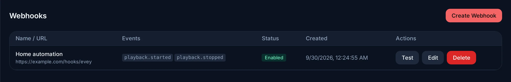

# Webhooks and API keys

Two ways to connect Evey to other tools without writing a plugin: a webhook
sends the server's events to a URL of yours, an API key lets a script call
the server as you. Both are created by an administrator in the admin panel;
this page is for the person who sets them up and for the person who writes
the receiver or the script.

## Send events to a URL

**Admin → Webhooks → Create Webhook**: a **Name**, a **URL**, the **Events**
to send, and an optional **Secret** for signing. **Test** sends a ping and
reports the answer.

<figure class="evey-shot" markdown="span">
  { loading=lazy }
  <figcaption>A webhook sending the start and the end of each playback.</figcaption>
</figure>

**Events.** A webhook subscribes to **All events** or to a chosen list. The
form offers every event the server publishes; among them:

| Area | Events |
| --- | --- |
| Library | `library.scan.started`, `library.scan.completed`, `media.item.added`, `media.item.updated`, `media.item.removed`, `metadata.refreshed` |
| Playback | `playback.started`, `playback.stopped`, `media.marked.watched`, `transcode.started`, `transcode.failed` |
| Accounts | `user.created`, `user.login.succeeded`, `user.login.failed`, `user.profile.created`, `user.apikey.created` |
| Requests | `media.request.created`, `media.request.answered` |
| Server | `backup.created`, `backup.failed`, `plugin.installed`, `plugin.error`, `server.config.changed`, `transcoding.derived_cache_full` (subtitle store below its free-space margin) |

A plugin that calls `EmitEvent` publishes `plugin.event.<type>`, which a
webhook on **All events** receives too.

**Delivery.** Each event is a JSON `POST`, with these headers:

- `X-Evey-Delivery`: an identifier that stays the same across the retries of
  one delivery, so your receiver can ignore a duplicate;
- `X-Evey-Signature`: `sha256=` followed by the HMAC-SHA256 of the body,
  computed with the webhook's secret. Verify it with the same secret to know
  the request comes from your server. Without a secret, the signature proves
  nothing. It covers the body only, so it does not stop a captured request
  from being sent again: prefer the two headers below;
- `X-Evey-Timestamp`: the time of the attempt, in Unix seconds. Each retry
  carries a fresh one;
- `X-Evey-Signature-V2`: `sha256=` followed by the HMAC-SHA256, computed with
  the webhook's secret, of the text `<timestamp>.<delivery id>.<body>` (the
  value of `X-Evey-Timestamp`, a dot, the value of `X-Evey-Delivery`, a dot,
  then the raw body).

To verify a delivery, recompute the V2 signature from the raw body and compare
it in constant time, then refuse the request when the timestamp is more than
5 minutes away from your clock (in either direction). For a receiver that
also remembers the delivery ids it has seen for that window, a captured
request cannot be replayed.

Each attempt waits up to 30 seconds for an answer. A delivery that fails is
retried after 1, 5 and 30 seconds. Every attempt is recorded; the history is
read through the API (`ListWebhookDeliveries` in the
[Plugin API](api/plugins/README.md)), not in the panel.

!!! warning "Only public addresses"
    A webhook URL must be `http` or `https` and point to a public address.
    `localhost`, private and link-local addresses (`192.168.x.x`, `10.x.x.x`,
    `172.16.x.x`...), and a name that resolves to one, are refused when the
    webhook is saved and again when the server connects. This keeps the
    server from being used to reach your internal network; a receiver on your
    local network needs a public address or a relay.

## Call the server from a script

An API key lets a script call the server API without a password. Keys are
created in **Admin → API Keys → New API Key** by an administrator, and belong
to that administrator.

- **The key is shown once**, when it is created. Store it then; it cannot be
  displayed again, only revoked with **Revoke**.
- **It acts as its owner**, with administrator rights, within its scopes.
- **Scopes** restrict what the key can do:

| Scope | Allows |
| --- | --- |
| `media:read` | Reading media metadata |
| `media:write` | Modifying media and starting scans |
| `playback:read` | Reading playback state and history |
| `playback:write` | Controlling playback and progress |
| `users:read` | Reading users |
| `users:write` | Modifying users |
| `admin:read` | Reading administration activity and statistics |
| `admin:write` | Modifying administration settings |

A key created without any scope (**All (legacy)**) has full access on the
non-administrative methods, like its owner, but administration methods always
require their scope: a legacy key cannot reach them. Select the scopes a
script needs.

The key goes in the `Authorization` header, with or without `Bearer`:

```bash
curl -H "Authorization: Bearer evey_..." https://media.example.com/api/v1/...
```

A key stops working at once when it is revoked, or when its owner is
disabled. The endpoints themselves are listed in the
[Server API](api/README.md), with the other ways to authenticate.

<!-- sources
form labels: i18n admin.webhooks.form.* (name, url, secret, events, allEvents), admin.webhooks.createWebhook, common.test, admin.webhooks.testPingSent
event list: frontend/packages/client/src/lib/webhookEvents.ts - WEBHOOK_EVENT_TYPES ; EventName() in internal/domain ; plugin events: internal/adapters/driving/pluginhost/host_server.go - pluginEmittedEvent.EventName
delivery, headers, timeout, retries, signature: internal/app/webhook/service.go - handleAny, attemptDeliver, sign, defaultRetryDelays, deliveryTimeout ; internal/domain/webhook/model.go - MatchesEvent ; history: proto/evey/v1/webhook.proto - ListWebhookDeliveries
public addresses only: internal/pkg/urlvalidator/validator.go - ValidateWebhookURL, isPrivateIP ; internal/pkg/ssrf/dialer.go
api keys: internal/adapters/driving/grpcapi/interceptors/auth.go - authenticateAPIKey (Bearer optional, evey_ prefix), authorize (admin methods always enforce the scope) ; internal/pkg/auth/rbac.go (scopes) ; rbac.go - CreateAPIKey RoleAdmin ; i18n auth.apiKeys.* (newKeyTitle, scopesAll, saveWarning, revoke)
-->
