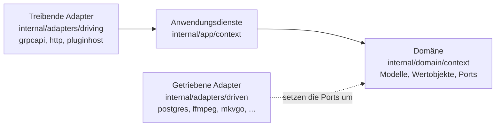
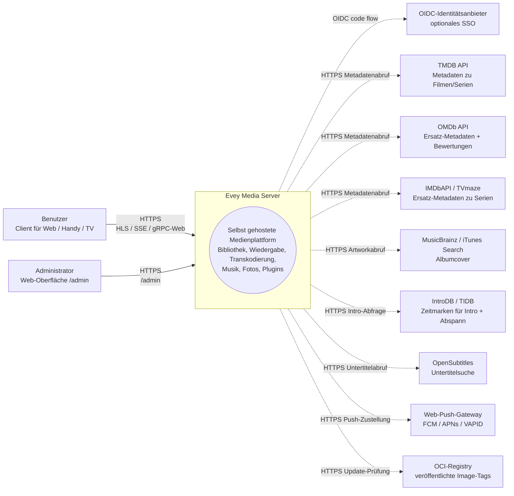
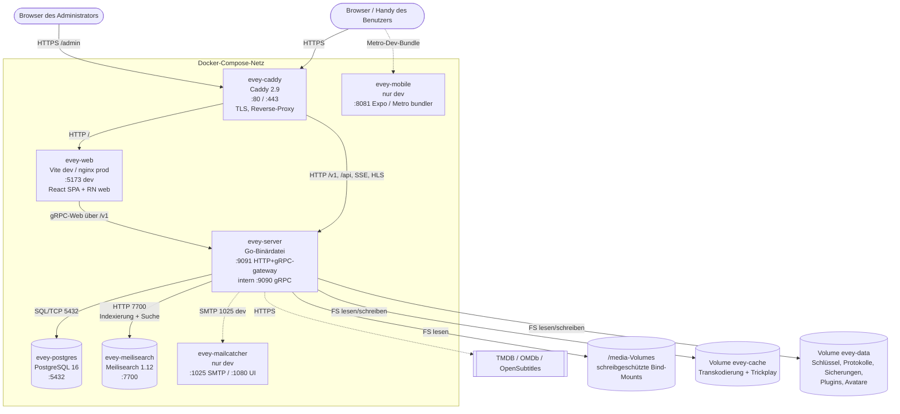
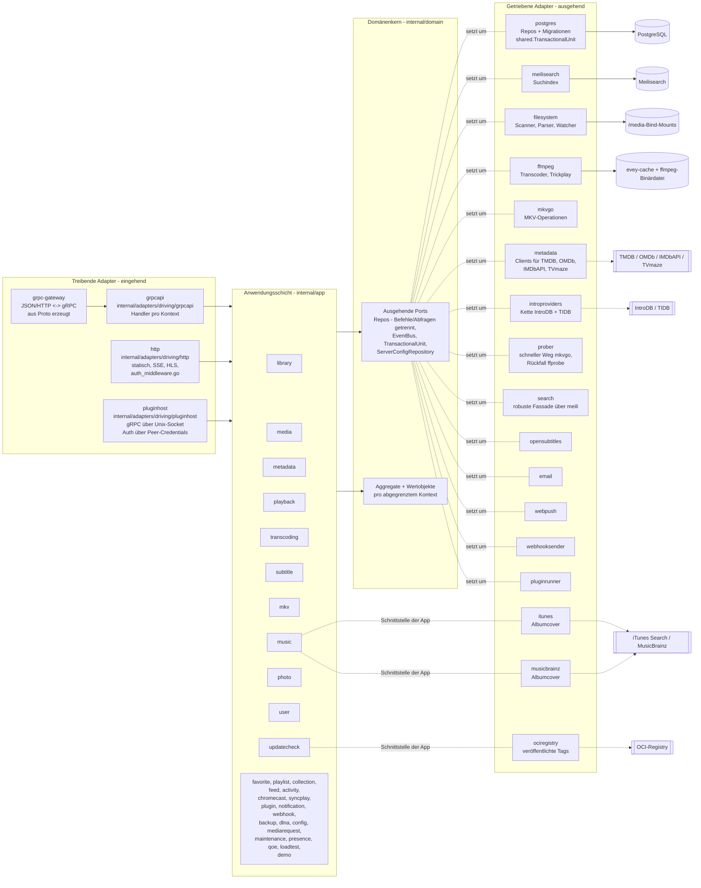
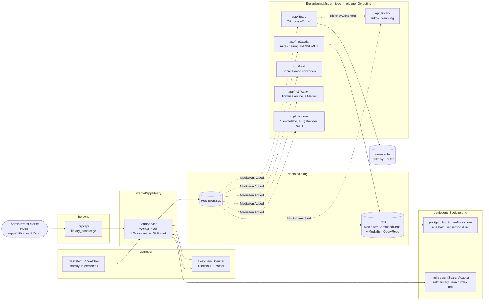

# Architektur

Wie der Server aufgebaut ist: die hexagonale Schichtung unter `internal/`,
die abgegrenzten Kontexte, die Ereignisse, die sie verbinden, und die
statischen Wächter, die den Code auf diesen Schienen halten. Der Code liegt
in `internal/domain`, `internal/app`, `internal/adapters/{driving,driven}`
und wird in `cmd/evey/wire*.go` verdrahtet. Die Struktur ist durch
[ADR-0001](adr/0001-hexagonal-architecture.md) festgelegt, die Aufteilung
der Repositorys durch [ADR-0009](adr/0009-cqrs-repo-split.md) und der
Ereignisbus durch [ADR-0010](adr/0010-event-bus.md). Wie man baut und
startet, steht in [DEV.md](../DEV.md); welche Dateien Sie für eine bestimmte
Änderung anfassen, steht in der [Karte der Codebasis](CODEBASE_MAP.md).

Das Backend ist in Go geschrieben. Die Clients für Web, Handy und Fernseher
sind ein TypeScript/React-Monorepo unter `frontend/` (React Native / Expo für
Handy und Fernseher).

## Schichtung

| Verzeichnis | Enthält | Regel |
| --- | --- | --- |
| `internal/domain/<context>/` | Modelle, Wertobjekte und die **Ports** (Schnittstellen) | kein Import eines Frameworks, kein Import eines anderen Kontexts |
| `internal/app/<context>/` | Anwendungsdienste, die die Ports steuern | Ein- und Ausgabe läuft über einen Port; `dlna` (SSDP / UPnP AVTransport) und `loadtest` (eigener HTTP-Client) sind die zwei bewussten Ausnahmen, die direkt ins Netz gehen |
| `internal/adapters/driven/` | ausgehende Adapter, die die Ports umsetzen: `postgres`, `meilisearch`, `ffmpeg`, `mkvgo`, `filesystem`, `prober`, `opensubtitles`, `email`, `webpush`, `webhooksender`, `pluginrunner`, `metadata`, `introproviders`, `search` | drei weitere erfüllen eine Schnittstelle der App-Schicht statt eines Domänen-Ports: `itunes` und `musicbrainz` (`app/music.AlbumArtFetcher`), `ociregistry` (`app/updatecheck`) |
| `internal/adapters/driving/` | eingehende Adapter: `grpcapi` (+ grpc-gateway HTTP), `http` (statische Dateien, Auth-Middleware, SSE, HLS, Dateien der Plugin-iframes), `pluginhost` (gRPC-Server auf einem Unix-Socket, authentifiziert über die Anmeldedaten der Gegenseite, die Host-API, die Plugins aus der Sandbox zurückrufen) | |
| `internal/pkg/` | der gemeinsame technische Kern: auth, logger, eventbus, i18n, metrics, tracing, ratelimit, procfork, ssrf, cache, ... | |
| `internal/config/` | Serverkonfiguration | |
| `gen/` | erzeugter Proto-Code | |

Abhängigkeitsregel: `adapters -> app -> domain`. Die Domäne importiert nie
die App oder die Adapter. Die Zusammensetzung ist von Hand geschrieben
(nicht google/wire), in `cmd/evey/wire.go` und seinen Geschwistern
`wire_infra.go`, `wire_services.go`, `wire_adapters.go`, `wire_events.go`,
`wire_helpers.go`. Tests umgehen die Adapter, indem sie Attrappen
einsetzen, die dieselben Domänen-Ports umsetzen: 20 der 21 Domänenpakete
bringen ein Unterpaket `fakes/` mit.

## Abgegrenzte Kontexte

Zweiunddreißig Kontextpakete liegen unter `internal/domain/` und
`internal/app/`: 19 gibt es in beiden Schichten, 2 nur in der Domäne
(`ratings`, `shared`), 11 nur in der App. Sie arbeiten teils über
Domänenereignisse auf einem gemeinsamen Bus zusammen; die App-Schicht liest
außerdem direkt das Domänenpaket eines benachbarten Kontexts (siehe
[Beziehungen](#relations)).

| Kontext | Zuständigkeit |
| --- | --- |
| `user` | Konten, Authentifizierung, Sitzungen, Einstellungen |
| `library` | Bibliotheken, Ordner, Scan-Aufträge, Medienindex, Personen, Sammlungen, Favoriten und Daumen eines Profils (Daumen haben keinen App-Dienst: Der Bewertungs-RPC speichert und liest `UserRatingRepository` direkt), Trickplay, Erkennung von Intro und Abspann |
| `media` (nur App) | Freigabelinks und Stream-Tokens |
| `mediarequest` | von Benutzern eingereichte Medienanfragen |
| `metadata` | Anreicherung über TMDB / OMDb, Artwork |
| `playback` | Streams, Fortschritt, Fernsteuerung, laufende Wiedergaben |
| `transcoding` | ffmpeg-Aufträge, HLS-Segmente |
| `subtitle` | eingebettet + extern + opensubtitles |
| `mkv` | Operationen am MKV-Container (über [mkvgo](playback/mkvgo.md)) |
| `music` | audiospezifische Wiedergabe + Tags |
| `photo` | Fotobibliotheken |
| `favorite` (nur App) | Favoriten pro Profil; das Modell und `FavoriteRepository` liegen in `domain/library` |
| `playlist` | Playlists der Benutzer, intelligente Playlists |
| `collection` (nur App) | von Administratoren gepflegte Sammlungen; ihre Ports liegen in `domain/library` |
| `ratings` (nur Domäne) | bildet die Altersfreigaben der Länder (CSA, FSK, MPAA, BBFC, ACB) auf eine einzige Achse des Mindestalters ab |
| `feed` | Aktivitätsfeed / Entdecken |
| `activity` | Zeitleiste der Benutzeraktivität |
| `chromecast` | Lebenszyklus einer Cast-Sitzung |
| `syncplay` | Synchronisierte Sitzungen über mehrere Geräte |
| `plugin` | Plugin-Verzeichnis, Sandbox-Tokens, Lebenszyklus |
| `notification` | Benachrichtigungen in der App + Web-Push |
| `webhook` | ausgehende Webhooks |
| `backup` | Sicherung/Wiederherstellung von Datenbank + Konfiguration |
| `config` (nur App) | gespeicherte Servereinstellungen, geschrieben von den Einstiegspunkten REST und gRPC |
| `dlna` (nur App) | SSDP-Erkennung und UPnP-AVTransport-Steuerung |
| `loadtest` (nur App) | simuliert Zuschauer gegen den eigenen HTTP-Stack des Servers: HLS, oder die rohe Datei, wenn das Urteil für einen Client Direktwiedergabe lautet |
| `maintenance` (nur App) | Medienwartung auf Anstoß des Administrators: Neuaufbau des Seek-Index, Reparaturjournal, Rückgängig, Prüfung der Tonspuren |
| `presence` (nur App) | nicht gespeichertes Verzeichnis im Arbeitsspeicher, wer gerade verbunden ist |
| `qoe` (nur App) | Empfang und Zusammenfassung der Wiedergabe-Telemetrie CMCD (CTA-5004) |
| `demo` (nur App) | die öffentliche Demo-Instanz (`EVEY_DEMO=1`): legt ihre Konten, Bibliotheken und frei lizenzierten Medien über die eigenen Dienste des Produkts an und setzt sich selbst zurück |
| `updatecheck` (nur App) | vergleicht den laufenden Build mit dem, was die Registry veröffentlicht, und sagt es dem Administrator; er aktualisiert nie etwas |
| `shared` (nur Domäne) | übergreifende Ports (`EventBus`, `TransactionalUnit`, `ServerConfigRepository`, `ShareLinkRepository`), typisierte IDs, Cursor, Stream-Tokens |

### Beziehungen

| Sender | Ereignisse | Empfangen von |
| --- | --- | --- |
| `library` | `LibraryCreated` / `LibraryDeleted`, `LibraryScanStarted` / `LibraryScanCompleted`, `MediaItemAdded`, `MediaItemRemoved`, `TrickplayGenerated` | `media.item.added`: `notification`, `metadata` (automatische Anreicherung), `library` selbst (Trickplay-Worker + Intro-Erkennung), `feed` (Genre-Cache verwerfen) |
| `playback` | `PlaybackStarted` / `PlaybackStopped` | heute kein eigener Abonnent; nur das `"*"`-Sammelabo von `webhook` empfängt sie |
| `user` | `UserCreated`, `user.password.reset_requested` | das erste hat keinen Abonnenten; das zweite empfängt der getriebene Adapter `email` |
| `pluginrunner` | `plugin.error` / `plugin.started` | `app/plugin` für sein Sicherheits-Dashboard, `notification` für den Administrator |
| `shared` | `ServerConfigChanged` | die Dienste, die eine im Verwaltungsbereich gespeicherte Einstellung ohne Neustart anwenden (SMTP, Zeitzone, CPU-Budget, ...) |

- Die Suchindexierung ist **nicht** ereignisgesteuert: `library.ScanService`
  ruft den Port `library.SearchIndex` direkt auf.
- Es gibt keine Brücke, die Domänenereignisse an Plugins weitergibt: Plugins
  erreichen die API mit JWTs mit begrenzten Bereichen
  ([ADR-0003](adr/0003-plugin-scoped-tokens.md)). Der Bus selbst ist
  [ADR-0010](adr/0010-event-bus.md).
- `shared.TransactionalUnit` umschließt Schreibvorgänge über mehrere
  Aggregate ([ADR-0002](adr/0002-transactional-unit-port.md)).

Kein Paket unter `internal/domain` importiert das Domänenpaket eines anderen
Kontexts. Diese Regel setzt `internal/contractguard/domain_imports_test.go`
durch (siehe [Architekturwächter](#architecture-guards)). Die App-Schicht
ist nicht daran gebunden: 15 App-Pakete importieren heute das Domänenpaket
eines benachbarten Kontexts.

## Typischer Datenfluss - „ein Benutzer spielt ein Medium ab“

1. Der Client (Handy/Web) ruft `POST /api/v1/playback/start` auf (Route von grpc-gateway).
2. `internal/adapters/driving/http` führt seine Auth-Middleware aus (`auth_middleware.go`, `httpAuthMiddleware`) und liest die Sitzung aus.
3. `internal/adapters/driving/grpcapi` (`playback_handler.go`) prüft das Proto und ruft `app/playback.CommandService.StartStream` auf (Trennung von Befehlen und Abfragen, siehe [ADR-0009](adr/0009-cqrs-repo-split.md)).
4. `app/playback.CommandService` ruft Domänen-Ports auf: `user.UserRepository`, `playback.SessionQueryRepo` (Idempotenz + Gerätelimit), `playback.SessionCommandRepo`, dann `shared.EventBus.Publish(PlaybackStarted)`.
5. Die getriebenen Adapter führen aus: `postgres` speichert die Sitzung innerhalb eines Bereichs `shared.TransactionalUnit.Do`; der Bus im Prozess (`internal/pkg/eventbus`) verteilt asynchron.
6. `PlaybackStarted` hat heute keinen eigenen Abonnenten: Nur das `"*"`-Sammelabo von `webhook` empfängt es.
7. Die Antwort fließt als JSON durch grpc-gateway zurück; Fortschrittsmeldungen laufen über SSE / gRPC-Streams.

Was passiert, sobald der Player nach dem Manifest und den Segmenten fragt,
beschreibt [Ein Video ausliefern - der HLS-Wiedergabeweg](playback-serving.md).

## Architekturwächter

Die Regeln oben stehen nicht nur in der Dokumentation.
`internal/contractguard/` enthält 58 statische Tests in 30 Dateien, die den
Build scheitern lassen, wenn sich die Codebasis von ihnen entfernt.

Die hexagonale Regel selbst ist `TestDomainContextsDoNotImportEachOther`
(ADR-0001), in `domain_imports_test.go`. Er durchläuft `internal/domain` und
setzt genau das durch: Ein Kontext darf `internal/domain/shared` und seinen
eigenen Paketbaum importieren, sonst nichts aus `internal/domain`, und nie
`internal/app` oder `internal/adapters`. Sein Bereich endet bei
`internal/domain`: Über die App-Schicht sagt er nichts.

Die übrigen schützen Verträge, die eine Sprach- oder Prozessgrenze
überqueren, darunter:

| Wächter | Was er ablehnt |
| --- | --- |
| `TestNoClientReadOfAFieldTheServerNeverWrites` | ein Feld einer Proto-Antwort, das ein Client liest, aber kein Servercode schreibt |
| `TestRegisteredHandlersGetEveryPortTheyDeclare`, `TestBootInstallsItsSilentWirings` | Verdrahtung, die sonst stillschweigend scheitern würde |
| `TestPostgresRepositoriesBoundTheirQueries` | eine Abfrage eines Postgres-Repositorys ohne Zeitlimit |
| `TestProcfork_EveryForkGoesThroughCommand` | ein Start eines Unterprozesses an `internal/pkg/procfork` vorbei |
| `TestEverySortFieldTheAPIAcceptsHasASQLColumn`, `...CanBuildACursorValue` | ein Sortierfeld, das in der Zuordnung zu SQL-Spalten oder im Cursor-Kodierer fehlt |
| `TestEveryWebSurfaceReachingAnAdminRPCIsClassified`, plus sein natives Gegenstück für Handy und Fernseher | eine Oberfläche, die einen RPC nur für Administratoren aufruft, ohne festzulegen, wer sie sieht |
| `TestEveryAllowedSlotIsMountedOnWebAndMobile`, `TestPluginBridgeParityWebMobile` | ein Slot für Plugin-Oberflächen oder eine Nachricht der Brücke, die es nur auf einem Client gibt |
| `TestImageSubtitleCodecsAgreeAcrossServerAndClients` | eine zweite Liste von Codecs für Bilduntertitel in einem Player |
| `TestHandWrittenClientTypesMatchTheEndpointTheyCall` | ein von Hand geschriebener Antworttyp für Handy/TV, der von seinem Endpunkt abweicht |
| `TestOnlyThePlanDecidesPlayback`, `TestNoCallerDerivesDownstreamOfThePlaybackPlan` | eine Wiedergabeentscheidung außerhalb des Plan-Resolvers ([ADR-0030](adr/0030-one-plan-one-decision.md)) |
| `TestRestartExitCodeAgreesWithTheEntrypoint` | ein Exit-Code in Go und `docker/entrypoint.sh`, die sich uneinig sind, was ein Neustart bedeutet |
| `TestServerEmittedI18nKeysExistInCatalogue`, `TestI18nPlaceholdersAgreeAcrossLocales` | ein vom Server gesendeter Schlüssel, der im Katalog fehlt, Platzhalter, die sich zwischen Sprachen unterscheiden |

## C4-Diagramme

Vier Diagramme beschreiben Evey in abnehmender Zoomstufe nach dem
[C4-Modell](https://c4model.com/). Die Knotennamen sind die echten
Go-Paketnamen unter `internal/`. Die Containernamen stammen aus
`docker-compose.yml` für `evey-server`, `evey-postgres` und `evey-caddy`;
`evey-web`, `evey-meilisearch`, `evey-mobile` und `evey-mailcatcher` sind in
`docker-compose.override.yml` angegeben und gibt es nur in der
Entwicklungsumgebung.

### Ebene 1 - Systemkontext

Wer mit Evey spricht und welche Drittanbieter Evey erreicht.

### Ebene 2 - Container

Die bereitstellbaren Einheiten, die `docker compose --env-file .env.dev up`
startet. Durchgezogene Pfeile sind Datenverkehr zur Laufzeit; gestrichelte
Pfeile gehen nach außen zu Drittanbietern.

!!! note "Die Produktion weicht von dieser Entwicklungsumgebung ab"
    Die Compose-Datei der Installation gibt einen einzigen Dienst an,
    `evey`. Es gibt keinen eigenen Container `evey-web` (und weder den
    Mailcatcher noch den Metro-Bundler, die es nur in der Entwicklung
    gibt): Die Binärdatei liefert die gebaute Weboberfläche aus `/srv` aus,
    ein Reverse-Proxy leitet also *alles*, Oberfläche und API, an sie auf
    `:9091` weiter. Postgres und Meilisearch laufen im selben Container,
    überwacht von `docker/entrypoint.sh`: PostgreSQL 17 mit seinen Daten
    unter `/data/postgres` und die Meilisearch-Binärdatei (`Dockerfile`,
    Stufe `meili-download`, auf 1.12.8 festgelegt) mit ihrem Index unter
    `/data/meili`. Die eigene `docker-compose.yml` des Repositorys behält
    getrennte Dienste `postgres` und `caddy`, beschrieben unter
    [Erweiterte Bereitstellungen](operations/advanced-deployments.md).
    Siehe [Installation](installation.md) und
    [Reverse-Proxy-Konfigurationen](reverse-proxy.md).

### Ebene 3 - Komponenten (Zoom auf `evey-server`)

Hexagonale Schichtung in der Go-Binärdatei. Treibende Adapter rufen
Anwendungsdienste über deren Schnittstellen auf; Anwendungsdienste hängen
nur von Domänen-Ports ab; getriebene Adapter setzen diese Ports um.

Hinweise zu den Goroutinen:

- Der gRPC-Server (`grpc.Server.Serve`) und der HTTP-Server (Gateway + statische Dateien) laufen jeweils in eigenen Goroutinen, gestartet von der Verdrahtung in `cmd/evey`.
- Scan-Aufträge von `app/library` laufen in einem Worker-Pool (eine Goroutine pro laufendem Bibliotheksscan, siehe `library.ScanService`).
- ffmpeg-Aufträge startet der getriebene Adapter `ffmpeg` (`ffmpeg.Transcoder.Start`) über `internal/pkg/procfork`, mit einer überwachenden Goroutine pro Auftrag, die die Fehlerausgabe (stderr) des Prozesses leert.
- `shared.EventBus` verteilt an die Abonnenten asynchron: Jeder Abonnent läuft in seiner eigenen Goroutine, ein langsamer Empfänger blockiert also nie die Sender. Der Bus öffnet selbst keine Transaktion; das ist Aufgabe des Handlers.
- `pluginrunner` startet einen Unterprozess pro Plugin; iframe-Plugins leben im Browser des Benutzers und sprechen über signierte Tokens zurück, die `app/plugin` ausstellt.

### Ebene 3 (Zugabe) - Komponenten-Zoom auf die Scan-Kette

Der heiße Pfad, der Dateien auf der Platte in durchsuchbare, angereicherte
Medien verwandelt. Durchgezogene Pfeile sind direkte Aufrufe; gestrichelte
Pfeile sind Domänenereignisse auf dem Bus. Die Suchindexierung ist ein
direkter Port-Aufruf aus `ScanService`, kein Ereignis.

Lesen Sie das zusammen mit dem Abschnitt „Typischer Datenfluss“ oben: Der
Wiedergabeweg ist der spiegelbildliche Leseweg; die Scan-Kette ist der
Schreibweg, der den Medienindex füllt, aus dem der Leseweg ausliefert.

## Weiterführende Lektüre

- [DEV.md](../DEV.md) - bauen, starten, Migrationen, Proto erzeugen
- [Karte der Codebasis](CODEBASE_MAP.md) - welche Dateien Sie für häufige Änderungen anfassen
- [Ein Video ausliefern - der HLS-Wiedergabeweg](playback-serving.md) - der Leseweg der HLS-Videoauslieferung, im Detail
- [Server-API](api/) - erzeugte API-Referenz
- [Entscheidungsprotokolle](adr/) - Architektur-Entscheidungsprotokolle

<!-- sources
layering: internal/domain ; internal/app ; internal/adapters/driven ; internal/adapters/driving ; internal/pkg ; internal/config ; gen ; cmd/evey/wire.go, wire_infra.go, wire_services.go, wire_adapters.go, wire_events.go, wire_helpers.go
app-layer interfaces: internal/app/music/album_art_chain.go - AlbumArtFetcher ; internal/adapters/driven/ociregistry (app/updatecheck)
network exceptions: internal/app/dlna/service.go ; internal/app/loadtest/runner.go
events and subscribers: internal/app/notification/command_service.go ; internal/app/metadata/command_service_enrich.go ; internal/app/library/trickplay_service.go ; internal/app/library/intro_detection_service.go ; internal/app/feed/genre_cache.go ; internal/app/webhook/service.go ; internal/adapters/driven/email/password_reset_emailer.go ; internal/app/plugin/security_dashboard_service.go ; internal/app/config/smtp.go, timezone.go, cpu_budget.go
guards: internal/contractguard/*_test.go - TestDomainContextsDoNotImportEachOther, TestOnlyThePlanDecidesPlayback, TestNoCallerDerivesDownstreamOfThePlaybackPlan, TestServerEmittedI18nKeysExistInCatalogue, TestI18nPlaceholdersAgreeAcrossLocales
topology: docker-compose.yml ; docker-compose.override.yml ; Dockerfile - MEILI_VERSION, postgresql-17 ; docker/entrypoint.sh - PG_MAJOR
-->
