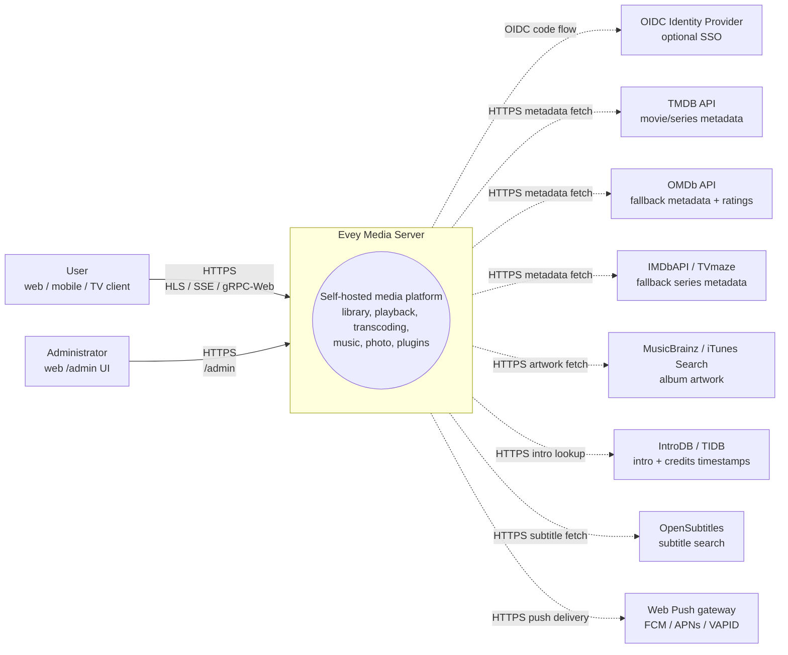
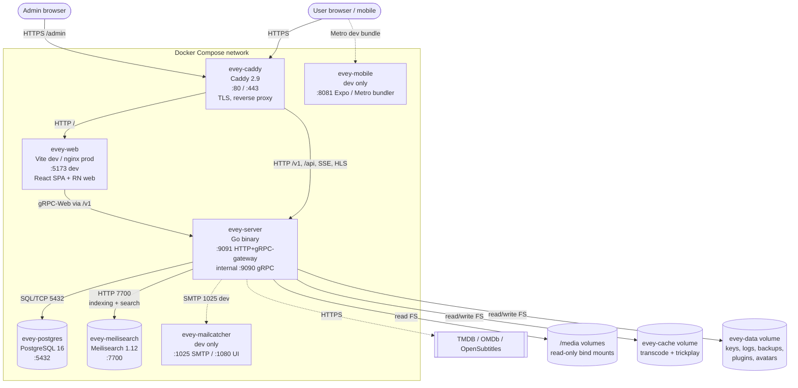
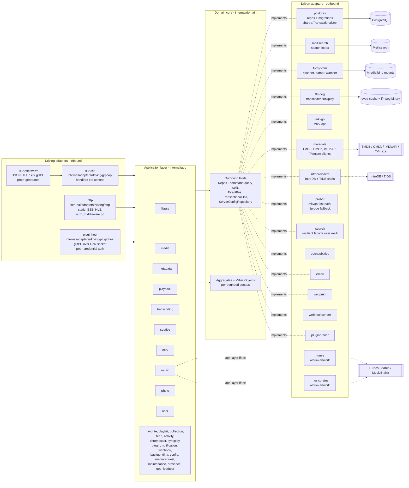
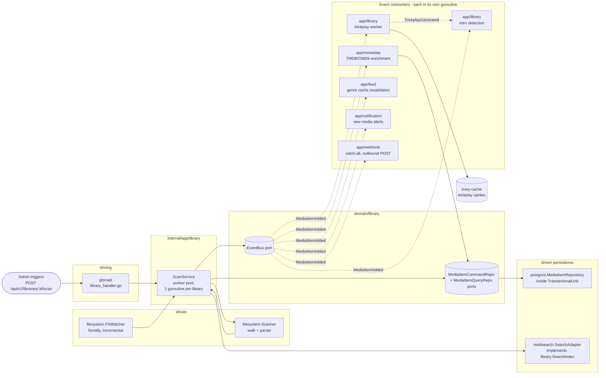

# Architektur

Evey ist ein selbst gehosteter Medienserver. Das Backend ist Go (hexagonal / DDD), das Frontend ein TypeScript/React-Monorepo, die Mobil-App React Native / Expo. Einrichtung und tiefere Interna stehen in [DEV.md](../DEV.md).

## Schichten

Strikte Aufteilung nach Ports und Adaptern unter `internal/`:

- `internal/domain/<context>/` - reine Domäne: Modelle, Wertobjekte, **Ports** (Interfaces). Keine Framework-Importe.
- `internal/app/<context>/` - Anwendungsdienste. Orchestrieren die Ports. Ein-/Ausgabe läuft normalerweise über einen Port; zwei Kontexte sind bewusste Ausnahmen und greifen direkt aufs Netz zu: `dlna` (SSDP / UPnP AVTransport) und `loadtest` (sein eigener HTTP-Client).
- `internal/adapters/driven/` - ausgehende Adapter, die Domänen-Ports implementieren: `postgres`, `meilisearch`, `ffmpeg`, `mkvgo`, `filesystem`, `prober`, `opensubtitles`, `email`, `webpush`, `webhooksender`, `pluginrunner`, `metadata`, `introproviders`, `search`. Zwei weitere liegen hier, erfüllen aber ein Interface der Anwendungsschicht statt eines Domänen-Ports: `itunes` und `musicbrainz`, beide `app/music.AlbumArtFetcher`.
- `internal/adapters/driving/` - eingehende Adapter: `grpcapi` (+ grpc-gateway HTTP), `http` (statische Dateien, Auth-Middleware, SSE, HLS, Assets der Erweiterungs-iframes), `pluginhost` (gRPC-Server auf einem Unix-Socket, authentifiziert über Peer-Credentials - die Host-API, die die abgeschotteten Unterprozesse der Erweiterungen zurückrufen).
- `internal/pkg/` - gemeinsamer technischer Kern, von allen Kontexten genutzt (auth, logger, eventbus, i18n, metrics, tracing, ratelimit, procfork, ssrf, cache, ...). Die Serverkonfiguration liegt in `internal/config/`; erzeugter Proto-Code in `gen/`.

Abhängigkeitsregel: `adapters -> app -> domain`. Die Domäne importiert nie app oder adapters. Zusammengesetzt wird in `cmd/evey/wire*.go` - von Hand geschriebene Verdrahtung, nicht google/wire: `wire.go`, `wire_infra.go`, `wire_services.go`, `wire_adapters.go`, `wire_events.go`, `wire_helpers.go`.

## Fachliche Kontexte

Dreißig Kontext-Pakete liegen unter `internal/domain/` und `internal/app/`: 19 gibt es in beiden Schichten, 2 nur in der Domäne (`ratings`, `shared`), 9 nur in der Anwendung. Die Zusammenarbeit läuft teils über Domänenereignisse, die über einen gemeinsamen Bus veröffentlicht werden; die Anwendungsschicht liest außerdem direkt das Domänenpaket eines benachbarten Kontexts (siehe [Beziehungen](#relations)).

| Kontext | Verantwortung |
| --- | --- |
| `user` | Konten, Anmeldung, Sitzungen, Einstellungen |
| `library` | Bibliotheken, Ordner, Scan-Aufträge, Medienindex, Personen, Sammlungen, Favoriten und Daumen eines Profils (Daumen haben keinen Anwendungsdienst: die Bewertungs-RPC speichert und liest `UserRatingRepository` direkt), Trickplay, Erkennung von Intro/Abspann |
| `media` (nur Anwendung) | Freigabelinks und Stream-Tokens |
| `mediarequest` | von Benutzern eingereichte Medienanfragen |
| `metadata` | Anreicherung über TMDB / OMDb, Artwork |
| `playback` | Streams, Fortschritt, Fernsteuerung, aktuelle Wiedergabe |
| `transcoding` | ffmpeg-Aufträge, HLS-Segmente |
| `subtitle` | eingebettet + extern + opensubtitles |
| `mkv` | Operationen auf MKV-Containern (über `mkvgo`) |
| `music` | audiospezifische Wiedergabe + Tagging |
| `photo` | Fotobibliotheken |
| `favorite` (nur Anwendung) | Favoriten pro Profil; das Modell und `FavoriteRepository` liegen in `domain/library` |
| `playlist` | Benutzer-Playlists, intelligente Playlists |
| `collection` (nur Anwendung) | vom Administrator gepflegte Sammlungen; ihre Ports liegen in `domain/library` |
| `ratings` (nur Domäne) | bildet die Freigaben der Länder (CSA, FSK, MPAA, BBFC, ACB) auf eine einzige Achse des Mindestalters ab |
| `feed` | Aktivitäts-Feed / Entdecken |
| `activity` | Aktivitätsverlauf der Benutzer |
| `chromecast` | Lebenszyklus von Cast-Sitzungen |
| `syncplay` | synchrone Sitzungen über mehrere Geräte |
| `plugin` | Register der Erweiterungen, Sandbox-Tokens, Lebenszyklus |
| `notification` | Benachrichtigungen in der App + Web-Push |
| `webhook` | ausgehende Webhooks |
| `backup` | Sicherung/Wiederherstellung von Datenbank + Konfiguration |
| `config` (nur Anwendung) | gespeicherte Servereinstellungen, geschrieben von den REST- und den gRPC-Einstiegspunkten |
| `dlna` (nur Anwendung) | SSDP-Erkennung und Steuerung über UPnP AVTransport |
| `loadtest` (nur Anwendung) | simuliert HLS-Zuschauer gegen den eigenen HTTP-Stack des Servers |
| `maintenance` (nur Anwendung) | vom Administrator ausgelöste Medienwartung: Neuaufbau des Sprungindex, Reparaturjournal, Rückgängig, Tonintegrität |
| `presence` (nur Anwendung) | nicht gespeichertes Register im Speicher, wer gerade verbunden ist |
| `qoe` (nur Anwendung) | Aufnahme und Aggregation der Wiedergabe-Telemetrie nach CMCD (CTA-5004) |
| `shared` (nur Domäne) | übergreifende Ports (`EventBus`, `TransactionalUnit`, `ServerConfigRepository`, `ShareLinkRepository`), typisierte IDs, Cursor, Stream-Tokens |

### Beziehungen

- `library` → sendet `LibraryCreated` / `LibraryDeleted`, `LibraryScanStarted` / `LibraryScanCompleted`, `MediaItemAdded`, `MediaItemRemoved`, `TrickplayGenerated`. `media.item.added` wird verarbeitet von `notification`, `metadata` (automatische Anreicherung), `library` selbst (Trickplay-Worker + Intro-Erkennung) und `feed` (Invalidierung des Genre-Caches).
- Die Suchindizierung ist **nicht** ereignisgesteuert: `library.ScanService` ruft den Port `library.SearchIndex` direkt auf.
- `playback` → sendet `PlaybackStarted` / `PlaybackStopped`. Keines von beiden hat heute einen eigenen Abonnenten; nur der Sammelempfänger `"*"` von `webhook` bekommt sie.
- `user` → sendet `UserCreated`, das keinen Abonnenten hat, und `user.password.reset_requested`, das vom getriebenen Adapter `email` verarbeitet wird.
- `plugin` → `pluginrunner` veröffentlicht `plugin.error` / `plugin.started`, und `app/plugin` verarbeitet sie für sein Sicherheits-Dashboard. Es gibt keine Brücke, die Domänenereignisse in Erweiterungen einspeist: Erweiterungen erreichen die API mit begrenzten JWTs (siehe ADR-0003). Der Bus selbst ist ADR-0010.
- `shared.TransactionalUnit` umschließt Schreibvorgänge über mehrere Aggregate (siehe ADR-0002).

Kein Paket unter `internal/domain` importiert das Domänenpaket eines anderen Kontexts - eine Regel, die `internal/contractguard/domain_imports_test.go` durchsetzt (siehe [Architektur-Wächter](#architecture-guards)). Die Anwendungsschicht ist daran nicht gebunden: 14 Anwendungspakete importieren heute das Domänenpaket eines benachbarten Kontexts.

## Typischer Datenfluss - „Benutzer spielt ein Medium ab“

1. Der Mobil- oder Web-Client ruft `POST /api/v1/playback/start` auf (Route von grpc-gateway).
2. `internal/adapters/driving/http` führt seine Auth-Middleware aus (`auth_middleware.go`, `httpAuthMiddleware`) und entnimmt die Sitzung.
3. `internal/adapters/driving/grpcapi` (`playback_handler.go`) prüft das Proto und ruft `app/playback.CommandService.StartStream` auf (Trennung von Befehlen und Abfragen, siehe ADR-0009).
4. `app/playback.CommandService` ruft Domänen-Ports auf: `user.UserRepository`, `playback.SessionQueryRepo` (Idempotenz + Gerätegrenze), `playback.SessionCommandRepo`, dann `shared.EventBus.Publish(PlaybackStarted)`.
5. Die getriebenen Adapter führen aus: `postgres` speichert die Sitzung in einem Bereich `shared.TransactionalUnit.Do`; der prozessinterne Bus (`internal/pkg/eventbus`) verteilt asynchron.
6. `PlaybackStarted` hat heute keinen eigenen Abonnenten: Nur der Sammelempfänger `"*"` von `webhook` bekommt es.
7. Die Antwort fließt über grpc-gateway als JSON zurück; Fortschrittsmeldungen laufen über SSE / gRPC-Streams.

## Kompositionswurzel

Die Verdrahtungsgraphen stehen in `cmd/evey/wire.go` und seinen Geschwistern (`wire_infra.go`, `wire_services.go`, `wire_adapters.go`, `wire_events.go`, `wire_helpers.go`). Tests umgehen die Adapter, indem sie Fakes einspeisen, die dieselben Domänen-Ports implementieren - 21 der 22 Domänenpakete bringen ein Unterpaket `fakes/` mit. Siehe [ADR-0001](adr/0001-hexagonal-architecture.md).

## Architektur-Wächter

Die Regeln oben sind nicht nur Dokumentation. `internal/contractguard/` enthält 31 statische Tests in 20 Dateien, die den Build scheitern lassen, sobald der Code von ihnen abweicht.

Die hexagonale Regel selbst ist `TestDomainContextsDoNotImportEachOther` (ADR-0001) in `domain_imports_test.go`. Er durchläuft `internal/domain` und setzt genau dies durch: Ein Kontext darf `internal/domain/shared` und seinen eigenen Paketbaum importieren, sonst nichts aus `internal/domain`, und nie `internal/app` oder `internal/adapters`. Sein Bereich endet bei `internal/domain` - über die Anwendungsschicht sagt er nichts.

Die übrigen bewachen Verträge, die eine Sprach- oder Prozessgrenze überqueren, darunter:

- `TestNoClientReadOfAFieldTheServerNeverWrites` - jedes Feld einer Proto-Antwort, das ein Client liest, muss irgendwo im Server geschrieben werden.
- `TestRegisteredHandlersGetEveryPortTheyDeclare` und `TestBootInstallsItsSilentWirings` - Verdrahtung, die sonst stillschweigend scheitern würde.
- `TestPostgresRepositoriesBoundTheirQueries` - jedes Postgres-Repository begrenzt seine Abfragen mit einem Timeout.
- `TestProcfork_EveryForkGoesThroughCommand` - jeder Fork eines Unterprozesses läuft über `internal/pkg/procfork`.
- `TestEverySortFieldTheAPIAcceptsHasASQLColumn` und `...CanBuildACursorValue` - Sortierfelder existieren sowohl in der Zuordnung der SQL-Spalten als auch im Cursor-Encoder.
- `TestEveryWebSurfaceReachingAnAdminRPCIsClassified`, plus sein natives Gegenstück für Mobil und TV - jede Oberfläche, die eine nur für Administratoren gedachte RPC aufruft, entscheidet, wer sie sieht.
- `TestEveryAllowedSlotIsMountedOnWebAndMobile` und `TestPluginBridgeParityWebMobile` - Gleichstand der Slots für Erweiterungen über die Clients hinweg.
- `TestImageSubtitleCodecsAgreeAcrossServerAndClients` - eine einzige Liste der Bitmap-Untertitel-Codecs, für Server und Player.
- `TestHandWrittenClientTypesMatchTheEndpointTheyCall` - die von Hand geschriebenen Antworttypen von Mobil/TV passen zum Endpunkt, den sie aufrufen.
- `TestRestartExitCodeAgreesWithTheEntrypoint` - der Go-Exit-Code und `docker/entrypoint.sh` sind sich einig, was ein Neustart bedeutet.
- i18n-Wächter - vom Server gesendete Schlüssel existieren im Katalog, Platzhalter stimmen über alle Sprachen überein.

## Weiterlesen

- [DEV.md](../DEV.md) - bauen, starten, Migrationen, Proto-Erzeugung
- [docs/CODEBASE_MAP.md](CODEBASE_MAP.md) - welche Dateien für häufige Änderungen anzufassen sind
- [docs/playback-serving.md](playback-serving.md) - der Lesepfad der HLS-Videoauslieferung, in der Tiefe (Entscheidung, Leiter, Fingerabdruck, CMAF/HLS/DASH, mkvgo gegenüber ffmpeg)
- [docs/api/](api/) - erzeugte API-Referenz
- [docs/adr/](adr/) - Architekturentscheidungen

## C4-Diagramme

Diese vier Diagramme dokumentieren Evey in abnehmender Zoomstufe nach dem [C4-Modell](https://c4model.com/). Alle Diagramme werden mit Mermaid gezeichnet; keine binären Dateien. Die Knotennamen sind die tatsächlichen Go-Paketnamen unter `internal/`. Die Containernamen stammen aus `docker-compose.yml` für `evey-server`, `evey-postgres` und `evey-caddy`; `evey-web`, `evey-meilisearch`, `evey-mobile` und `evey-mailcatcher` sind in `docker-compose.override.yml` angegeben und existieren nur in der Entwicklungstopologie.

### Ebene 1 - Systemkontext

Wer mit Evey spricht und welche Drittanbieter Evey selbst anspricht.

### Ebene 2 - Container

Die auslieferbaren Einheiten, die `docker compose --env-file .env.dev up` startet. Durchgezogene Pfeile sind Laufzeitverkehr; gestrichelte Pfeile gehen nach außen zu Drittanbietern.

> **Die Produktion weicht von dieser Entwicklungstopologie ab.** Die
> Installations-Compose-Datei deklariert nur drei Dienste - `evey`, `postgres`,
> `caddy`. Es gibt keinen eigenen Container `evey-web` (und weder den nur für die
> Entwicklung gedachten Mailcatcher noch den Metro-Bundler): Das Binary
> `evey-server` liefert die gebaute Weboberfläche aus `/srv` aus, sodass der
> Reverse Proxy *alles* - Oberfläche und API - an ihn auf `:9091` weiterleitet.
> Einen eigenen Container `evey-meilisearch` gibt es auch nicht: Das
> Meilisearch-Binary ist in das Image `evey` eingebaut (`Dockerfile`, Stufe
> `meili-download`, festgelegt auf 1.12.8) und hält seinen Index unter
> `/data/meili`. Siehe [installation.md](installation.md) und
> [reverse-proxy.md](reverse-proxy.md).

### Ebene 3 - Komponenten (Zoom auf `evey-server`)

Hexagonale Schichtung im Go-Binary. Eingehende Adapter rufen Anwendungsdienste über deren Interfaces auf; Anwendungsdienste hängen nur von Domänen-Ports ab; ausgehende Adapter implementieren diese Ports.

Hinweise zu Goroutinen:
- Der gRPC-Server (`grpc.Server.Serve`) und der HTTP-Server (Gateway + statische Dateien) laufen jeweils in eigenen Goroutinen, abgezweigt von der Hauptverdrahtung in `cmd/evey`.
- Die Scan-Aufträge von `app/library` laufen in einem Worker-Pool (eine Goroutine pro aktivem Bibliotheksscan, siehe `library.ScanService`).
- ffmpeg-Aufträge werden vom getriebenen Adapter `ffmpeg` (`ffmpeg.Transcoder.Start`) über `internal/pkg/procfork` geforkt, mit einer überwachenden Goroutine pro Auftrag, die das stderr des Prozesses leert.
- `shared.EventBus` verteilt an Abonnenten asynchron: Jeder Abonnent läuft in seiner eigenen Goroutine, damit ein langsamer Verbraucher nie Veröffentlicher blockiert. Der Bus öffnet selbst keine Transaktion - das ist Sache des Handlers.
- `pluginrunner` startet einen Unterprozess pro Erweiterung; iframe-Erweiterungen leben im Browser des Benutzers und sprechen über signierte Tokens zurück, die `app/plugin` ausstellt.

### Ebene 3 (Zugabe) - Komponenten-Zoom auf die Scan-Pipeline

Der heiße Pfad, der Dateien auf der Platte in durchsuchbare, angereicherte Medien verwandelt. Durchgezogene Pfeile sind direkte Aufrufe; gestrichelte Pfeile sind Domänenereignisse auf dem Bus. Beachten Sie, dass die Suchindizierung ein direkter Port-Aufruf aus `ScanService` ist, kein Ereignis.

Lesen Sie das zusammen mit dem Abschnitt „Typischer Datenfluss“ oben: Der Wiedergabepfad ist der symmetrische Lesepfad; die Scan-Pipeline ist der Schreibpfad, der den Medienindex füllt, aus dem der Lesepfad liefert.
