# Plugin-Sandbox und Bedrohungsmodell

Was der Server tut, um ein Plugin einzusperren: die Prüfungen bei der
Installation, die Schutzschichten zur Laufzeit, die Sandbox-Modi und was
jede davon trotzdem nicht verhindern kann. Der Code liegt in
`internal/adapters/driven/pluginrunner` (Analyse bei der Installation,
Sandbox), `cmd/evey-plugin-launcher` (Landlock und der seccomp-Filter des
Kernels), `sandbox/sandbox.c` (der `LD_PRELOAD`-Filter) und
`internal/adapters/driving/pluginhost` (die Host-API, die Plugins
aufrufen). Die Gestaltung ist durch
[ADR-0012](adr/0012-plugin-token-deny-by-default.md),
[ADR-0013](adr/0013-userspace-plugin-resource-monitor.md) und
[ADR-0014](adr/0014-landlock-plugin-sandbox.md) festgelegt. Wenn Sie ein
Plugin schreiben und wissen möchten, was Sie angeben dürfen und was
abgelehnt wird, lesen Sie [Berechtigungen und Slots](plugins/security-model.md).
Welche Sandbox Ihre Maschine bekommt, steht in
[Plugin-Sandbox einrichten](plugins/sandbox-deployment.md).

## Bedrohungsmodell

Plugins laufen als eigene Prozesse, die mit dem Server über gRPC auf
Unix-Sockets sprechen. Der Server vertraut standardmäßig keinem Plugin-Code.
Die Risiken, gegen die er sich wehrt, vom schwersten zum leichtesten:

1. **Identitätsdiebstahl** - ein Plugin gibt sich als ein anderes aus, um dessen Berechtigungen zu nutzen.
2. **Rechteausweitung** - ein Plugin bricht aus seiner Sandbox aus und führt Befehle als Server aus.
3. **Dateizugriff** - ein Plugin liest oder schreibt außerhalb seines eigenen Verzeichnisses, vor allem die Geheimnisse des Servers.
4. **Datenabfluss übers Netz** - ein Plugin schickt Daten an einen Host seiner Wahl.
5. **Missbrauch von Ressourcen** - Mining, Fork-Bomben, Erschöpfen von Arbeitsspeicher oder Platte.
6. **Lieferkette** - verschleierter oder kompilierter Code, den die Analyse nicht lesen kann.

```mermaid
flowchart LR
    zip[Paket] --> ex[Entpacken des ZIP<br/>Grenzen, kein Symlink, kein setuid]
    ex --> man[Manifest<br/>Berechtigungen]
    man --> an[Statische Analyse<br/>CRITICAL lehnt ab]
    an --> sig[Signatur<br/>cosign-Regel]
    sig --> prev[Vorschau für den Administrator<br/>nimmt an oder lehnt ab]
    prev --> run[Laufzeit]
    subgraph run[Laufzeit - jeder Modus]
        fs[Dateisystem<br/>nur das eigene Verzeichnis]
        net[Netz<br/>kein IP-Socket, Fetch-Vermittler]
        sys[Systemaufrufe<br/>seccomp-Sperrliste]
        uid[Eigener Benutzer<br/>oder User-Namespace]
        sock[Host-Socket<br/>Identität über SO_PEERCRED]
        res[Ressourcenwächter<br/>Speicher, PIDs, Platte, nice]
    end
```

## Bei der Installation

### Entpacken des ZIP

Bevor irgendeine Datei geschrieben wird (`pluginrunner/zip.go`):

- höchstens 5.000 Einträge, 100 MB pro Datei, 500 MB unkomprimiert
  insgesamt, und ein Kompressionsverhältnis von 100:1 oberhalb von 1 MB
  unkomprimiert (Dekompressionsbomben);
- Einträge, deren Pfad das Archiv verlässt (`..`), werden abgelehnt;
- symbolische Links werden abgelehnt;
- setuid-, setgid- und Sticky-Bits werden entfernt.

### Manifest und Berechtigungen

Das Manifest gibt die Berechtigungen an, die ein Plugin verlangt. Eine
unbekannte Berechtigung lässt die Installation scheitern. Danach werden sie
durchgesetzt:

- **`subprocess`** erlaubt Kindprozesse. Ohne diese Berechtigung lehnt der
  Kernel das Erzeugen von Prozessen ab (`-deny-fork`), und der
  `LD_PRELOAD`-Filter lehnt für interpretierte Plugins zusätzlich `execve`
  ab.
- **`native-binary`** erlaubt, kompilierten Code oder Archive mitzuliefern,
  die die Analyse nicht lesen kann.
- **API-Berechtigungen** (`api.library`, `api.user`, `api.metadata`,
  `media.read`, `media.write`, `notification.sender`...) werden bei jedem
  Aufruf an den Host von
  [`PluginPermissionInterceptor`](../internal/adapters/driving/grpcapi/plugin_interceptor.go)
  geprüft.

Die vollständige Liste steht in
[Berechtigungen und Slots](plugins/security-model.md#permissions-catalog).

### Statische Analyse

Jede Datei des Pakets wird von
[`pluginrunner.AnalyzePlugin`](../internal/adapters/driven/pluginrunner/analyzer.go)
geprüft, nach einem Normalisierungsschritt, der übliche Verschleierungen
rückgängig macht (Aliase, verkettete Zeichenketten, f-Strings):

| Kategorie | Schwere | Beispiele |
|---|---|---|
| `shell_exec` | CRITICAL | `os.system`, `subprocess.run`, `child_process.exec`, PHP `system()`/`shell_exec()`/`proc_open()`, `preg_replace /e`, Backticks in Ruby, `open('\|cmd')` |
| `network` | WARNING / CRITICAL | `requests.get`, `fetch`, Reverse- und Bind-Shells |
| `filesystem` | WARNING / CRITICAL | `/etc/passwd`, `.ssh/`, `rm -rf`, Operationen mit symbolischen Links |
| `obfuscation` | CRITICAL | `eval`, Base64-Dekodierung, Hex-Folgen, `__builtins__`, `base64 -d \| bash` |
| `privilege` | CRITICAL | `setuid`, `chmod 4777`, `sudo`, Signale an PID 1 |
| `cryptomining` | CRITICAL | `stratum+tcp`, `xmrig`, `cryptonight` |
| `runtime_install` | CRITICAL | `pip install`, `npm install`, `curl ... \| sh` |
| `dynamic_import` | CRITICAL | `__import__()`, `importlib.import_module` |
| `sandbox_escape` | CRITICAL | `vm.runIn*`, `process.binding`, `new Function`, `__subclasses__()`, `__mro__` |
| `deserialization` | CRITICAL / WARNING | `pickle.loads`, `marshal.loads`, `__reduce__`; WARNING: `yaml.load()` ohne Loader |
| `native_code` | CRITICAL / WARNING | `ctypes.CDLL`, `ffi.Library`; WARNING: `unsafe` in Go |
| `compiled_binary` | WARNING, dann BLOCK | `.so`, `.dll`, `.exe`, `.wasm`, `.jar` |
| `embedded_archive` | WARNING, dann BLOCK | `.zip`, `.tar.gz` |
| `mime_mismatch` | wie CRITICAL behandelt | eine Endung, die ein Bild vorgibt, mit anderem Inhalt |
| `suspicious_url` | WARNING | ein Schema außer HTTP in einer URL im Code |
| `unvendored_deps` | WARNING | `requirements.txt` oder `package.json` ohne mitgelieferte Module |

Ein Fund der Stufe CRITICAL oder ein `mime_mismatch` lehnt die Installation
ab. `compiled_binary` und `embedded_archive` lehnen sie ab, außer das
Manifest gibt `native-binary` an.

!!! note "Was die Analyse nicht garantieren kann"
    Sie arbeitet mit Mustern. Sie löst bekannte Arten der Verschleierung auf
    (Zeichenketten, die in mehreren Schritten zu etwas Aufrufbarem verkettet
    werden, Zugriff auf eingebaute Funktionen über den Namen, Ausbrüche über
    `Function.constructor`), jede mit einem Regressionsbeispiel in
    `tests/fixtures/plugins/malicious/`. Sie kann aber nicht jede
    Umwandlung zur Laufzeit verfolgen (`strrev("metsys")`, eine Nutzlast,
    die aus einer Datei gelesen und dekodiert wird). Sie schlägt auch in
    Kommentaren an: Ein Kommentar `# pip install foo` löst `runtime_install`
    aus. **Die Grenze, die wirklich durchgesetzt wird, ist die Sandbox zur
    Laufzeit, nicht die Analyse**: Ein Plugin, das ein Muster an ihr
    vorbeischmuggelt, kann trotzdem die Daten des Servers nicht lesen, keinen
    gesperrten Systemaufruf machen, seine Ressourcenlimits nicht
    überschreiten und keine Host-Methode aufrufen, für die es keine
    Berechtigung hat.

### Signatur

Ein Paket kann mit cosign signiert werden. `EVEY_PLUGINS_COSIGN_POLICY`
legt fest, was eine fehlgeschlagene Prüfung bewirkt (`pluginrunner/cosign.go`):

| Regel | Wirkung |
|---|---|
| `off` | Die Signatur wird nicht geprüft. |
| `warn` (Standard) | Ein Fehlschlag wird festgehalten und dem Administrator angezeigt, ohne zu blockieren. Ohne konfigurierten öffentlichen Schlüssel wird nichts geprüft. |
| `enforce` | Ein Fehlschlag lehnt die Installation oder das Update ab. |

Der öffentliche Schlüssel wird mit `EVEY_PLUGINS_COSIGN_PUBLIC_KEY`
angegeben.

### Vorschau für den Administrator

`POST /api/v1/admin/plugins/preview` führt die Analyse aus, ohne zu
installieren. Der Administrator sieht die verlangten Berechtigungen, jeden
Fund mit Datei, Zeile und Kategorie, die im Code gefundenen URLs und den
SHA256 des Pakets. Derselbe Hash wird geprüft, wenn die Installation
ausgeführt wird: Das analysierte Paket ist also das installierte. Ein Update
zeigt den Unterschied bei Berechtigungen, Slots und Hosts, und eine neue
Berechtigung verlangt eine ausdrückliche Bestätigung.

Für erhöhte Berechtigungen ist der Administrator die Vertrauensgrenze: Evey
zeigt die Angriffsfläche, der Administrator nimmt an oder lehnt ab.

## Zur Laufzeit

Sechs Schichten gelten in jedem [Sandbox-Modus](#sandbox-modes); wie die
ersten beiden durchgesetzt werden, hängt vom Modus ab.

### Dateisystem

Ein Plugin sieht sein eigenes Verzeichnis und sein Socket-Verzeichnis, nicht
die Daten des Servers. Dafür sorgt eine Landlock-Freigabeliste (`landlock`)
oder eine Liste erlaubter Mounts von bubblewrap (`bubblewrap`, `strict`). Im
Modus `basic` auf einem Kernel ohne Landlock gibt es keine Beschränkung pro
Pfad: Dann schützen der eigene Benutzer und die Dateirechte die Geheimnisse
des Servers.

### Netz

Ein Plugin hat **keinen direkten Netzzugang**, egal was es angibt: Jeder
IP-Socket wird abgelehnt (`-deny-inet` in `landlock` und `basic`, ein
Netzwerk-Namespace in `bubblewrap` und `strict`). Ein Plugin mit der
Berechtigung `network` ruft die Methode `Fetch` des Hosts über seinen
Unix-Socket auf. Der Host, in
`internal/adapters/driving/pluginhost/fetch.go`:

- prüft das Ziel gegen die Liste `external_fetch` des Plugins (genaue Hosts, ohne Beachtung von Groß- und Kleinschreibung);
- erlaubt nur `http` und `https` und nur `GET` und `HEAD`;
- verbindet sich über einen SSRF-sicheren Client (`internal/pkg/ssrf`), der
  private, reservierte und link-lokale Adressen nach der DNS-Auflösung
  ablehnt. DNS-Rebinding und Weiterleitungen werden also erneut geprüft
  (eine Weiterleitung zu einem Host außerhalb der Liste wird abgelehnt);
- hängt keine Zugangsdaten des Servers an, begrenzt den Antwortinhalt auf
  8 MiB und die Anfrage-Header auf 8 KiB und gibt nach 20 s auf.

Das schließt die Wege, die direkter Ausgang offen ließ (IP-Adressen wie
`169.254.169.254`, ein eigener DNS-Resolver des Plugins). Was bleibt: Der
Vermittler bestimmt, *wohin* ein Aufruf geht, nicht *was* er mitnimmt. Siehe
[Bekannte Grenzen](#known-limits).

!!! tip "Empfehlung für Betreiber"
    Der Vermittler verlagert die SSRF-Angriffsfläche auf den Host. Eine
    Ausgangsregel auf dem Container `evey-server`, unabhängig vom Code,
    fügt eine zweite Mauer hinzu: Verwerfen Sie `169.254.0.0/16` und
    beschränken Sie das interne Netz auf die Endpunkte von Datenbank und
    Suche.

### Systemaufrufe

Zwei seccomp-Filter lehnen dieselben gefährlichen Systemaufrufe ab:

1. **Der Kernel-Filter**, installiert von
   [`evey-plugin-launcher`](../cmd/evey-plugin-launcher) kurz bevor er das
   Plugin startet ([`seccomp_linux.go`](../cmd/evey-plugin-launcher/seccomp_linux.go)).
   Das Plugin und seine Kinder erben ihn, und er **deckt auch kompilierte,
   statische Binärdateien ab**. Eine falsche Architektur in einem
   Systemaufruf beendet den Prozess. Angewendet in `landlock` und `basic`.
2. **Der `LD_PRELOAD`-Filter**, [`sandbox/sandbox.c`](../sandbox/sandbox.c),
   geladen in interpretierte Plugins, die `subprocess` nicht angeben. Er
   lehnt zusätzlich `execve`/`execveat` ab und markiert das Plugin als nicht
   auslesbar (non-dumpable). Angewendet in `landlock`, `basic` und
   `strict`. Fehlt die Bibliothek, wird der Start eines solchen Plugins
   abgelehnt (`plugin.error`).

Abgelehnte Systemaufrufe:

| Kategorie | Systemaufrufe |
|---|---|
| Debugging | `ptrace`, `process_vm_readv`, `process_vm_writev` |
| Signale | `tgkill`, `rt_sigqueueinfo`, `rt_tgsigqueueinfo` an jeden Prozess außer dem Plugin selbst (beide Filter); `kill` ebenso im Kernel-Filter, an jedes Ziel im `LD_PRELOAD`-Filter; `tkill` im Kernel-Filter (der `LD_PRELOAD`-Filter erlaubt es an das Plugin selbst); `pidfd_send_signal`, `pidfd_getfd` (stiehlt einen Dateideskriptor). Eine Laufzeit, die ein Signal erneut auslöst oder ihre eigenen Threads unterbricht, funktioniert weiter. Ab Landlock ABI 6 kann ein Plugin außerdem keinem Prozess außerhalb seiner Sandbox ein Signal schicken |
| Mounts | `mount`, `umount2`, `pivot_root`, `chroot` |
| Namespaces | `unshare`, `setns` und `clone` mit einem Flag `CLONE_NEW*` (unshare unter anderem Namen), für jedes Plugin |
| Kernel-Module | `init_module`, `finit_module`, `delete_module` |
| BPF, perf | `bpf`, `perf_event_open` |
| Hardware-E/A | `ioperm`, `iopl` (nur x86-64, wo es sie gibt) |
| Swap | `swapon`, `swapoff` |
| Systemsteuerung | `syslog`, `reboot`, `settimeofday`, `clock_settime`, `clock_adjtime`, `adjtimex` |
| Kexec | `kexec_load`, `kexec_file_load` |
| Bausteine für Kernel-Exploits | `io_uring_setup`, `io_uring_enter`, `io_uring_register`, `userfaultfd` |
| Identität | `setuid`, `setgid`, `setreuid`, `setregid`, `setresuid`, `setresgid`, `capset` |
| Schlüsselbund | `add_key`, `request_key`, `keyctl` |

Für ein Plugin ohne `subprocess` lehnt der Kernel außerdem das Erzeugen von
Prozessen ab (`fork`, `vfork`, `clone` ohne `CLONE_THREAD`; `clone3`
antwortet `ENOSYS`, damit die C-Bibliothek auf `clone` zurückfällt); Threads
funktionieren weiter.

Das ist eine **Sperrliste**: `open`, `read`, `write`, `mmap`, Unix-`socket`
und `connect` bleiben erlaubt. Pfade beschränkt die Dateisystem-Schicht,
nicht seccomp. In `bubblewrap` wird der Launcher nicht benutzt: Eine
statische Binärdatei bekommt dort keinen seccomp-Filter und wird durch die
Namespaces und die Liste erlaubter Mounts eingesperrt.

### Ein eigener Benutzer

Ein Plugin kann als Benutzer 1001 (`evey-plugin`) laufen, getrennt vom
Server (1000). Dann kann es die Geheimnisse des Servers allein wegen der
Dateirechte nicht lesen. `EVEY_PLUGINS_UID_SEPARATION` steuert das:

| Wert | Wann der Wechsel passiert |
|---|---|
| `auto` (Standard) | nur wenn die Sandbox zu `basic` aufgelöst wird, der einzige Fall, in dem die Dateirechte die einzige Mauer um die Geheimnisse sind |
| `on` | immer, als zusätzliche Schicht |
| `off` | nie |

Den Wechsel macht der Launcher, der `cap_setuid` hält; der Server selbst
läuft ohne Rechte oder Capabilities. Der Launcher lehnt jedes Ziel unter
1000 ab. Kann er nicht wechseln, wird ein Plugin in `basic` abgelehnt (der
Benutzer ist dort die einzige Mauer), während es in `landlock` mit einer
Warnung als Benutzer des Servers läuft. In `bubblewrap` und `strict`
übernimmt der User-Namespace diese Rolle.

Ist der Wechsel aktiv, sind der Signierschlüssel (`0600`) und die
Sicherungen (Verzeichnis `0700`, Dateien `0600`) zur Laufzeit nur für den
Besitzer lesbar, und das gilt auch für ein per Bind-Mount eingehängtes
`/data`. Alle Plugins teilen sich den Benutzer 1001: Voneinander getrennt
sind sie durch die Dateisystem-Schicht, nicht durch den Benutzer.

### Authentifizierung am Host-Socket

Jedes Plugin hat seinen eigenen Socket,
`/tmp/evey/plugins/<plugin_id>/host.sock`, bedient von seinem eigenen
gRPC-Server. Bei jedem Aufruf liest der Server die PID des Aufrufers aus dem
Kernel (`SO_PEERCRED`, das im Benutzerbereich nicht gefälscht werden kann)
und vergleicht sie mit der PID, die beim Start des Plugins festgehalten
wurde. Die Identität des Plugins kommt aus dem Socket, nie aus einem Header.
Ein Plugin kann sich also nicht als ein anderes ausgeben, nicht den Socket
eines anderen Plugins aufrufen und keine Aufrufe über einen Kindprozess
leiten. Eine abweichende PID wird als Warnung protokolliert.

### Ressourcenlimits

Ein Wächter im Benutzerbereich (cgroups sind in einem Container ohne
Privilegien nicht verfügbar) liest alle 2 Sekunden `/proc/<pid>` und hält
ein Plugin an, das ein Limit überschreitet
([ADR-0013](adr/0013-userspace-plugin-resource-monitor.md)):

| Limit | Standard | Geprüft |
|---|---|---|
| Arbeitsspeicher (RSS) | 256 MiB | bei jedem Durchlauf |
| Prozesse und Threads | 64 | bei jedem Durchlauf |
| Speicherplatz seines Verzeichnisses | 100 MiB | bei jedem 15. Durchlauf, etwa alle 30 s |
| CPU-Priorität | `nice` 10, beim Start gesetzt | - |

Derselbe Durchlauf markiert ein Plugin, das einen CPU-Kern etwa 30 s lang
über 90 % auslastet, und hält ein Plugin mit `hardware.gpu` an, das eine
Grafikeinheit auf dieselbe Weise auslastet. Die Limits werden pro Plugin
unter **Verwaltung → Plugins → Ressourcenlimits** gesetzt; die
Umgebungsvariablen `EVEY_PLUGINS_MEMORY_MB`, `EVEY_PLUGINS_PIDS_MAX`,
`EVEY_PLUGINS_DISK_MAX_MB` und `EVEY_PLUGINS_CPU_NICE` legen die
Standardwerte beim Start fest.

### Abschottung der Oberfläche

Die Oberfläche eines Plugins läuft in einem
`<iframe sandbox="allow-scripts">`, ohne Zugriff auf denselben Ursprung,
ohne Formulare und Popups, unter einer Content-Security-Policy, die
Verbindungen nur zu seinen Hosts aus `external_fetch` erlaubt. Die Brücke
(`frontend/packages/client/src/plugins/hostProtocol.ts`) begrenzt, was sie
von der Seite verlangen kann: `toast` höchstens 3 pro Sekunde, 200 Zeichen,
kein HTML; `navigate` nimmt nur `/home`, `/library`, `/media`, `/player`,
`/settings` und `/search` an; `resize` zwischen 50 px (60 auf Handy und
Fernseher) und 800 px. Slots werden bei der Installation und erneut beim
Darstellen geprüft.

### Härtung des Servers

Beim Start markiert sich der Server als nicht auslesbar
(`PR_SET_DUMPABLE=0`,
[`hardening_linux.go`](../cmd/evey/hardening_linux.go)): Ein Prozess, der
als derselbe Benutzer läuft, kann seinen Speicher oder seine Umgebung nicht
über `/proc` lesen. Das schützt den Signierschlüssel im Speicher und die
Passwörter für Datenbank und Suche, auch auf einem Kernel ohne Landlock.

### Benachrichtigung bei Abstürzen

Der Runner veröffentlicht ein Ereignis `plugin.error`, wenn einem Plugin,
das die Sandbox-Bibliothek braucht, diese fehlt, oder wenn ein Plugin mit
einem Fehler endet. Der Benachrichtigungsdienst leitet es über die
eingerichteten Kanäle an den Administrator weiter, und das
**Sicherheits-Dashboard** hält es fest.

## Sandbox-Modi

Der Modus legt fest, wie Dateisystem und Netz eingeschränkt werden.
`EVEY_PLUGINS_SANDBOX_MODE` setzt den Anfangswert (Standard `auto`); er
lässt sich unter **Verwaltung → Plugins → Ressourcenlimits →
Sandbox-Modus** ändern. Der Runner wendet ihn in
[`applySandbox`](../internal/adapters/driven/pluginrunner/runner_sandbox.go)
an. In jedem Modus gilt: kein direkter IP-Ausgang, der Ressourcenwächter und
die Authentifizierung am Host-Socket.

| Schicht | landlock | basic | bubblewrap | strict |
|---|---|---|---|---|
| Dateisystem | Landlock-Freigabeliste | keine ohne Landlock (nur Dateirechte) | Liste erlaubter Mounts | Liste erlaubter Mounts |
| Netz | `-restrict-net` + `-deny-inet` | `-deny-inet` | Netzwerk-Namespace | Netzwerk-Namespace |
| Kernel-seccomp (auch statische Binärdateien) | ja | ja | nein | nein |
| `LD_PRELOAD`-seccomp (interpretierte Plugins ohne `subprocess`) | ja | ja | nein | ja |
| Eigener Benutzer | mit `on` | ja (`auto`) | User-Namespace | User-Namespace |
| Ressourcenlimits | ja | ja | ja | ja |

### `auto` (Standard)

Wird einmal, beim ersten Start eines Plugins, zum stärksten Modus
aufgelöst, den der Host unterstützt: **landlock**, wenn der Kernel Landlock
durchsetzt *und* die Binärdatei `evey-plugin-launcher` gefunden wird (neben
der Server-Binärdatei, im `$PATH` oder unter `EVEY_PLUGIN_LAUNCHER`); sonst
**bubblewrap**, wenn sich eine Test-Sandbox tatsächlich aufbauen lässt
([`ProbeSandbox`](../internal/adapters/driven/pluginrunner/sandbox_probe.go)),
was in der Praxis Bare Metal oder einen privilegierten Container bedeutet;
sonst **basic**. Landlock kommt zuerst, weil es keine Privilegien braucht
und unter dem Standard-Sicherheitsprofil von Docker läuft. Der aufgelöste
Modus wird protokolliert und in der Zeile **Host-Sandbox** unter
**Verwaltung → Plugins → Sicherheits-Dashboard** angezeigt.

| Bereitstellung | Was `auto` ergibt |
|---|---|
| Docker auf einem aktuellen Kernel | `landlock`: Beschränkung pro Pfad, kein direkter Ausgang, gefährliche Systemaufrufe abgelehnt, auch für statische Binärdateien. Der Normalfall. |
| Docker auf einem alten Kernel ohne Landlock, z. B. einem alten NAS | `basic`: Geheimnisse geschützt und Netz gekappt, aber für alle lesbare Dateien sichtbar. Siehe [Plugin-Sandbox einrichten](plugins/sandbox-deployment.md). |
| Bare Metal | `bubblewrap`: die stärkste Abschottung von Dateisystem und Prozessen, ohne seccomp-Filter für statische Binärdateien. |

### `landlock`

- **Dateisystem:** eine Landlock-Freigabeliste, die der Launcher anwendet.
  Systemverzeichnisse (`/usr`, `/lib`, `/lib64`, `/bin`, `/sbin`, `/etc`,
  `/app`) nur lesbar; von `/dev` nur `null`, `zero`, `full`, `random` und
  `urandom`, damit die Knoten der Grafikkarte und das Terminal des Servers
  außer Reichweite bleiben; das Verzeichnis und das Socket-Verzeichnis des
  Plugins lesbar und beschreibbar; alles andere verweigert, auch `/data`
  und andere Plugins. Ein Plugin mit `hardware.gpu` bekommt seinen
  Render-Knoten als einzige Ausnahme.
- **Netz:** `-restrict-net` und `-deny-inet`; Ausgang nur über `Fetch`.
- **Systemaufrufe:** der Kernel-Filter und der `LD_PRELOAD`-Filter.
- **Voraussetzung:** ein Kernel 5.13 oder neuer mit Landlock in der Liste
  der aktiven LSM, und der Launcher (beides trifft auf das offizielle Image
  mit einem aktuellen Host zu). Ein ausdrücklich gesetztes `landlock`
  startet kein Plugin, das es nicht einsperren kann.

### `bubblewrap`

- **Dateisystem und Prozesse:** sechs abgetrennte Namespaces (`user`,
  `pid`, `uts`, `ipc`, `cgroup`, `net`) und eine Liste erlaubter Mounts;
  sonst gibt es darin nichts (`buildBwrapCmd` in
  `pluginrunner/runner_bwrap.go`).

  | Pfad | Zugriff |
  |---|---|
  | `/usr`, `/bin`, `/sbin`, `/lib`, `/lib64` | nur lesen |
  | `/etc/ssl`, `/etc/ca-certificates`, `/etc/resolv.conf`, `/etc/nsswitch.conf`, `/etc/{alpine,os}-release` | nur lesen (nie `/etc` als Ganzes: kein `passwd`, `shadow`, `ssh`) |
  | das Verzeichnis des Plugins, sein Socket-Verzeichnis | lesen und schreiben |
  | `/proc` | ein eigener Mount |
  | `/dev` | ein minimaler künstlicher Satz (null, zero, random, urandom, tty, pts) |
  | `/tmp` | ein leeres tmpfs |

  `/data`, `/var`, `/home`, `/root`, `/run` und die Verzeichnisse anderer
  Plugins existieren darin nicht. Ein Kanarienvogel-Plugin
  (`tests/fixtures/plugins/canary-sandbox-runtime/`) prüft diese Anordnung
  gegen einen laufenden Stack.
- **Netz:** der Netzwerk-Namespace, für jedes Plugin.
- **Systemaufrufe:** kein seccomp-Filter; die Namespaces sorgen für die
  Abschottung.
- **Voraussetzung:** die Binärdatei `bwrap` und die Systemaufrufe
  `mount`/`unshare`. In Docker braucht das ein gelockertes
  Sicherheitsprofil, praktisch ist das also ein Modus für Bare Metal.

### `strict`

`bubblewrap` plus der `LD_PRELOAD`-Filter (nur interpretierte Plugins).

### `basic`

Der letzte Ausweg von `auto`: der eigene Benutzer, der Kernel-Filter, der
`LD_PRELOAD`-Filter, `-deny-inet` und Landlock, wenn der Kernel es hat. Auf
einem Kernel ohne Landlock gibt es keine Beschränkung pro Pfad: Ein Plugin
kann nicht sensible, für alle lesbare Dateien lesen und die Prozessliste
sehen. Die Geheimnisse des Servers bleiben durch den eigenen Benutzer und
`PR_SET_DUMPABLE` geschützt, das Netz ist gekappt, und gefährliche
Systemaufrufe werden abgelehnt, auch für kompilierte Binärdateien.

## Konfiguration

| Variable | Standard | Wirkung |
|---|---|---|
| `EVEY_PLUGINS_SANDBOX_MODE` | `auto` | `auto`, `landlock`, `bubblewrap`, `strict` oder `basic`. Auch unter **Verwaltung → Plugins** änderbar. |
| `EVEY_PLUGINS_UID_SEPARATION` | `auto` | `auto`, `on` oder `off`. Nicht vereinbar mit `no_new_privs` auf dem Container. |
| `EVEY_PLUGINS_COSIGN_POLICY` | `warn` | `off`, `warn` oder `enforce`. |
| `EVEY_PLUGINS_COSIGN_PUBLIC_KEY` | keiner | Der Schlüssel, gegen den Signaturen geprüft werden. |
| `EVEY_PLUGINS_MEMORY_MB`, `EVEY_PLUGINS_PIDS_MAX`, `EVEY_PLUGINS_DISK_MAX_MB`, `EVEY_PLUGINS_CPU_NICE` | 256, 64, 100, 10 | Standardwerte der Ressourcenlimits beim Start; der Verwaltungsbereich überschreibt sie pro Plugin. |

Das offizielle Image bringt `evey-plugin-launcher` (Landlock und den
Kernel-Filter) und `bubblewrap` mit. bubblewrap braucht außerdem User-
Namespaces ohne Privilegien auf dem Host. Welche Einrichtung zu welcher
Maschine passt, in einfachen Worten:
[Plugin-Sandbox einrichten](plugins/sandbox-deployment.md).

## Bekannte Grenzen

| Grenze | Auswirkung | Was sie heute begrenzt |
|---|---|---|
| Keine Beschränkung pro Pfad in `basic` auf einem Kernel ohne Landlock | Ein Plugin kann nicht sensible, für alle lesbare Dateien und die Verzeichnisse anderer Plugins lesen | Geheimnisse geschützt durch den eigenen Benutzer und `PR_SET_DUMPABLE`; `auto` bevorzugt Landlock oder bubblewrap |
| Alle Plugins teilen sich den Benutzer 1001 | Ein Plugin kann seinen Geschwistern Signale schicken (Signale an den Server werden abgelehnt) | `PR_SET_DUMPABLE` verhindert das Lesen anderer Prozesse über `/proc`; Landlock und bubblewrap trennen die Plugin-Verzeichnisse |
| Seccomp ist eine Sperrliste | Datei- und Unix-Socket-Aufrufe bleiben erlaubt | Pfade sind durch Landlock oder bubblewrap beschränkt; IP-Sockets werden abgelehnt |
| Der Vermittler verlagert die SSRF-Angriffsfläche auf den Host | Ein Fehler in der Prüfung des Vermittlers könnte eine interne Adresse erreichen | Freigabeliste und SSRF-sicherer Client in Go; eine Ausgangsregel auf dem Container als unabhängige Schicht |
| Der Vermittler bestimmt, wohin ein Aufruf geht, nicht was er mitnimmt | Daten können zu einem Host auf der Liste des Plugins abfließen | Erlauben Sie nur Hosts, denen Sie diese Daten anvertrauen |
| Die Analyse arbeitet mit Mustern | Absichtliche Verschleierung kann Code verstecken | Vorschau für den Administrator; die Grenze ist die Sandbox, nicht die Analyse |
| `LD_PRELOAD` deckt nur dynamische, interpretierte Plugins ab | Eine statische Binärdatei in `basic` ohne Launcher entgeht ihm | Das offizielle Image bringt immer den Launcher mit, dessen Kernel-Filter statische Binärdateien abdeckt |

## Erreichbarkeit im Netz (außerhalb des Bedrohungsmodells für Plugins)

Zwei feste Regeln bestimmen, wer den Server überhaupt erreichen kann:

- **Nur der HTTP-Port ist zum Veröffentlichen gedacht.** Der gRPC-Port
  (`EVEY_SERVER_PORT`, Standard 9090) ist ein interner Transport, dessen
  einziger Client das HTTP-Gateway im selben Prozess ist; die HTTP-API
  liegt auf diesem Port plus eins. gRPC bindet standardmäßig an Loopback
  (`EVEY_GRPC_BIND=127.0.0.1`), weil die Sperre für den Fernzugriff eine
  HTTP-Middleware ist und gRPC nicht abdeckt. Wer die Bindung erweitert,
  bekommt eine Warnung im Protokoll; ihn per Firewall abzuschirmen ist dann
  Aufgabe des Betreibers.
- **Die Sperre für den Fernzugriff entscheidet anhand der einen
  Client-Adresse, die an der Grenze des vertrauenswürdigen Proxys geprüft
  wurde**, nie anhand eines Anfrage-Headers. Ein Client kann sich nicht über
  `X-Forwarded-For` als `127.0.0.1` ausgeben, und eine Anfrage, die diese
  Grenze nie überquert hat, gilt als entfernt. Das ist eine Frage der
  Bereitstellung, keine Authentifizierung.

Siehe [Fernzugriff und HTTPS](administration/remote-access.md) und
[Server und Netzwerk](environment/server.md#remote-access).

## Was die Protokolle enthalten dürfen

Das Serverprotokoll speist **Protokolle & Debug**, Fehlerberichte und
Sicherungen. Deshalb werden Zugangsdaten schon beim Schreiben einer Zeile
entfernt (`internal/pkg/logger/redact.go`): Ein Attribut, dessen Schlüssel
ein Geheimnis benennt (`authorization`, `token`, `api_key`, `password`,
`pin`, `secret`...), wird ganz ersetzt, und jede Zeichenkette mit einem
Bearer-Token, einem JWT oder einem Paar `secret=value` wird bereinigt. Die
Protokoll-Routen wenden dieselbe Regel beim Ausgeben auf ältere Zeilen an.
Für den Code heißt das: Schreiben Sie nie einen nicht geheimen Wert unter
einem Schlüsselnamen für Geheimnisse ins Protokoll (er wird maskiert), und
tragen Sie eine neue Art von Zugangsdaten in diese Liste ein, bevor sie je
protokolliert wird.

## Eine Schwachstelle melden

Melden Sie vertraulich, nie in einem öffentlichen Issue:
`security@eveyproject.org`, die Adresse aus der
[Sicherheitsrichtlinie](../SECURITY.md) des Repositorys. Sie gilt für die
Authentifizierung von Plugins, Berechtigungen und Ausbrüche aus der Sandbox
wie für alles andere. Testen Sie nicht gegen Evey-Instanzen, die Ihnen nicht
gehören.

<!-- sources
install checks: internal/adapters/driven/pluginrunner/zip.go ; internal/adapters/driven/pluginrunner/analyzer.go ; internal/adapters/driven/pluginrunner/cosign.go ; internal/app/plugin/install.go ; internal/adapters/driving/grpcapi/plugin_interceptor.go - PluginPermissionInterceptor
runtime: internal/adapters/driven/pluginrunner/runner_sandbox.go - applySandbox ; internal/adapters/driven/pluginrunner/runner_landlock.go - resolveAutoMode, launcherPath, systemReadOnlyDirs, safeDevNodes ; cmd/evey-plugin-launcher/seccomp_linux.go - deniedSyscalls, selfSignalSyscalls, cloneNamespaceFlags, appendDenyForkRules ; cmd/evey-plugin-launcher/droppriv_linux.go ; sandbox/sandbox.c ; internal/adapters/driven/pluginrunner/runner_bwrap.go - buildBwrapCmd ; internal/adapters/driven/pluginrunner/sandbox_probe.go - ProbeSandbox ; internal/adapters/driving/pluginhost/fetch.go - Fetch, maxFetchBytes, maxFetchHeaderBytes, fetchTimeout ; cmd/evey/hardening_linux.go
resource monitor: internal/adapters/driven/pluginrunner/runner_resmon.go - defaultMemBytes, defaultPIDsMax, resMonInterval, resMonDiskEveryN, resMonCPUPegPct, resMonGPUPegPct ; internal/app/plugin/resource_config.go - ResolveResourceConfig
bridge: frontend/packages/client/src/plugins/hostProtocol.ts - ALLOWED_NAV_PREFIXES, SLOT_MAX_HEIGHT, TOAST_MAX, TOAST_WINDOW_MS, TOAST_MAX_LENGTH ; frontend/packages/client/src/web/PluginIframe.tsx - MIN_SLOT_HEIGHT ; frontend/packages/client/src/native/PluginWebView.tsx
config: internal/config/config.go - EVEY_PLUGINS_SANDBOX_MODE, EVEY_PLUGINS_UID_SEPARATION, EVEY_PLUGINS_COSIGN_POLICY, EVEY_PLUGINS_COSIGN_PUBLIC_KEY, EVEY_PLUGINS_MEMORY_MB, EVEY_PLUGINS_PIDS_MAX, EVEY_PLUGINS_DISK_MAX_MB, EVEY_PLUGINS_CPU_NICE, EVEY_SERVER_PORT, EVEY_GRPC_BIND
logs: internal/pkg/logger/redact.go
i18n: admin.nav.plugins ; admin.plugins.resourceLimits.title, sandboxMode ; admin.plugins.security.title, sandboxHost ; admin.nav.logs
-->
