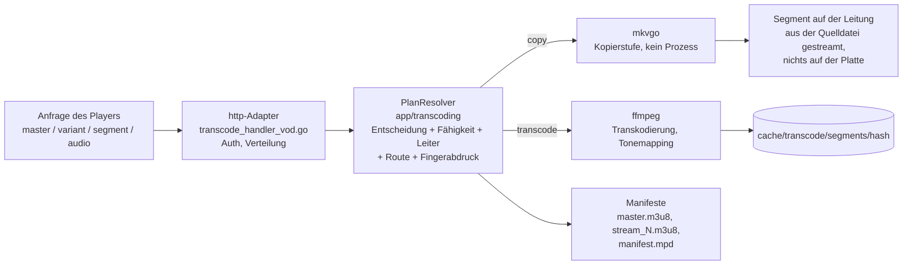

# Ein Video ausliefern - der HLS-Wiedergabeweg

Was passiert, wenn ein Player ein Video anfordert, von der ersten Anfrage
nach `master.m3u8` bis zu den Bytes eines Segments: der Leseweg. Der Code
verteilt sich auf den treibenden Adapter `http`
(`internal/adapters/driving/http/transcode_*`), die Dienste in
`app/transcoding` und die getriebenen Adapter `ffmpeg` / `mkvgo` / `prober`.
Keine einzelne Funktion führt den ganzen Ablauf aus, deshalb ist diese Seite
die Karte. Entschieden wird er durch
[ADR-0030](adr/0030-one-plan-one-decision.md) (ein Plan, eine
Entscheidung), [ADR-0024](adr/0024-playback-plan-resolver.md) (der
Plan-Resolver) und
[ADR-0029](adr/0029-transcoding-routes-are-measured-not-assumed.md)
(gemessene Fähigkeiten). Sie ist das Gegenstück zur Scan-Kette in
[Architektur](ARCHITECTURE.md) und die Vertiefung hinter „Golden path 4“ in
der [Karte der Codebasis](CODEBASE_MAP.md). Die Sicht des Benutzers auf
dieselbe Aushandlung finden Sie unter
[Wie Evey die Wiedergabeart wählt](playback/how-playback-is-decided.md).

## Das Denkmodell: 3 Fragen, 2 Engines, 1 Schlüssel

Ein Video auszuliefern heißt, drei Fragen zu beantworten und die Antwort
dann zu verpacken, wobei alles über einen einzigen Hash adressiert wird.

| Frage | Beantwortet von | Wo |
| --- | --- | --- |
| **F1 - Kann ich die Datei günstig lesen?** | Verteilung der Analyse nach **Dateiendung**: `.mkv/.webm` und `.mp4/.mov` gehen an [mkvgo](playback/mkvgo.md) (nur der Dateikopf, kein Prozess); alles andere, und jeder Fehlschlag des schnellen Wegs, geht an ffprobe, die maßgebliche Instanz | `adapters/driven/prober/dispatcher.go` |
| **F2 - Kann der Client sie so abspielen, wie sie ist?** | die Wiedergabe-**Entscheidung**, pro Spur getroffen: Video `copy` oder `transcode`, Audio `copy`, `transcode` oder der wasm-Weg für AC-3; Video und Audio werden unabhängig entschieden, und der häufige Fall ist „Video kopieren, Audio neu nach AAC kodieren“ | `app/transcoding/decision.go` |
| **F3 - Wie viel kann dieser Host kodieren?** | die kalibrierte **Fähigkeit** (gemessen im ersten ruhigen Moment) plus die **Zulassung** (welche Stufe der Leiter passt, gibt es einen freien Platz) | `app/transcoding/calibration_service.go`, `admission_shaper.go` |

Zwei Engines ziehen sich durch alles:

- **mkvgo** liest und verpackt neu (Remux, auf Abruf), ohne einen Prozess zu starten. Kostenlos.
- **ffmpeg / ffprobe** dekodieren, kodieren neu und analysieren, indem sie einen Prozess starten. Teuer.

Ein Schlüssel: Alles (Cache-Verzeichnis, ffmpeg-Sitzung, Segment-URLs) wird
über den **Fingerabdruck der Entscheidung** adressiert, einen Hash der
Entscheidung. Dieselben Bytes, derselbe Hash, eine gemeinsame Kodierung. Die
Korrektheit des ganzen Systems beruht darauf, dass dieser Hash **stabil**
bleibt, zwischen dem Manifest, das ein Player hält, und jedem Segment, das er
später abruft.

Die beiden Engines verlassen den Server auf unterschiedliche Weise: Ein
mkvgo-Segment wird auf Anfrage gebaut und laufend in die Verbindung
geschrieben, der Kopierweg berührt den Segment-Cache also nie. Ein
ffmpeg-Segment ist eine Datei im Verzeichnis des Fingerabdrucks, einmal
geschrieben und von dort ausgeliefert.

## Lesereihenfolge - einer Anfrage durch den Code folgen

Öffnen Sie diese Dateien nacheinander, um eine einzelne Wiedergabeanfrage
von Anfang bis Ende zu verfolgen:

1. **Einstieg** - `internal/adapters/driving/http/transcode_handler_vod.go`:
   `serveHTTP` prüft die Authentifizierung und verteilt dann auf master /
   variant / segment / audio.
2. **Der Plan** - `http/transcode_vod_plan.go` übersetzt den
   `*http.Request` in einen `PlaybackRequest` ohne Transportbezug;
   `app/transcoding/playback_plan_resolver.go` (`PlanResolver.Resolve`, der
   konkrete `PlaybackPlanResolver` in `playback_plan.go`) liefert einen
   einzigen unveränderlichen `PlaybackPlan`: die Entscheidung (F2), die
   Klasse der Leiter, die zugeschnittene Leiter, die Hardware-Route, den
   Packager und den Fingerabdruck. Jedes Manifest und jedes Segment der
   Sitzung wird daraus ausgeliefert: Eingabe des Manifests, Prüfung zum
   Abwerfen von Stufen, Versiegelung veralteter URLs, Wahl des Produzenten
   und Segmentschlüssel lesen alle diese eine Auflösung. Innerhalb einer
   Anfrage gilt die Invariante des Cache-Hashs also schon durch die
   Bauweise (der heiße Pfad für Segmente ging von etwa 5 Abrufen der
   Profileinstellungen auf 1 zurück). Die Hilfsfunktionen für Fakten der
   Quelle (Codec, HDR, SAR, 10 Bit...) liegen daneben in `source_facts.go`.
   `makeDecision` und `buildFingerprint` in
   `http/transcode_vod_fingerprint.go` sind dünne Hüllen für die
   Aufrufstellen ohne Plan (Vorwärmen, Master auf Abruf).
3. **F2 - Entscheidung** - `internal/app/transcoding/decision.go`:
   `MakePlaybackDecisionWithPrefs` (rein) ist das Gehirn, das pro Spur
   zwischen Kopieren und Transkodieren entscheidet. Der Resolver legt die
   Festlegungen aus der Anfrage darüber (`vd=` / `ad=`), die Übersteuerung
   für die Audio-Neusynchronisierung usw.
4. **F3 - Fähigkeit** - `internal/app/transcoding/calibration_service.go`:
   `Current()` liefert `domain/transcoding.Derive(report, policy)`
   (`derive.go`), die Obergrenzen des Hosts, abgeleitet aus der letzten
   Kalibrierung.
5. **Leiter und Zulassung** - der Resolver schneidet die Leiter zu
   (Komplexitätsklasse, Profile der Produzenten, Grenzen aus Quelle und
   Fähigkeit, CMCD/AV1-Grenzen, Zulassungsroute und Obergrenze) und
   **friert sie** dann auf der Zulassungsfestlegung **ein**
   (`admission_shaper.go`, `FreezeLadder`). Jeder spätere Aufruf liest sie
   wörtlich: Die Invariante des Cache-Hashs wird so Teil der Struktur.
   `video_session_limiter.go` hält den Kapazitätsplatz; ist er voll, weicht
   die Route von Hardware auf Software aus.
6. **Fingerabdruck** - ein `DecisionFingerprint` (Typ und `Hash()` in
   `app/transcoding/segment_cache.go`), vom Resolver zusammengesetzt. Der
   Hash ist der Cache-Schlüssel.
7. **Die Bytes erzeugen** - Kopieren: **mkvgo**,
   `app/transcoding/ondemand.go` (Port) und
   `adapters/driven/mkvgo/ondemand.go`; Transkodieren: **ffmpeg**,
   `adapters/driven/ffmpeg/hls_transcoder.go` (`BuildFFmpegArgs` ist rein;
   Segmente landen in `/cache/transcode/segments/<hash>/`).
8. **Verpacken** - `app/transcoding/manifest_generator.go` schreibt
   `master.m3u8` / `stream_N.m3u8`; `manifest_generator_dash.go` schreibt
   `manifest.mpd`.

!!! warning "Über Anfragen hinweg beruht die Invariante auf eingebackenen URLs"
    Jede Eingabe der Entscheidung muss in die URLs der Unterdateien
    eingebacken sein (`querySuffix` in `manifest_generator.go`), sonst kann
    eine Abfrage mitten in der Wiedergabe den Plan unter dem Player kippen.
    URLs pro Sitzung werden neu gebacken
    (`transcode_vod_manifest_rebake.go`), damit sie den Stream-Token tragen,
    für HLS wie für DASH, auch für Chromecast ohne Cookies.

## Die zwei Engines, nach Kosten

Der **Verteiler der Analyse** (`adapters/driven/prober/dispatcher.go`) ist
eine Zuständigkeitskette nach Dateiendung: Er versucht mkvgo und fällt bei
jedem Zweifel auf ffprobe zurück (Lesefehler, Panic, nicht abbildbares
Ergebnis, eine verlorene Medienspur in einer MP4, DoVi-Profil 5, nicht
lesbare Farbangaben). Beide schnellen Wege sind immer an (nil-Schranken in
`wire.go`); ffprobe ist das Sicherheitsnetz und wird nie umgangen. Ein
zweiter, gleich gebauter Verteiler (`keyframe_dispatcher.go`) kümmert sich
um den Seek-Index (die Stellen, an denen gespult werden kann).

| Vorgang | mkvgo (kostenlos) | ffprobe / ffmpeg (teuer) |
|---|---|---|
| Analyse der Metadaten (Codec, Abmessungen, HDR, Bitrate, Dauer) | `.mkv/.webm/.mp4/.mov`, nur der Dateikopf | alles andere, oder als Rückfall |
| Bildratenmodus (cfr/vfr) | `AnalyzeFrameRateMode` | - |
| Remux von MKV nach MP4 (ohne Neukodierung) | `RemuxToMP4` | - |
| HLS/DASH auf Abruf (Kopierstufe) | `OnDemandPackager` | - |
| Video neu kodieren / HDR-Tonemapping | - | `hls_transcoder.go` |
| Zeilensprung erkennen (idet), Landepunkt beim Spulen, chromaprint, DoVi P5 | - (braucht Dekodierung / Zusatzdaten) | ffmpeg / ffprobe |

Drei ffprobe-Aufrufe laufen noch auf MKV/MP4-Quellen, deren Daten mkvgo
schon bereitstellt, alle im getriebenen Adapter `ffmpeg`: die Dauer in
`trickplay.go`, Bitrate und Abmessungen in `complexity_classifier.go`, die
Audioverzögerung der Wiedergabe in `audio_delay.go`.

## Audio wird getrennt vom Video entschieden

`makeDecision` erzeugt `VideoDecision` und `AudioDecision` unabhängig
voneinander. Die „Kopierstufe“ (`isCopyRequest`) hängt nur am **Video**;
selbst ein kopiertes Video trägt meist eine neu kodierte AAC-Spur daneben.
Die Audio-Entscheidung hat drei Ausgänge:

| Ausgang | Was ausgeliefert wird |
| --- | --- |
| kopieren | die Spur der Quelle, so wie sie ist |
| nach AAC transkodieren | ffmpeg, leichte Last |
| der **wasm-Weg**, für AC-3 / E-AC-3 in einem Browser, der es nicht selbst dekodieren kann | der Master wird zu einem reinen Video-Master mit einem Tag `#EVEY-AUDIO-URI`, das AC-3 wird **kopiert** (mkvgo `od_audio`, wenn sich der Plan bauen lässt, sonst ffmpeg `-c:a copy`), und `ac3go.wasm` dekodiert es im Browser zu PCM (`WasmAudioEngine.ts`), im Takt an das Video gekoppelt |

Safari ist vom wasm-Weg ausgeschlossen, über seine Fähigkeit, nicht über
seinen Namen: `canWasmDecodeAC3()`
(`frontend/packages/client/src/web/codec.ts`) liefert nur dann true, wenn
der Browser meldet, dass er AC-3 *nicht* selbst abspielen kann, und Safari
meldet, dass er es kann.

## Verpacken: CMAF, HLS, DASH

Der Container ist immer **CMAF** (fMP4): ein `init.mp4` pro Variante plus
`.m4s`-Segmente (der MPEG-TS-Zweig in `hls_transcoder.go` ist tot:
`needsFMP4Segments` liefert immer true). Über *dieselben* Segmente:

- **HLS** (`master.m3u8`, `stream_N.m3u8`, `EXT-X-MAP` init + `.m4s`), beide Engines.
- **DASH** (`manifest.mpd`): auf dem mkvgo-Kopierweg das eigene Manifest
  des Packagers (`OnDemandPlan.HasDASH`, Byte für Byte identisch, kein
  Speicherplatz, unter AES-128 abgeschaltet); auf dem ffmpeg-Weg ein
  Manifest, das **aus dem Plan erklärt** wird, über dieselben Fragmente, die
  die HLS-Playlists ansprechen (`ManifestGenerator.MPD`), geschrieben bevor
  irgendein Fragment existiert.

Was das DASH-Manifest ehrlich macht, ist das **Segmentraster**
(`domain/transcoding.SegmentGrid`): Jede transkodierte Stufe wird auf
dieselbe ganze Zahl von Bildern geschnitten, `round(3 s x fps)` (72 bei
23,976 fps, 75 bei 25, 90 bei 29,97). Ein Segment ist also exakt in den
Ticks der Videospur und über die ganze Umschaltgruppe hinweg identisch; der
Kopier-Rückfall erklärt seinen Keyframe-Plan. Eine Quelle mit unbekannter
oder variabler Bildrate bleibt beim alten 3-s-Takt, behält HLS und
antwortet auf `manifest.mpd` mit 404. Kein Client wird auf DASH
umgestellt: HLS bleibt überall der Standard. `DASHFromCMAF` von mkvgo über
die erzeugten Fragmente ist das Orakel für die Übereinstimmung
(`internal/pkg/cmafparity`, `TestDASHGridIntegration` bei 23,976/25/29,97
fps: kalt, Spulen, Umschaltgruppe mit zwei Stufen, getrenntes Audio
innerhalb eines AAC-Frames).

## Eingesetzte Entwurfsmuster

| Muster | Wo |
| --- | --- |
| Ports und Adapter (hexagonal) | die App-Schicht spricht mit `StreamProber`, `BenchmarkRunner`, `OnDemandPackager`, `StreamProducer`; ffmpeg und mkvgo setzen sie um, und eine neue Engine ist ein neuer Adapter |
| Strategie | `StreamProducer` (Software / Hardware / Kopie), gewählt von einem `ProducerSelector` |
| Zuständigkeitskette mit Rückfall | die Verteiler für Analyse und Keyframes (mkvgo, dann ffprobe als maßgebliche Instanz) |
| Inhaltsadressierter Cache | der Hash von `DecisionFingerprint` ist der Schlüssel für Cache und ffmpeg-Sitzung |
| Reiner Kern, imperative Hülle | `Derive`, `MakePlaybackDecision` und das Kostenmodell sind rein und werden ohne ffmpeg oder Datenbank getestet |
| Unveränderliches Wertobjekt | `StreamPlan`, die Zulassungsentscheidung, einmal erzeugt und nie verändert, damit die Invariante von URLs zu Bytes schon durch die Bauweise gilt |
| Kontrollierter Abbau | ein sicherer Rückfall bei jedem Schritt: Standardfähigkeit 720p, Ausweichen von Hardware auf Software, von Kopie auf Transkodierung, von mkvgo auf ffprobe |

<!-- sources
entry and plan: internal/adapters/driving/http/transcode_handler_vod.go - serveHTTP ; internal/adapters/driving/http/transcode_vod_plan.go ; internal/adapters/driving/http/transcode_vod_fingerprint.go - makeDecision, buildFingerprint ; internal/adapters/driving/http/transcode_vod_manifest_rebake.go
resolver: internal/app/transcoding/playback_plan_resolver.go - PlanResolver.Resolve ; internal/app/transcoding/playback_plan.go - PlaybackRequest, PlaybackPlan ; internal/app/transcoding/source_facts.go
decision and capability: internal/app/transcoding/decision.go - MakePlaybackDecisionWithPrefs ; internal/app/transcoding/calibration_service.go - Current ; internal/domain/transcoding/derive.go - Derive
ladder, admission, fingerprint: internal/app/transcoding/admission_shaper.go - StreamPlan, FreezeLadder ; internal/app/transcoding/video_session_limiter.go ; internal/app/transcoding/segment_cache.go - DecisionFingerprint ; internal/app/transcoding/stream_producer.go - StreamProducer, ProducerSelector
engines: internal/adapters/driven/prober/dispatcher.go ; internal/adapters/driven/prober/keyframe_dispatcher.go ; internal/app/transcoding/ondemand.go - OnDemandPackager ; internal/adapters/driven/mkvgo/ondemand.go ; internal/adapters/driven/ffmpeg/hls_transcoder.go - BuildFFmpegArgs, needsFMP4Segments ; internal/adapters/driven/ffmpeg/trickplay.go, complexity_classifier.go, audio_delay.go
packaging: internal/app/transcoding/manifest_generator.go - querySuffix, EVEY-AUDIO-URI ; internal/app/transcoding/manifest_generator_dash.go ; internal/domain/transcoding/segment_grid.go - SegmentTargetSeconds, gridFor ; internal/pkg/cmafparity ; internal/adapters/driven/ffmpeg/dash_grid_integration_test.go - TestDASHGridIntegration
wasm: frontend/packages/client/src/web/codec.ts - canWasmDecodeAC3
-->
