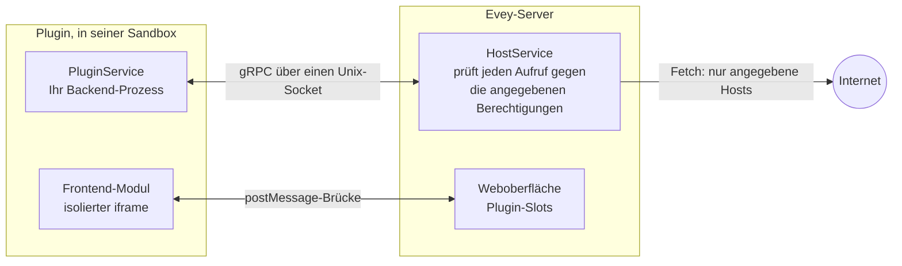

# Plugins

Plugins ergänzen Evey um das, was es nicht von selbst tut: Metadatenquellen,
Benachrichtigungskanäle, Webhook-Empfänger, Abschnitte der Startseite,
Überlagerungen im Player und Themes. Jedes Plugin ist ein eigener Prozess, der
über einen lokalen Socket mit dem Server spricht, von einer Sandbox eingesperrt
und auf die Berechtigungen beschränkt, die sein Manifest angibt. Seine
Oberfläche, falls es eine hat, läuft in einem isolierten Rahmen der Seite.

<figure class="evey-shot" markdown="span">
  { loading=lazy }
  <figcaption>Ohne Plugins.</figcaption>
</figure>

<figure class="evey-shot" markdown="span">
  { loading=lazy }
  <figcaption>Mit dem Beispiel-Plugin für das Wetter: ein Abschnitt oben, in seinem eigenen Rahmen gezeichnet.</figcaption>
</figure>

## Plugins installieren und verwalten

**Admin → Plugins** installiert ein Plugin aus seiner ZIP-Datei. Bevor etwas
installiert wird, zeigt die Vorschau:

<figure class="evey-shot" markdown="span">
  { loading=lazy }
  <figcaption><strong>Admin → Plugins</strong>: die verfügbaren Laufzeiten, die Ressourcengrenzen und eine Karte pro Plugin (Oberfläche auf Englisch).</figcaption>
</figure>

- die Berechtigungen, die das Plugin angibt, die Slots der Oberfläche, in denen
  es erscheinen möchte, und die Hosts, die es kontaktieren wird;
- was die statische Analyse in seinem Code gefunden hat;
- seine Signatur, wenn der Server Signaturen prüft.

Ein Plugin, bei dessen Analyse ein kritisches Muster gefunden wird, wird
abgelehnt. Ein Update eines installierten Plugins durchläuft dieselbe Vorschau;
verlangt es neue Berechtigungen, Slots oder Hosts, müssen Sie den Unterschied
ausdrücklich annehmen.

Jedes Plugin hat dann auf seiner Karte: aktivieren oder deaktivieren,
aktualisieren, Logs und seine Ressourcengrenzen (Speicher, Prozesse,
Festplatte, CPU-Priorität). Die Zeile **Host-Sandbox** des
**Sicherheits-Dashboards** zeigt den auf diesem Host tatsächlich geltenden
Sandbox-Modus: siehe [Plugin-Sandbox einrichten](plugins/sandbox-deployment.md),
wenn sie `basic` anzeigt.

Plugins sind standardmäßig aktiviert. `EVEY_PLUGINS_ENABLED=false` schaltet das
Subsystem ganz ab.

## Was ein Plugin kann und was nicht

Ein Plugin sieht sein eigenes Verzeichnis und nicht die Daten des Servers, hat
keinen direkten Netzwerkzugang (ein Plugin mit Netzwerkerlaubnis erreicht nur
die Hosts, die es angegeben hat, über den Server) und kann keine Prozesse
starten, außer es gibt die Berechtigung `subprocess` an. Die Berechtigungen, die
ein Plugin verlangen kann, stehen unter
[Berechtigungen und Slots](plugins/security-model.md). Wie die Sandbox
funktioniert und was sie noch nicht verhindern kann, beschreibt
[Sicherheitsmodell und Plugin-Sandbox](SECURITY.md).

Prüfen Sie ein Plugin von Dritten vor der Installation, wie jede Software:
Sobald ein Host auf der Liste eines Plugins steht, kann der Server nicht
überprüfen, was das Plugin an ihn sendet.

## Ein Plugin schreiben

Ein Plugin kann in jeder Sprache geschrieben werden, die sein `entrypoint`
starten kann. Erzeugte gRPC-Stubs werden für Python, Node.js, PHP, Ruby, Dart,
Java und Swift mitgeliefert; Go-Stubs werden mit `protoc-gen-go` erzeugt;
kompilierte Programme brauchen die Berechtigung `native-binary`.

| Seite | Inhalt |
| --- | --- |
| [Ein Plugin schreiben](plugins/dev-setup.md) | Voraussetzungen, erstes Plugin, die Installationsschleife, Signieren, Verteilen. Hier beginnen. |
| [Plugin-API-Referenz](plugins/api-reference.md) | Das Manifest, die Backend-Aufrufe und der Datenspeicher, die Frontend-Brücke `evey.*`, die Capabilities. |
| [Berechtigungen und Slots](plugins/security-model.md) | Was ein Manifest angeben darf, was bei der Installation geprüft wird, die Regeln für externe Abrufe, die Slots. |
| [Themes](themes.md) | Die Oberfläche mit CSS und einem abgeschotteten Skript neu gestalten. |
| [Webhooks und API-Schlüssel](webhooks-api-keys.md) | Evey mit anderen Werkzeugen verbinden, ohne ein Plugin zu schreiben. |
