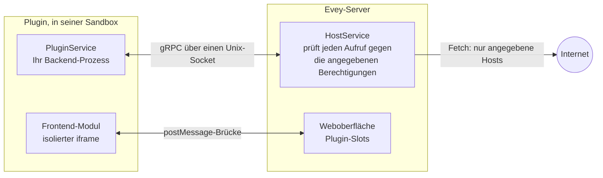

# Ein Plugin schreiben

Diese Seite führt einen Entwickler von einem Klon von Evey zu einem Plugin,
das auf einem lokalen Server läuft, und dann zu einem signierten Paket, das
andere Administratoren installieren können. Die Anleitung in
[Abschnitt 3](#3-your-first-plugin-step-by-step) ist der direkte Weg; der
Rest ist Nachschlagematerial, zu dem Sie zurückkehren werden. Die Aufrufe und
Felder selbst stehen in der [Plugin-API-Referenz](api-reference.md).



Ein Plugin ist ein ZIP mit einer `plugin.yaml` auf oberster Ebene und einem
Backend-Prozess, den der Server in einer Sandbox startet. Der Prozess bietet
einen kleinen gRPC-Dienst auf einem Unix-Socket an und ruft den Server über
einen anderen zurück. Es kann auch ein Oberflächenmodul mitbringen, das in
einem isolierten Frame der Seite dargestellt wird. Mit externen Diensten
kommuniziert es nur über den Server, und nur mit den Hosts, die es angegeben hat.

## 1. Voraussetzungen

| Werkzeug | Wozu |
|---|---|
| Go 1.27, Node.js 22 mit pnpm, Docker mit Compose | Die Entwicklungsumgebung (`make dev`) baut den Server und die Web-App. |
| `bubblewrap` (`bwrap`) | Nur für die Sandbox-Modi `bubblewrap` und `strict`. Der Standardmodus `auto` nutzt Landlock und braucht ab Kernel 5.13 nichts weiter. |
| [cosign](https://docs.sigstore.dev/cosign/installation/) | Um Ihr Paket vor der Verteilung zu signieren ([Abschnitt 7](#7-sign-your-plugin)). Zum Entwickeln nicht nötig. |

Wählen Sie die Sprache Ihres Plugins unter den Laufzeiten, die der Server
starten kann: `python`, `nodejs`, `php`, `ruby`, `lua`, `bash` und `sh`
brauchen ihren Interpreter im Image; `go` bringt eine kompilierte
Binärdatei mit und braucht die Berechtigung `native-binary`. Das
Standard-Image enthält nur Python. Das Image `-nodejs` ergänzt Node.js, das
Image `-full` ergänzt PHP, Ruby und Lua. Ein Manifest, das eine Laufzeit
nennt, die dem Image fehlt, wird bei der Installation abgelehnt, mit der
Liste der verfügbaren Laufzeiten.

Die gRPC-Schnittstelle ist in einer einzigen Datei definiert, `proto/plugin/v1/plugin_api.proto`.
Stubs werden für Python, Node.js, PHP, Ruby, Dart, Java und Swift unter
`sdk/<language>/` erzeugt. Der Server kopiert die Stubs Ihrer Sprache beim
Start des Plugins neben Ihren Einstiegspunkt. Ein Plugin in Node.js oder
Python muss also nichts mitliefern: Das Image stellt Node.js-Plugins
`@grpc/grpc-js` und `@grpc/proto-loader` bereit und Python-Plugins `grpcio`.
Für eine andere Sprache erzeugen Sie die Stubs mit `protoc` und legen sie ins
ZIP:

```bash
protoc --proto_path=proto \
       --<lang>_out=OUT_DIR --grpc_<lang>_out=OUT_DIR \
       proto/plugin/v1/plugin_api.proto
```

`make plugin-sdk` erzeugt die mitgelieferten Stubs neu. Jede
`sdk/<lang>/README.md` nennt das gRPC-Plugin, das ihre Sprache braucht.

## 2. Evey lokal starten

```sh
git clone git@github.com:eveyproject/evey.git
cd evey
cp .env.dev.example .env.dev   # dann MEDIA_DIR, EVEY_DB_PASSWORD, MEILI_MASTER_KEY setzen
make setup                      # einmalig: trägt evey.test in /etc/hosts ein
make dev                        # postgres, meilisearch, der Server (Air), die Web-App (Vite)
```

Öffnen Sie `https://evey.test`. Der Einrichtungsassistent legt beim ersten
Start das Administratorkonto an, wie in
[Ersteinrichtung](../getting-started/first-setup.md) beschrieben.
Plugin-Dateien liegen in `./evey-data/plugins/<plugin-id>/`, im Container
als `/data/plugins` eingehängt.

## 3. Ihr erstes Plugin, Schritt für Schritt

Das Beispiel `examples/plugins/nodejs-example` ist das kleinste vollständige
Plugin: Es bedient `PluginService`, verbindet sich mit `HostService` und
schreibt eine Zeile in sein Protokoll, wenn der Server es startet. Wir
kopieren es, ändern eine Sache und installieren es.

1. **Kopieren Sie das Beispiel.**

    ```sh
    cp -r examples/plugins/nodejs-example ~/hello-plugin
    cd ~/hello-plugin
    ```

2. **Geben Sie ihm einen Namen.** Bearbeiten Sie `plugin.yaml`:

    ```yaml title="plugin.yaml"
    name: hello-plugin          # eindeutig, kebab-case
    kind: plugin
    version: 1.0.0              # semver: bei jedem Hochladen erhöhen
    description: Says hello in its log
    author: you
    language: nodejs            # die Laufzeit, die der Server haben muss
    entrypoint: node main.js    # die Befehlszeile, die der Server startet
    permissions:
      - api.library             # erlaubt dem Backend, Medien zu lesen
    ```

    `language` sagt dem Server, welche Laufzeit er prüfen und welche Stubs
    er kopieren soll. `entrypoint` ist das, was er startet, im Verzeichnis
    des Plugins, mit der Umgebung aus dem nächsten Schritt.

3. **Lesen Sie `main.js`.** Der Server übergibt dem Prozess drei Variablen:
   `EVEY_PLUGIN_ID`, `EVEY_PLUGIN_SOCK` (der Socket, auf dem *Ihr* Prozess
   lauschen und `PluginService` bedienen muss) und `EVEY_HOST_SOCK` (der
   Socket, mit dem Sie sich verbinden, um `HostService` aufzurufen). Das
   Beispiel lädt `plugin_api.proto` aus seinem eigenen Verzeichnis, wohin der
   Server die Datei kopiert hat, und setzt die fünf Methoden von
   `PluginService` um. Ändern Sie die Nachricht in `Initialize`:

    ```js title="main.js (excerpt)"
    Initialize(call, callback) {
      hostLog("LOG_LEVEL_INFO", `hello from ${process.env.EVEY_PLUGIN_ID}`);
      callback(null, { success: true });
    },
    ```

4. **Packen Sie es als ZIP.** Das Manifest muss auf oberster Ebene des
   Archivs liegen, nicht in einem Unterverzeichnis:

    ```sh
    zip -r ../hello-plugin.zip . -x ".*" "node_modules/*"
    ```

5. **Installieren Sie es.** Unter **Verwaltung → Plugins** wählen Sie
   **Plugin installieren**, dann das ZIP und **Vorschau & Installieren**: Die
   Vorschau listet `api.library` und das Ergebnis der statischen Analyse.
   Über die API sieht dasselbe Hochladen so aus:

    ```sh
    curl -F "plugin=@hello-plugin.zip" \
         -H "Authorization: Bearer $EVEY_TOKEN" \
         https://evey.test/api/v1/admin/plugins/upload
    ```

6. **Lesen Sie das Protokoll.** Auf der Karte des Plugins zeigt
   **Protokolle** die Zeile, die `Initialize` geschrieben hat.
   `docker compose logs evey` enthält die Serverseite desselben Starts, unter
   der ID des Plugins.

7. **Arbeiten Sie weiter.** Ändern Sie den Code, erhöhen Sie `version`,
   packen Sie neu und nutzen Sie **Aus Quelle aktualisieren …** auf der
   Karte. Ein Hochladen mit derselben oder einer niedrigeren Version wird
   abgelehnt. Eine neue Berechtigung im Manifest löst den
   Zustimmungsschritt aus, den der Administrator bestätigen muss.

Damit kennen Sie die gesamte Backend-Schnittstelle. Davon ausgehend lässt
sich ein Plugin in drei Richtungen erweitern: den Server aufrufen
(`HostService`, Abschnitt 4), eine Oberfläche darstellen (Abschnitt 5) und
externe Dienste erreichen (Abschnitt 6).

## 4. Den Server aus dem Backend aufrufen

Jeder Aufruf an `HostService` trägt die Identität des Plugins: Der Server
prüft den Prozess am Socket über seine PID, und ein Interceptor lehnt jeden
Aufruf ab, dessen Berechtigung das Manifest nicht angibt. Drei Gruppen
brauchen gar keine Berechtigung:

- `Log` schreibt ins Protokoll des Plugins, das auf seiner Karte erscheint;
- `GetConfig` liest die Werte, die der Administrator unter **Konfiguration**
  gesetzt hat (angegeben in `config_schema`); mit `SetConfig` legt das Plugin
  dort eigene Schlüssel ab;
- `GetData` / `SetData` / `DeleteData` / `ListDataKeys` ist der private
  Schlüssel-Wert-Speicher des Plugins, der bei der Deinstallation gelöscht
  wird.

`GetMediaItem` und `ListMediaItems` brauchen `api.library` oder
`media.read`; `Fetch` braucht `network`. Die vollständige Tabelle, mit den
Methoden, die in der Schnittstelle definiert sind, aber noch nicht bedient werden, steht in
der [Plugin-API-Referenz](api-reference.md#hostservice-what-the-plugin-can-call).

## 5. Eine Oberfläche hinzufügen

Eine Oberfläche ist ein JavaScript-Modul, das die Seite in einem
isolierten Frame lädt, in einem der Slots, die der Server erlaubt. Geben
Sie an, wo die Dateien liegen und wohin das Modul kommt:

```yaml title="plugin.yaml"
web_root: dist               # das Verzeichnis, das als statische Dateien ausgeliefert wird
frontend:
  - slot: home.section       # siehe die Liste der Slots
    src: dist/index.js       # muss unter web_root liegen
```

Das Modul bekommt eine Brücke `window.evey`: `evey.onInit` übergibt ihm die
Konfiguration des Plugins, die Sprache, das Design und die Oberfläche, in
der es angezeigt wird. `evey.resize`, `evey.toast` und `evey.navigate` wirken
innerhalb fester Grenzen auf die Seite. Und wenn das Manifest `prefs` oder
`public` angibt, erreichen `evey.prefs.*` und `evey.media.*` den Server über
einen kurzlebigen Token, den der Host für den Frame verwaltet.
`examples/plugins/weather` ist ein vollständiges Widget mit Build-Schritt;
`examples/plugins/data-demo` zeigt `prefs`, `public` und den Slot
`admin.nav`. Die Brücke und die Slots sind in der
[Plugin-API-Referenz](api-reference.md#frontend-api) beschrieben.

## 6. Externe Dienste erreichen

Ein Plugin-Prozess kann keinen Socket ins Internet öffnen, in keinem
Sandbox-Modus. Die einzige Verbindung nach außen ist der Aufruf `Fetch` von
`HostService`: Der Server prüft das Ziel gegen das Manifest und führt die
Anfrage dann selbst aus.

```yaml title="plugin.yaml"
permissions:
  - network
external_fetch:
  - api.open-meteo.com       # reine Hostnamen: kein Schema, kein Platzhalter, keine IP
```

`network` ohne `external_fetch` wird bei der Installation abgelehnt. Zur
Laufzeit nimmt der Vermittler `http` und `https`, `GET` und `HEAD` an,
liefert Antworten bis 8 MiB innerhalb von 20 Sekunden und lehnt private oder
reservierte Adressen ab, auch über eine Weiterleitung. Der Frame der
Oberfläche bekommt dieselbe Hostliste als `connect-src`. Ein Widget darf
diese Hosts also direkt über `https` aufrufen. Die Regeln stehen in
[Berechtigungen und Slots](security-model.md#external-fetch-rules).

!!! note "Die Hostliste ist eine verbindliche Zusage an den Administrator"
    Der Administrator sieht die Hostliste bei der Installation und muss
    jede Ergänzung beim Update bestätigen. Beschränken Sie sie auf das, was
    das Plugin braucht, und schreiben Sie in Ihre README, was jeder Host
    bekommt.

## 7. Ihr Plugin signieren

!!! info "Was eine Signatur beweist"
    Eine Signatur belegt, dass das ZIP, das der Administrator installiert,
    Byte für Byte das ist, das **Sie** veröffentlicht haben, signiert mit dem
    Schlüssel, dem er vertraut. Sie sagt nichts darüber aus, was das Plugin tut:
    Berechtigungen, Hosts und die Analyse in der Vorschau gelten weiter.
    Evey prüft sie offline und im eigenen Prozess (ECDSA P-256 über den
    SHA-256 des ZIP, das Format, das `cosign sign-blob --key` erzeugt): kein
    `cosign`-Programm auf dem Server, kein Netz, kein Transparenzprotokoll.

Sie brauchen [cosign](https://docs.sigstore.dev/cosign/installation/) nur
auf Ihrem eigenen Rechner.

1. **Einmalig: ein Schlüsselpaar erzeugen.**

    ```sh
    # eine echte Passphrase wählen; cosign.key bleibt privat, nie committen
    COSIGN_PASSWORD="your-passphrase" cosign generate-key-pair
    # -> cosign.key (privat) und cosign.pub (die Datei, die Sie weitergeben)
    ```

2. **Bei jeder Veröffentlichung: packen, dann signieren**, und zwar genau die
   Datei, die Sie verteilen.

    ```sh
    cd hello-plugin && zip -r ../hello-plugin.zip . && cd ..

    COSIGN_PASSWORD="your-passphrase" cosign sign-blob \
      --key cosign.key --tlog-upload=false --yes \
      --output-signature hello-plugin.zip.sig \
      hello-plugin.zip
    ```

3. **Vor der Auslieferung prüfen**, mit derselben Prüfung, die der Server
   macht:

    ```sh
    cosign verify-blob --key cosign.pub --signature hello-plugin.zip.sig \
      --insecure-ignore-tlog hello-plugin.zip      # -> Verified OK
    ```

4. **Drei Dateien zusammen veröffentlichen**: `hello-plugin.zip`,
   `hello-plugin.zip.sig` und `cosign.pub`. Stellen Sie den Fingerabdruck
   des öffentlichen Schlüssels an einen Ort, an dem Ihre Benutzer ihn
   vergleichen können (README, Versionshinweise). So wissen sie, dass
   `cosign.pub` nicht ausgetauscht wurde.

Auf der Instanz, die das Plugin installiert, setzt der Administrator den
Schlüssel und eine Regel und startet den Server neu:

```sh
EVEY_PLUGINS_COSIGN_PUBLIC_KEY=/etc/evey/cosign.pub
EVEY_PLUGINS_COSIGN_POLICY=warn   # oder "enforce", um abzulehnen, was die Prüfung nicht besteht
```

Dann wählt er unter **Verwaltung → Plugins** das ZIP und unter
**Signaturdatei (.zip.sig, optional)** dessen `.zip.sig`. Über die API ist
die Signatur das Feld `sig` beim Hochladen. Die Vorschau zeigt **Signiert**
oder eine ungültige Signatur, und das Sicherheits-Dashboard behält das
Ergebnis.

Typische Fehlerquellen:

- **Jede Änderung am ZIP macht die Signatur ungültig**, sogar dieselben
  Dateien neu zu packen. Signieren Sie die Datei, die Sie verteilen, und
  signieren Sie jede Version neu.
- **Nur ECDSA-P-256-Schlüssel werden angenommen**, und genau die erzeugt
  `cosign generate-key-pair`. Schlüsselloses Signieren und Verweise auf ein
  KMS werden nicht geprüft.
- Der Schlüssel wird beim Start aus einer PEM-Datei gelesen: Eine fehlende
  oder fehlerhafte Datei verhindert den Start des Servers, statt erst bei der
  ersten Installation einen Fehler auszulösen. Mit `enforce` und ohne Schlüssel startet der
  Server nicht.
- Mit dem Standard `warn` und ohne konfigurierten öffentlichen Schlüssel
  **wird nichts geprüft**; der Server schreibt beim Start nur eine Warnung
  ins Protokoll.
- Ein falscher Schlüssel, ein manipuliertes ZIP und eine fehlende `.sig`
  gelten alle als fehlgeschlagene Signatur: Unter `enforce` wird die
  Installation oder das Update abgelehnt.

## 8. Was der Installer prüft, der Reihe nach

Jeder Schritt kann das Paket ablehnen. Der Administrator sieht den Grund,
das Serverprotokoll enthält die Einzelheiten.

1. **Manifest.** `plugin.yaml` wird direkt aus dem ZIP gelesen:
   Pflichtfelder, semver, bekannte Berechtigungen und Capabilities, Slots aus
   der erlaubten Liste, Einträge in `external_fetch`, die reine Hostnamen
   sind, `web_root` vorhanden, wenn `frontend` angegeben ist. Die angegebene
   `language` muss eine Laufzeit des Images sein.
2. **Version und Ausweitung.** Bei einem schon installierten Plugin muss die
   neue Version höher sein, und jede neue Berechtigung, Capability, jeder
   neue Slot oder Host hält die Installation hier an, bis der Administrator
   den Unterschied bestätigt (`accept_permission_changes=true` auf der
   Upload-Route).
3. **Signatur und Hash.** Die Signatur wird geprüft, wenn ein öffentlicher
   Schlüssel konfiguriert ist; ein Fehler blockiert nur unter `enforce`. Der
   Hash des ZIP wird festgehalten und erneut geprüft, wenn ein zuvor in der
   Vorschau gezeigtes Update angewendet wird.
4. **Entpacken** in ein Zwischenverzeichnis: höchstens 5.000 Einträge,
   100 MB pro Datei, 500 MB insgesamt, ein Kompressionsverhältnis von 100:1,
   kein symbolischer Link, kein Pfad, der das Archiv verlässt. Ein Update
   ändert die laufende Version erst, wenn alle folgenden Schritte
   bestanden sind.
5. **Nur Themes:** Das Stylesheet wird bereinigt und zurückgeschrieben, und
   eine `theme.js`, die ein verbotenes Muster enthält, führt zur
   Ablehnung des Pakets.
6. **Statische Analyse** jeder Textdatei: Ein kritischer Fund lehnt das
   Paket ab. Die Warnungen `deserialization` und `obfuscation` lehnen es
   ebenfalls ab, und `native_code`, kompilierte Binärdateien und eingebettete
   Archive lehnen es ab, außer das Manifest gibt `native-binary` an.
7. **Speichern und starten.** Das Zwischenverzeichnis ersetzt das bisherige
   Verzeichnis, der Datensatz geschrieben und der Prozess gestartet.

Wonach die Analyse sucht, steht in
[Plugin-Sandbox und Bedrohungsmodell](../SECURITY.md#static-analysis). Sie
liest auch Kommentare: Eine Zeile `# pip install foo` in einem Kommentar wird
wie Code gemeldet.

## 9. Unter welchen Bedingungen Ihr Prozess läuft

Der Server startet den Prozess mit niedrigerer CPU-Priorität, einer
Obergrenze für den Arbeitsspeicher, einem Limit für Prozesse und Threads und
einer Größengrenze für sein Verzeichnis. Ein Wächter hält ein Plugin an, das
sie überschreitet. Die Standardwerte sind 256 MiB, 64 Prozesse und 100 MiB.
Der Administrator kann sie unter **Verwaltung → Plugins → Ressourcenlimits**
anpassen. Ohne die Berechtigung `subprocess` kann der Prozess keine
Kindprozesse starten, egal in welcher Sprache; Threads funktionieren.

Die Sandbox beschränkt das Dateisystem auf das Verzeichnis des Plugins und
blockiert jeden Netzwerk-Socket, ohne Ausnahme. Welcher Modus gilt, hängt vom
Host ab, nicht vom Plugin:
[Plugin-Sandbox und Bedrohungsmodell](../SECURITY.md#sandbox-modes)
beschreibt die Modi, und [Plugin-Sandbox einrichten](sandbox-deployment.md)
sagt einem Administrator, welchen er wählen soll.

## 10. Ein Plugin verteilen

Es gibt keinen Katalog: Ein Administrator installiert ein Plugin, indem er
sein ZIP hochlädt oder seine URL im Verwaltungsbereich einfügt, egal wo Sie
es veröffentlichen (ein Release auf einer Code-Plattform, Ihre eigene
Website).

- Liefern Sie das ZIP, seine `.sig` und Ihre `cosign.pub` zusammen aus
  (Abschnitt 7).
- Nennen Sie die Berechtigungen und die Hosts aus `external_fetch` in Ihrer
  README: Der Administrator sieht sie bei der Installation und muss sie
  bestätigen. Ein unerwarteter Eintrag dort ist der häufigste Grund, warum eine
  Installation abgelehnt wird.
- Damit Ihr Plugin bei den mitgelieferten Beispielen erscheint, öffnen Sie
  einen Pull Request gegen `examples/plugins/` mit dem Quellcode und einer
  README. Beispiele werden geprüft und aus dem Quellcode gebaut; ein Eintrag
  ist keine Empfehlung und trägt keine Signatur des Projekts.

## 11. Fehlerbehebung

| Symptom | Ursache | Lösung |
|---|---|---|
| `plugin requires "nodejs" runtime which is not installed in this image` | Der Image-Variante fehlt der Interpreter. | Nutzen Sie das Image `-nodejs` oder `-full`, oder schreiben Sie das Plugin in Python. |
| `manifest: external_fetch entry "*.tmdb.org" is a wildcard - use explicit hostnames` | Platzhalter werden bei der Installation abgelehnt, ohne Ausnahme. | Listen Sie jeden Hostnamen auf, den Sie brauchen (`api.tmdb.org`, `image.tmdb.org`). |
| `manifest: frontend slot "admin.section" not allowed` | Der Slot steht nicht in der erlaubten Liste. | Wählen Sie einen Slot aus der [Liste der Slots](api-reference.md#slots); `admin.nav` ist der einzige Slot im Verwaltungsbereich. |
| `manifest: network permission requires non-empty external_fetch` | `network` ohne Hosts angegeben. | Ergänzen Sie die Hosts oder streichen Sie die Berechtigung. |
| `plugin already installed at version 1.0.0, new version must be higher` | Das ZIP trägt die installierte Version. | Erhöhen Sie `version` oder deinstallieren Sie zuerst. |
| `signature does not match the plugin or the configured key` | Die `.sig` wurde mit einem anderen Schlüssel erstellt, oder das ZIP hat sich nach dem Signieren geändert. | Signieren Sie genau dieses ZIP neu mit dem richtigen Schlüssel, oder korrigieren Sie `EVEY_PLUGINS_COSIGN_PUBLIC_KEY`. |
| `plugin blocked: theme.js contains forbidden pattern` | Der Scanner für Theme-Skripte hat eine verbotene API gefunden. | Ein Theme darf nur `evey.theme.*` aufrufen: siehe [Themes](../themes.md#what-the-scanner-refuses). |
| Das Protokoll endet mit `memory quota exceeded (... MB > ... MB)` | Der Wächter hat das Plugin über seinem Speicherlimit angehalten. | Senken Sie den Speicherverbrauch oder erhöhen Sie **Max. Arbeitsspeicher (MiB)** unter **Ressourcenlimits**. |
| `bwrap: ... permission denied` | Modus `bubblewrap` in Docker, blockiert vom seccomp- oder AppArmor-Profil des Containers. | Behalten Sie den Standardmodus `auto`. Sonst siehe [Plugin-Sandbox einrichten](sandbox-deployment.md). |
| Das Oberflächenmodul erscheint nicht | Das Plugin ist deaktiviert, der Slot falsch geschrieben, oder `src` liegt nicht unter `web_root`. | Prüfen Sie den Zustand der Karte, den Namen des Slots und die Anfragen an `/api/v1/plugins/<id>/assets/...` im Netzwerkbereich des Browsers. |

<!-- sources
runtimes, image variants: internal/adapters/driven/pluginrunner/runtime_availability.go - runtimeBinaries, compiledLanguages ; internal/app/plugin/install.go - parseAndValidateManifest ; Dockerfile (RUNTIMES lean/nodejs/full)
stubs copied at start, NODE_PATH: internal/adapters/driven/filesystem/plugin_fs.go - CopySDKStubs ; internal/adapters/driven/pluginrunner/runner_start.go ; sdk/python/README.md ; examples/plugins/nodejs-example/package.json
dev stack: DEV.md (Quick Start) ; Makefile - setup, dev ; docker-compose.yml (evey-data/plugins:/data/plugins)
example: examples/plugins/nodejs-example/main.js, plugin.yaml
env vars: internal/adapters/driven/pluginrunner/runner_start.go (EVEY_PLUGIN_ID, EVEY_PLUGIN_SOCK, EVEY_HOST_SOCK)
upload route, fields: internal/adapters/driving/http/plugin_asset_handler.go (plugin, sig, accept_permission_changes)
host RPC permissions: internal/adapters/driving/grpcapi/plugin_interceptor.go ; peer auth: internal/adapters/driving/pluginhost/peer_creds.go
host RPCs: internal/adapters/driving/pluginhost/host_server.go - Log, GetConfig, SetConfig, GetData ; fetch.go - Fetch (GET/HEAD, maxFetchBytes, fetchTimeout)
frame connect-src: frontend/packages/client/src/plugins/hostProtocol.ts - buildConnectSrc ; internal/adapters/driving/http/plugin_frame_handler.go - pluginFramePolicy
bridge: frontend/packages/client/src/plugins/bridgeScript.ts - EveyBridge
cosign: internal/adapters/driven/pluginrunner/cosign.go - loadP256PublicKey ; internal/config/config.go - CosignPolicy validation
install order: internal/app/plugin/install.go - installLocalZip, parseAndValidateManifest, resolveExistingPlugin, verifyPluginIntegrity, extractPluginToStaging, validateStagedPlugin, checkEscalatedWarnings, swapAndPersistPlugin ; update.go - ApplyUpdate ; zip limits: docs/SECURITY.md (ZIP extraction)
resource limits: internal/config/config.go - Plugins ; internal/adapters/driven/pluginrunner/runner_resmon.go ; i18n admin.plugins.resourceLimits.*
error texts: internal/adapters/driven/pluginrunner/manifest.go ; internal/domain/plugin/model.go ; internal/app/plugin/install.go ; cosign.go ; runner_resmon.go
-->
