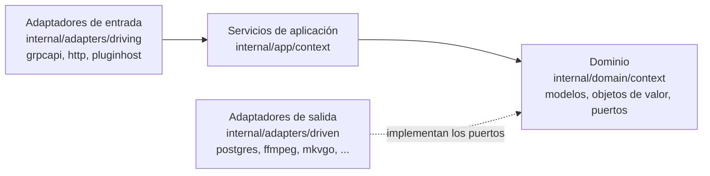
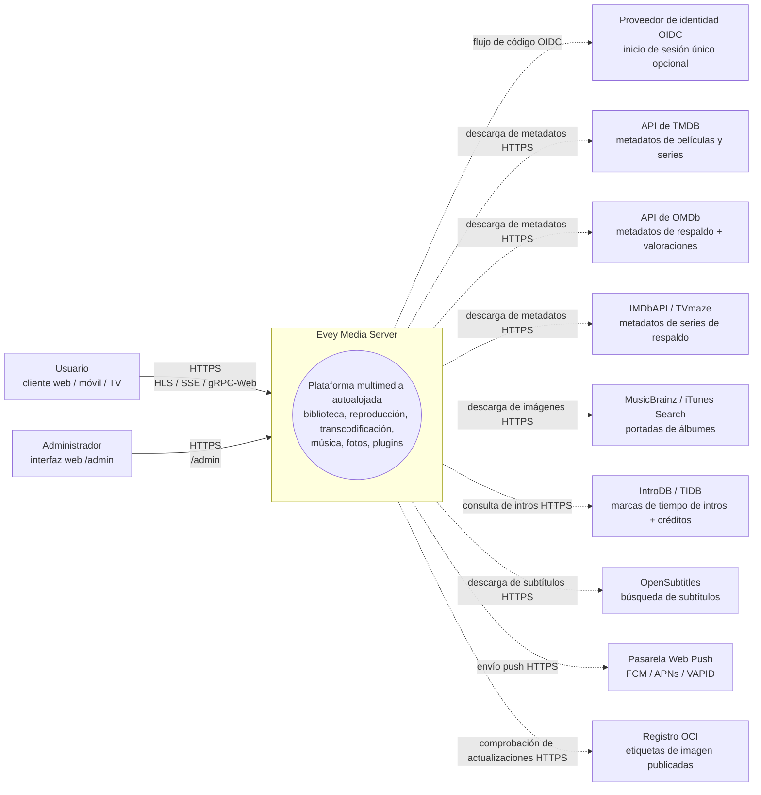
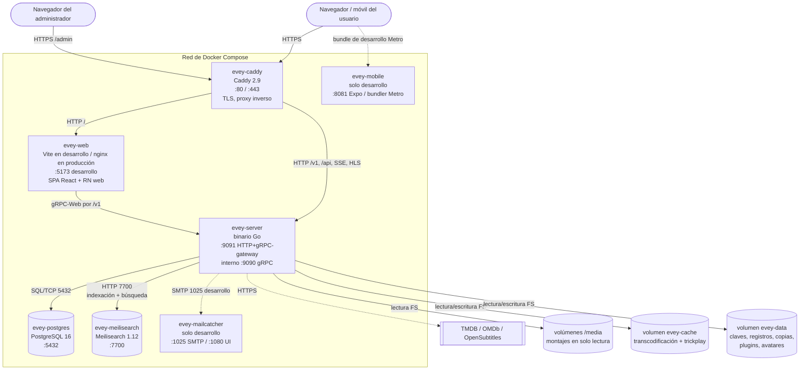
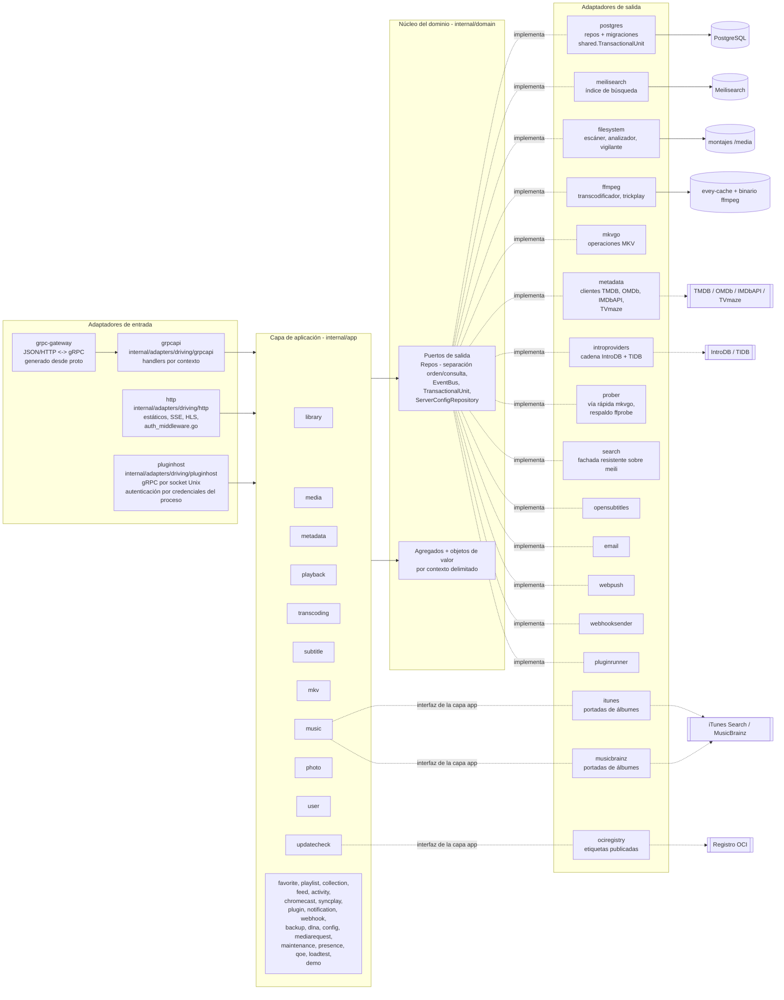
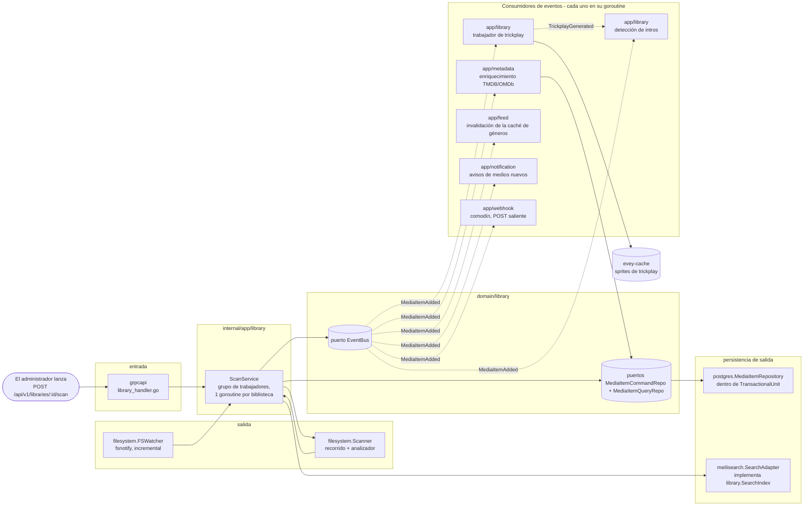

# Arquitectura

Cómo está montado el servidor: las capas hexagonales bajo `internal/`, los
contextos delimitados, los eventos que los conectan y las guardas estáticas
que mantienen el código en esos raíles. El código vive en `internal/domain`,
`internal/app`, `internal/adapters/{driving,driven}` y se conecta en
`cmd/evey/wire*.go`; la organización la decide
[ADR-0001](adr/0001-hexagonal-architecture.md), la separación de los
repositorios [ADR-0009](adr/0009-cqrs-repo-split.md) y el bus de eventos
[ADR-0010](adr/0010-event-bus.md). Para compilar y ejecutar, lee
[DEV.md](../DEV.md); para saber qué archivos tocar en un cambio concreto, lee
el [Mapa del código](CODEBASE_MAP.md).

El backend está en Go; los clientes web, móvil y TV son un monorepo
TypeScript/React en `frontend/` (React Native / Expo para móvil y TV).

## Capas

| Carpeta | Contiene | Regla |
| --- | --- | --- |
| `internal/domain/<context>/` | los modelos, los objetos de valor y los **puertos** (interfaces) | ningún import de framework, ningún import de otro contexto |
| `internal/app/<context>/` | los servicios de aplicación que orquestan los puertos | toda entrada/salida pasa por un puerto; `dlna` (SSDP / UPnP AVTransport) y `loadtest` (su propio cliente HTTP) son las dos excepciones deliberadas que acceden directamente a la red |
| `internal/adapters/driven/` | los adaptadores de salida que implementan los puertos: `postgres`, `meilisearch`, `ffmpeg`, `mkvgo`, `filesystem`, `prober`, `opensubtitles`, `email`, `webpush`, `webhooksender`, `pluginrunner`, `metadata`, `introproviders`, `search` | tres más cumplen una interfaz de la capa de aplicación en lugar de un puerto del dominio: `itunes` y `musicbrainz` (`app/music.AlbumArtFetcher`), `ociregistry` (`app/updatecheck`) |
| `internal/adapters/driving/` | los adaptadores de entrada: `grpcapi` (+ HTTP de grpc-gateway), `http` (archivos estáticos, middleware de autenticación, SSE, HLS, recursos de los iframes de plugins), `pluginhost` (servidor gRPC en un socket Unix, autenticado por las credenciales del proceso que se conecta: la API del servidor a la que llaman los plugins desde su sandbox) | |
| `internal/pkg/` | el núcleo técnico compartido: auth, logger, eventbus, i18n, metrics, tracing, ratelimit, procfork, ssrf, cache, ... | |
| `internal/config/` | la configuración del servidor | |
| `gen/` | el código proto generado | |

Regla de dependencias: `adapters -> app -> domain`. El dominio nunca importa
la aplicación ni los adaptadores. La composición está escrita a mano (no con
google/wire) en `cmd/evey/wire.go` y sus hermanos `wire_infra.go`,
`wire_services.go`, `wire_adapters.go`, `wire_events.go`, `wire_helpers.go`.
Los tests se saltan los adaptadores inyectando dobles que implementan los
mismos puertos del dominio: 20 de los 21 paquetes del dominio incluyen un
subpaquete `fakes/`.

## Contextos delimitados

Treinta y dos paquetes de contexto viven en `internal/domain/` e
`internal/app/`: 19 existen en las dos capas, 2 solo en el dominio
(`ratings`, `shared`) y 11 solo en la aplicación. Colaboran en parte mediante
eventos de dominio en un bus compartido; la capa de aplicación también lee
directamente el paquete de dominio de un contexto vecino (consulta
[Relaciones](#relations)).

| Contexto | Responsabilidad |
| --- | --- |
| `user` | cuentas, autenticación, sesiones, preferencias |
| `library` | bibliotecas, carpetas, trabajos de escaneo, índice de medios, personas, colecciones, los favoritos y los pulgares de un perfil (los pulgares no tienen servicio de aplicación: el RPC de valoración guarda y lee `UserRatingRepository` tal cual), trickplay, detección de intros y créditos |
| `media` (solo aplicación) | enlaces para compartir y tokens de streaming |
| `mediarequest` | solicitudes de medios enviadas por los usuarios |
| `metadata` | enriquecimiento con TMDB / OMDb, imágenes |
| `playback` | flujos, progreso, control remoto, reproduciendo ahora |
| `transcoding` | trabajos de ffmpeg, segmentos HLS |
| `subtitle` | integrados + externos + opensubtitles |
| `mkv` | operaciones con el contenedor MKV (con [mkvgo](playback/mkvgo.md)) |
| `music` | reproducción y etiquetado propios del audio |
| `photo` | bibliotecas de fotos |
| `favorite` (solo aplicación) | favoritos por perfil; el modelo y `FavoriteRepository` viven en `domain/library` |
| `playlist` | listas de reproducción de los usuarios, listas inteligentes |
| `collection` (solo aplicación) | colecciones preparadas por el administrador; sus puertos viven en `domain/library` |
| `ratings` (solo dominio) | traduce las clasificaciones de cada país (CSA, FSK, MPAA, BBFC, ACB) a un único eje de edad mínima |
| `feed` | feed de actividad / descubrir |
| `activity` | cronología de la actividad del usuario |
| `chromecast` | ciclo de vida de las sesiones de envío |
| `syncplay` | sesiones sincronizadas entre varios dispositivos |
| `plugin` | registro de plugins, tokens del sandbox, ciclo de vida |
| `notification` | notificaciones dentro de la aplicación + webpush |
| `webhook` | webhooks salientes |
| `backup` | copia de seguridad y restauración de la base de datos + la configuración |
| `config` (solo aplicación) | ajustes del servidor guardados, escritos tanto desde la entrada REST como desde la gRPC |
| `dlna` (solo aplicación) | descubrimiento SSDP y control UPnP AVTransport |
| `loadtest` (solo aplicación) | simula espectadores contra la propia pila HTTP del servidor: HLS, o el archivo tal cual cuando el veredicto de un cliente es una lectura directa |
| `maintenance` (solo aplicación) | mantenimiento de medios lanzado por el administrador: reconstrucción del índice de posicionamiento, diario de reparaciones, deshacer, integridad del audio |
| `presence` (solo aplicación) | registro en memoria, no guardado, de quién está conectado ahora mismo |
| `qoe` (solo aplicación) | recepción y agregación de la telemetría de reproducción CMCD (CTA-5004) |
| `demo` (solo aplicación) | la instancia pública de demostración (`EVEY_DEMO=1`): crea sus cuentas, sus bibliotecas y sus medios de licencia libre con los propios servicios del producto, y se reinicia sola |
| `updatecheck` (solo aplicación) | compara la versión en marcha con lo que publica el registro y se lo dice al administrador; nunca actualiza nada |
| `shared` (solo dominio) | puertos transversales (`EventBus`, `TransactionalUnit`, `ServerConfigRepository`, `ShareLinkRepository`), ids tipados, cursores, tokens de streaming |

### Relaciones

| Emisor | Eventos | Los consume |
| --- | --- | --- |
| `library` | `LibraryCreated` / `LibraryDeleted`, `LibraryScanStarted` / `LibraryScanCompleted`, `MediaItemAdded`, `MediaItemRemoved`, `TrickplayGenerated` | `media.item.added`: `notification`, `metadata` (enriquecimiento automático), el propio `library` (trabajador de trickplay + detección de intros), `feed` (invalidación de la caché de géneros) |
| `playback` | `PlaybackStarted` / `PlaybackStopped` | hoy ningún suscriptor específico; solo los recibe el comodín `"*"` de `webhook` |
| `user` | `UserCreated`, `user.password.reset_requested` | el primero no tiene suscriptor; el segundo lo consume el adaptador de salida `email` |
| `pluginrunner` | `plugin.error` / `plugin.started` | `app/plugin` para su panel de seguridad, `notification` para el administrador |
| `shared` | `ServerConfigChanged` | los servicios que aplican sin reiniciar un ajuste guardado en el panel de administración (SMTP, zona horaria, presupuesto de CPU, ...) |

- La indexación para la búsqueda **no** va por eventos: `library.ScanService`
  llama directamente al puerto `library.SearchIndex`.
- No hay ningún puente que lleve los eventos de dominio a los plugins: los
  plugins llegan a la API con JWT de alcance limitado
  ([ADR-0003](adr/0003-plugin-scoped-tokens.md)). El bus en sí es
  [ADR-0010](adr/0010-event-bus.md).
- `shared.TransactionalUnit` envuelve las escrituras que afectan a varios
  agregados ([ADR-0002](adr/0002-transactional-unit-port.md)).

Ningún paquete de `internal/domain` importa el paquete de dominio de otro
contexto, una regla que impone `internal/contractguard/domain_imports_test.go`
(consulta [Guardas de arquitectura](#architecture-guards)). La capa de
aplicación no está sujeta a ella: hoy 15 paquetes de aplicación importan el
paquete de dominio de un contexto vecino.

## Flujo de datos típico - "un usuario reproduce un medio"

1. El cliente móvil o web llama a `POST /api/v1/playback/start` (ruta de grpc-gateway).
2. `internal/adapters/driving/http` ejecuta su middleware de autenticación (`auth_middleware.go`, `httpAuthMiddleware`) y extrae la sesión.
3. `internal/adapters/driving/grpcapi` (`playback_handler.go`) valida el proto y llama a `app/playback.CommandService.StartStream` (separación entre órdenes y consultas, consulta [ADR-0009](adr/0009-cqrs-repo-split.md)).
4. `app/playback.CommandService` llama a los puertos del dominio: `user.UserRepository`, `playback.SessionQueryRepo` (idempotencia + límite de dispositivos), `playback.SessionCommandRepo`, y después `shared.EventBus.Publish(PlaybackStarted)`.
5. Los adaptadores de salida hacen el trabajo: `postgres` guarda la sesión dentro de un ámbito `shared.TransactionalUnit.Do`; el bus interno del proceso (`internal/pkg/eventbus`) reparte de forma asíncrona.
6. `PlaybackStarted` no tiene hoy ningún suscriptor específico: solo lo recibe el comodín `"*"` de `webhook`.
7. La respuesta vuelve por grpc-gateway como JSON; las actualizaciones del progreso circulan por SSE / flujos gRPC.

Lo que pasa cuando el reproductor pide el manifiesto y los segmentos es el
tema de [Servir un vídeo - el camino de reproducción HLS](playback-serving.md).

## Guardas de arquitectura

Las reglas de arriba no son solo documentación. `internal/contractguard/`
contiene 58 tests estáticos repartidos en 30 archivos que hacen fallar la
compilación cuando el código se aparta de ellas.

La regla hexagonal en sí es `TestDomainContextsDoNotImportEachOther`
(ADR-0001), en `domain_imports_test.go`. Recorre `internal/domain` e impone
exactamente esto: un contexto puede importar `internal/domain/shared` y su
propio árbol de paquetes, nada más de `internal/domain`, y nunca
`internal/app` ni `internal/adapters`. Su alcance termina en
`internal/domain`: no dice nada de la capa de aplicación.

Las demás vigilan contratos que cruzan la frontera de un lenguaje o de un
proceso, entre ellas:

| Guarda | Lo que rechaza |
| --- | --- |
| `TestNoClientReadOfAFieldTheServerNeverWrites` | un campo de respuesta proto que lee un cliente y que ningún código del servidor escribe |
| `TestRegisteredHandlersGetEveryPortTheyDeclare`, `TestBootInstallsItsSilentWirings` | conexiones que, si no, fallarían sin avisar |
| `TestPostgresRepositoriesBoundTheirQueries` | una consulta de un repositorio Postgres sin tiempo límite |
| `TestProcfork_EveryForkGoesThroughCommand` | un proceso hijo lanzado sin pasar por `internal/pkg/procfork` |
| `TestEverySortFieldTheAPIAcceptsHasASQLColumn`, `...CanBuildACursorValue` | un campo de ordenación que falta en la tabla de columnas SQL o en el codificador de cursores |
| `TestEveryWebSurfaceReachingAnAdminRPCIsClassified`, más su equivalente nativo para móvil y TV | una superficie de la interfaz que llama a un RPC reservado a los administradores sin decidir quién la ve |
| `TestEveryAllowedSlotIsMountedOnWebAndMobile`, `TestPluginBridgeParityWebMobile` | un slot de interfaz de plugin o un mensaje del puente presente en un solo cliente |
| `TestImageSubtitleCodecsAgreeAcrossServerAndClients` | una segunda lista de códecs de subtítulos en imagen en un reproductor |
| `TestHandWrittenClientTypesMatchTheEndpointTheyCall` | un tipo de respuesta escrito a mano en móvil o TV que se aparta de su endpoint |
| `TestOnlyThePlanDecidesPlayback`, `TestNoCallerDerivesDownstreamOfThePlaybackPlan` | una decisión de reproducción tomada fuera del resolutor del plan ([ADR-0030](adr/0030-one-plan-one-decision.md)) |
| `TestRestartExitCodeAgreesWithTheEntrypoint` | un código de salida de Go y `docker/entrypoint.sh` que no coinciden en lo que significa un reinicio |
| `TestServerEmittedI18nKeysExistInCatalogue`, `TestI18nPlaceholdersAgreeAcrossLocales` | una clave emitida por el servidor que falta en el catálogo, marcadores que difieren entre idiomas |

## Diagramas C4

Cuatro diagramas describen Evey con niveles de zoom cada vez mayores,
siguiendo el [modelo C4](https://c4model.com/). Los nombres de los nodos son
los nombres reales de los paquetes Go de `internal/`. Los nombres de los
contenedores vienen de `docker-compose.yml` para `evey-server`,
`evey-postgres` y `evey-caddy`; `evey-web`, `evey-meilisearch`,
`evey-mobile` y `evey-mailcatcher` se declaran en
`docker-compose.override.yml` y solo existen en la topología de desarrollo.

### Nivel 1 - Contexto del sistema

Quién habla con Evey, y a qué servicios de terceros se conecta Evey.

### Nivel 2 - Contenedores

Las unidades desplegables que arranca `docker compose --env-file .env.dev up`.
Las flechas continuas son tráfico en funcionamiento; las discontinuas son
conexiones salientes hacia terceros.

!!! note "La producción es distinta de esta topología de desarrollo"
    El compose de instalación declara un solo servicio, `evey`. No hay un
    contenedor `evey-web` aparte (ni el mailcatcher ni el bundler Metro, que
    son solo de desarrollo): el binario sirve la interfaz web compilada desde
    `/srv`, así que un proxy inverso le reenvía *todo*, interfaz y API, en
    `:9091`. Postgres y Meilisearch funcionan dentro del mismo contenedor,
    supervisados por `docker/entrypoint.sh`: PostgreSQL 17 con sus datos en
    `/data/postgres`, y el binario de Meilisearch (`Dockerfile`, etapa
    `meili-download`, fijado en la 1.12.8) con su índice en `/data/meili`. El
    `docker-compose.yml` del propio repositorio mantiene servicios `postgres`
    y `caddy` separados, descritos en
    [Despliegues avanzados](operations/advanced-deployments.md). Consulta
    [Instalación](installation.md) y
    [Configuraciones de proxy inverso](reverse-proxy.md).

### Nivel 3 - Componentes (zoom en `evey-server`)

Las capas hexagonales dentro del binario Go. Los adaptadores de entrada
llaman a los servicios de aplicación a través de sus interfaces; los
servicios de aplicación solo dependen de los puertos del dominio; los
adaptadores de salida implementan esos puertos.

Notas sobre las goroutines:

- El servidor gRPC (`grpc.Server.Serve`) y el servidor HTTP (gateway + estáticos) funcionan cada uno en sus propias goroutines, lanzadas desde la conexión principal en `cmd/evey`.
- Los trabajos de escaneo de `app/library` funcionan en un grupo de trabajadores (una goroutine por cada escaneo de biblioteca activo, consulta `library.ScanService`).
- Los trabajos de ffmpeg los lanza el adaptador de salida `ffmpeg` (`ffmpeg.Transcoder.Start`) a través de `internal/pkg/procfork`, con una goroutine de supervisión por trabajo que vacía el stderr del proceso.
- `shared.EventBus` reparte a los suscriptores de forma asíncrona: cada suscriptor funciona en su propia goroutine, así que un consumidor lento nunca bloquea a quien publica. El bus no abre ninguna transacción propia; eso es trabajo del handler.
- `pluginrunner` lanza un subproceso por plugin; los plugins de iframe viven dentro del navegador del usuario y se comunican con tokens firmados emitidos por `app/plugin`.

### Nivel 3 (extra) - Zoom en la cadena de escaneo

La vía crítica que convierte los archivos del disco en medios enriquecidos y
que se pueden buscar. Las flechas continuas son llamadas directas; las
discontinuas son eventos de dominio en el bus. La indexación para la búsqueda
es una llamada directa a un puerto desde `ScanService`, no un evento.

Lee esto junto con la sección "Flujo de datos típico" de arriba: el camino
de reproducción es el camino de lectura simétrico; la cadena de escaneo es el
camino de escritura que prepara el índice de medios del que se sirve el
camino de lectura.

## Para saber más

- [DEV.md](../DEV.md) - compilar, ejecutar, migraciones, generación de los proto
- [Mapa del código](CODEBASE_MAP.md) - qué archivos tocar en los cambios habituales
- [Servir un vídeo - el camino de reproducción HLS](playback-serving.md) - el camino de lectura que sirve el vídeo HLS, a fondo
- [API del servidor](api/) - la referencia de la API generada
- [Registros de decisión](adr/) - los registros de decisiones de arquitectura

<!-- sources
layering: internal/domain ; internal/app ; internal/adapters/driven ; internal/adapters/driving ; internal/pkg ; internal/config ; gen ; cmd/evey/wire.go, wire_infra.go, wire_services.go, wire_adapters.go, wire_events.go, wire_helpers.go
app-layer interfaces: internal/app/music/album_art_chain.go - AlbumArtFetcher ; internal/adapters/driven/ociregistry (app/updatecheck)
network exceptions: internal/app/dlna/service.go ; internal/app/loadtest/runner.go
events and subscribers: internal/app/notification/command_service.go ; internal/app/metadata/command_service_enrich.go ; internal/app/library/trickplay_service.go ; internal/app/library/intro_detection_service.go ; internal/app/feed/genre_cache.go ; internal/app/webhook/service.go ; internal/adapters/driven/email/password_reset_emailer.go ; internal/app/plugin/security_dashboard_service.go ; internal/app/config/smtp.go, timezone.go, cpu_budget.go
guards: internal/contractguard/*_test.go - TestDomainContextsDoNotImportEachOther, TestOnlyThePlanDecidesPlayback, TestNoCallerDerivesDownstreamOfThePlaybackPlan, TestServerEmittedI18nKeysExistInCatalogue, TestI18nPlaceholdersAgreeAcrossLocales
topology: docker-compose.yml ; docker-compose.override.yml ; Dockerfile - MEILI_VERSION, postgresql-17 ; docker/entrypoint.sh - PG_MAJOR
-->
