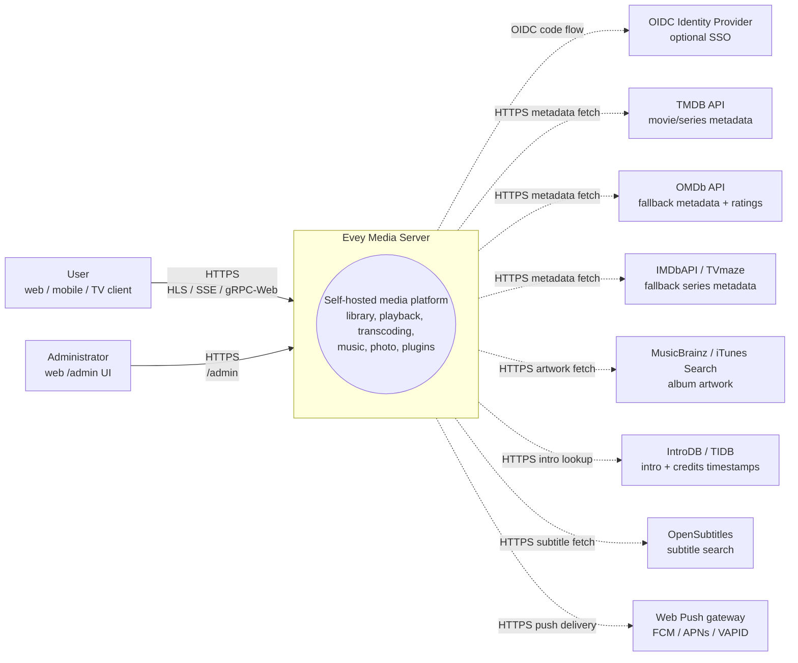
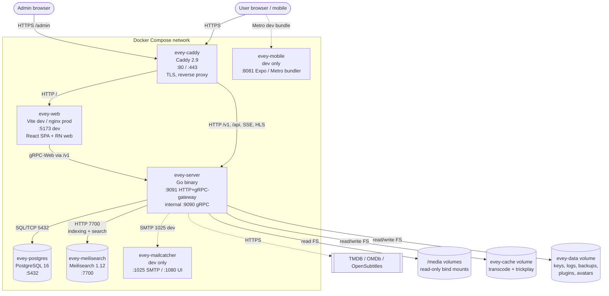
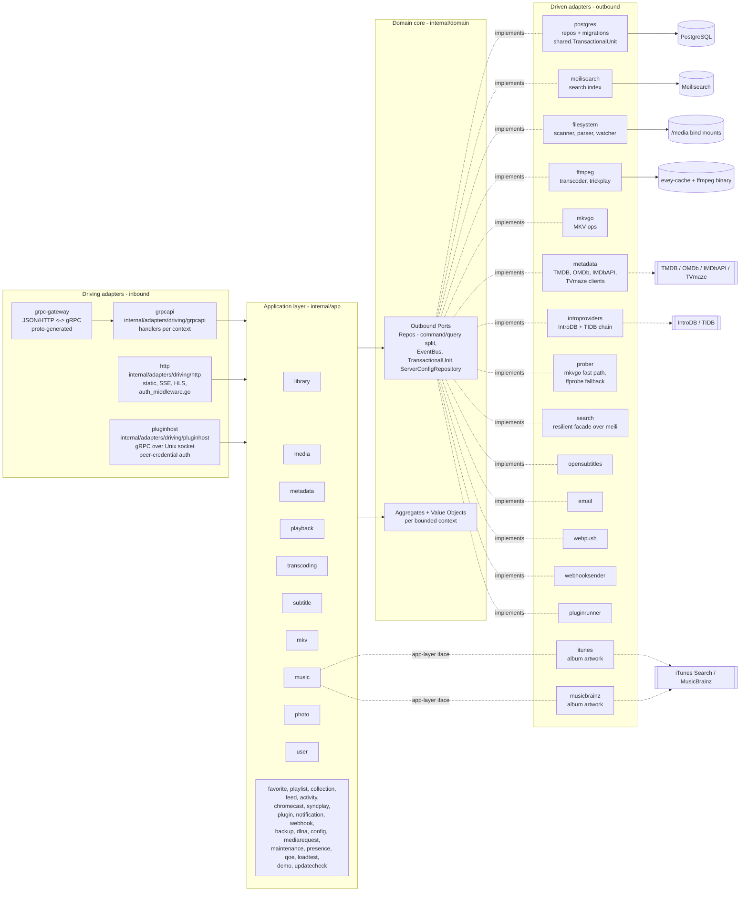
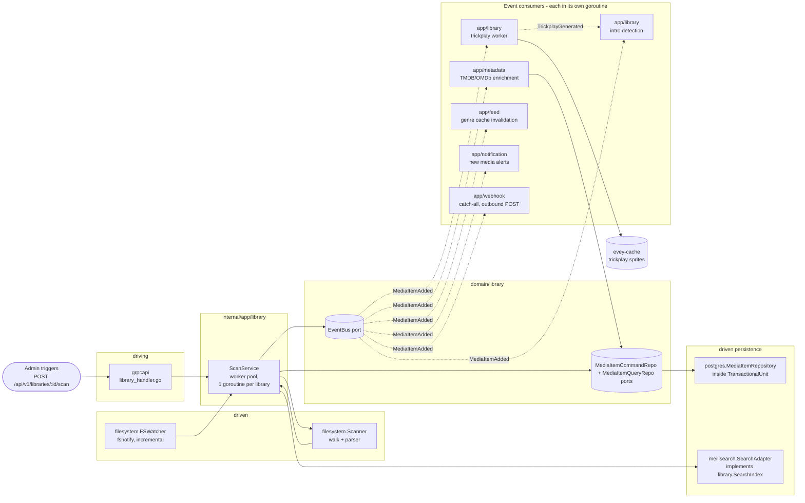

# Arquitectura

Evey es un servidor multimedia autoalojado. El backend es Go (hexagonal / DDD), el frontend es un monorepo TypeScript/React, el móvil es React Native / Expo. Consulta [DEV.md](../DEV.md) para la puesta en marcha y los detalles internos.

## Capas

Disposición estricta de puertos y adaptadores bajo `internal/`:

- `internal/domain/<context>/`: dominio puro: modelos, objetos de valor, **puertos** (interfaces). Ninguna importación de framework.
- `internal/app/<context>/`: servicios de aplicación. Orquestan los puertos. La E/S pasa normalmente por un puerto; dos contextos son excepciones deliberadas y llegan directamente a la red: `dlna` (SSDP / UPnP AVTransport) y `loadtest` (su propio cliente HTTP).
- `internal/adapters/driven/`: adaptadores salientes que implementan los puertos del dominio: `postgres`, `meilisearch`, `ffmpeg`, `mkvgo`, `filesystem`, `prober`, `opensubtitles`, `email`, `webpush`, `webhooksender`, `pluginrunner`, `metadata`, `introproviders`, `search`. Dos más viven aquí pero satisfacen una interfaz de la capa de aplicación en lugar de un puerto del dominio: `itunes` y `musicbrainz`, ambos `app/music.AlbumArtFetcher`.
- `internal/adapters/driving/`: adaptadores entrantes: `grpcapi` (+ HTTP de grpc-gateway), `http` (estáticos, middleware de autenticación, SSE, HLS, recursos de los iframes de plugins), `pluginhost` (servidor gRPC sobre un socket Unix, autenticado por las credenciales del par: la API del anfitrión a la que llaman de vuelta los subprocesos de plugins en sandbox).
- `internal/pkg/`: núcleo técnico compartido reutilizado entre contextos (auth, logger, eventbus, i18n, metrics, tracing, ratelimit, procfork, ssrf, cache, ...). La configuración del servidor vive en `internal/config/`; el código proto generado vive en `gen/`.

Regla de dependencia: `adapters -> app -> domain`. El dominio nunca importa app ni adapters. La composición se hace en `cmd/evey/wire*.go`, conexiones escritas a mano, no google/wire: `wire.go`, `wire_infra.go`, `wire_services.go`, `wire_adapters.go`, `wire_events.go`, `wire_helpers.go`.

## Contextos delimitados

Treinta y dos paquetes de contexto viven bajo `internal/domain/` e `internal/app/`: 19 existen en ambas capas, 2 son solo de dominio (`ratings`, `shared`) y 11 solo de aplicación. La colaboración se hace en parte mediante eventos de dominio publicados en un bus compartido; la capa de aplicación también lee directamente el paquete de dominio de un contexto vecino (consulta [Relaciones](#relations)).

| Contexto | Responsabilidad |
| --- | --- |
| `user` | cuentas, autenticación, sesiones, preferencias |
| `library` | bibliotecas, carpetas, tareas de escaneo, índice de medios, personas, colecciones, los favoritos y pulgares de un perfil (los pulgares no tienen servicio de aplicación: el RPC de valoración guarda y lee `UserRatingRepository` tal cual), trickplay, detección de intros y créditos |
| `media` (solo app) | enlaces para compartir y tokens de flujo |
| `mediarequest` | solicitudes de contenido enviadas por los usuarios |
| `metadata` | enriquecimiento TMDB / OMDb, imágenes |
| `playback` | flujos, progreso, control remoto, reproduciendo ahora |
| `transcoding` | tareas ffmpeg, segmentos HLS |
| `subtitle` | incrustados + externos + opensubtitles |
| `mkv` | operaciones sobre el contenedor MKV (mediante `mkvgo`) |
| `music` | reproducción y etiquetado específicos del audio |
| `photo` | bibliotecas de fotos |
| `favorite` (solo app) | favoritos por perfil; el modelo y `FavoriteRepository` viven en `domain/library` |
| `playlist` | listas de reproducción de usuario, listas inteligentes |
| `collection` (solo app) | colecciones seleccionadas por el administrador; sus puertos viven en `domain/library` |
| `ratings` (solo dominio) | traduce las clasificaciones de cada país (CSA, FSK, MPAA, BBFC, ACB) a un único eje de edad mínima |
| `feed` | flujo de actividad / descubrir |
| `activity` | cronología de la actividad del usuario |
| `chromecast` | ciclo de vida de una sesión de envío |
| `syncplay` | sesiones sincronizadas entre dispositivos |
| `plugin` | registro de plugins, tokens del sandbox, ciclo de vida |
| `notification` | notificaciones en la aplicación + webpush |
| `webhook` | webhooks salientes |
| `backup` | copia y restauración de la base de datos y la configuración |
| `config` (solo app) | ajustes del servidor persistidos, escritos por los puntos de entrada REST y gRPC |
| `dlna` (solo app) | descubrimiento SSDP y control UPnP AVTransport |
| `loadtest` (solo app) | simula espectadores HLS contra la propia pila HTTP del servidor |
| `maintenance` (solo app) | mantenimiento de medios lanzado por el administrador: reconstrucción del índice de posicionamiento, diario de reparaciones, deshacer, integridad del audio |
| `presence` (solo app) | registro en memoria, no persistido, de quién está conectado ahora mismo |
| `qoe` (solo app) | ingesta y agregación de la telemetría de reproducción CMCD (CTA-5004) |
| `demo` (solo app) | la instancia de demostración pública (`EVEY_DEMO=1`): crea sus cuentas, bibliotecas y medios de licencia libre mediante los propios servicios del producto, y se reinicia sola |
| `updatecheck` (solo app) | compara la versión en ejecución con lo que publica el registro e informa al administrador; nunca actualiza nada |
| `shared` (solo dominio) | puertos transversales (`EventBus`, `TransactionalUnit`, `ServerConfigRepository`, `ShareLinkRepository`), ids tipados, cursores, tokens de flujo |

### Relaciones

- `library` → emite `LibraryCreated` / `LibraryDeleted`, `LibraryScanStarted` / `LibraryScanCompleted`, `MediaItemAdded`, `MediaItemRemoved`, `TrickplayGenerated`. `media.item.added` lo consumen `notification`, `metadata` (enriquecimiento automático), el propio `library` (trabajador de trickplay + detección de intros) y `feed` (invalidación de la caché de géneros).
- La indexación de la búsqueda **no** se basa en eventos: `library.ScanService` llama directamente al puerto `library.SearchIndex`.
- `playback` → emite `PlaybackStarted` / `PlaybackStopped`. Ninguno tiene hoy un suscriptor dedicado; solo los recibe el comodín `"*"` de `webhook`.
- `user` → emite `UserCreated`, que no tiene suscriptor, y `user.password.reset_requested`, que consume el adaptador saliente `email`.
- `plugin` → `pluginrunner` publica `plugin.error` / `plugin.started`, y `app/plugin` los consume para su panel de seguridad. No hay ningún puente que lleve los eventos de dominio a los plugins: los plugins llegan a la API con JWT de ámbito limitado (consulta ADR-0003). El propio bus es ADR-0010.
- `shared.TransactionalUnit` envuelve las escrituras sobre varios agregados (consulta ADR-0002).

Ningún paquete bajo `internal/domain` importa el paquete de dominio de otro contexto, una regla que impone `internal/contractguard/domain_imports_test.go` (consulta [Guardas de arquitectura](#architecture-guards)). La capa de aplicación no está sujeta a ella: 15 paquetes de aplicación importan hoy el paquete de dominio de un contexto vecino.

## Flujo de datos típico: "un usuario reproduce un medio"

1. El cliente móvil o web llama a `POST /api/v1/playback/start` (ruta de grpc-gateway).
2. `internal/adapters/driving/http` ejecuta su middleware de autenticación (`auth_middleware.go`, `httpAuthMiddleware`) y extrae la sesión.
3. `internal/adapters/driving/grpcapi` (`playback_handler.go`) valida el proto y llama a `app/playback.CommandService.StartStream` (separación comando/consulta, consulta ADR-0009).
4. `app/playback.CommandService` llama a los puertos del dominio: `user.UserRepository`, `playback.SessionQueryRepo` (idempotencia + límite de dispositivos), `playback.SessionCommandRepo`, y después `shared.EventBus.Publish(PlaybackStarted)`.
5. Los adaptadores salientes ejecutan: `postgres` persiste la sesión dentro de un ámbito `shared.TransactionalUnit.Do`; el bus en proceso (`internal/pkg/eventbus`) reparte de forma asíncrona.
6. `PlaybackStarted` no tiene hoy suscriptor dedicado: solo lo recibe el comodín `"*"` de `webhook`.
7. La respuesta vuelve por grpc-gateway en JSON; las actualizaciones de progreso circulan por SSE / flujos gRPC.

## Raíz de composición

Los grafos de conexión viven en `cmd/evey/wire.go` y sus hermanos (`wire_infra.go`, `wire_services.go`, `wire_adapters.go`, `wire_events.go`, `wire_helpers.go`). Las pruebas se saltan los adaptadores inyectando dobles que implementan los mismos puertos del dominio: 20 de los 21 paquetes de dominio incluyen un subpaquete `fakes/`. Consulta [ADR-0001](adr/0001-hexagonal-architecture.md).

## Guardas de arquitectura

Las reglas de arriba no son solo documentación. `internal/contractguard/` contiene 54 pruebas estáticas en 29 archivos que hacen fallar la compilación cuando el código se aparta de ellas.

La propia regla hexagonal es `TestDomainContextsDoNotImportEachOther` (ADR-0001), en `domain_imports_test.go`. Recorre `internal/domain` e impone exactamente esto: un contexto puede importar `internal/domain/shared` y su propio árbol de paquetes, nada más de `internal/domain`, y nunca `internal/app` ni `internal/adapters`. Su alcance termina en `internal/domain`: no dice nada de la capa de aplicación.

Las demás guardan contratos que cruzan una frontera de lenguaje o de proceso, entre ellas:

- `TestNoClientReadOfAFieldTheServerNeverWrites`: cada campo de respuesta proto que lee un cliente debe escribirse en algún lugar del servidor.
- `TestRegisteredHandlersGetEveryPortTheyDeclare` y `TestBootInstallsItsSilentWirings`: conexiones que de otro modo fallarían en silencio.
- `TestPostgresRepositoriesBoundTheirQueries`: cada repositorio Postgres limita sus consultas con un plazo.
- `TestProcfork_EveryForkGoesThroughCommand`: cada lanzamiento de subproceso pasa por `internal/pkg/procfork`.
- `TestEverySortFieldTheAPIAcceptsHasASQLColumn` y `...CanBuildACursorValue`: los campos de ordenación existen a la vez en el mapa de columnas SQL y en el codificador de cursores.
- `TestEveryWebSurfaceReachingAnAdminRPCIsClassified`, más su equivalente nativo para móvil y televisor: cualquier superficie de interfaz que llama a un RPC reservado a administradores decide quién la ve.
- `TestEveryAllowedSlotIsMountedOnWebAndMobile` y `TestPluginBridgeParityWebMobile`: paridad de los slots de interfaz de plugins entre clientes.
- `TestImageSubtitleCodecsAgreeAcrossServerAndClients`: una sola lista de códecs de subtítulos en imagen, servidor y reproductores.
- `TestHandWrittenClientTypesMatchTheEndpointTheyCall`: los tipos de respuesta escritos a mano de móvil y televisor corresponden al endpoint al que llaman.
- `TestRestartExitCodeAgreesWithTheEntrypoint`: el código de salida de Go y `docker/entrypoint.sh` coinciden en lo que significa un reinicio.
- Guardas de i18n: las claves emitidas por el servidor existen en el catálogo, los marcadores coinciden entre idiomas.

## Para saber más

- [DEV.md](../DEV.md): compilar, ejecutar, migraciones, generación de proto
- [docs/CODEBASE_MAP.md](CODEBASE_MAP.md): qué archivos tocar para los cambios habituales
- [docs/playback-serving.md](playback-serving.md): la ruta de lectura que sirve el vídeo HLS, en detalle (decisión, escala, huella, CMAF/HLS/DASH, mkvgo frente a ffmpeg)
- [docs/api/](api/): referencia de la API generada
- [docs/adr/](adr/): registros de decisiones de arquitectura

## Diagramas C4

Estos cuatro diagramas describen Evey con niveles de zoom decrecientes según el [modelo C4](https://c4model.com/). Todos se dibujan con Mermaid; ningún recurso binario. Los nombres de los nodos son los nombres reales de los paquetes Go bajo `internal/`. Los nombres de los contenedores vienen de `docker-compose.yml` para `evey-server`, `evey-postgres` y `evey-caddy`; `evey-web`, `evey-meilisearch`, `evey-mobile` y `evey-mailcatcher` se declaran en `docker-compose.override.yml` y solo existen en la topología de desarrollo.

### Nivel 1 - Contexto del sistema

Quién habla con Evey, y a qué terceros llega Evey.

### Nivel 2 - Contenedores

Las unidades desplegables que levanta `docker compose --env-file .env.dev up`. Las flechas continuas son tráfico en ejecución; las discontinuas son salidas hacia terceros.

> **La producción difiere de esta topología de desarrollo.** El compose de
> instalación declara un solo servicio, `evey`. No hay un contenedor `evey-web`
> aparte (ni el mailcatcher ni el bundler Metro, solo de desarrollo): el binario
> sirve la interfaz web compilada desde `/srv`, así que un proxy inverso le
> reenvía *todo*, interfaz y API, en `:9091`. Postgres y Meilisearch se ejecutan
> dentro del mismo contenedor, supervisados por `docker/entrypoint.sh`:
> PostgreSQL 17 con sus datos en `/data/postgres`, y el binario de Meilisearch
> (`Dockerfile`, etapa `meili-download`, fijado en 1.12.8) con su índice en
> `/data/meili`. El propio `docker-compose.yml` del repositorio conserva
> servicios `postgres` y `caddy` aparte, descritos en
> [Despliegues avanzados](operations/advanced-deployments.md). Consulta
> [Instalación](installation.md) y [Proxy inverso](reverse-proxy.md).

### Nivel 3 - Componentes (zoom sobre `evey-server`)

Capas hexagonales dentro del binario Go. Los adaptadores entrantes llaman a los servicios de aplicación a través de sus interfaces; los servicios de aplicación solo dependen de los puertos del dominio; los adaptadores salientes implementan esos puertos.

Notas sobre las goroutines:
- El servidor gRPC (`grpc.Server.Serve`) y el servidor HTTP (gateway + estáticos) se ejecutan cada uno en su propia goroutine a partir de la conexión principal en `cmd/evey`.
- Las tareas de escaneo de `app/library` se ejecutan en un pool de trabajadores (una goroutine por escaneo de biblioteca activo, consulta `library.ScanService`).
- Las tareas ffmpeg las lanza mediante `internal/pkg/procfork` el adaptador saliente `ffmpeg` (`ffmpeg.Transcoder.Start`), con una goroutine supervisora por tarea que vacía el stderr del proceso.
- `shared.EventBus` reparte a los suscriptores de forma asíncrona: cada suscriptor se ejecuta en su propia goroutine para que un consumidor lento nunca bloquee a quienes publican. El bus no abre ninguna transacción propia: eso es cosa del manejador.
- `pluginrunner` lanza un subproceso por plugin; los plugins en iframe viven en el navegador del usuario y responden mediante tokens firmados emitidos por `app/plugin`.

### Nivel 3 (extra) - Zoom de componentes sobre la canalización de escaneo

La ruta caliente que convierte los archivos del disco en medios enriquecidos y buscables. Las flechas continuas son llamadas directas; las discontinuas son eventos de dominio en el bus. Fíjate en que la indexación de la búsqueda es una llamada directa a un puerto desde `ScanService`, no un evento.

Léelo junto con la sección "Flujo de datos típico" de arriba: la ruta de reproducción es la ruta de lectura simétrica; la canalización de escaneo es la ruta de escritura que prepara el índice de medios del que sirve la ruta de lectura.
