# Sandbox de plugins y modelo de amenazas { #plugin-sandbox-and-threat-model }

Lo que hace el servidor para aislar a un plugin: las comprobaciones al
instalar, las capas mientras funciona, los modos de sandbox, y lo que cada
uno todavía no puede impedir. El código está en
`internal/adapters/driven/pluginrunner` (análisis en la instalación,
sandbox), `cmd/evey-plugin-launcher` (Landlock y el filtro seccomp del
núcleo), `sandbox/sandbox.c` (el filtro `LD_PRELOAD`) e
`internal/adapters/driving/pluginhost` (la API del servidor a la que llaman
los plugins); el diseño lo deciden
[ADR-0012](https://github.com/eveyproject/evey/blob/master/docs/adr/0012-plugin-token-deny-by-default.md),
[ADR-0013](https://github.com/eveyproject/evey/blob/master/docs/adr/0013-userspace-plugin-resource-monitor.md) y
[ADR-0014](https://github.com/eveyproject/evey/blob/master/docs/adr/0014-landlock-plugin-sandbox.md). Si escribes un plugin y
quieres saber qué puedes declarar y qué se rechazará, lee
[Permisos y slots](plugins/security-model.md); para saber qué sandbox recibe
tu máquina, lee [Configurar el sandbox de plugins](plugins/sandbox-deployment.md).

## Modelo de amenazas { #threat-model }

Los plugins funcionan como procesos separados que se comunican con el servidor por
gRPC sobre sockets Unix. Por defecto, el servidor no confía en el código de
ningún plugin. Los riesgos de los que se defiende, del más grave al menos
grave:

1. **Suplantación** - un plugin se hace pasar por otro para usar sus permisos.
2. **Escalada de privilegios** - un plugin se escapa de su sandbox y ejecuta órdenes como el servidor.
3. **Acceso al sistema de archivos** - un plugin lee o escribe fuera de su propia carpeta, en particular los secretos del servidor.
4. **Fuga por la red** - un plugin envía datos a un host que elige él.
5. **Abuso de recursos** - minería, bombas de procesos, agotamiento de la memoria o del disco.
6. **Cadena de suministro** - código ofuscado o compilado que el análisis no puede leer.

```mermaid
flowchart LR
    zip[Paquete] --> ex[Extracción del ZIP<br/>límites, sin enlaces simbólicos, sin setuid]
    ex --> man[Manifiesto<br/>permisos]
    man --> an[Análisis estático<br/>CRITICAL rechaza]
    an --> sig[Firma<br/>política cosign]
    sig --> prev[Vista previa del administrador<br/>acepta o rechaza]
    prev --> run[En funcionamiento]
    subgraph run[En funcionamiento - todos los modos]
        fs[Sistema de archivos<br/>solo su propia carpeta]
        net[Red<br/>sin socket IP, intermediario Fetch]
        sys[Llamadas al sistema<br/>lista de bloqueo seccomp]
        uid[Usuario aparte<br/>o espacio de nombres de usuario]
        sock[Socket del servidor<br/>identidad SO_PEERCRED]
        res[Vigilante de recursos<br/>memoria, PIDs, disco, nice]
    end
```

## Al instalar { #at-install }

### Extracción del ZIP { #zip-extraction }

Antes de escribir ningún archivo (`pluginrunner/zip.go`):

- como mucho 5.000 entradas, 100 MB por archivo, 500 MB descomprimidos en
  total, y una relación de compresión de 100:1 por encima de 1 MB
  descomprimido (bombas de descompresión);
- se rechazan las entradas cuya ruta sale del archivo (`..`);
- se rechazan los enlaces simbólicos;
- se quitan los bits setuid, setgid y sticky.

### Manifiesto y permisos { #manifest-and-permissions }

El manifiesto declara los permisos que pide un plugin. Un permiso desconocido
hace que se rechace la instalación. Después se aplican:

- **`subprocess`** permite los procesos hijos. Sin él, el núcleo rechaza la
  creación de procesos (`-deny-fork`), y el filtro `LD_PRELOAD` también
  rechaza `execve` en los plugins interpretados.
- **`native-binary`** permite incluir código compilado o archivos
  comprimidos, que el análisis no puede leer.
- **Los permisos de API** (`api.library`, `api.user`, `api.metadata`,
  `media.read`, `media.write`, `notification.sender`...) los comprueba en
  cada llamada al servidor
  [`PluginPermissionInterceptor`](https://github.com/eveyproject/evey/blob/master/internal/adapters/driving/grpcapi/plugin_interceptor.go).

La lista completa está en [Permisos y slots](plugins/security-model.md#permissions-catalog).

### Análisis estático { #static-analysis }

Cada archivo del paquete lo analiza
[`pluginrunner.AnalyzePlugin`](https://github.com/eveyproject/evey/blob/master/internal/adapters/driven/pluginrunner/analyzer.go),
después de una pasada de normalización que deshace la ofuscación habitual
(alias, concatenación de cadenas, f-strings):

| Categoría | Gravedad | Ejemplos |
|---|---|---|
| `shell_exec` | WARNING / CRITICAL | `os.system`, `subprocess.run`, `child_process.exec`, PHP `system()`/`shell_exec()`/`proc_open()`, `preg_replace /e`, Ruby `Kernel.exec`/`system`, `open('\|cmd')` (CRITICAL); comillas invertidas de Ruby (WARNING) |
| `network` | WARNING / CRITICAL | `requests.get`, `fetch`, shells inversas y de escucha |
| `filesystem` | WARNING / CRITICAL | `/etc/passwd`, `.ssh/`, `rm -rf`, operaciones con enlaces simbólicos |
| `obfuscation` | WARNING / CRITICAL | `eval`, `__builtins__`, `base64 -d \| bash` y otras decodificaciones enviadas a un shell (CRITICAL); decodificación base64, secuencias hexadecimales (WARNING) |
| `privilege` | CRITICAL | `setuid`, `chmod 4777`, `sudo`, enviar señales al PID 1 |
| `cryptomining` | CRITICAL | `stratum+tcp`, `xmrig`, `cryptonight` |
| `runtime_install` | CRITICAL | `pip install`, `npm install`, `curl ... \| sh` |
| `dynamic_import` | CRITICAL | `__import__()`, `importlib.import_module` |
| `sandbox_escape` | CRITICAL | `vm.runIn*`, `process.binding`, `new Function`, `__subclasses__()`, `__mro__` |
| `deserialization` | CRITICAL / WARNING | `pickle.loads`, `marshal.loads`, `__reduce__`; WARNING: `yaml.load()` sin Loader |
| `native_code` | CRITICAL / WARNING | `ctypes.CDLL`, `ffi.Library`; WARNING: `unsafe` de Go |
| `compiled_binary` | WARNING, después BLOCK | `.so`, `.dll`, `.exe`, `.wasm`, `.jar` |
| `embedded_archive` | WARNING, después BLOCK | `.zip`, `.tar.gz` |
| `mime_mismatch` | se trata como CRITICAL | una extensión que dice ser una imagen, con otro contenido |
| `suspicious_url` | WARNING | un esquema que no es HTTP en una URL escrita en el código |
| `unvendored_deps` | WARNING | `requirements.txt` o `package.json` sin los módulos incluidos |

Un hallazgo CRITICAL o un `mime_mismatch` hace que se rechace la
instalación. `compiled_binary` y `embedded_archive` la rechazan salvo que el
manifiesto declare `native-binary`.

!!! note "Lo que el análisis no puede garantizar"
    Funciona con patrones. Resuelve tipos de ofuscación conocidos
    (concatenar cadenas en varios pasos hasta obtener algo que se puede
    llamar, buscar un builtin por su nombre, escapatorias con
    `Function.constructor`), cada uno con un caso de regresión en
    `tests/fixtures/plugins/malicious/`, pero no puede seguir todas las
    transformaciones que se hacen mientras el código funciona
    (`strrev("metsys")`, decodificar una carga leída de un archivo). Los comentarios se
    eliminan antes del análisis. **La frontera que se impone es el sandbox en
    funcionamiento, no el análisis**: un plugin con un patrón que el
    análisis no detecta sigue sin poder leer los datos del servidor, hacer una
    llamada al sistema prohibida, superar sus límites de recursos ni llamar a
    un método del servidor para el que no tiene permiso.

### Firma { #signature }

Un paquete se puede firmar con cosign (`cosign sign-blob --key`, ECDSA P-256
sobre el SHA-256 del ZIP). La clave pública del autor viaja dentro del
paquete como `cosign.pub`; Evey verifica con ella la `.sig` separada, dentro
de su propio proceso y sin conexión (`pluginrunner/cosign.go`), y calcula la
huella de la clave (`sha256:` sobre la clave pública DER). De ello se
derivan tres cosas:

- **Confianza**: la huella está, o no, en la lista de **Editores de
  confianza** de la instancia (`Administración → Plugins`, o rellenada al
  arrancar con `EVEY_PLUGINS_COSIGN_PUBLIC_KEY`). Una clave de confianza
  muestra el nombre del editor; una desconocida muestra su huella y una
  acción **Confiar en esta clave**.
- **Continuidad**: la huella queda fijada en el plugin al instalarlo. Una
  actualización firmada con otra clave (`publisher-changed`) o que ya no está
  firmada (`signature-lost`) se rechaza, sea cual sea la política, hasta que
  el administrador acepte al nuevo editor en el diálogo de actualización
  (`accept_new_publisher`).
- **Política**: `EVEY_PLUGINS_COSIGN_POLICY` fija lo que hace el veredicto.

| Política | Efecto |
|---|---|
| `off` | La firma no se comprueba y no se registra nada. |
| `warn` (por defecto) | El veredicto se registra y se muestra; los paquetes sin firma, de clave no fiable o no válidos se instalan. |
| `enforce` | Solo se instala o actualiza un paquete firmado por un editor de confianza. |

Una firma demuestra que el paquete es el que su editor publicó, y que una
actualización viene del mismo editor. No dice nada del código, que juzgan el
análisis, los permisos y el sandbox.

### Vista previa del administrador { #administrator-preview }

`POST /api/v1/admin/plugins/preview` ejecuta el análisis sin instalar. El
administrador ve los permisos pedidos, cada hallazgo con su archivo, su línea
y su categoría, las URL encontradas en el código y el SHA256 del paquete; el
hash que el administrador ha aceptado se comprueba al actualizar, y una primera instalación puede fijarse con un fragmento `#sha256:` en la URL, así que el paquete
analizado es el paquete instalado. Una actualización muestra la diferencia de
permisos, slots y hosts, y un permiso nuevo exige una aceptación explícita.

El administrador es la frontera de confianza para los permisos elevados:
Evey muestra lo que el plugin podrá tocar, y el administrador acepta o
rechaza.

## En funcionamiento { #at-run-time }

Seis capas se mantienen en todos los [modos de sandbox](#sandbox-modes);
cómo se imponen las dos primeras depende del modo.

### Sistema de archivos { #filesystem }

Un plugin ve su propia carpeta y la carpeta de su socket, y no los datos del
servidor, gracias a una lista permitida de Landlock (`landlock`) o a una
lista blanca de montajes de bubblewrap (`bubblewrap`, `strict`). En el modo
`basic`, en un núcleo sin Landlock, no hay restricción por ruta: entonces lo que
protege los secretos del servidor son el usuario aparte y los permisos de los
archivos.

### Red { #network }

Un plugin **no tiene acceso directo a la red**, declare lo que declare: se
rechaza cualquier socket IP (`-deny-inet` en `landlock` y `basic`, un espacio
de nombres de red en `bubblewrap` y `strict`). Un plugin con el permiso
`network` llama al método `Fetch` del servidor por su socket Unix. El
servidor, en `internal/adapters/driving/pluginhost/fetch.go`:

- comprueba el destino con la lista `external_fetch` del plugin (hosts exactos, sin distinguir mayúsculas de minúsculas; un comodín `*.example.com` se rechaza en la instalación; un sufijo de puerto se ignora);
- solo permite `http` y `https`, y solo `GET` y `HEAD`;
- se conecta con un cliente protegido contra SSRF (`internal/pkg/ssrf`) que
  rechaza las direcciones privadas, reservadas y de enlace local después de
  la resolución DNS, así que el DNS rebinding y las redirecciones se vuelven
  a comprobar (se rechaza una redirección hacia un host que no está en la
  lista);
- no añade ninguna credencial del servidor, limita el cuerpo de la respuesta
  a 8 MiB y las cabeceras de la petición a 8 KiB, y abandona a los 20 s.

Esto cierra los caminos que dejaba abiertos la salida directa (las IP
literales como `169.254.169.254`, el resolutor propio de un plugin). Lo que
queda: el intermediario controla *adónde* va una llamada, no *lo que* lleva.
Consulta [Límites conocidos](#known-limits).

!!! tip "Recomendado para quien administra el servidor"
    El intermediario traslada al servidor la superficie de ataque SSRF. Una
    regla de salida en el contenedor `evey-server`, independiente del código,
    añade una segunda protección: bloquea `169.254.0.0/16` y limita la red interna
    a la base de datos y al servicio de búsqueda.

### Llamadas al sistema { #system-calls }

Dos filtros seccomp rechazan las mismas llamadas al sistema peligrosas:

1. **El filtro del núcleo**, que instala
   [`evey-plugin-launcher`](https://github.com/eveyproject/evey/blob/master/cmd/evey-plugin-launcher) justo antes de
   arrancar el plugin ([`seccomp_linux.go`](https://github.com/eveyproject/evey/blob/master/cmd/evey-plugin-launcher/seccomp_linux.go)).
   Lo heredan el plugin y sus hijos y **cubre también los binarios
   compilados estáticos**. Una arquitectura que no coincide en una llamada
   al sistema mata el proceso. Se aplica en `landlock` y `basic`.
2. **El filtro `LD_PRELOAD`**, [`sandbox/sandbox.c`](https://github.com/eveyproject/evey/blob/master/sandbox/sandbox.c),
   cargado en los plugins interpretados que no declaran `subprocess`.
   También rechaza `execve`/`execveat`, y marca el plugin como no volcable.
   Se aplica en `landlock`, `basic` y `strict`. Si falta la biblioteca, se
   impide el arranque de ese plugin (`plugin.error`).

Llamadas al sistema rechazadas:

| Categoría | Llamadas al sistema |
|---|---|
| Depuración | `ptrace`, `process_vm_readv`, `process_vm_writev` |
| Señales | `tgkill`, `rt_sigqueueinfo`, `rt_tgsigqueueinfo` hacia cualquier proceso que no sea el propio plugin (los dos filtros); `kill` igual en el filtro del núcleo, y hacia cualquier destino en el filtro `LD_PRELOAD`; `tkill` en el filtro del núcleo (el filtro `LD_PRELOAD` lo permite hacia el propio plugin); `pidfd_send_signal`, `pidfd_getfd` (roba un descriptor de archivo). Un runtime que vuelve a lanzar una señal o interrumpe sus propios hilos sigue funcionando. Con Landlock ABI 6 o posterior, un plugin tampoco puede enviar señales a un proceso fuera de su sandbox |
| Montajes | `mount`, `umount2`, `pivot_root`, `chroot` |
| Espacios de nombres | `unshare`, `setns`, y `clone` con un indicador `CLONE_NEW*` (unshare con otro nombre), para todos los plugins |
| Módulos del núcleo | `init_module`, `finit_module`, `delete_module` |
| BPF, perf | `bpf`, `perf_event_open` |
| E/S de hardware | `ioperm`, `iopl` (solo x86-64, donde existen) |
| Swap | `swapon`, `swapoff` |
| Control del sistema | `syslog`, `reboot`, `settimeofday`, `clock_settime`, `clock_adjtime`, `adjtimex` |
| Kexec | `kexec_load`, `kexec_file_load` |
| Primitivas de exploits del núcleo | `io_uring_setup`, `io_uring_enter`, `io_uring_register`, `userfaultfd` |
| Identidad | `setuid`, `setgid`, `setreuid`, `setregid`, `setresuid`, `setresgid`, `capset` |
| Llavero | `add_key`, `request_key`, `keyctl` |

Para un plugin sin `subprocess`, el núcleo también rechaza la creación de
procesos (`fork`, `vfork`, `clone` sin `CLONE_THREAD`; `clone3` responde
`ENOSYS` para que la biblioteca C vuelva a `clone`); los hilos siguen
funcionando.

Es una **lista de bloqueo**: `open`, `read`, `write`, `mmap`, `socket` Unix y
`connect` siguen permitidos. Las rutas las restringe la capa del sistema de
archivos, no seccomp. En `bubblewrap` no se usa el lanzador: ahí un binario
estático no recibe ningún filtro seccomp, y lo contienen los espacios de
nombres y la lista blanca de montajes.

### Un usuario aparte { #a-separate-user }

Un plugin puede funcionar como el usuario 1001 (`evey-plugin`), distinto del
servidor (1000), así que los secretos del servidor le resultan ilegibles solo
por los permisos de los archivos. Lo controla `EVEY_PLUGINS_UID_SEPARATION`:

| Valor | Cuándo se hace el cambio |
|---|---|
| `auto` (por defecto) | solo cuando el sandbox acaba en `basic`, el único caso en el que los permisos de los archivos son la única protección de los secretos |
| `on` | siempre, como capa extra |
| `off` | nunca |

El cambio lo hace el lanzador, que tiene `cap_setuid`; el servidor en sí
funciona sin privilegios ni capacidades. El lanzador rechaza cualquier
destino por debajo de 1000. Si no puede cambiar, un plugin en `basic` se
rechaza (ahí el usuario es la única protección), mientras que en `landlock`
funciona con el usuario del servidor y un aviso. En `bubblewrap` y `strict`,
este papel lo cumple el espacio de nombres de usuario.

Cuando está activo, la clave de firma (`0600`) y las copias de seguridad
(carpeta `0700`, archivos `0600`) solo son accesibles para su dueño mientras
el servidor funciona, y eso se mantiene incluso con un `/data` montado desde
el equipo anfitrión. Todos los plugins comparten el usuario 1001: los aísla
entre sí la capa del sistema de archivos, no el usuario.

### Autenticación del socket del servidor { #host-socket-authentication }

Cada plugin tiene su propio socket,
`/tmp/evey/plugins/<plugin_id>/host.sock`, servido por su propio servidor
gRPC. En cada llamada, el servidor lee el PID de quien llama en el núcleo
(`SO_PEERCRED`, que el espacio de usuario no puede falsificar) y lo compara
con el PID guardado al arrancar el plugin. La identidad del plugin sale del
socket, nunca de una cabecera. Así que un plugin no puede hacerse pasar por
otro, llamar al socket de otro plugin ni hacer pasar llamadas por un proceso
hijo. Un PID que no coincide se anota como aviso.

### Límites de recursos { #resource-limits }

Un vigilante en el espacio de usuario (los cgroups no están disponibles en
un contenedor sin privilegios) lee `/proc/<pid>` cada 2 segundos y detiene un
plugin que supera un límite
([ADR-0013](https://github.com/eveyproject/evey/blob/master/docs/adr/0013-userspace-plugin-resource-monitor.md)):

| Límite | Por defecto | Se comprueba |
|---|---|---|
| memoria (RSS) | 256 MiB | en cada pasada |
| procesos e hilos | 64 | en cada pasada (solo el número de hilos del proceso principal) |
| disco usado por su carpeta | 100 MiB | cada 15 pasadas, unos 30 s |
| prioridad de CPU | `nice` 10, aplicado al arrancar | - |

La misma pasada señala un plugin que mantiene un núcleo de CPU por encima
del 90 % durante unos 30 s, y detiene un plugin con `hardware.gpu` que
mantiene igual de ocupado un motor gráfico. Un único conjunto de límites de recursos, fijado
en **Administración → Plugins → Límites de recursos**, se aplica a todos los plugins; las variables de
entorno `EVEY_PLUGINS_MEMORY_MB`, `EVEY_PLUGINS_PIDS_MAX`,
`EVEY_PLUGINS_DISK_MAX_MB` y `EVEY_PLUGINS_CPU_NICE` fijan los valores por
defecto al arrancar.

### Aislamiento de la interfaz { #interface-isolation }

La interfaz de un plugin funciona en un `<iframe sandbox="allow-scripts">`,
sin acceso al mismo origen, sin formularios ni ventanas emergentes, bajo una
Content-Security-Policy que solo permite conexiones a sus hosts de
`external_fetch`. El puente
(`frontend/packages/client/src/plugins/hostProtocol.ts`) limita lo que puede
pedir a la página: `toast` como mucho 3 por segundo, 200 caracteres, sin
HTML; `navigate` solo acepta `/home`, `/library`, `/media`, `/player`,
`/settings` y `/search`; `resize` entre 50 px (60 en móvil y TV) y 800 px.
Los slots se comprueban al instalar.

### Refuerzo del servidor { #server-hardening }

Al arrancar, el servidor se marca como no volcable (`PR_SET_DUMPABLE=0`,
[`hardening_linux.go`](https://github.com/eveyproject/evey/blob/master/cmd/evey/hardening_linux.go)): un proceso que
funciona con el mismo usuario no puede leer su memoria ni su entorno a
través de `/proc`, lo que protege la clave de firma en memoria y las
contraseñas de la base de datos y de la búsqueda, incluso en un núcleo sin
Landlock.

### Aviso de fallos { #crash-notification }

El ejecutor publica un evento `plugin.error` cuando falta la biblioteca del
sandbox para un plugin que la necesita, o cuando un plugin termina con un
error. El servicio de notificaciones se lo envía al administrador por los
canales configurados, y el **Panel de seguridad** lo registra.

## Modos de sandbox { #sandbox-modes }

El modo elige cómo se restringen el sistema de archivos y la red.
`EVEY_PLUGINS_SANDBOX_MODE` fija el valor inicial (por defecto `auto`); se
puede cambiar en **Administración → Plugins → Límites de recursos → Modo de
sandbox**. El ejecutor lo aplica en
[`applySandbox`](https://github.com/eveyproject/evey/blob/master/internal/adapters/driven/pluginrunner/runner_sandbox.go).
En todos los modos: ninguna salida IP directa, el vigilante de recursos y la
autenticación del socket del servidor.

| Capa | landlock | basic | bubblewrap | strict |
|---|---|---|---|---|
| Sistema de archivos | lista permitida de Landlock | ninguna sin Landlock (solo los permisos de los archivos) | lista blanca de montajes | lista blanca de montajes |
| Red | `-restrict-net` + `-deny-inet` | `-deny-inet` | espacio de nombres de red | espacio de nombres de red |
| Seccomp del núcleo (también binarios estáticos) | sí | sí | no | no |
| Seccomp `LD_PRELOAD` (plugins interpretados sin `subprocess`) | sí | sí | no | sí |
| Usuario aparte | con `on` | sí (`auto`) | espacio de nombres de usuario | espacio de nombres de usuario |
| Límites de recursos | sí | sí | sí | sí |

### `auto` (por defecto) { #auto-default }

Se resuelve, una vez, al arrancar el primer plugin, en el modo más fuerte
que admite el equipo: **landlock** cuando el núcleo aplica Landlock *y* se
encuentra el binario `evey-plugin-launcher` (junto al binario del servidor,
en `$PATH` o en `EVEY_PLUGIN_LAUNCHER`); si no, **bubblewrap** cuando un
sandbox de prueba se construye de verdad
([`ProbeSandbox`](https://github.com/eveyproject/evey/blob/master/internal/adapters/driven/pluginrunner/sandbox_probe.go)),
lo que en la práctica significa sin contenedor o en un contenedor con
privilegios; si no, **basic**. Landlock va primero porque no necesita ningún
privilegio y funciona con el perfil de seguridad por defecto de Docker. El
modo resuelto se anota en el registro, y aparece en la línea **Sandbox del
host** de **Administración → Plugins → Panel de seguridad**.

| Despliegue | Lo que da `auto` |
|---|---|
| Docker en un núcleo reciente | `landlock`: restricción por ruta, sin salida directa, llamadas al sistema peligrosas rechazadas, binarios estáticos incluidos. El caso normal. |
| Docker en un núcleo antiguo sin Landlock, p. ej. un NAS antiguo | `basic`: secretos protegidos y red cortada, pero los archivos legibles por todos quedan visibles. Consulta [Configurar el sandbox de plugins](plugins/sandbox-deployment.md). |
| Sin contenedor | `bubblewrap`: el aislamiento más fuerte del sistema de archivos y de los procesos, sin filtro seccomp para los binarios estáticos. |

### `landlock` { #landlock }

- **Sistema de archivos:** una lista permitida de Landlock que aplica el
  lanzador. Las carpetas del sistema (`/usr`, `/lib`, `/lib64`, `/bin`,
  `/sbin`, `/etc`, `/app`) en solo lectura; de `/dev`, solo `null`, `zero`,
  `full`, `random` y `urandom`, así que los nodos de la tarjeta gráfica y el
  terminal del servidor quedan fuera de alcance; la carpeta del plugin y la
  de su socket en lectura y escritura; todo lo demás, incluidos `/data` y los
  otros plugins, denegado. Un plugin con `hardware.gpu` recibe su nodo de
  renderizado como única excepción.
- **Red:** `-restrict-net` y `-deny-inet`; salida solo por `Fetch`.
- **Llamadas al sistema:** el filtro del núcleo y el filtro `LD_PRELOAD`.
- **Requiere:** un núcleo 5.13 o posterior con Landlock en la lista de LSM
  activos, y el lanzador (las dos cosas se cumplen con la imagen oficial en
  un equipo reciente). Un `landlock` explícito se niega a arrancar un plugin
  que no puede aislar.

### `bubblewrap` { #bubblewrap }

- **Sistema de archivos y procesos:** seis espacios de nombres separados
  (`user`, `pid`, `uts`, `ipc`, `cgroup`, `net`) y una lista blanca de
  montajes; dentro no existe nada más (`buildBwrapCmd` en
  `pluginrunner/runner_bwrap.go`).

  | Ruta | Acceso |
  |---|---|
  | `/usr`, `/bin`, `/sbin`, `/lib`, `/lib64` | solo lectura |
  | `/etc/ssl`, `/etc/ca-certificates`, `/etc/resolv.conf`, `/etc/nsswitch.conf`, `/etc/{alpine,os}-release` | solo lectura (nunca `/etc` entero: ni `passwd`, ni `shadow`, ni `ssh`) |
  | la carpeta del plugin, la carpeta de su socket | lectura y escritura |
  | `/proc` | su propio montaje |
  | `/dev` | un conjunto sintético mínimo (null, zero, random, urandom, tty, pts) |
  | `/tmp` | un tmpfs vacío |

  `/data`, `/var`, `/home`, `/root`, `/run` y las carpetas de los otros
  plugins no existen dentro. Un plugin canario
  (`tests/fixtures/plugins/canary-sandbox-runtime/`) comprueba esta
  disposición contra un entorno en marcha.
- **Red:** el espacio de nombres de red, para todos los plugins.
- **Llamadas al sistema:** ningún filtro seccomp; los espacios de nombres se
  encargan del aislamiento.
- **Requiere:** el binario `bwrap` y las llamadas al sistema
  `mount`/`unshare`. En Docker eso exige un perfil de seguridad relajado, así
  que en la práctica es un modo para instalaciones sin contenedor.

### `strict` { #strict }

`bubblewrap` más el filtro `LD_PRELOAD` (solo plugins interpretados).

### `basic` { #basic }

El último recurso de `auto`: el usuario aparte, el filtro del núcleo, el
filtro `LD_PRELOAD`, `-deny-inet` y Landlock si el núcleo lo tiene. En un
núcleo sin Landlock no hay restricción por ruta: un plugin puede leer los
archivos no sensibles legibles por todos y ver la lista de procesos. Los
secretos del servidor siguen protegidos por el usuario aparte y
`PR_SET_DUMPABLE`, la red está cortada y las llamadas al sistema peligrosas
se rechazan, binarios compilados incluidos.

## Configuración { #configuration }

| Variable | Por defecto | Efecto |
|---|---|---|
| `EVEY_PLUGINS_SANDBOX_MODE` | `auto` | `auto`, `landlock`, `bubblewrap`, `strict` o `basic`. También se puede cambiar en **Administración → Plugins**. |
| `EVEY_PLUGINS_UID_SEPARATION` | `auto` | `auto`, `on` u `off`. Incompatible con `no_new_privs` en el contenedor. |
| `EVEY_PLUGINS_COSIGN_POLICY` | `warn` | `off`, `warn` o `enforce`. |
| `EVEY_PLUGINS_COSIGN_PUBLIC_KEY` | ninguna | Opcional: una clave pública PEM que se añade a los editores de confianza al arrancar. |
| `EVEY_PLUGINS_MEMORY_MB`, `EVEY_PLUGINS_PIDS_MAX`, `EVEY_PLUGINS_DISK_MAX_MB`, `EVEY_PLUGINS_CPU_NICE` | 256, 64, 100, 10 | Valores por defecto de los límites de recursos al arrancar; el panel los sustituye, para todos los plugins a la vez. |

La imagen oficial incluye `evey-plugin-launcher` (Landlock y el filtro del
núcleo) y `bubblewrap`. bubblewrap necesita además espacios de nombres de
usuario sin privilegios en el equipo. Qué configuración va con qué máquina,
en palabras sencillas:
[Configurar el sandbox de plugins](plugins/sandbox-deployment.md).

## Límites conocidos { #known-limits }

| Límite | Consecuencia | Lo que lo limita hoy |
|---|---|---|
| Sin restricción por ruta en `basic` en un núcleo sin Landlock | Un plugin puede leer los archivos no sensibles legibles por todos y las carpetas de los otros plugins | Secretos protegidos por el usuario aparte y `PR_SET_DUMPABLE`; `auto` prefiere Landlock o bubblewrap |
| Todos los plugins comparten el usuario 1001 | En modo `basic`, un plugin puede leer archivos que pertenecen a los otros plugins | Enviar señales a otros procesos está bloqueado (seccomp, `LD_PRELOAD` y bubblewrap lo bloquean); `PR_SET_DUMPABLE` impide leer otros procesos por `/proc`; Landlock y bubblewrap aíslan las carpetas de los plugins |
| Seccomp es una lista de bloqueo | Las llamadas de archivos y de sockets Unix siguen permitidas | Las rutas las restringen Landlock o bubblewrap; los sockets IP se rechazan |
| El intermediario traslada al servidor la superficie SSRF | Un fallo en la validación del intermediario podría llegar a una dirección interna | Lista permitida y cliente protegido contra SSRF en Go; una regla de salida en el contenedor como capa independiente |
| El intermediario controla adónde va una llamada, no lo que lleva | Los datos pueden salir hacia un host de la lista del plugin | Permite solo los hosts a los que confiarías esos datos |
| El análisis funciona con patrones | Una ofuscación deliberada puede esconder código | Vista previa del administrador; la frontera es el sandbox, no el análisis |
| `LD_PRELOAD` solo cubre los plugins dinámicos e interpretados | No cubre un binario estático en `basic` sin el lanzador | La imagen oficial siempre incluye el lanzador, cuyo filtro del núcleo cubre los binarios estáticos |

## Exposición a la red (fuera del modelo de amenazas de los plugins) { #network-exposure-outside-the-plugin-threat-model }

Dos reglas fijas deciden quién puede llegar al servidor:

- **Solo el puerto HTTP está pensado para publicarse.** El puerto gRPC
  (`EVEY_SERVER_PORT`, por defecto 9090) es un transporte interno cuyo único
  cliente es la pasarela HTTP del mismo proceso; la API HTTP es ese puerto
  más uno. gRPC escucha por defecto solo en la interfaz local
  (`EVEY_GRPC_BIND=127.0.0.1`) porque el control de acceso remoto es un
  middleware HTTP y no lo cubre. Abrir más esa escucha anota un aviso;
  entonces protegerla con un cortafuegos es tarea de quien administra el
  servidor.
- **El control de acceso remoto decide a partir de la única dirección de
  cliente validada en la frontera del proxy de confianza**, nunca a partir de
  una cabecera de la petición. Un cliente no puede hacerse pasar por
  `127.0.0.1` con `X-Forwarded-For`, y una petición que nunca cruzó esa
  frontera cuenta como remota. Es un control de despliegue, no una
  autenticación.

Consulta [Acceso remoto y HTTPS](administration/remote-access.md) y
[Servidor y red](environment/server.md#remote-access).

## Lo que pueden contener los registros { #what-the-logs-may-contain }

El registro del servidor alimenta **Registros y depuración**, los informes de
errores y las copias de seguridad, así que las credenciales se borran al
escribir cada línea (`internal/pkg/logger/redact.go`): un atributo cuya clave
nombra un secreto (`authorization`, `token`, `api_key`, `password`, `pin`,
`secret`...) se sustituye entero, y cualquier cadena que lleve un token
bearer, un JWT o una pareja `secret=value` se limpia. Las rutas de los
registros aplican la misma regla a las líneas antiguas al servirlas. Para el
código: nunca registres un valor no secreto con un nombre de clave secreto
(se enmascarará), y añade a esa lista cualquier tipo nuevo de credencial
antes de que llegue a registrarse.

## Informar de una vulnerabilidad { #reporting-a-vulnerability }

Infórmala en privado, nunca en una incidencia pública:
`security@eveyproject.org`, la dirección de la
[política de seguridad](https://github.com/eveyproject/evey/blob/master/SECURITY.md) del repositorio. Cubre la
autenticación de los plugins, los permisos y las fugas del sandbox como
cualquier otra cosa. No hagas pruebas contra instancias de Evey que no sean
tuyas.

<!-- sources
install checks: internal/adapters/driven/pluginrunner/zip.go ; internal/adapters/driven/pluginrunner/analyzer.go ; internal/adapters/driven/pluginrunner/cosign.go ; internal/app/plugin/install.go ; internal/adapters/driving/grpcapi/plugin_interceptor.go - PluginPermissionInterceptor
runtime: internal/adapters/driven/pluginrunner/runner_sandbox.go - applySandbox ; internal/adapters/driven/pluginrunner/runner_landlock.go - resolveAutoMode, launcherPath, systemReadOnlyDirs, safeDevNodes ; cmd/evey-plugin-launcher/seccomp_linux.go - deniedSyscalls, selfSignalSyscalls, cloneNamespaceFlags, appendDenyForkRules ; cmd/evey-plugin-launcher/droppriv_linux.go ; sandbox/sandbox.c ; internal/adapters/driven/pluginrunner/runner_bwrap.go - buildBwrapCmd ; internal/adapters/driven/pluginrunner/sandbox_probe.go - ProbeSandbox ; internal/adapters/driving/pluginhost/fetch.go - Fetch, maxFetchBytes, maxFetchHeaderBytes, fetchTimeout ; cmd/evey/hardening_linux.go
resource monitor: internal/adapters/driven/pluginrunner/runner_resmon.go - defaultMemBytes, defaultPIDsMax, resMonInterval, resMonDiskEveryN, resMonCPUPegPct, resMonGPUPegPct ; internal/app/plugin/resource_config.go - ResolveResourceConfig
bridge: frontend/packages/client/src/plugins/hostProtocol.ts - ALLOWED_NAV_PREFIXES, SLOT_MAX_HEIGHT, TOAST_MAX, TOAST_WINDOW_MS, TOAST_MAX_LENGTH ; frontend/packages/client/src/web/PluginIframe.tsx - MIN_SLOT_HEIGHT ; frontend/packages/client/src/native/PluginWebView.tsx
config: internal/config/config.go - EVEY_PLUGINS_SANDBOX_MODE, EVEY_PLUGINS_UID_SEPARATION, EVEY_PLUGINS_COSIGN_POLICY, EVEY_PLUGINS_COSIGN_PUBLIC_KEY, EVEY_PLUGINS_MEMORY_MB, EVEY_PLUGINS_PIDS_MAX, EVEY_PLUGINS_DISK_MAX_MB, EVEY_PLUGINS_CPU_NICE, EVEY_SERVER_PORT, EVEY_GRPC_BIND
logs: internal/pkg/logger/redact.go
i18n: admin.nav.plugins ; admin.plugins.resourceLimits.title, sandboxMode ; admin.plugins.security.title, sandboxHost ; admin.nav.logs
-->
