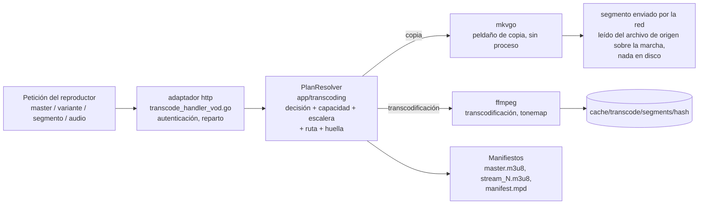

# Servir un vídeo - el camino de reproducción HLS

Lo que pasa cuando un reproductor pide un vídeo, desde la primera petición
de `master.m3u8` hasta los bytes de un segmento: el camino de lectura. El
código está repartido entre el adaptador de entrada `http`
(`internal/adapters/driving/http/transcode_*`), los servicios de
`app/transcoding` y los adaptadores de salida `ffmpeg` / `mkvgo` / `prober`;
ninguna función ejecuta todo el recorrido, así que esta página hace de mapa.
Lo deciden [ADR-0030](adr/0030-one-plan-one-decision.md) (un plan, una
decisión), [ADR-0024](adr/0024-playback-plan-resolver.md) (el resolutor del
plan) y [ADR-0029](adr/0029-transcoding-routes-are-measured-not-assumed.md)
(capacidades medidas). Es la contrapartida de la cadena de escaneo descrita
en [Arquitectura](ARCHITECTURE.md) y el análisis a fondo que hay detrás del
"Golden path 4" del [Mapa del código](CODEBASE_MAP.md). Para ver la misma
negociación desde el lado del usuario, lee
[Cómo elige Evey el modo de reproducción](playback/how-playback-is-decided.md).

## El modelo mental: 3 preguntas, 2 motores, 1 clave

Servir un vídeo se reduce a responder tres preguntas y después empaquetar la
respuesta, con todo identificado por un único hash.

| Pregunta | La responde | Dónde |
| --- | --- | --- |
| **P1 - ¿Puedo leer el archivo con poco coste?** | el reparto del análisis según la **extensión del archivo**: `.mkv/.webm` y `.mp4/.mov` van a [mkvgo](playback/mkvgo.md) (solo la cabecera, sin proceso); todo lo demás, y cualquier fallo de la vía rápida, va a ffprobe, que es la autoridad | `adapters/driven/prober/dispatcher.go` |
| **P2 - ¿Puede el cliente reproducirlo tal cual?** | la **decisión** de reproducción, pista por pista: vídeo `copy` o `transcode`, audio `copy`, `transcode` o la vía wasm de AC-3; el vídeo y el audio se deciden por separado, y el caso habitual es "copiar el vídeo, volver a codificar el audio en AAC" | `app/transcoding/decision.go` |
| **P3 - ¿Cuánto puede codificar esta máquina?** | la **capacidad** calibrada (medida en el primer momento tranquilo) más la **admisión** (qué peldaño de la escalera cabe, si queda un hueco libre) | `app/transcoding/calibration_service.go`, `admission_shaper.go` |

Dos motores intervienen en todo el recorrido:

- **mkvgo** lee y reempaqueta (Remux, bajo demanda) sin lanzar ningún proceso. Gratis.
- **ffmpeg / ffprobe** decodifican, vuelven a codificar y analizan lanzando un proceso. Caros.

Una clave: todo (la carpeta de la caché, la sesión de ffmpeg, las URL de los
segmentos) se identifica por la **huella de la decisión**, un hash de la
decisión. Los mismos bytes, el mismo hash, una sola codificación compartida.
Que todo el sistema funcione bien depende de que ese hash sea **estable**
entre el manifiesto que tiene un reproductor y cada segmento que pide
después.

Los dos motores sacan los datos del servidor de forma distinta: un segmento
de mkvgo se construye cuando se pide y se escribe en la conexión sobre la
marcha, así que la vía de copia nunca toca la caché de segmentos; un segmento
de ffmpeg es un archivo dentro de la carpeta de la huella, que se escribe una
vez y se sirve desde ahí.

## Orden de lectura - sigue una petición por el código

Abre estos archivos en orden para seguir una sola petición de reproducción
de principio a fin:

1. **Entrada** - `internal/adapters/driving/http/transcode_handler_vod.go`:
   `serveHTTP` autentica y después reparte entre master / variante /
   segmento / audio.
2. **El plan** - `http/transcode_vod_plan.go` convierte la `*http.Request` en
   una `PlaybackRequest` independiente del transporte;
   `app/transcoding/playback_plan_resolver.go` (`PlanResolver.Resolve`, el
   `PlaybackPlanResolver` concreto en `playback_plan.go`) devuelve un único
   `PlaybackPlan` inmutable: la decisión (P2), la clase de escalera, la
   escalera ajustada, la ruta de hardware, el empaquetador y la huella. Cada
   manifiesto y cada segmento de la sesión se sirven a partir de él: la
   entrada del manifiesto, la prueba de descarte, el sellado de URL
   caducadas, la elección del productor y la clave del segmento leen todos
   esa única resolución, así que dentro de una petición la regla del hash de
   la caché se cumple por construcción (la vía crítica de los segmentos pasó
   de unas 5 lecturas de preferencias de perfil a 1). Las funciones
   auxiliares sobre los datos de la fuente (códec, HDR, SAR, diez bits...)
   están al lado, en `source_facts.go`. `makeDecision` y `buildFingerprint`,
   en `http/transcode_vod_fingerprint.go`, son simples envoltorios para los
   puntos de llamada sin plan (precalentamiento, master bajo demanda).
3. **P2 - Decisión** - `internal/app/transcoding/decision.go`:
   `MakePlaybackDecisionWithPrefs` (pura) es el cerebro que decide copiar o
   transcodificar pista por pista. El resolutor añade encima los valores
   fijados en la petición (`vd=` / `ad=`), la corrección de la
   resincronización del audio, etc.
4. **P3 - Capacidad** - `internal/app/transcoding/calibration_service.go`:
   `Current()` devuelve `domain/transcoding.Derive(report, policy)`
   (`derive.go`), los techos de la máquina deducidos de la última
   calibración.
5. **Escalera y admisión** - el resolutor ajusta la escalera (clase de
   complejidad, perfiles de los productores, topes de la fuente y de la
   capacidad, topes CMCD/AV1, ruta y techo de admisión) y después **la
   congela** en el valor fijado de admisión (`admission_shaper.go`,
   `FreezeLadder`), que se lee tal cual en cada llamada posterior: la regla
   del hash de la caché convertida en estructura. `video_session_limiter.go`
   reserva el hueco de capacidad; la ruta pasa del hardware al software
   cuando está llena.
6. **Huella** - un `DecisionFingerprint` (el tipo y `Hash()` en
   `app/transcoding/segment_cache.go`), que monta el resolutor. El hash es la
   clave de la caché.
7. **Producir los bytes** - copia: **mkvgo**, `app/transcoding/ondemand.go`
   (puerto) y `adapters/driven/mkvgo/ondemand.go`; transcodificación:
   **ffmpeg**, `adapters/driven/ffmpeg/hls_transcoder.go` (`BuildFFmpegArgs`
   es pura; los segmentos acaban en `/cache/transcode/segments/<hash>/`).
8. **Empaquetado** - `app/transcoding/manifest_generator.go` escribe
   `master.m3u8` / `stream_N.m3u8`; `manifest_generator_dash.go` escribe
   `manifest.mpd`.

!!! warning "Entre peticiones, la regla depende de grabar los datos en las URL"
    Cada dato que entra en la decisión tiene que quedar grabado en las URL
    hijas (`querySuffix` en `manifest_generator.go`); si no, una consulta a
    mitad de la reproducción puede cambiar el plan sin que el reproductor lo
    sepa. Las URL de cada sesión se vuelven a grabar
    (`transcode_vod_manifest_rebake.go`) para llevar el token de streaming,
    tanto en HLS como en DASH, incluido Chromecast, que no usa cookies.

## Los dos motores, por coste

El **repartidor de análisis** (`adapters/driven/prober/dispatcher.go`) es una
cadena de responsabilidad según la extensión: prueba mkvgo, y vuelve a
ffprobe ante cualquier duda (error de lectura, pánico, resultado que no se
puede traducir, una pista multimedia MP4 descartada, DoVi perfil 5, color
ilegible). Las dos vías rápidas están siempre activas (puertas nil en
`wire.go`); ffprobe es la red de seguridad y nunca se salta. Un segundo
repartidor idéntico (`keyframe_dispatcher.go`) se encarga del índice de
posicionamiento.

| Operación | mkvgo (gratis) | ffprobe / ffmpeg (caro) |
|---|---|---|
| Análisis de los metadatos (códec, dimensiones, HDR, bitrate, duración) | `.mkv/.webm/.mp4/.mov`, solo la cabecera | todo lo demás, o como respaldo |
| Modo de fotogramas (cfr/vfr) | `AnalyzeFrameRateMode` | - |
| Remux de MKV a MP4 (sin volver a codificar) | `RemuxToMP4` | - |
| HLS/DASH bajo demanda (peldaño de copia) | `OnDemandPackager` | - |
| Recodificación del vídeo / tonemap HDR | - | `hls_transcoder.go` |
| Detección del entrelazado (idet), punto de llegada de un salto, chromaprint, DoVi P5 | - (necesita decodificar o leer datos auxiliares) | ffmpeg / ffprobe |

Todavía se lanzan tres procesos ffprobe sobre fuentes MKV/MP4 cuyos datos ya
ofrece mkvgo, todos en el adaptador de salida `ffmpeg`: la duración en
`trickplay.go`, el bitrate y las dimensiones en `complexity_classifier.go`,
y el retardo del audio de reproducción en `audio_delay.go`.

## El audio se decide aparte del vídeo

`makeDecision` produce `VideoDecision` y `AudioDecision` por separado. El
"peldaño de copia" (`isCopyRequest`) depende solo del **vídeo**; incluso un
vídeo copiado suele llevar al lado una pista AAC recodificada. La decisión
del audio tiene tres resultados posibles:

| Resultado | Lo que se sirve |
| --- | --- |
| copia | la pista de origen tal cual |
| transcodificación a AAC | ffmpeg, ligero |
| la **vía wasm**, para AC-3 / E-AC-3 en un navegador que no lo puede decodificar por sí mismo | el master queda solo con vídeo y una etiqueta `#EVEY-AUDIO-URI`, el AC-3 se **copia** (`od_audio` de mkvgo si el plan se puede montar; si no, ffmpeg `-c:a copy`), y `ac3go.wasm` lo decodifica a PCM en el navegador (`WasmAudioEngine.ts`), sincronizado con el reloj del vídeo |

Safari queda fuera de la vía wasm por capacidad, no por nombre:
`canWasmDecodeAC3()` (`frontend/packages/client/src/web/codec.ts`) solo
devuelve true cuando el navegador informa de que *no puede* reproducir AC-3
por sí mismo, y Safari informa de que sí puede.

## Empaquetado: CMAF, HLS, DASH

El contenedor es siempre **CMAF** (fMP4): un `init.mp4` por variante más
segmentos `.m4s` (la rama MPEG-TS de `hls_transcoder.go` ya no se usa:
`needsFMP4Segments` siempre devuelve true). Sobre *los mismos* segmentos:

- **HLS** (`master.m3u8`, `stream_N.m3u8`, init `EXT-X-MAP` + `.m4s`), con los dos motores.
- **DASH** (`manifest.mpd`): en la vía de copia de mkvgo, el manifiesto del
  propio empaquetador (`OnDemandPlan.HasDASH`, idéntico byte a byte, sin
  almacenamiento, desactivado con AES-128); en la vía de ffmpeg, un
  manifiesto **declarado a partir del plan** sobre los mismos fragmentos a
  los que apuntan las listas HLS (`ManifestGenerator.MPD`), escrito antes de
  que exista ningún fragmento.

Lo que hace que el manifiesto DASH sea fiel es la **rejilla de segmentos**
(`domain/transcoding.SegmentGrid`): cada peldaño transcodificado se corta en
el mismo número entero de fotogramas, `round(3 s x fps)` (72 a 23,976 fps,
75 a 25, 90 a 29,97), así que un segmento es exacto en las unidades de
tiempo de la pista de vídeo e idéntico en todo el conjunto de cambio de
calidad; el respaldo de copia declara su plan de fotogramas clave. Una fuente
cuya frecuencia de fotogramas es desconocida o variable se queda en el reloj
antiguo de 3 s, mantiene HLS y responde 404 a `manifest.mpd`. Ningún cliente
se pasa a DASH: HLS sigue siendo el valor por defecto en todas partes.
`DASHFromCMAF` de mkvgo sobre los fragmentos producidos es la referencia de
paridad (`internal/pkg/cmafparity`, `TestDASHGridIntegration` a
23,976/25/29,97 fps: en frío, con salto, con un conjunto de cambio de dos
peldaños, con el audio aparte dentro de una trama AAC).

## Patrones de diseño en juego

| Patrón | Dónde |
| --- | --- |
| Puertos y adaptadores (hexagonal) | la capa de aplicación habla con `StreamProber`, `BenchmarkRunner`, `OnDemandPackager`, `StreamProducer`; ffmpeg y mkvgo los implementan, y un motor nuevo es un adaptador nuevo |
| Estrategia | `StreamProducer` (software / hardware / copia), elegido por un `ProducerSelector` |
| Cadena de responsabilidad con respaldo | los repartidores de análisis y de fotogramas clave (mkvgo, y después ffprobe como autoridad) |
| Caché direccionada por contenido | el hash `DecisionFingerprint` es la clave de la caché y de la sesión de ffmpeg |
| Núcleo puro, capa imperativa | `Derive`, `MakePlaybackDecision` y el modelo de costes son puros, con tests unitarios sin ffmpeg ni base de datos |
| Objeto de valor inmutable | `StreamPlan`, la decisión de admisión, emitida una vez y nunca modificada, así que la regla de las URL a los bytes se cumple por construcción |
| Degradación progresiva | un respaldo seguro en cada paso: capacidad 720p por defecto, paso del hardware al software, de la copia a la transcodificación, de mkvgo a ffprobe |

<!-- sources
entry and plan: internal/adapters/driving/http/transcode_handler_vod.go - serveHTTP ; internal/adapters/driving/http/transcode_vod_plan.go ; internal/adapters/driving/http/transcode_vod_fingerprint.go - makeDecision, buildFingerprint ; internal/adapters/driving/http/transcode_vod_manifest_rebake.go
resolver: internal/app/transcoding/playback_plan_resolver.go - PlanResolver.Resolve ; internal/app/transcoding/playback_plan.go - PlaybackRequest, PlaybackPlan ; internal/app/transcoding/source_facts.go
decision and capability: internal/app/transcoding/decision.go - MakePlaybackDecisionWithPrefs ; internal/app/transcoding/calibration_service.go - Current ; internal/domain/transcoding/derive.go - Derive
ladder, admission, fingerprint: internal/app/transcoding/admission_shaper.go - StreamPlan, FreezeLadder ; internal/app/transcoding/video_session_limiter.go ; internal/app/transcoding/segment_cache.go - DecisionFingerprint ; internal/app/transcoding/stream_producer.go - StreamProducer, ProducerSelector
engines: internal/adapters/driven/prober/dispatcher.go ; internal/adapters/driven/prober/keyframe_dispatcher.go ; internal/app/transcoding/ondemand.go - OnDemandPackager ; internal/adapters/driven/mkvgo/ondemand.go ; internal/adapters/driven/ffmpeg/hls_transcoder.go - BuildFFmpegArgs, needsFMP4Segments ; internal/adapters/driven/ffmpeg/trickplay.go, complexity_classifier.go, audio_delay.go
packaging: internal/app/transcoding/manifest_generator.go - querySuffix, EVEY-AUDIO-URI ; internal/app/transcoding/manifest_generator_dash.go ; internal/domain/transcoding/segment_grid.go - SegmentTargetSeconds, gridFor ; internal/pkg/cmafparity ; internal/adapters/driven/ffmpeg/dash_grid_integration_test.go - TestDASHGridIntegration
wasm: frontend/packages/client/src/web/codec.ts - canWasmDecodeAC3
-->
