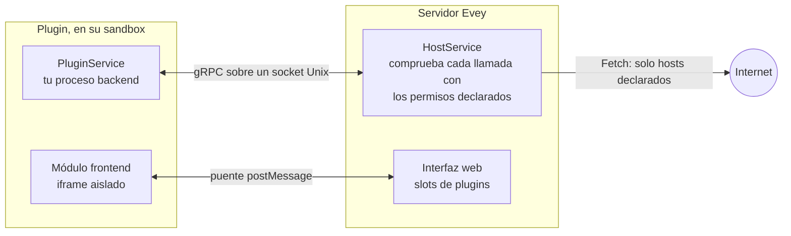

# Plugins

Los plugins añaden a Evey lo que no hace por sí solo: fuentes de metadatos,
canales de notificación, receptores de webhooks, secciones de la página de
inicio, superposiciones del reproductor y temas. Cada plugin es un proceso aparte
que habla con el servidor a través de un socket local, confinado por un sandbox y
limitado a los permisos que declara su manifiesto. Su interfaz, si la tiene, se
ejecuta en un marco aislado de la página.

<figure class="evey-shot" markdown="span">
  { loading=lazy }
  <figcaption>Sin plugins.</figcaption>
</figure>

<figure class="evey-shot" markdown="span">
  { loading=lazy }
  <figcaption>Con el plugin de ejemplo del tiempo: una sección arriba, dibujada en su propio marco (interfaz en inglés).</figcaption>
</figure>

## Instalar y gestionar plugins

**Admin → Plugins** instala un plugin a partir de su archivo ZIP. Antes de
instalar nada, la vista previa muestra:

<figure class="evey-shot" markdown="span">
  { loading=lazy }
  <figcaption><strong>Admin → Plugins</strong>: los entornos de ejecución disponibles, los límites de recursos y una tarjeta por plugin (interfaz en inglés).</figcaption>
</figure>

- los permisos que declara el plugin, los slots de la interfaz en los que quiere
  aparecer y los hosts a los que se conectará;
- lo que encontró el análisis estático en su código;
- su firma, cuando el servidor comprueba las firmas.

Un plugin cuyo análisis encuentra un patrón crítico se rechaza. La actualización
de un plugin instalado pasa por la misma vista previa; cuando pide permisos,
slots u hosts nuevos, debes aceptar la diferencia de forma explícita.

Después, cada plugin tiene en su tarjeta: activar o desactivar, actualizar,
registros y sus límites de recursos (memoria, procesos, disco, prioridad de
CPU). La línea **Sandbox del host** del **Panel de seguridad** muestra el modo de
sandbox realmente activo en este equipo: consulta
[Configurar el sandbox de plugins](plugins/sandbox-deployment.md) si muestra
`basic`.

Los plugins están activados por defecto. `EVEY_PLUGINS_ENABLED=false` desactiva
el subsistema por completo.

## Lo que un plugin puede y no puede hacer

Un plugin ve su propio directorio y no los datos del servidor, no tiene acceso
directo a la red (un plugin autorizado en la red solo llega a los hosts que
declaró, a través del servidor) y no puede lanzar procesos salvo que declare el
permiso `subprocess`. Los permisos que puede pedir un plugin se listan en
[Permisos y slots](plugins/security-model.md). Cómo funciona el sandbox, y lo que
todavía no puede impedir, se describe en
[Modelo de seguridad y sandbox de plugins](SECURITY.md).

Revisa un plugin de terceros antes de instalarlo, como harías con cualquier
software: una vez que un host está en la lista de un plugin, el servidor no puede
inspeccionar lo que el plugin le envía.

## Escribir un plugin

Un plugin se puede escribir en cualquier lenguaje que su `entrypoint` pueda
lanzar. Se incluyen stubs gRPC generados para Python, Node.js, PHP, Ruby, Dart,
Java y Swift; los stubs Go se generan con `protoc-gen-go`; los binarios
compilados necesitan el permiso `native-binary`.

| Página | Contenido |
| --- | --- |
| [Escribir un plugin](plugins/dev-setup.md) | Requisitos, primer plugin, el ciclo de instalación, firma, distribución. Empieza aquí. |
| [Referencia de la API de plugins](plugins/api-reference.md) | El manifiesto, las llamadas del backend y el almacén de datos, el puente frontend `evey.*`, las capacidades. |
| [Permisos y slots](plugins/security-model.md) | Lo que puede declarar un manifiesto, lo que se comprueba al instalar, las reglas de acceso externo, los slots. |
| [Temas](themes.md) | Cambiar el estilo de la interfaz con CSS y un script en sandbox. |
| [Webhooks y claves de API](webhooks-api-keys.md) | Integrar Evey con otras herramientas sin escribir un plugin. |
