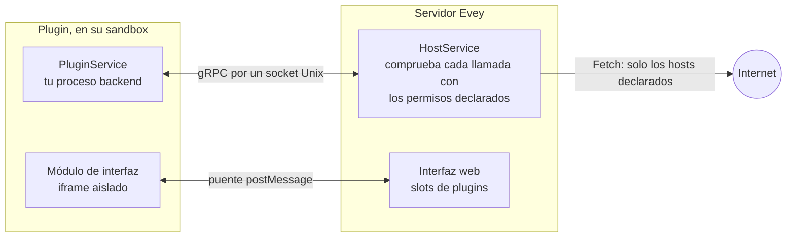

# Escribir un plugin { #writing-a-plugin }

Esta página lleva a un desarrollador desde un clon de Evey hasta un plugin
que funciona en un servidor local, y después hasta un paquete firmado que
otros administradores pueden instalar. El tutorial de la
[sección 3](#3-your-first-plugin-step-by-step) es el camino directo; el resto
es referencia a la que volverás. Las llamadas y los campos en sí están en la
[Referencia de la API de plugins](api-reference.md).



Un plugin es un ZIP con un `plugin.yaml` en su raíz y un proceso backend que
el servidor arranca en un sandbox. El proceso sirve un pequeño servicio gRPC
en un socket Unix y llama al servidor por otro. También puede incluir un
módulo de interfaz, que se dibuja en un marco con sandbox dentro de la
página, y solo se comunica con el exterior a través del servidor, con los hosts que
declaró.

## 1. Requisitos previos { #1-prerequisites }

| Herramienta | Para qué |
|---|---|
| Go 1.27, Node.js 22 con pnpm, Docker con Compose | El entorno de desarrollo (`make dev`) compila el servidor y la aplicación web. |
| `bubblewrap` (`bwrap`) | Solo para los modos de sandbox `bubblewrap` y `strict`. El modo por defecto, `auto`, usa Landlock y no necesita nada en un núcleo 5.13 o posterior. |
| [cosign](https://docs.sigstore.dev/cosign/installation/) | Para firmar tu paquete antes de distribuirlo ([sección 7](#7-sign-your-plugin)). No hace falta para desarrollar. |

Elige el lenguaje de tu plugin entre los runtimes que el servidor puede
arrancar: `python`, `nodejs`, `php`, `ruby`, `lua`, `bash` y `sh` necesitan
su intérprete en la imagen, y `go` incluye un binario compilado y necesita el
permiso `native-binary`. La imagen por defecto lleva Python, Node.js, PHP, Ruby y Lua; la imagen
`-nodejs` conserva Python y Node.js y la imagen `-lean` solo Python. Un
manifiesto que nombra un runtime que la imagen no tiene se rechaza al
instalar, con la lista de los runtimes disponibles.

El contrato gRPC es un solo archivo, `proto/plugin/v1/plugin_api.proto`. Solo
el SDK de Python incluye stubs generados; los demás lenguajes en
`sdk/<language>/` contienen el `.proto`. El servidor copia los archivos de tu
lenguaje junto a tu entrypoint cuando arranca el plugin. La imagen aporta
`grpcio` a los plugins de Python, que no tienen que incluir nada. Un plugin
Node.js debe incluir su `node_modules` (`@grpc/grpc-js` y
`@grpc/proto-loader`) en el paquete. Para otro lenguaje, genera los stubs con `protoc` e inclúyelos en el ZIP:

```bash
protoc --proto_path=proto \
       --<lang>_out=OUT_DIR --grpc_<lang>_out=OUT_DIR \
       proto/plugin/v1/plugin_api.proto
```

`make plugin-sdk` regenera los stubs incluidos; cada `sdk/<lang>/README.md`
indica el plugin gRPC que necesita su lenguaje.

## 2. Arrancar Evey en local { #2-bring-up-evey-locally }

```sh
git clone git@github.com:eveyproject/evey.git
cd evey
cp .env.dev.example .env.dev   # después rellena MEDIA_DIR, EVEY_DB_PASSWORD, MEILI_MASTER_KEY
make setup                      # una vez: añade evey.test a /etc/hosts
make dev                        # postgres, meilisearch, el servidor (Air), la aplicación web (Vite)
```

Abre `https://evey.test`. El asistente de configuración crea la cuenta de
administrador en el primer arranque, como se explica en
[Primera configuración](../getting-started/first-setup.md). Los archivos de
los plugins van a `./evey-data/plugins/<plugin-id>/`, montado como
`/data/plugins` en el contenedor.

## 3. Tu primer plugin, paso a paso { #3-your-first-plugin-step-by-step }

El ejemplo `examples/plugins/nodejs-example` es el plugin completo más
pequeño: sirve `PluginService`, se conecta a `HostService` y escribe una
línea en su registro cuando el servidor lo arranca. Lo copiamos, cambiamos
una cosa y lo instalamos.

1. **Copia el ejemplo.**

    ```sh
    cp -r examples/plugins/nodejs-example ~/hello-plugin
    cd ~/hello-plugin
    ```

2. **Ponle un nombre.** Edita `plugin.yaml`:

    ```yaml title="plugin.yaml"
    name: hello-plugin          # único, en kebab-case
    kind: plugin
    version: 1.0.0              # semver: súbela en cada subida
    description: Says hello in its log
    author: you
    language: nodejs            # el runtime que tiene que tener el servidor
    entrypoint: node main.js    # la línea de comandos que ejecuta el servidor
    permissions:
      - api.library             # permite al backend leer los elementos multimedia
    ```

    `language` le dice al servidor qué runtime comprobar y qué stubs copiar;
    `entrypoint` es lo que ejecuta, en la carpeta del plugin, con el entorno
    del paso siguiente.

3. **Lee `main.js`.** El servidor pasa tres variables al proceso:
   `EVEY_PLUGIN_ID`, `EVEY_PLUGIN_SOCK` (el socket en el que *tu* proceso
   tiene que escuchar, sirviendo `PluginService`) y `EVEY_HOST_SOCK` (el
   socket al que te conectas para llamar a `HostService`). El ejemplo carga
   `plugin_api.proto` desde su propia carpeta, donde lo copió el servidor, e
   implementa los cinco métodos de `PluginService`. Cambia el mensaje de
   `Initialize`:

    ```js title="main.js (extracto)"
    Initialize(call, callback) {
      hostLog("LOG_LEVEL_INFO", `hello from ${process.env.EVEY_PLUGIN_ID}`);
      callback(null, { success: true });
    },
    ```

4. **Comprímelo en un ZIP.** El manifiesto tiene que estar en la raíz del
   archivo, no en una subcarpeta:

    ```sh
    zip -r ../hello-plugin.zip . -x ".*"
    ```

5. **Instálalo.** En **Administración → Plugins**, **Instalar plugin**, elige
   el ZIP y **Vista previa e instalar**: la vista previa muestra
   `api.library` y el resultado del análisis estático. Por la API, la misma
   subida es:

    ```sh
    curl -F "plugin=@hello-plugin.zip" \
         -H "Authorization: Bearer $EVEY_TOKEN" \
         https://evey.test/api/v1/admin/plugins/upload
    ```

6. **Lee el registro.** En la tarjeta del plugin, **Registros** muestra la línea
   escrita por `Initialize`. `docker compose logs evey` muestra el lado del
   servidor de ese mismo arranque, con el id del plugin.

7. **Repite.** Cambia el código, sube `version`, vuelve a comprimir y usa
   **Actualizar desde origen…** en la tarjeta. Una subida con la misma
   versión o una menor se rechaza; un permiso nuevo en el manifiesto lanza
   el paso de consentimiento que el administrador tiene que aprobar.

Lo que tienes es todo el contrato del backend. A partir de aquí, un plugin
se puede ampliar de tres formas: llamar al servidor (`HostService`, sección 4),
dibujar una interfaz (sección 5) y llegar al exterior (sección 6).

## 4. Llamar al servidor desde el backend { #4-call-the-server-from-the-backend }

Cada llamada a `HostService` lleva la identidad del plugin: el servidor
comprueba el proceso del socket por su PID, y un interceptor rechaza
cualquier llamada cuyo permiso no declare el manifiesto. Tres grupos no
necesitan ningún permiso:

- `Log` escribe en el registro del plugin, que se ve en su tarjeta;
- `GetConfig` lee los valores que el administrador fijó en **Configuración**
  (declarados en `config_schema`), y `SetConfig` permite al plugin guardar
  ahí sus propias claves;
- `GetData` / `SetData` / `DeleteData` / `ListDataKeys` es el almacén
  clave/valor privado del plugin, que se borra al desinstalarlo.

`GetMediaItem` y `ListMediaItems` necesitan `api.library` o `media.read`;
`Fetch` necesita `network`. La tabla completa, con los métodos declarados en
el contrato pero que todavía no se sirven, está en la
[Referencia de la API de plugins](api-reference.md#hostservice-what-the-plugin-can-call).

## 5. Añadir una interfaz { #5-add-an-interface }

Una interfaz es un módulo JavaScript que la página carga en un marco con
sandbox, en uno de los slots que permite el servidor. Declara dónde están los
archivos y dónde va el módulo:

```yaml title="plugin.yaml"
web_root: dist               # la carpeta que se sirve como archivos estáticos
frontend:
  - slot: home.section       # consulta la lista de slots
    src: dist/index.js       # tiene que estar dentro de web_root
```

El módulo recibe un puente `window.evey`: `evey.onInit` le entrega la
configuración del plugin, el idioma, el tema y la superficie en la que se
muestra; `evey.resize`, `evey.toast` y `evey.navigate` actúan sobre la página
dentro de unos límites fijos; y, cuando el manifiesto declara `prefs` o
`public`, `evey.prefs.*` y `evey.media.*` llegan al servidor con un token de
corta duración que la página anfitriona guarda para el marco.
`examples/plugins/weather` es un widget completo con un paso de compilación;
`examples/plugins/data-demo` muestra `prefs`, `public` y el slot `admin.nav`.
El puente y los slots se describen en la
[Referencia de la API de plugins](api-reference.md#frontend-api).

## 6. Llegar al exterior { #6-reach-the-outside-world }

Un proceso de plugin no puede abrir ningún socket hacia internet, en todos
los modos en los que el launcher se ejecuta (`basic` sin el launcher solo prohíbe `execve`). La única salida es la llamada `Fetch` de `HostService`: el
servidor comprueba el destino con el manifiesto y después hace la petición él
mismo.

```yaml title="plugin.yaml"
permissions:
  - network
external_fetch:
  - api.open-meteo.com       # nombres de host a secas: sin esquema, sin comodín, sin IP
```

`network` sin `external_fetch` se rechaza al instalar. Mientras funciona, el
intermediario acepta `http` y `https`, `GET` y `HEAD`, respuestas de hasta
8 MiB en 20 segundos, y rechaza las direcciones privadas o reservadas,
incluso a través de una redirección. El marco de la interfaz recibe la misma
lista de hosts como su `connect-src`, así que un widget puede llamar
directamente a esos hosts por `https`. Las reglas están en
[Permisos y slots](security-model.md#external-fetch-rules).

!!! note "Los hosts son un contrato con el administrador"
    El administrador ve la lista de hosts al actualizar y en el Panel de seguridad, y tiene que aprobar
    cualquier añadido al actualizar. Limítala a lo que necesita el plugin, y
    explica en tu README lo que recibe cada host.

## 7. Firma tu plugin { #7-sign-your-plugin }

!!! info "Lo que demuestra una firma"
    Una firma dice que el ZIP que instala el administrador es, byte a byte, el
    que **tú** publicaste. Tu clave pública viaja dentro del paquete
    (`cosign.pub` en la raíz del ZIP), y Evey fija su huella en el plugin al
    instalarlo: una actualización firmada con otra clave, o que ya no está
    firmada, se rechaza hasta que el administrador acepte el cambio. No dice
    nada de lo que hace el plugin: los permisos, los hosts y el análisis de la
    vista previa se siguen aplicando. Evey la comprueba sin conexión y dentro
    de su propio proceso (ECDSA P-256 sobre el SHA-256 del ZIP, el formato
    que produce `cosign sign-blob --key`): sin binario `cosign` en el
    servidor, sin red, sin registro de transparencia.

Solo necesitas [cosign](https://docs.sigstore.dev/cosign/installation/) en tu
máquina.

1. **Una vez: genera un par de claves.**

    ```sh
    # elige una frase de contraseña de verdad; cosign.key es privada, nunca la subas al repositorio
    COSIGN_PASSWORD="your-passphrase" cosign generate-key-pair
    # -> cosign.key (privada) y cosign.pub (el archivo que repartes)
    ```

2. **En cada versión: pon tu clave pública en la raíz del plugin, comprime
   y después firma** exactamente el archivo que vas a distribuir.

    ```sh
    cp cosign.pub hello-plugin/cosign.pub
    cd hello-plugin && zip -r ../hello-plugin.zip . && cd ..

    COSIGN_PASSWORD="your-passphrase" cosign sign-blob \
      --key cosign.key --tlog-upload=false --yes \
      --output-signature hello-plugin.zip.sig \
      hello-plugin.zip
    ```

3. **Compruébala antes de publicar**, con la misma verificación que hace el
   servidor:

    ```sh
    cosign verify-blob --key cosign.pub --signature hello-plugin.zip.sig \
      --insecure-ignore-tlog hello-plugin.zip      # -> Verified OK
    ```

4. **Publica los dos archivos juntos**: `hello-plugin.zip` (tu clave pública
   va dentro) y `hello-plugin.zip.sig`, uno junto al otro, para que una
   instalación por URL encuentre la firma en `<url>.sig`. Pon la huella de la
   clave (`sha256:...`, que Evey muestra en la tarjeta del plugin) en tu README
   y en las notas de la versión, para que los administradores puedan
   compararla antes de confiar en la clave.

En la instancia que lo instala, el administrador elige el ZIP en
**Administración → Plugins** y, en **Archivo de firma (.zip.sig, opcional)**,
su `.zip.sig`; por la API, la firma es el campo `sig` de la subida. Evey
verifica el paquete con la clave que lleva y muestra una de estas opciones:

- **Firmado por <editor>**: la clave está en la lista de **Editores de
  confianza** de la instancia.
- **Firmado - clave desconocida sha256:...**: la firma es buena, pero todavía
  no se confía en la clave. Un clic, **Confiar en esta clave**, la añade a la
  lista con un nombre.
- **Sin firma**, o **Firma no válida**.

La política decide qué ocurre: `EVEY_PLUGINS_COSIGN_POLICY=warn` (por
defecto) registra el veredicto y deja pasar toda instalación; `enforce` solo
admite claves de confianza. Sea cual sea la política, una actualización cuya
clave difiere de la versión instalada, o que abandona la firma, se rechaza
hasta que el administrador marque **El editor cambió, acepto la nueva clave**
en el diálogo de actualización. `EVEY_PLUGINS_COSIGN_PUBLIC_KEY` es
opcional: añade una clave a la lista de confianza al arrancar (marcada como
la del operador del servidor).

Errores habituales:

- **Cualquier cambio en el ZIP invalida la firma**, incluso volver a comprimir
  los mismos archivos. Firma el archivo que distribuyes, y vuelve a firmar en
  cada versión.
- **Conserva la misma clave** de una versión a la siguiente. Una clave nueva
  es un editor nuevo para cada administrador que te instaló: se le pedirá que
  la acepte. Cambia de clave a propósito, y dilo en las notas de la versión.
- **Solo se aceptan claves ECDSA P-256**, que es lo que crea `cosign
  generate-key-pair`. Las firmas sin clave (keyless) y las referencias KMS no
  se verifican.
- Un `.sig` sin `cosign.pub` en el ZIP, o al revés, cuenta como **Sin
  firma**.
- Una clave equivocada, un ZIP manipulado y un `.sig` que falta se leen
  todos como una firma fallida: con `enforce`, se rechaza la instalación o la
  actualización.

## 8. Lo que comprueba el instalador, en orden { #8-what-the-installer-checks-in-order }

Cada paso puede rechazar el paquete; el administrador ve el motivo, y el
registro del servidor tiene el detalle.

1. **Manifiesto.** `plugin.yaml` se lee directamente del ZIP: campos
   obligatorios, semver, permisos y capacidades conocidos, slots de la lista
   permitida, entradas de `external_fetch` que son nombres de host a secas,
   `web_root` presente cuando se declara `frontend`. El `language` declarado
   tiene que ser un runtime de la imagen.
2. **Versión y ampliación de permisos.** Para un plugin ya instalado, la
   versión nueva tiene que ser mayor, y cualquier permiso, capacidad, slot o
   host nuevo detiene la instalación aquí hasta que el administrador aprueba
   la diferencia (`accept_permission_changes=true` en la ruta de subida).
3. **Firma y hash.** La firma se verifica cuando hay una clave pública
   configurada; un fallo solo bloquea con `enforce`. El hash del ZIP se
   guarda, y se vuelve a comprobar cuando se aplica una actualización
   revisada antes en la vista previa.
4. **Extracción** a una carpeta temporal: como mucho 5.000 entradas, 100 MB
   por archivo, 500 MB en total, una relación de compresión de 100:1, ningún
   enlace simbólico, ninguna ruta que salga del archivo. Una actualización
   nunca toca la versión en marcha hasta que pasan todos los pasos
   siguientes.
5. **Solo temas:** la hoja de estilos se sanea y se guarda, y un `theme.js`
   que coincide con un patrón prohibido hace que se rechace el paquete.
6. **Análisis estático** de cada archivo de texto: un hallazgo crítico
   rechaza el paquete; los avisos `deserialization` y `obfuscation` también,
   y `native_code`, los binarios compilados y los archivos comprimidos
   incrustados lo rechazan salvo que el manifiesto declare `native-binary`.
7. **Guardar y arrancar.** La carpeta temporal se pone en su sitio, se
   escribe la fila en la base de datos y se arranca el proceso.

Lo que busca el análisis está en
[Sandbox de plugins y modelo de amenazas](../SECURITY.md#static-analysis).
Los comentarios se eliminan antes del análisis, así que una línea comentada
no se señala.

## 9. Las condiciones en las que funciona tu proceso { #9-what-your-process-runs-under }

El servidor arranca el proceso con una prioridad de CPU más baja, un techo de
memoria, un límite de procesos e hilos y un límite de tamaño para su carpeta;
un vigilante detiene un plugin que los supera. Los valores por defecto son
256 MiB, 64 procesos y 100 MiB, y el administrador puede ajustarlos en
**Administración → Plugins → Límites de recursos**. Sin el permiso
`subprocess`, el proceso no puede lanzar procesos hijos, sea cual sea el
lenguaje; los hilos sí funcionan.

En todos los modos en los que el launcher se ejecuta, el sandbox limita el sistema de archivos a la carpeta del plugin y corta
todos los sockets de red (`basic` sin el launcher solo prohíbe `execve`). El modo que se aplica depende del
servidor, no del plugin:
[Sandbox de plugins y modelo de amenazas](../SECURITY.md#sandbox-modes) los
describe, y [Configurar el sandbox de plugins](sandbox-deployment.md) le dice
a un administrador cuál elegir.

## 10. Distribuir un plugin { #10-distribute-a-plugin }

No hay catálogo: un administrador instala un plugin subiendo su ZIP o
pegando su URL en el panel de administración, desde donde lo publiques (una
versión en una forja, tu propia web).

- Publica juntos el ZIP, su `.sig` y tu `cosign.pub` (sección 7).
- Indica los permisos y los hosts de `external_fetch` en tu README: el
  administrador ve los permisos al instalar y los hosts al actualizar y en el Panel de seguridad, y tiene que aprobarlos; algo inesperado ahí
  es el primer motivo por el que se rechaza una instalación.
- Para que tu plugin aparezca con los ejemplos incluidos, abre una pull
  request contra `examples/plugins/` con el código fuente y un README. Los
  ejemplos se revisan y se compilan desde el código fuente; aparecer en la
  lista no es una recomendación y no lleva ninguna firma del proyecto.

## 11. Solución de problemas { #11-troubleshooting }

| Síntoma | Causa | Solución |
|---|---|---|
| `plugin requires "nodejs" runtime which is not installed in this image` | A la variante de la imagen le falta el intérprete. | Usa la imagen por defecto o `-nodejs`, o escribe el plugin en Python. |
| `manifest: external_fetch entry "*.tmdb.org" is a wildcard - use explicit hostnames` | Los comodines se rechazan al instalar, sin excepciones. | Enumera cada nombre de host que necesites (`api.tmdb.org`, `image.tmdb.org`). |
| `manifest: frontend slot "admin.section" not allowed` | El slot no está en la lista permitida. | Elige un slot de la [lista de slots](api-reference.md#slots); `admin.nav` es el único slot de la zona de administración. |
| `manifest: network permission requires non-empty external_fetch` | Se ha declarado `network` sin hosts. | Añade los hosts, o quita el permiso. |
| `plugin already installed at version 1.0.0, new version must be higher` | El ZIP lleva la versión ya instalada. | Sube `version`, o desinstala primero. |
| `signature does not match the plugin or the configured key` | El `.sig` se hizo con otra clave, o el ZIP cambió después de firmarlo. | Vuelve a firmar exactamente ese ZIP con la clave correcta, o corrige `EVEY_PLUGINS_COSIGN_PUBLIC_KEY`. |
| `plugin blocked: theme.js contains forbidden pattern` | El analizador de scripts de temas ha encontrado una API prohibida. | Un tema solo puede llamar a `evey.theme.*`: consulta [Temas](../themes.md#what-the-scanner-refuses). |
| El registro termina con `memory quota exceeded (... MB > ... MB)` | El vigilante detuvo el plugin al pasar su límite de memoria. | Reduce el uso de memoria, o sube **Memoria máx. (MiB)** en **Límites de recursos**. |
| `bwrap: ... permission denied` | Modo `bubblewrap` dentro de Docker, bloqueado por el perfil seccomp o AppArmor del contenedor. | Quédate con el modo por defecto, `auto`. Si no, consulta [Configurar el sandbox de plugins](sandbox-deployment.md). |
| El módulo de interfaz no aparece | El plugin está desactivado, el nombre del slot está mal escrito o `src` no está dentro de `web_root`. | Comprueba el estado de la tarjeta, el nombre del slot y las peticiones `/api/v1/plugins/<id>/assets/...` en el panel de red del navegador. |

<!-- sources
runtimes, image variants: internal/adapters/driven/pluginrunner/runtime_availability.go - runtimeBinaries, compiledLanguages ; internal/app/plugin/install.go - parseAndValidateManifest ; Dockerfile (RUNTIMES lean/nodejs/full)
stubs copied at start, NODE_PATH: internal/adapters/driven/filesystem/plugin_fs.go - CopySDKStubs ; internal/adapters/driven/pluginrunner/runner_start.go ; sdk/python/README.md ; examples/plugins/nodejs-example/package.json
dev stack: DEV.md (Quick Start) ; Makefile - setup, dev ; docker-compose.yml (evey-data/plugins:/data/plugins)
example: examples/plugins/nodejs-example/main.js, plugin.yaml
env vars: internal/adapters/driven/pluginrunner/runner_start.go (EVEY_PLUGIN_ID, EVEY_PLUGIN_SOCK, EVEY_HOST_SOCK)
upload route, fields: internal/adapters/driving/http/plugin_asset_handler.go (plugin, sig, accept_permission_changes)
host RPC permissions: internal/adapters/driving/grpcapi/plugin_interceptor.go ; peer auth: internal/adapters/driving/pluginhost/peer_creds.go
host RPCs: internal/adapters/driving/pluginhost/host_server.go - Log, GetConfig, SetConfig, GetData ; fetch.go - Fetch (GET/HEAD, maxFetchBytes, fetchTimeout)
frame connect-src: frontend/packages/client/src/plugins/hostProtocol.ts - buildConnectSrc ; internal/adapters/driving/http/plugin_frame_handler.go - pluginFramePolicy
bridge: frontend/packages/client/src/plugins/bridgeScript.ts - EveyBridge
cosign: internal/adapters/driven/pluginrunner/cosign.go - loadP256PublicKey ; internal/config/config.go - CosignPolicy validation
install order: internal/app/plugin/install.go - installLocalZip, parseAndValidateManifest, resolveExistingPlugin, verifyPluginIntegrity, extractPluginToStaging, validateStagedPlugin, checkEscalatedWarnings, swapAndPersistPlugin ; update.go - ApplyUpdate ; zip limits: docs/SECURITY.md (ZIP extraction)
resource limits: internal/config/config.go - Plugins ; internal/adapters/driven/pluginrunner/runner_resmon.go ; i18n admin.plugins.resourceLimits.*
error texts: internal/adapters/driven/pluginrunner/manifest.go ; internal/domain/plugin/model.go ; internal/app/plugin/install.go ; cosign.go ; runner_resmon.go
-->
