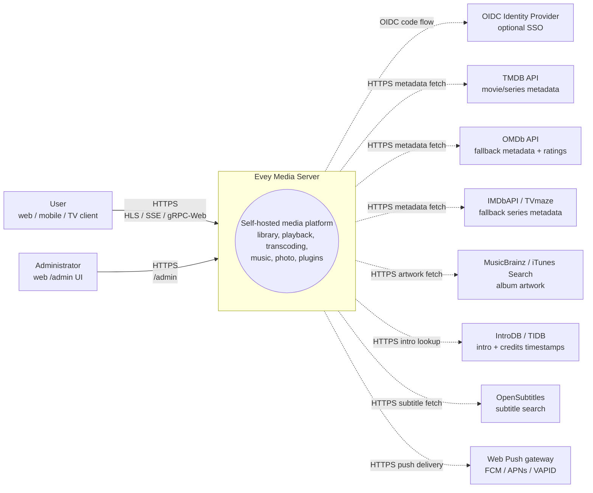
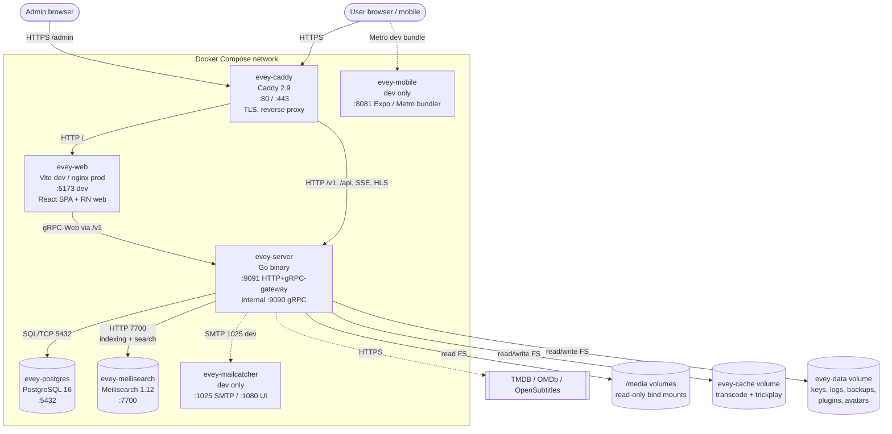
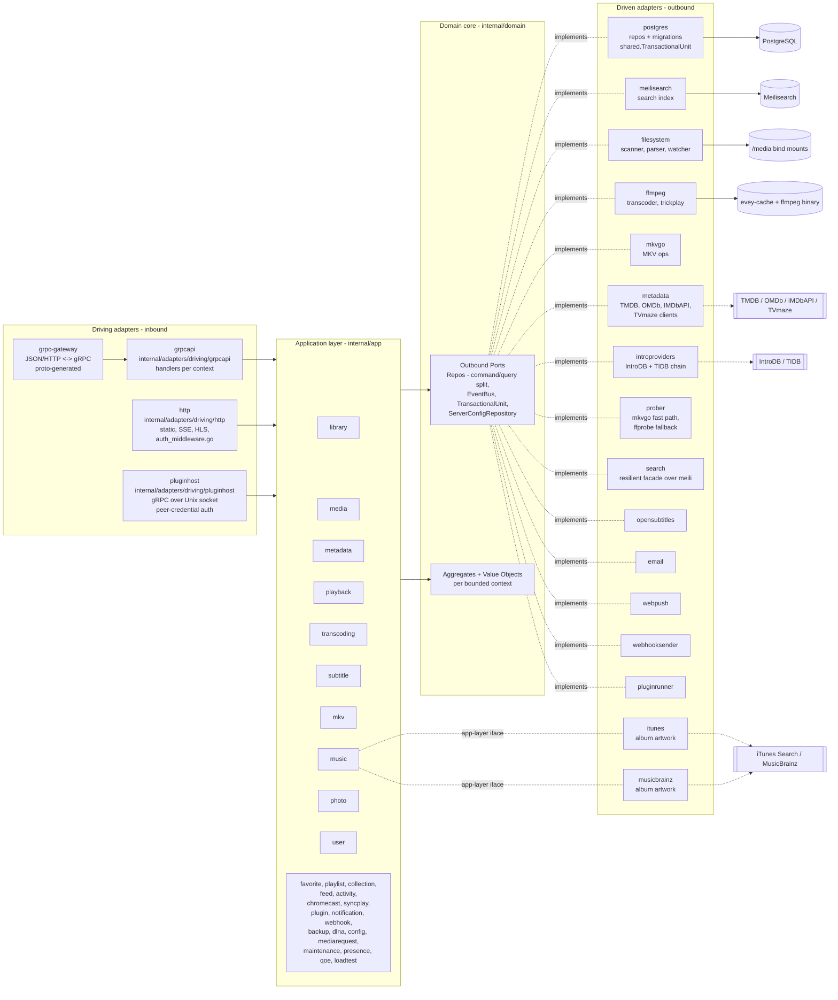
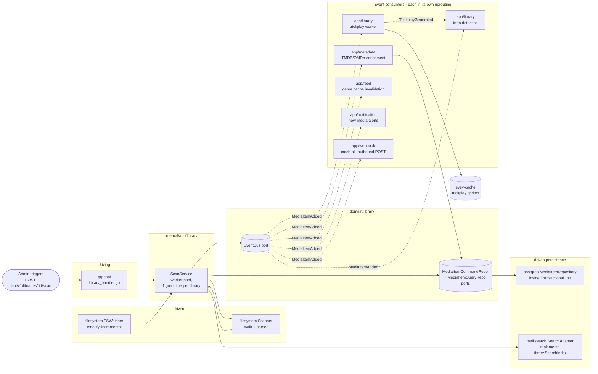

# Architecture

Evey est un serveur multimédia auto-hébergé. Le serveur est écrit en Go (architecture hexagonale, DDD), l'interface web est un monorepo TypeScript/React, et le mobile est en React Native / Expo. Voir [DEV.md](../DEV.md) pour la mise en place et les détails internes.

## Découpage en couches

Disposition stricte en ports et adaptateurs sous `internal/` :

- `internal/domain/<contexte>/` : domaine pur, modèles, objets valeurs, **ports** (interfaces). Aucun import de framework.
- `internal/app/<contexte>/` : services applicatifs. Ils orchestrent les ports. Les entrées-sorties passent normalement par un port ; deux contextes font exception en connaissance de cause et parlent au réseau directement : `dlna` (SSDP et UPnP AVTransport) et `loadtest` (son propre client HTTP).
- `internal/adapters/driven/` : adaptateurs sortants implémentant les ports du domaine : `postgres`, `meilisearch`, `ffmpeg`, `mkvgo`, `filesystem`, `prober`, `opensubtitles`, `email`, `webpush`, `webhooksender`, `pluginrunner`, `metadata`, `introproviders`, `search`. Deux autres vivent ici mais satisfont une interface de la couche applicative plutôt qu'un port du domaine : `itunes` et `musicbrainz`, tous deux `app/music.AlbumArtFetcher`.
- `internal/adapters/driving/` : adaptateurs entrants : `grpcapi` (avec la passerelle HTTP grpc-gateway), `http` (fichiers statiques, intergiciel d'authentification, SSE, HLS, ressources des iframes d'extension), `pluginhost` (serveur gRPC sur une socket Unix, authentifié par les identifiants du pair : c'est l'API hôte que rappellent les sous-processus isolés des extensions).
- `internal/pkg/` : noyau technique partagé entre contextes (auth, logger, eventbus, i18n, metrics, tracing, ratelimit, procfork, ssrf, cache, etc.). La configuration du serveur vit dans `internal/config/` ; le code proto généré vit dans `gen/`.

Règle de dépendance : `adapters -> app -> domain`. Le domaine n'importe jamais l'application ni les adaptateurs. La composition se fait dans `cmd/evey/wire*.go`, un câblage écrit à la main et non google/wire : `wire.go`, `wire_infra.go`, `wire_services.go`, `wire_adapters.go`, `wire_events.go`, `wire_helpers.go`.

## Contextes délimités

Trente paquets de contexte vivent sous `internal/domain/` et `internal/app/` : 19 existent dans les deux couches, 2 n'existent que dans le domaine (`ratings`, `shared`), 9 seulement dans l'application. La collaboration passe en partie par des événements de domaine publiés sur un bus partagé ; la couche applicative lit aussi directement le paquet de domaine d'un contexte voisin (voir [Relations](#relations)).

| Contexte | Responsabilité |
| --- | --- |
| `user` | comptes, authentification, sessions, préférences |
| `library` | bibliothèques, dossiers, tâches de scan, index des médias, personnes, collections, favoris et pouces d'un profil (les pouces n'ont pas de service applicatif : la RPC de notation enregistre et lit `UserRatingRepository` tel quel), trickplay, détection des génériques |
| `media` (application seulement) | liens de partage et jetons de flux |
| `mediarequest` | demandes de médias soumises par les utilisateurs |
| `metadata` | enrichissement TMDB et OMDb, illustrations |
| `playback` | flux, progression, télécommande, lecture en cours |
| `transcoding` | tâches ffmpeg, segments HLS |
| `subtitle` | sous-titres intégrés, externes et OpenSubtitles |
| `mkv` | opérations sur conteneurs MKV (via `mkvgo`) |
| `music` | lecture et étiquetage propres à l'audio |
| `photo` | bibliothèques photo |
| `favorite` (application seulement) | favoris par profil ; le modèle et `FavoriteRepository` vivent dans `domain/library` |
| `playlist` | playlists utilisateur, playlists intelligentes |
| `collection` (application seulement) | collections composées par l'administrateur ; ses ports vivent dans `domain/library` |
| `ratings` (domaine seulement) | fait correspondre les classifications par pays (CSA, FSK, MPAA, BBFC, ACB) à un unique âge minimum |
| `feed` | fil d'activité et découverte |
| `activity` | chronologie d'activité de l'utilisateur |
| `chromecast` | cycle de vie des sessions de cast |
| `syncplay` | sessions de synchronisation multi-appareils |
| `plugin` | registre des extensions, jetons du bac à sable, cycle de vie |
| `notification` | notifications dans l'application et par push web |
| `webhook` | webhooks sortants |
| `backup` | sauvegarde et restauration de la base et de la configuration |
| `config` (application seulement) | réglages serveur persistés, écrits à la fois par l'entrée REST et par l'entrée gRPC |
| `dlna` (application seulement) | découverte SSDP et contrôle UPnP AVTransport |
| `loadtest` (application seulement) | simule des spectateurs HLS contre la propre pile HTTP du serveur |
| `maintenance` (application seulement) | maintenance des médias déclenchée par l'administrateur : reconstruction de l'index de navigation, journal de réparation, annulation, intégrité audio |
| `presence` (application seulement) | registre en mémoire, non persisté, de qui est connecté à l'instant |
| `qoe` (application seulement) | ingestion et agrégation de la télémétrie de lecture CMCD (CTA-5004) |
| `shared` (domaine seulement) | ports transverses (`EventBus`, `TransactionalUnit`, `ServerConfigRepository`, `ShareLinkRepository`), identifiants typés, curseurs, jetons de flux |

### Relations

- `library` émet `LibraryCreated` et `LibraryDeleted`, `LibraryScanStarted` et `LibraryScanCompleted`, `MediaItemAdded`, `MediaItemRemoved`, `TrickplayGenerated`. `media.item.added` est consommé par `notification`, `metadata` (enrichissement automatique), `library` lui-même (worker trickplay et détection de générique) et `feed` (invalidation du cache de genres).
- L'indexation de recherche n'est **pas** pilotée par les événements : `library.ScanService` appelle directement le port `library.SearchIndex`.
- `playback` émet `PlaybackStarted` et `PlaybackStopped`. Aucun des deux n'a d'abonné dédié aujourd'hui ; seul le fourre-tout `"*"` de `webhook` les reçoit.
- `user` émet `UserCreated`, qui n'a aucun abonné, et `user.password.reset_requested`, consommé par l'adaptateur piloté `email`.
- `plugin` : `pluginrunner` publie `plugin.error` et `plugin.started`, et `app/plugin` les consomme pour son tableau de bord de sécurité. Il n'existe aucun pont acheminant les événements de domaine vers les extensions : celles-ci atteignent l'API avec des JWT limités (voir ADR-0003). Le bus lui-même fait l'objet de l'ADR-0010.
- `shared.TransactionalUnit` enveloppe les écritures portant sur plusieurs agrégats (voir ADR-0002).

Aucun paquet sous `internal/domain` n'importe le paquet de domaine d'un autre contexte, règle imposée par `internal/contractguard/domain_imports_test.go` (voir [Gardes d'architecture](#architecture-guards)). La couche applicative n'y est pas soumise : 14 paquets applicatifs importent aujourd'hui le domaine d'un contexte voisin.

## Flux de données typique : « un utilisateur lance un média »

1. Le client mobile ou web appelle `POST /api/v1/playback/start` (route grpc-gateway).
2. `internal/adapters/driving/http` exécute son intergiciel d'authentification (`auth_middleware.go`, `httpAuthMiddleware`) et en extrait la session.
3. `internal/adapters/driving/grpcapi` (`playback_handler.go`) valide le proto et appelle `app/playback.CommandService.StartStream` (séparation commande/requête, voir ADR-0009).
4. `app/playback.CommandService` appelle les ports du domaine : `user.UserRepository`, `playback.SessionQueryRepo` (idempotence et plafond d'appareils), `playback.SessionCommandRepo`, puis `shared.EventBus.Publish(PlaybackStarted)`.
5. Les adaptateurs pilotés s'exécutent : `postgres` persiste la session dans une portée `shared.TransactionalUnit.Do` ; le bus en mémoire (`internal/pkg/eventbus`) distribue de façon asynchrone.
6. `PlaybackStarted` n'a aucun abonné dédié aujourd'hui : seul le fourre-tout `"*"` de `webhook` le reçoit.
7. La réponse remonte en JSON par la grpc-gateway ; les mises à jour de progression circulent en SSE ou en flux gRPC.

## Racine de composition

Les graphes de câblage vivent dans `cmd/evey/wire.go` et ses fichiers voisins (`wire_infra.go`, `wire_services.go`, `wire_adapters.go`, `wire_events.go`, `wire_helpers.go`). Les tests court-circuitent les adaptateurs en injectant des doublures qui implémentent les mêmes ports de domaine : 21 des 22 paquets de domaine livrent un sous-paquet `fakes/`. Voir [ADR-0001](adr/0001-hexagonal-architecture.md).

## Gardes d'architecture

Les règles ci-dessus ne sont pas que de la documentation. `internal/contractguard/` contient 31 tests statiques répartis sur 20 fichiers, qui font échouer la compilation dès que le code s'en écarte.

La règle hexagonale elle-même est `TestDomainContextsDoNotImportEachOther` (ADR-0001), dans `domain_imports_test.go`. Il parcourt `internal/domain` et impose exactement ceci : un contexte peut importer `internal/domain/shared` et son propre arbre de paquets, rien d'autre de `internal/domain`, et jamais `internal/app` ni `internal/adapters`. Sa portée s'arrête à `internal/domain` : il ne dit rien de la couche applicative.

Les autres gardent des contrats qui franchissent une frontière de langage ou de processus, parmi lesquels :

- `TestNoClientReadOfAFieldTheServerNeverWrites` : tout champ de réponse proto lu par un client doit être écrit quelque part côté serveur.
- `TestRegisteredHandlersGetEveryPortTheyDeclare` et `TestBootInstallsItsSilentWirings` : des câblages qui échoueraient autrement en silence.
- `TestPostgresRepositoriesBoundTheirQueries` : tout dépôt Postgres borne ses requêtes par un délai.
- `TestProcfork_EveryForkGoesThroughCommand` : tout lancement de sous-processus passe par `internal/pkg/procfork`.
- `TestEverySortFieldTheAPIAcceptsHasASQLColumn` et `...CanBuildACursorValue` : les champs de tri existent à la fois dans la table des colonnes SQL et dans l'encodeur de curseur.
- `TestEveryWebSurfaceReachingAnAdminRPCIsClassified`, et son équivalent natif pour le mobile et la TV : toute surface d'interface appelant un RPC réservé à l'administrateur décide qui la voit.
- `TestEveryAllowedSlotIsMountedOnWebAndMobile` et `TestPluginBridgeParityWebMobile` : parité des emplacements d'insertion des extensions entre clients.
- `TestImageSubtitleCodecsAgreeAcrossServerAndClients` : une seule liste de codecs de sous-titres bitmap, côté serveur comme côté lecteurs.
- `TestHandWrittenClientTypesMatchTheEndpointTheyCall` : les types de réponse écrits à la main pour le mobile et la TV correspondent au point d'accès appelé.
- `TestRestartExitCodeAgreesWithTheEntrypoint` : le code de sortie Go et `docker/entrypoint.sh` s'accordent sur ce qu'est un redémarrage.
- Gardes d'internationalisation : les clés émises par le serveur existent dans le catalogue, et les substitutions concordent entre langues.

## Pour aller plus loin

- [DEV.md](../DEV.md) : compilation, exécution, migrations, génération des protos
- [docs/CODEBASE_MAP.md](CODEBASE_MAP.md) : quels fichiers toucher pour les modifications courantes
- [docs/playback-serving.md](playback-serving.md) : le chemin de lecture de la vidéo HLS, en détail (décision, échelle de paliers, empreinte, CMAF/HLS/DASH, mkvgo contre ffmpeg)
- [docs/api/](api/) : référence d'API générée
- [docs/adr/](adr/) : les décisions d'architecture

## Diagrammes C4

Ces quatre diagrammes documentent Evey à des niveaux de zoom décroissants, en suivant le [modèle C4](https://c4model.com/). Tous sont rendus par Mermaid, sans aucune ressource binaire. Les noms des nœuds sont les vrais noms de paquets Go sous `internal/`. Les noms de conteneurs viennent de `docker-compose.yml` pour `evey-server`, `evey-postgres` et `evey-caddy` ; `evey-web`, `evey-meilisearch`, `evey-mobile` et `evey-mailcatcher` sont déclarés dans `docker-compose.override.yml` et n'existent que dans la topologie de développement.

### Niveau 1 : contexte du système

Qui parle à Evey, et vers quels tiers Evey se tourne.

### Niveau 2 : conteneurs

Les unités déployables que lève `docker compose --env-file .env.dev up`. Les flèches pleines sont du trafic d'exécution, les flèches en pointillés sont des appels sortants vers des tiers.

> **La production diffère de cette topologie de développement.** Le compose
> d'installation ne déclare que trois services : `evey`, `postgres` et `caddy`.
> Il n'y a pas de conteneur `evey-web` distinct (ni le mailcatcher ni le
> bundler Metro, réservés au développement) : le binaire `evey-server` sert
> l'interface web compilée depuis `/srv`, si bien que le reverse proxy lui
> transmet *tout*, interface et API, sur le port `:9091`. Il n'y a pas non plus
> de conteneur `evey-meilisearch` : le binaire Meilisearch est cuit dans l'image
> `evey` (`Dockerfile`, étape `meili-download`, épinglé en 1.12.8) et garde son
> index sous `/data/meili`. Voir
> [installation.md](installation.md) et [reverse-proxy.md](reverse-proxy.md).

### Niveau 3 : composants (zoom sur `evey-server`)

Le découpage hexagonal à l'intérieur du binaire Go. Les adaptateurs entrants appellent les services applicatifs par leurs interfaces ; les services applicatifs ne dépendent que des ports du domaine ; les adaptateurs sortants implémentent ces ports.

Notes sur les goroutines :
- Le serveur gRPC (`grpc.Server.Serve`) et le serveur HTTP (passerelle et fichiers statiques) tournent chacun dans leur propre goroutine, lancée depuis le câblage principal de `cmd/evey`.
- Les tâches de scan de `app/library` tournent sur un groupe de workers (une goroutine par scan de bibliothèque actif, voir `library.ScanService`).
- Les tâches ffmpeg sont lancées via `internal/pkg/procfork` par l'adaptateur piloté `ffmpeg` (`ffmpeg.Transcoder.Start`), avec une goroutine de supervision par tâche qui vide la sortie d'erreur du processus.
- `shared.EventBus` distribue aux abonnés de façon asynchrone : chaque abonné tourne dans sa propre goroutine, si bien qu'un consommateur lent ne bloque jamais les producteurs. Le bus n'ouvre aucune transaction de son côté, c'est au gestionnaire de le faire.
- `pluginrunner` lance un sous-processus par extension ; les extensions en iframe vivent dans le navigateur de l'utilisateur et répondent au serveur au moyen de jetons signés délivrés par `app/plugin`.

### Niveau 3 (bonus) : zoom sur le pipeline de scan

Le chemin chaud qui transforme des fichiers sur disque en médias indexés et enrichis. Les flèches pleines sont des appels directs, les flèches en pointillés sont des événements de domaine sur le bus. Notez que l'indexation de recherche est un appel direct au port depuis `ScanService`, pas un événement.

À lire avec la section « Flux de données typique » plus haut : le chemin de lecture est le chemin symétrique, et le pipeline de scan est le chemin d'écriture qui alimente l'index des médias dans lequel la lecture puise.
