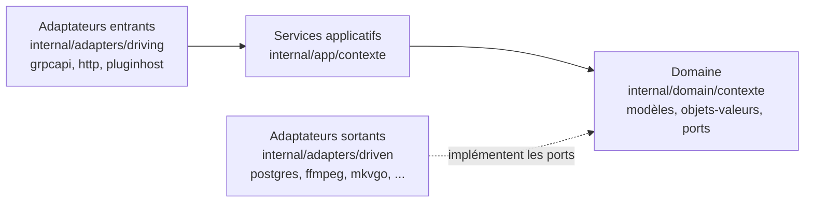
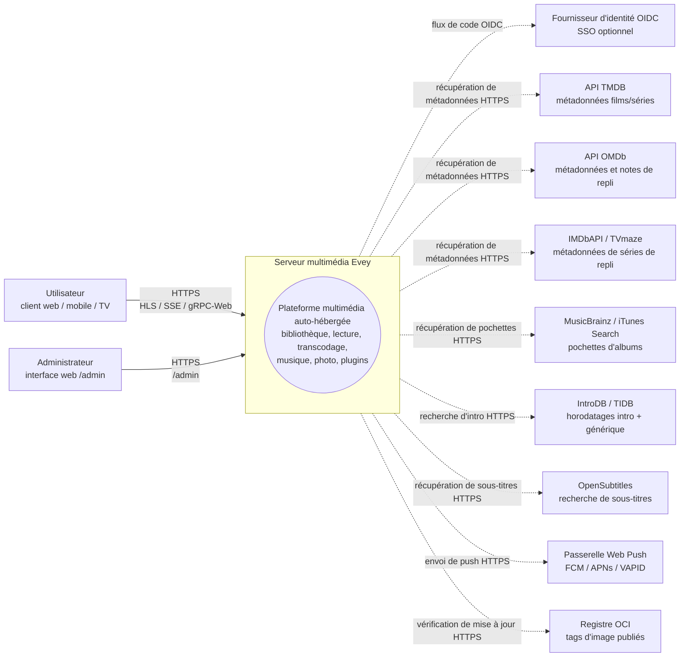
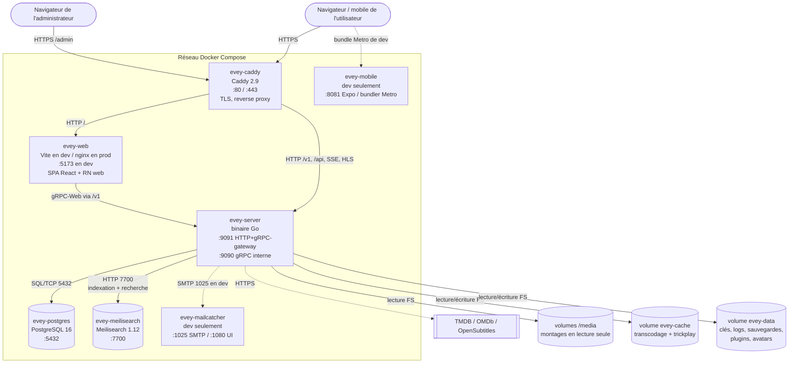
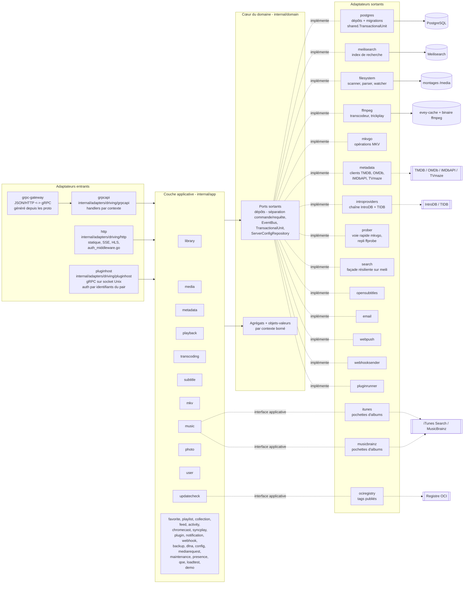
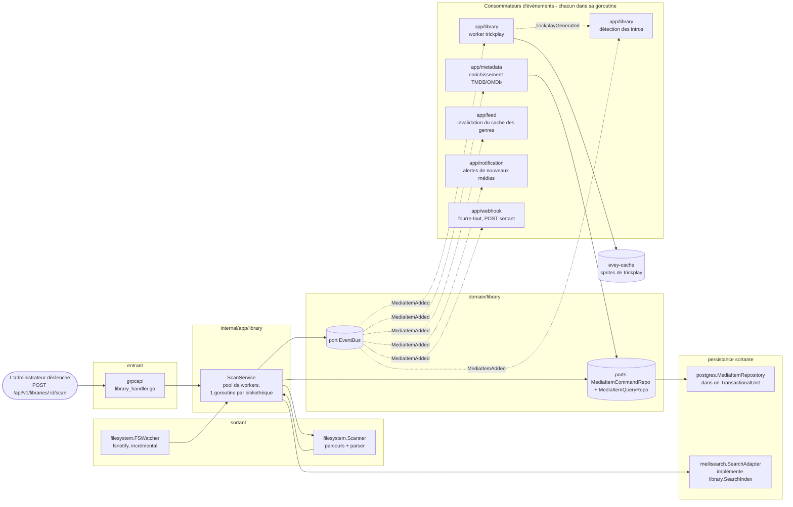

# Architecture

Comment le serveur est assemblé : les couches hexagonales sous `internal/`,
les contextes bornés, les événements qui les relient, et les gardes statiques
qui maintiennent le code sur ces rails. Le code vit dans `internal/domain`,
`internal/app`, `internal/adapters/{driving,driven}` et est câblé dans
`cmd/evey/wire*.go` ; la disposition est décidée par
[ADR-0001](adr/0001-hexagonal-architecture.md), la séparation des dépôts par
[ADR-0009](adr/0009-cqrs-repo-split.md) et le bus d'événements par
[ADR-0010](adr/0010-event-bus.md). Pour construire et lancer le serveur, lisez
[DEV.md](../DEV.md) ; pour savoir quels fichiers toucher pour une modification
donnée, lisez la [Carte du code](CODEBASE_MAP.md).

Le serveur est en Go ; les clients web, mobile et TV forment un monorepo
TypeScript/React sous `frontend/` (React Native / Expo pour le mobile et la TV).

## Couches

| Dossier | Contient | Règle |
| --- | --- | --- |
| `internal/domain/<contexte>/` | les modèles, les objets-valeurs et les **ports** (interfaces) | aucun import de framework, aucun import d'un autre contexte |
| `internal/app/<contexte>/` | les services applicatifs qui orchestrent les ports | les entrées-sorties passent par un port ; `dlna` (SSDP / UPnP AVTransport) et `loadtest` (son propre client HTTP) sont les deux exceptions délibérées qui atteignent le réseau directement |
| `internal/adapters/driven/` | les adaptateurs sortants qui implémentent les ports : `postgres`, `meilisearch`, `ffmpeg`, `mkvgo`, `filesystem`, `prober`, `opensubtitles`, `email`, `webpush`, `webhooksender`, `pluginrunner`, `metadata`, `introproviders`, `search` | trois autres satisfont une interface de la couche applicative plutôt qu'un port du domaine : `itunes` et `musicbrainz` (`app/music.AlbumArtFetcher`), `ociregistry` (`app/updatecheck`) |
| `internal/adapters/driving/` | les adaptateurs entrants : `grpcapi` (+ HTTP via grpc-gateway), `http` (statique, middleware d'authentification, SSE, HLS, ressources des iframes de plugins), `pluginhost` (serveur gRPC sur une socket Unix, authentifié par les identifiants du pair, l'API hôte que rappellent les plugins en sandbox) | |
| `internal/pkg/` | le noyau technique partagé : auth, logger, eventbus, i18n, metrics, tracing, ratelimit, procfork, ssrf, cache, ... | |
| `internal/config/` | la configuration du serveur | |
| `gen/` | le code proto généré | |

Règle de dépendance : `adapters -> app -> domain`. Le domaine n'importe jamais
la couche applicative ni les adaptateurs. La composition est écrite à la main
(pas google/wire) dans `cmd/evey/wire.go` et ses voisins `wire_infra.go`,
`wire_services.go`, `wire_adapters.go`, `wire_events.go`, `wire_helpers.go`.
Les tests contournent les adaptateurs en injectant des doublures qui
implémentent les mêmes ports du domaine : 20 des 21 paquets du domaine
livrent un sous-paquet `fakes/`.

## Contextes bornés

Trente-deux paquets de contexte vivent sous `internal/domain/` et
`internal/app/` : 19 existent dans les deux couches, 2 n'existent que dans le
domaine (`ratings`, `shared`), 11 n'existent que dans la couche applicative.
Ils collaborent en partie par des événements de domaine sur un bus partagé ;
la couche applicative lit aussi directement le paquet de domaine d'un
contexte voisin (voir [Relations](#relations)).

| Contexte | Responsabilité |
| --- | --- |
| `user` | comptes, authentification, sessions, préférences |
| `library` | bibliothèques, dossiers, tâches de scan, index des médias, personnes, collections, favoris et pouces d'un profil (les pouces n'ont pas de service applicatif : le RPC de notation stocke et lit `UserRatingRepository` tel quel), trickplay, détection des intros et génériques |
| `media` (app seulement) | liens de partage et jetons de flux |
| `mediarequest` | demandes de médias soumises par les utilisateurs |
| `metadata` | enrichissement TMDB / OMDb, illustrations |
| `playback` | flux, progression, télécommande, lecture en cours |
| `transcoding` | tâches ffmpeg, segments HLS |
| `subtitle` | sous-titres intégrés + externes + opensubtitles |
| `mkv` | opérations sur le conteneur MKV (via [mkvgo](playback/mkvgo.md)) |
| `music` | lecture et étiquetage propres à l'audio |
| `photo` | bibliothèques de photos |
| `favorite` (app seulement) | favoris par profil ; le modèle et `FavoriteRepository` vivent dans `domain/library` |
| `playlist` | listes de lecture des utilisateurs, listes intelligentes |
| `collection` (app seulement) | collections constituées par l'administrateur ; ses ports vivent dans `domain/library` |
| `ratings` (domaine seulement) | projette les classifications nationales (CSA, FSK, MPAA, BBFC, ACB) sur un seul axe d'âge minimum |
| `feed` | fil d'activité / découverte |
| `activity` | chronologie d'activité des utilisateurs |
| `chromecast` | cycle de vie des sessions de cast |
| `syncplay` | sessions synchronisées entre appareils |
| `plugin` | registre des plugins, jetons de sandbox, cycle de vie |
| `notification` | notifications dans l'application + webpush |
| `webhook` | webhooks sortants |
| `backup` | sauvegarde et restauration de la base et de la configuration |
| `config` (app seulement) | réglages persistants du serveur, écrits par les points d'entrée REST et gRPC |
| `dlna` (app seulement) | découverte SSDP et pilotage UPnP AVTransport |
| `loadtest` (app seulement) | simule des spectateurs contre la propre pile HTTP du serveur : en HLS, ou sur le fichier brut quand le verdict d'un client est une lecture directe |
| `maintenance` (app seulement) | maintenance des médias déclenchée par l'administrateur : reconstruction de l'index de lecture, journal de réparation, annulation, intégrité audio |
| `presence` (app seulement) | registre en mémoire, non persisté, de qui est connecté en ce moment |
| `qoe` (app seulement) | ingestion et agrégation de la télémétrie de lecture CMCD (CTA-5004) |
| `demo` (app seulement) | l'instance de démonstration publique (`EVEY_DEMO=1`) : alimente ses comptes, ses bibliothèques et ses médias sous licence libre via les services du produit, et se réinitialise |
| `updatecheck` (app seulement) | compare le build en cours avec ce que publie le registre et prévient l'administrateur ; ne met jamais rien à jour |
| `shared` (domaine seulement) | ports transverses (`EventBus`, `TransactionalUnit`, `ServerConfigRepository`, `ShareLinkRepository`), identifiants typés, curseurs, jetons de flux |

### Relations

| Émetteur | Événements | Consommés par |
| --- | --- | --- |
| `library` | `LibraryCreated` / `LibraryDeleted`, `LibraryScanStarted` / `LibraryScanCompleted`, `MediaItemAdded`, `MediaItemRemoved`, `TrickplayGenerated` | `media.item.added` : `notification`, `metadata` (enrichissement automatique), `library` lui-même (worker trickplay + détection des intros), `feed` (invalidation du cache des genres) |
| `playback` | `PlaybackStarted` / `PlaybackStopped` | aucun abonné dédié aujourd'hui ; seul le fourre-tout `"*"` de `webhook` les reçoit |
| `user` | `UserCreated`, `user.password.reset_requested` | le premier n'a pas d'abonné ; le second est consommé par l'adaptateur sortant `email` |
| `pluginrunner` | `plugin.error` / `plugin.started` | `app/plugin` pour son tableau de bord sécurité, `notification` pour l'administrateur |
| `shared` | `ServerConfigChanged` | les services qui appliquent sans redémarrage un réglage enregistré dans le panneau d'administration (SMTP, fuseau horaire, budget CPU, ...) |

- L'indexation de recherche n'est **pas** pilotée par événement :
  `library.ScanService` appelle directement le port `library.SearchIndex`.
- Aucune passerelle ne transmet les événements de domaine aux plugins : les
  plugins atteignent l'API avec des JWT à portée limitée
  ([ADR-0003](adr/0003-plugin-scoped-tokens.md)). Le bus lui-même est
  l'[ADR-0010](adr/0010-event-bus.md).
- `shared.TransactionalUnit` enveloppe les écritures multi-agrégats
  ([ADR-0002](adr/0002-transactional-unit-port.md)).

Aucun paquet sous `internal/domain` n'importe le paquet de domaine d'un autre
contexte, règle imposée par `internal/contractguard/domain_imports_test.go`
(voir [Gardes d'architecture](#architecture-guards)). La couche applicative
n'y est pas tenue : 15 paquets applicatifs importent aujourd'hui le paquet de
domaine d'un contexte voisin.

## Flux de données typique : « un utilisateur lance un média »

1. Le client mobile ou web appelle `POST /api/v1/playback/start` (route grpc-gateway).
2. `internal/adapters/driving/http` exécute son middleware d'authentification (`auth_middleware.go`, `httpAuthMiddleware`) et extrait la session.
3. `internal/adapters/driving/grpcapi` (`playback_handler.go`) valide le proto et appelle `app/playback.CommandService.StartStream` (séparation commande/requête, voir [ADR-0009](adr/0009-cqrs-repo-split.md)).
4. `app/playback.CommandService` appelle les ports du domaine : `user.UserRepository`, `playback.SessionQueryRepo` (idempotence + plafond d'appareils), `playback.SessionCommandRepo`, puis `shared.EventBus.Publish(PlaybackStarted)`.
5. Les adaptateurs sortants s'exécutent : `postgres` persiste la session dans une portée `shared.TransactionalUnit.Do` ; le bus en mémoire (`internal/pkg/eventbus`) distribue de façon asynchrone.
6. `PlaybackStarted` n'a pas d'abonné dédié aujourd'hui : seul le fourre-tout `"*"` de `webhook` le reçoit.
7. La réponse revient en JSON via grpc-gateway ; les mises à jour de progression passent par SSE / flux gRPC.

Ce qui se passe ensuite, quand le lecteur demande le manifeste et les
segments, fait l'objet de [Pipeline de lecture](playback-serving.md).

## Gardes d'architecture

Les règles ci-dessus ne sont pas que de la documentation.
`internal/contractguard/` contient 58 tests statiques répartis sur 30
fichiers qui font échouer le build dès que le code s'en écarte.

La règle hexagonale elle-même est `TestDomainContextsDoNotImportEachOther`
(ADR-0001), dans `domain_imports_test.go`. Elle parcourt `internal/domain` et
impose exactement ceci : un contexte peut importer `internal/domain/shared` et
sa propre arborescence, rien d'autre dans `internal/domain`, et jamais
`internal/app` ni `internal/adapters`. Sa portée s'arrête à
`internal/domain` : elle ne dit rien de la couche applicative.

Les autres gardent des contrats qui franchissent une frontière de langage ou
de processus, parmi lesquels :

| Garde | Ce qu'elle refuse |
| --- | --- |
| `TestNoClientReadOfAFieldTheServerNeverWrites` | un champ de réponse proto lu par un client que le serveur n'écrit nulle part |
| `TestRegisteredHandlersGetEveryPortTheyDeclare`, `TestBootInstallsItsSilentWirings` | un câblage qui échouerait en silence |
| `TestPostgresRepositoriesBoundTheirQueries` | une requête d'un dépôt Postgres sans délai limite |
| `TestProcfork_EveryForkGoesThroughCommand` | un lancement de sous-processus qui contourne `internal/pkg/procfork` |
| `TestEverySortFieldTheAPIAcceptsHasASQLColumn`, `...CanBuildACursorValue` | un champ de tri absent de la table des colonnes SQL ou de l'encodeur de curseur |
| `TestEveryWebSurfaceReachingAnAdminRPCIsClassified`, et son pendant natif pour mobile et TV | une surface d'interface appelant un RPC réservé à l'administrateur sans décider qui la voit |
| `TestEveryAllowedSlotIsMountedOnWebAndMobile`, `TestPluginBridgeParityWebMobile` | un slot d'interface de plugin ou un message du pont présent sur un seul client |
| `TestImageSubtitleCodecsAgreeAcrossServerAndClients` | une seconde liste de codecs de sous-titres bitmap sur un lecteur |
| `TestHandWrittenClientTypesMatchTheEndpointTheyCall` | un type de réponse écrit à la main pour mobile/TV qui dérive de son point d'entrée |
| `TestOnlyThePlanDecidesPlayback`, `TestNoCallerDerivesDownstreamOfThePlaybackPlan` | une décision de lecture prise hors du résolveur de plan ([ADR-0030](adr/0030-one-plan-one-decision.md)) |
| `TestRestartExitCodeAgreesWithTheEntrypoint` | un code de sortie Go et `docker/entrypoint.sh` en désaccord sur ce que signifie un redémarrage |
| `TestServerEmittedI18nKeysExistInCatalogue`, `TestI18nPlaceholdersAgreeAcrossLocales` | une clé émise par le serveur absente du catalogue, des espaces réservés qui diffèrent entre langues |

## Diagrammes C4

Quatre diagrammes documentent Evey à des niveaux de zoom décroissants selon
le [modèle C4](https://c4model.com/). Les noms des nœuds sont les vrais noms
des paquets Go sous `internal/`. Les noms des conteneurs viennent de
`docker-compose.yml` pour `evey-server`, `evey-postgres` et `evey-caddy` ;
`evey-web`, `evey-meilisearch`, `evey-mobile` et `evey-mailcatcher` sont
déclarés dans `docker-compose.override.yml` et n'existent que dans la
topologie de développement.

### Niveau 1 : contexte du système

Qui parle à Evey, et quels tiers Evey contacte.

### Niveau 2 : conteneurs

Les unités déployables lancées par `docker compose --env-file .env.dev up`.
Les flèches pleines sont le trafic à l'exécution ; les flèches pointillées
sont le trafic sortant vers des tiers.

!!! note "La production diffère de cette topologie de développement"
    Le compose d'installation déclare un seul service, `evey`. Il n'y a pas
    de conteneur `evey-web` séparé (ni le mailcatcher et le bundler Metro,
    réservés au dev) : le binaire sert l'interface web construite depuis
    `/srv`, donc un reverse proxy lui transmet *tout*, interface et API, sur
    `:9091`. Postgres et Meilisearch tournent dans le même conteneur,
    supervisés par `docker/entrypoint.sh` : PostgreSQL 17 avec ses données
    sous `/data/postgres`, et le binaire Meilisearch (`Dockerfile`, étape
    `meili-download`, figé en 1.12.8) avec son index sous `/data/meili`. Le
    `docker-compose.yml` du dépôt garde des services `postgres` et `caddy`
    séparés, décrits dans
    [Déploiements avancés](operations/advanced-deployments.md). Voir
    [Installation](installation.md) et [Reverse proxy](reverse-proxy.md).

### Niveau 3 : composants (zoom sur `evey-server`)

Les couches hexagonales à l'intérieur du binaire Go. Les adaptateurs entrants
appellent les services applicatifs par leurs interfaces ; les services
applicatifs ne dépendent que des ports du domaine ; les adaptateurs sortants
implémentent ces ports.

Notes sur les goroutines :

- Le serveur gRPC (`grpc.Server.Serve`) et le serveur HTTP (gateway + statique) tournent chacun dans leur propre goroutine, lancée depuis le câblage principal de `cmd/evey`.
- Les tâches de scan de `app/library` tournent sur un pool de workers (une goroutine par scan de bibliothèque actif, voir `library.ScanService`).
- Les tâches ffmpeg sont lancées via `internal/pkg/procfork` par l'adaptateur sortant `ffmpeg` (`ffmpeg.Transcoder.Start`), avec une goroutine de supervision par tâche qui vide la sortie d'erreur du processus.
- `shared.EventBus` distribue aux abonnés de façon asynchrone : chaque abonné tourne dans sa propre goroutine, pour qu'un consommateur lent ne bloque jamais les émetteurs. Le bus n'ouvre aucune transaction de son propre chef ; c'est le travail du handler.
- `pluginrunner` lance un sous-processus par plugin ; les plugins en iframe vivent dans le navigateur de l'utilisateur et répondent via des jetons signés émis par `app/plugin`.

### Niveau 3 (bonus) : zoom sur le pipeline de scan

Le chemin chaud qui transforme des fichiers sur disque en médias enrichis et
cherchables. Les flèches pleines sont des appels directs ; les flèches
pointillées sont des événements de domaine sur le bus. L'indexation de
recherche est un appel direct de port depuis `ScanService`, pas un événement.

À lire avec la section « Flux de données typique » ci-dessus : le chemin de
lecture est le chemin de lecture symétrique ; le pipeline de scan est le
chemin d'écriture qui prépare l'index des médias que le chemin de lecture
sert.

## Pour aller plus loin

- [DEV.md](../DEV.md) : construction, lancement, migrations, génération des proto
- [Carte du code](CODEBASE_MAP.md) : quels fichiers toucher pour les modifications courantes
- [Pipeline de lecture](playback-serving.md) : le chemin de lecture vidéo HLS, en détail
- [Référence de l'API](api/) : référence générée de l'API
- [Décisions d'architecture](adr/) : les ADR

<!-- sources
layering: internal/domain ; internal/app ; internal/adapters/driven ; internal/adapters/driving ; internal/pkg ; internal/config ; gen ; cmd/evey/wire.go, wire_infra.go, wire_services.go, wire_adapters.go, wire_events.go, wire_helpers.go
app-layer interfaces: internal/app/music/album_art_chain.go - AlbumArtFetcher ; internal/adapters/driven/ociregistry (app/updatecheck)
network exceptions: internal/app/dlna/service.go ; internal/app/loadtest/runner.go
events and subscribers: internal/app/notification/command_service.go ; internal/app/metadata/command_service_enrich.go ; internal/app/library/trickplay_service.go ; internal/app/library/intro_detection_service.go ; internal/app/feed/genre_cache.go ; internal/app/webhook/service.go ; internal/adapters/driven/email/password_reset_emailer.go ; internal/app/plugin/security_dashboard_service.go ; internal/app/config/smtp.go, timezone.go, cpu_budget.go
guards: internal/contractguard/*_test.go - TestDomainContextsDoNotImportEachOther, TestOnlyThePlanDecidesPlayback, TestNoCallerDerivesDownstreamOfThePlaybackPlan, TestServerEmittedI18nKeysExistInCatalogue, TestI18nPlaceholdersAgreeAcrossLocales
topology: docker-compose.yml ; docker-compose.override.yml ; Dockerfile - MEILI_VERSION, postgresql-17 ; docker/entrypoint.sh - PG_MAJOR
-->
