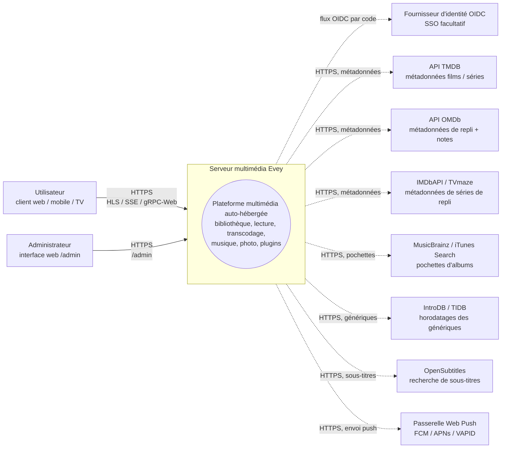
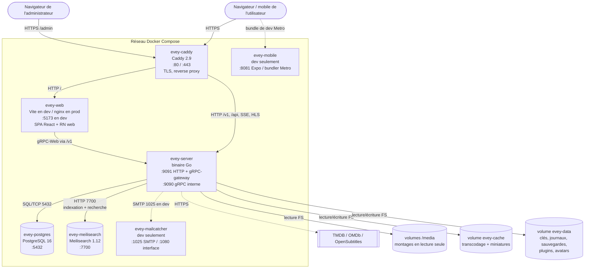
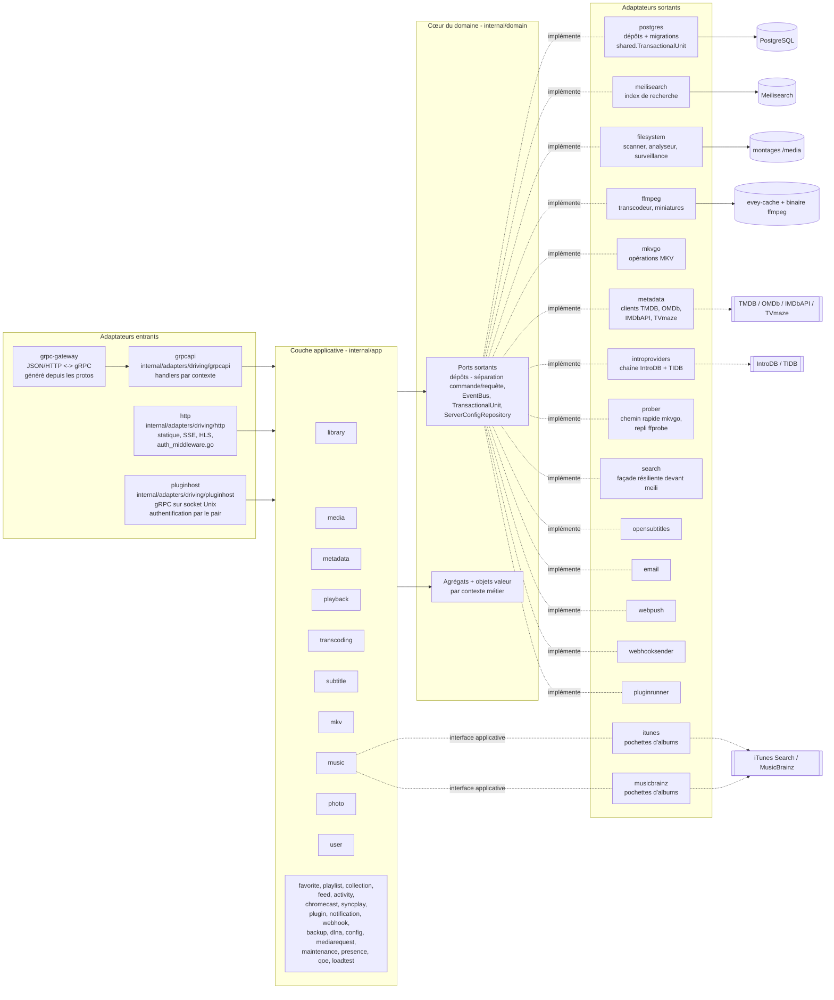
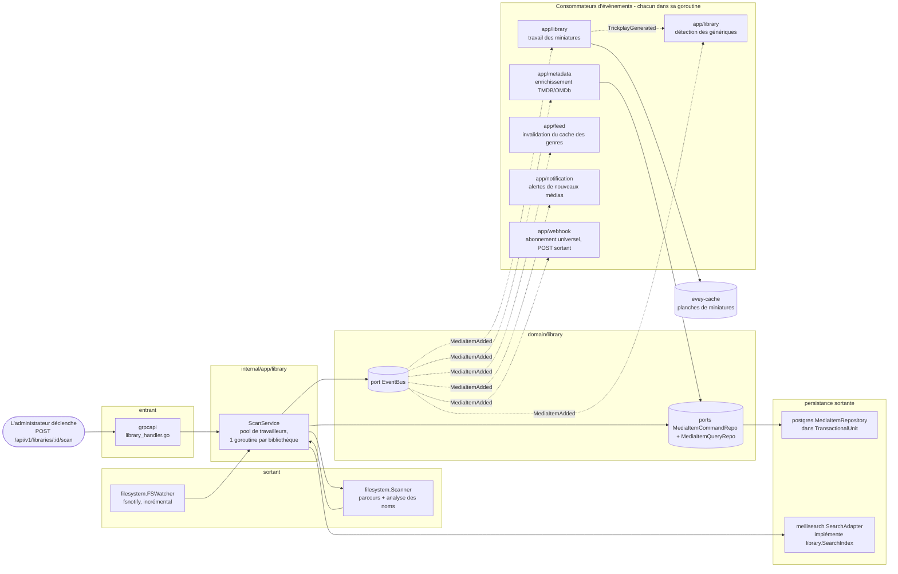

# Architecture

Evey est un serveur multimédia auto-hébergé. Le serveur est en Go (hexagonal /
DDD), le frontend est un monorepo TypeScript/React, le mobile est en React Native
/ Expo. Voir [DEV.md](../DEV.md) pour l'installation et les détails internes.

## Couches

Une disposition ports et adaptateurs stricte sous `internal/` :

- `internal/domain/<contexte>/` : le domaine pur : modèles, objets valeur,
  **ports** (interfaces). Aucun import de framework.
- `internal/app/<contexte>/` : les services applicatifs. Ils orchestrent les
  ports. Les entrées-sorties passent normalement par un port ; deux contextes
  sont des exceptions délibérées et accèdent directement au réseau : `dlna`
  (SSDP / UPnP AVTransport) et `loadtest` (son propre client HTTP).
- `internal/adapters/driven/` : les adaptateurs sortants, qui implémentent les
  ports du domaine : `postgres`, `meilisearch`, `ffmpeg`, `mkvgo`, `filesystem`,
  `prober`, `opensubtitles`, `email`, `webpush`, `webhooksender`, `pluginrunner`,
  `metadata`, `introproviders`, `search`. Deux autres vivent ici mais
  satisfont une interface de la couche applicative plutôt qu'un port du
  domaine : `itunes` et `musicbrainz`, tous deux des
  `app/music.AlbumArtFetcher`.
- `internal/adapters/driving/` : les adaptateurs entrants : `grpcapi` (+ la
  passerelle HTTP grpc-gateway), `http` (fichiers statiques, middleware
  d'authentification, SSE, HLS, fichiers des iframes de plugins), `pluginhost`
  (serveur gRPC sur une socket Unix, authentifié par les identifiants du pair :
  l'API de l'hôte que rappellent les sous-processus de plugins isolés).
- `internal/pkg/` : le noyau technique partagé entre les contextes (auth,
  journalisation, bus d'événements, i18n, métriques, traçage, limitation de
  débit, procfork, ssrf, cache, ...). La configuration du serveur vit dans
  `internal/config/` ; le code généré depuis les protos vit dans `gen/`.

Règle de dépendance : `adapters -> app -> domain`. Le domaine n'importe jamais
l'application ni les adaptateurs. L'assemblage se fait dans
`cmd/evey/wire*.go`, un câblage écrit à la main, pas google/wire : `wire.go`,
`wire_infra.go`, `wire_services.go`, `wire_adapters.go`, `wire_events.go`,
`wire_helpers.go`.

## Contextes métier

Trente paquets de contexte vivent sous `internal/domain/` et `internal/app/` : 19
existent dans les deux couches, 2 seulement dans le domaine (`ratings`,
`shared`), 9 seulement dans l'application. La collaboration passe en partie par
des événements du domaine publiés sur un bus partagé ; la couche applicative lit
aussi directement le paquet de domaine d'un contexte voisin (voir
[Relations](#relations)).

| Contexte | Responsabilité |
| --- | --- |
| `user` | comptes, authentification, sessions, préférences |
| `library` | bibliothèques, dossiers, tâches de scan, index des médias, personnes, collections, favoris et pouces d'un profil (les pouces n'ont pas de service applicatif : le RPC de notation stocke et lit `UserRatingRepository` tel quel), miniatures de navigation, détection des génériques |
| `media` (application seulement) | liens de partage et jetons de flux |
| `mediarequest` | demandes de médias soumises par les utilisateurs |
| `metadata` | enrichissement TMDB / OMDb, visuels |
| `playback` | flux, progression, contrôle à distance, lectures en cours |
| `transcoding` | tâches ffmpeg, segments HLS |
| `subtitle` | sous-titres intégrés, externes et OpenSubtitles |
| `mkv` | opérations sur le conteneur MKV (via `mkvgo`) |
| `music` | lecture et étiquetage propres à l'audio |
| `photo` | bibliothèques de photos |
| `favorite` (application seulement) | favoris par profil ; le modèle et `FavoriteRepository` vivent dans `domain/library` |
| `playlist` | playlists des utilisateurs, playlists intelligentes |
| `collection` (application seulement) | collections composées par l'administrateur ; ses ports vivent dans `domain/library` |
| `ratings` (domaine seulement) | ramène les classifications nationales (CSA, FSK, MPAA, BBFC, ACB) sur un axe unique d'âge minimal |
| `feed` | fil d'activité / découverte |
| `activity` | chronologie d'activité de l'utilisateur |
| `chromecast` | cycle de vie des sessions de diffusion |
| `syncplay` | sessions synchronisées sur plusieurs appareils |
| `plugin` | registre des plugins, jetons de sandbox, cycle de vie |
| `notification` | notifications dans l'application et push web |
| `webhook` | webhooks sortants |
| `backup` | sauvegarde et restauration de la base et de la configuration |
| `config` (application seulement) | réglages persistants du serveur, écrits à la fois par les points d'entrée REST et gRPC |
| `dlna` (application seulement) | découverte SSDP et contrôle UPnP AVTransport |
| `loadtest` (application seulement) | simule des spectateurs HLS contre la propre pile HTTP du serveur |
| `maintenance` (application seulement) | maintenance des médias déclenchée par l'administrateur : reconstruction de l'index de lecture, journal des réparations, annulation, intégrité de l'audio |
| `presence` (application seulement) | registre en mémoire, non persistant, de qui est connecté en ce moment |
| `qoe` (application seulement) | réception et agrégation de la télémétrie de lecture CMCD (CTA-5004) |
| `shared` (domaine seulement) | ports transverses (`EventBus`, `TransactionalUnit`, `ServerConfigRepository`, `ShareLinkRepository`), identifiants typés, curseurs, jetons de flux |

### Relations

- `library` → émet `LibraryCreated` / `LibraryDeleted`, `LibraryScanStarted` /
  `LibraryScanCompleted`, `MediaItemAdded`, `MediaItemRemoved`,
  `TrickplayGenerated`. `media.item.added` est consommé par `notification`,
  `metadata` (enrichissement automatique), `library` lui-même (travail des
  miniatures de navigation et détection des génériques) et `feed` (invalidation
  du cache des genres).
- L'indexation de recherche n'est **pas** pilotée par événement :
  `library.ScanService` appelle directement le port `library.SearchIndex`.
- `playback` → émet `PlaybackStarted` / `PlaybackStopped`. Aucun n'a d'abonné
  dédié aujourd'hui ; seul l'abonnement universel `"*"` de `webhook` les reçoit.
- `user` → émet `UserCreated`, qui n'a pas d'abonné, et
  `user.password.reset_requested`, consommé par l'adaptateur sortant `email`.
- `plugin` → `pluginrunner` publie `plugin.error` / `plugin.started`, et
  `app/plugin` les consomme pour son tableau de bord de sécurité. Aucun pont ne
  transmet les événements du domaine aux plugins : les plugins atteignent l'API
  avec des JWT à portée limitée (voir ADR-0003). Le bus lui-même est l'ADR-0010.
- `shared.TransactionalUnit` englobe les écritures sur plusieurs agrégats (voir
  ADR-0002).

Aucun paquet sous `internal/domain` n'importe le paquet de domaine d'un autre
contexte, règle imposée par `internal/contractguard/domain_imports_test.go`
(voir [Gardes d'architecture](#architecture-guards)). La couche applicative n'y
est pas tenue : 14 paquets applicatifs importent aujourd'hui le paquet de
domaine d'un contexte voisin.

## Un flux typique : « un utilisateur lance un média »

1. Le client mobile ou web appelle `POST /api/v1/playback/start` (route
   grpc-gateway).
2. `internal/adapters/driving/http` passe par son middleware d'authentification
   (`auth_middleware.go`, `httpAuthMiddleware`) et en extrait la session.
3. `internal/adapters/driving/grpcapi` (`playback_handler.go`) valide le proto et
   appelle `app/playback.CommandService.StartStream` (séparation commande /
   requête, voir ADR-0009).
4. `app/playback.CommandService` appelle les ports du domaine :
   `user.UserRepository`, `playback.SessionQueryRepo` (idempotence et limite
   d'appareils), `playback.SessionCommandRepo`, puis
   `shared.EventBus.Publish(PlaybackStarted)`.
5. Les adaptateurs sortants s'exécutent : `postgres` enregistre la session dans
   une portée `shared.TransactionalUnit.Do` ; le bus interne au processus
   (`internal/pkg/eventbus`) distribue de façon asynchrone.
6. `PlaybackStarted` n'a pas d'abonné dédié aujourd'hui : seul l'abonnement
   universel `"*"` de `webhook` le reçoit.
7. La réponse revient en JSON par grpc-gateway ; les mises à jour de progression
   passent par SSE ou par des flux gRPC.

## Racine de composition

Les graphes de câblage vivent dans `cmd/evey/wire.go` et ses voisins
(`wire_infra.go`, `wire_services.go`, `wire_adapters.go`, `wire_events.go`,
`wire_helpers.go`). Les tests contournent les adaptateurs en injectant des
doublures qui implémentent les mêmes ports du domaine : 21 des 22 paquets de
domaine fournissent un sous-paquet `fakes/`. Voir
[ADR-0001](adr/0001-hexagonal-architecture.md).

## Gardes d'architecture

Les règles ci-dessus ne sont pas que de la documentation. `internal/contractguard/`
contient 31 tests statiques, répartis dans 20 fichiers, qui font échouer la
compilation dès que le code s'en écarte.

La règle hexagonale elle-même est `TestDomainContextsDoNotImportEachOther`
(ADR-0001), dans `domain_imports_test.go`. Il parcourt `internal/domain` et impose
exactement ceci : un contexte peut importer `internal/domain/shared` et sa propre
arborescence, rien d'autre de `internal/domain`, et jamais `internal/app` ni
`internal/adapters`. Sa portée s'arrête à `internal/domain` : il ne dit rien de la
couche applicative.

Les autres gardent des contrats qui franchissent une frontière de langage ou de
processus, parmi lesquels :

- `TestNoClientReadOfAFieldTheServerNeverWrites` : chaque champ de réponse proto
  lu par un client doit être écrit quelque part côté serveur.
- `TestRegisteredHandlersGetEveryPortTheyDeclare` et
  `TestBootInstallsItsSilentWirings` : du câblage qui, sinon, échouerait en
  silence.
- `TestPostgresRepositoriesBoundTheirQueries` : chaque dépôt PostgreSQL borne ses
  requêtes par un délai.
- `TestProcfork_EveryForkGoesThroughCommand` : chaque lancement de sous-processus
  passe par `internal/pkg/procfork`.
- `TestEverySortFieldTheAPIAcceptsHasASQLColumn` et `...CanBuildACursorValue` :
  les champs de tri existent à la fois dans la table des colonnes SQL et dans
  l'encodeur de curseurs.
- `TestEveryWebSurfaceReachingAnAdminRPCIsClassified`, et son pendant natif pour
  le mobile et la TV : toute surface d'interface qui appelle un RPC réservé aux
  administrateurs décide de qui la voit.
- `TestEveryAllowedSlotIsMountedOnWebAndMobile` et
  `TestPluginBridgeParityWebMobile` : la parité des emplacements d'interface des
  plugins entre les clients.
- `TestImageSubtitleCodecsAgreeAcrossServerAndClients` : une seule liste des
  codecs de sous-titres en image, pour le serveur et les lecteurs.
- `TestHandWrittenClientTypesMatchTheEndpointTheyCall` : les types de réponse
  écrits à la main du mobile et de la TV correspondent au point d'accès qu'ils
  appellent.
- `TestRestartExitCodeAgreesWithTheEntrypoint` : le code de sortie Go et
  `docker/entrypoint.sh` s'accordent sur ce que signifie un redémarrage.
- Les gardes i18n : les clés émises par le serveur existent dans le catalogue, et
  les paramètres concordent entre les langues.

## Pour aller plus loin

- [DEV.md](../DEV.md) : compilation, exécution, migrations, génération des protos
- [docs/CODEBASE_MAP.md](CODEBASE_MAP.md) : quels fichiers toucher pour les
  changements courants
- [docs/playback-serving.md](playback-serving.md) : le chemin de lecture vidéo HLS
  en détail (décision, échelle, empreinte, CMAF/HLS/DASH, mkvgo ou ffmpeg)
- [docs/api/](api/) : la référence de l'API, générée
- [docs/adr/](adr/) : les fiches de décision d'architecture

## Diagrammes C4

Ces quatre diagrammes décrivent Evey à des niveaux de zoom décroissants, selon le
[modèle C4](https://c4model.com/). Tous s'affichent avec Mermaid, sans aucune image
binaire. Les noms des nœuds sont les vrais noms des paquets Go sous `internal/`.
Les noms des conteneurs viennent de `docker-compose.yml` pour `evey-server`,
`evey-postgres` et `evey-caddy` ; `evey-web`, `evey-meilisearch`, `evey-mobile` et
`evey-mailcatcher` sont déclarés dans `docker-compose.override.yml` et n'existent
que dans la topologie de développement.

### Niveau 1 : contexte du système

Qui parle à Evey, et quels tiers Evey contacte.

### Niveau 2 : conteneurs

Les unités déployables lancées par `docker compose --env-file .env.dev up`. Les
flèches pleines sont le trafic à l'exécution ; les flèches pointillées, les
sorties vers des tiers.

> **La production diffère de cette topologie de développement.** Le compose
> d'installation ne déclare que trois services : `evey`, `postgres`, `caddy`. Il
> n'y a pas de conteneur `evey-web` séparé (ni le mailcatcher ni le bundler Metro,
> propres au développement) : le binaire `evey-server` sert l'interface web
> compilée depuis `/srv`, si bien que le reverse proxy lui renvoie *tout*,
> interface et API, sur `:9091`. Il n'y a pas non plus de conteneur
> `evey-meilisearch` séparé : le binaire Meilisearch est intégré à l'image `evey`
> (`Dockerfile`, étape `meili-download`, figé en 1.12.8) et garde son index sous
> `/data/meili`. Voir [installation.md](installation.md) et
> [reverse-proxy.md](reverse-proxy.md).

### Niveau 3 : composants (zoom sur `evey-server`)

La disposition hexagonale à l'intérieur du binaire Go. Les adaptateurs entrants
appellent les services applicatifs par leurs interfaces ; les services
applicatifs ne dépendent que des ports du domaine ; les adaptateurs sortants
implémentent ces ports.

Notes sur les goroutines :

- Le serveur gRPC (`grpc.Server.Serve`) et le serveur HTTP (passerelle et
  statique) tournent chacun dans leur propre goroutine, lancée depuis l'assemblage
  principal de `cmd/evey`.
- Les scans de `app/library` tournent sur un pool de travailleurs (une goroutine
  par scan de bibliothèque actif, voir `library.ScanService`).
- Les tâches ffmpeg sont lancées via `internal/pkg/procfork` par l'adaptateur
  sortant `ffmpeg` (`ffmpeg.Transcoder.Start`), avec une goroutine de supervision
  par tâche, qui vide la sortie d'erreur du processus.
- `shared.EventBus` distribue les abonnés de façon asynchrone : chaque abonné
  tourne dans sa propre goroutine, si bien qu'un consommateur lent ne bloque
  jamais les éditeurs. Le bus n'ouvre aucune transaction lui-même : c'est le rôle
  du handler.
- `pluginrunner` lance un sous-processus par plugin ; les plugins en iframe vivent
  dans le navigateur de l'utilisateur et rappellent le serveur avec des jetons
  signés émis par `app/plugin`.

### Niveau 3 (bonus) : zoom sur le pipeline de scan

Le chemin chaud qui transforme des fichiers sur le disque en médias enrichis et
cherchables. Les flèches pleines sont des appels directs ; les flèches
pointillées, des événements du domaine sur le bus. L'indexation de recherche est
un appel direct au port depuis `ScanService`, pas un événement.

À lire avec la section « Un flux typique » plus haut : le chemin de lecture en est
le symétrique ; le pipeline de scan est le chemin d'écriture qui prépare l'index
des médias sur lequel s'appuie le chemin de lecture.
