# Sandbox des plugins et modèle de menace { #plugin-sandbox-and-threat-model }

Ce que fait le serveur pour confiner un plugin : les vérifications à
l'installation, les couches à l'exécution, les modes de sandbox, et ce que
chacun ne peut toujours pas empêcher. Le code se trouve dans
`internal/adapters/driven/pluginrunner` (analyse à l'installation, sandbox),
`cmd/evey-plugin-launcher` (Landlock et le filtre seccomp du noyau),
`sandbox/sandbox.c` (le filtre `LD_PRELOAD`) et
`internal/adapters/driving/pluginhost` (l'API hôte qu'appellent les
plugins) ; la conception est décidée par
[ADR-0012](https://github.com/eveyproject/evey/blob/master/docs/adr/0012-plugin-token-deny-by-default.md),
[ADR-0013](https://github.com/eveyproject/evey/blob/master/docs/adr/0013-userspace-plugin-resource-monitor.md) et
[ADR-0014](https://github.com/eveyproject/evey/blob/master/docs/adr/0014-landlock-plugin-sandbox.md). Si vous écrivez un plugin et
voulez savoir ce que vous pouvez déclarer et ce qui sera refusé, lisez
[Permissions et slots](plugins/security-model.md) ; pour savoir quelle sandbox
votre machine obtient, lisez
[Mise en place de la sandbox](plugins/sandbox-deployment.md).

## Modèle de menace { #threat-model }

Les plugins tournent dans des processus séparés qui communiquent avec le
serveur en gRPC sur des sockets Unix. Par défaut, le serveur ne fait
confiance à aucun code de plugin. Les risques contre lesquels il se protège,
du plus grave au moins grave :

1. **Usurpation** : un plugin se fait passer pour un autre afin d'utiliser ses permissions.
2. **Élévation de privilèges** : un plugin sort de sa sandbox et exécute des commandes avec les droits du serveur.
3. **Accès aux fichiers** : un plugin lit ou écrit hors de son propre dossier, en particulier les secrets du serveur.
4. **Exfiltration réseau** : un plugin envoie des données vers un hôte de son choix.
5. **Abus de ressources** : minage, fork bomb, épuisement de la mémoire ou du disque.
6. **Chaîne d'approvisionnement** : du code obscurci ou compilé que l'analyse ne peut pas lire.

```mermaid
flowchart LR
    zip[Paquet] --> ex[Extraction du ZIP<br/>limites, pas de lien symbolique, pas de setuid]
    ex --> man[Manifeste<br/>permissions]
    man --> an[Analyse statique<br/>CRITICAL refuse]
    an --> sig[Signature<br/>politique cosign]
    sig --> prev[Aperçu administrateur<br/>accepte ou refuse]
    prev --> run[Exécution]
    subgraph run[Exécution - dans tous les modes]
        fs[Fichiers<br/>son dossier seulement]
        net[Réseau<br/>aucune socket IP, courtier Fetch]
        sys[Appels système<br/>liste de refus seccomp]
        uid[Utilisateur séparé<br/>ou espace de noms utilisateur]
        sock[Socket hôte<br/>identité par SO_PEERCRED]
        res[Moniteur de ressources<br/>mémoire, PID, disque, nice]
    end
```

## À l'installation { #at-install }

### Extraction du ZIP { #zip-extraction }

Avant d'écrire le moindre fichier (`pluginrunner/zip.go`) :

- au plus 5 000 entrées, 100 Mo par fichier, 500 Mo décompressés au total, et
  un taux de compression de 100:1 au-delà de 1 Mo décompressé (bombes de
  décompression) ;
- les entrées dont le chemin sort de l'archive (`..`) sont refusées ;
- les liens symboliques sont refusés ;
- les bits setuid, setgid et sticky sont retirés.

### Manifeste et permissions { #manifest-and-permissions }

Le manifeste déclare les permissions qu'un plugin demande. Une permission
inconnue refuse l'installation. Elles sont ensuite appliquées :

- **`subprocess`** autorise les processus enfants. Sans elle, la création de
  processus est refusée par le noyau (`-deny-fork`), et le filtre
  `LD_PRELOAD` refuse aussi `execve` pour les plugins interprétés.
- **`native-binary`** autorise la livraison de code compilé ou d'archives,
  que l'analyse ne peut pas lire.
- Les **permissions d'API** (`api.library`, `api.user`, `api.metadata`,
  `media.read`, `media.write`, `notification.sender`...) sont vérifiées à
  chaque appel vers l'hôte par
  [`PluginPermissionInterceptor`](https://github.com/eveyproject/evey/blob/master/internal/adapters/driving/grpcapi/plugin_interceptor.go).

La liste complète est dans [Permissions et slots](plugins/security-model.md#permissions-catalog).

### Analyse statique { #static-analysis }

Chaque fichier du paquet est analysé par
[`pluginrunner.AnalyzePlugin`](https://github.com/eveyproject/evey/blob/master/internal/adapters/driven/pluginrunner/analyzer.go),
après une passe de normalisation qui défait les obscurcissements courants
(alias, concaténation de chaînes, f-strings) :

| Catégorie | Gravité | Exemples |
|---|---|---|
| `shell_exec` | WARNING / CRITICAL | `os.system`, `subprocess.run`, `child_process.exec`, PHP `system()`/`shell_exec()`/`proc_open()`, `preg_replace /e`, Ruby `Kernel.exec`/`system`, `open('\|cmd')` (CRITICAL) ; accents graves Ruby (WARNING) |
| `network` | WARNING / CRITICAL | `requests.get`, `fetch`, reverse shells et bind shells |
| `filesystem` | WARNING / CRITICAL | `/etc/passwd`, `.ssh/`, `rm -rf`, opérations sur les liens symboliques |
| `obfuscation` | WARNING / CRITICAL | `eval`, `__builtins__`, `base64 -d \| bash` et autres décodages redirigés vers un shell (CRITICAL) ; décodage base64, séquences hexadécimales (WARNING) |
| `privilege` | CRITICAL | `setuid`, `chmod 4777`, `sudo`, signal vers le PID 1 |
| `cryptomining` | CRITICAL | `stratum+tcp`, `xmrig`, `cryptonight` |
| `runtime_install` | CRITICAL | `pip install`, `npm install`, `curl ... \| sh` |
| `dynamic_import` | CRITICAL | `__import__()`, `importlib.import_module` |
| `sandbox_escape` | CRITICAL | `vm.runIn*`, `process.binding`, `new Function`, `__subclasses__()`, `__mro__` |
| `deserialization` | CRITICAL / WARNING | `pickle.loads`, `marshal.loads`, `__reduce__` ; WARNING : `yaml.load()` sans Loader |
| `native_code` | CRITICAL / WARNING | `ctypes.CDLL`, `ffi.Library` ; WARNING : `unsafe` en Go |
| `compiled_binary` | WARNING, puis BLOCK | `.so`, `.dll`, `.exe`, `.wasm`, `.jar` |
| `embedded_archive` | WARNING, puis BLOCK | `.zip`, `.tar.gz` |
| `mime_mismatch` | traité comme CRITICAL | une extension qui prétend être une image, avec un autre contenu |
| `suspicious_url` | WARNING | un schéma non HTTP dans un littéral d'URL |
| `unvendored_deps` | WARNING | `requirements.txt` ou `package.json` sans modules embarqués |

Un résultat CRITICAL ou un `mime_mismatch` refuse l'installation.
`compiled_binary` et `embedded_archive` la refusent sauf si le manifeste
déclare `native-binary`.

!!! note "Ce que l'analyse ne peut pas garantir"
    Elle travaille sur des motifs. Elle résout des classes d'obscurcissement
    connues (concaténation de chaînes en un appelable sur plusieurs étapes,
    recherche d'un builtin par son nom, échappements par
    `Function.constructor`), chacune avec un cas de non-régression dans
    `tests/fixtures/plugins/malicious/`, mais elle ne peut pas suivre toutes
    les transformations faites à l'exécution (`strrev("metsys")`, décodage
    d'une charge lue depuis un fichier). Les commentaires sont retirés avant
    l'analyse. **La frontière d'application est la sandbox à
    l'exécution, pas l'analyse** : un plugin qui fait passer un motif inaperçu
    ne peut toujours pas lire les données du serveur, appeler un appel système
    refusé, dépasser ses limites de ressources, ni appeler une méthode de
    l'hôte pour laquelle il n'a pas la permission.

### Signature { #signature }

Un paquet peut être signé avec cosign. `EVEY_PLUGINS_COSIGN_POLICY` fixe ce
que fait une vérification en échec (`pluginrunner/cosign.go`) :

| Politique | Effet |
|---|---|
| `off` | La signature n'est pas vérifiée. |
| `warn` (défaut) | Un échec est enregistré et montré à l'administrateur, sans bloquer. Sans clé publique configurée, rien n'est vérifié. |
| `enforce` | Un échec refuse l'installation ou la mise à jour. |

La clé publique est donnée par `EVEY_PLUGINS_COSIGN_PUBLIC_KEY`.

### Aperçu administrateur { #administrator-preview }

`POST /api/v1/admin/plugins/preview` lance l'analyse sans installer.
L'administrateur voit les permissions demandées, chaque résultat avec son
fichier, sa ligne et sa catégorie, les URL trouvées dans le code, et le SHA256
du paquet ; le hachage que l'administrateur a validé est vérifié à la mise à jour, et une première installation peut être épinglée par un fragment `#sha256:` dans l'URL,
de sorte que le paquet analysé est le paquet installé. Une mise à jour montre
la différence de permissions, de slots et d'hôtes, et une nouvelle permission
exige un accord explicite.

L'administrateur est la frontière de confiance pour les permissions élevées :
Evey montre la surface, l'administrateur accepte ou refuse.

## À l'exécution { #at-run-time }

Six couches s'appliquent dans tous les [modes de sandbox](#sandbox-modes) ;
la façon dont les deux premières sont appliquées dépend du mode.

### Fichiers { #filesystem }

Un plugin voit son propre dossier et son dossier de socket, et pas les
données du serveur, grâce à une liste d'autorisation Landlock (`landlock`) ou
à une liste blanche de montages bubblewrap (`bubblewrap`, `strict`). En mode
`basic` sur un noyau sans Landlock, il n'y a aucun confinement par chemin :
l'utilisateur séparé et les permissions de fichiers sont alors ce qui protège
les secrets du serveur.

### Réseau { #network }

Un plugin n'a **aucun accès réseau direct**, quoi qu'il déclare : toute socket
IP est refusée (`-deny-inet` en `landlock` et `basic`, un espace de noms
réseau en `bubblewrap` et `strict`). Un plugin doté de la permission
`network` appelle la méthode `Fetch` de l'hôte via sa socket Unix. L'hôte,
dans `internal/adapters/driving/pluginhost/fetch.go` :

- compare la cible à la liste `external_fetch` du plugin (hôtes exacts, sans distinction de casse ; un joker `*.example.com` est refusé à l'installation ; un suffixe de port est ignoré) ;
- n'autorise que `http` et `https`, et seulement `GET` et `HEAD` ;
- se connecte par un client protégé contre le SSRF (`internal/pkg/ssrf`) qui
  refuse les adresses privées, réservées et de lien local après résolution
  DNS, de sorte que le rebinding DNS et les redirections sont revérifiés
  (une redirection vers un hôte hors liste est refusée) ;
- n'ajoute aucun identifiant du serveur, plafonne le corps de la réponse à
  8 Mio et les en-têtes de la requête à 8 Kio, et abandonne après 20 s.

Cela ferme les chemins que l'accès direct laissait ouverts (IP littérales
comme `169.254.169.254`, le propre résolveur du plugin). Ce qui reste : le
courtier contrôle *où* va un appel, pas *ce qu'il* transporte. Voir
[Limites connues](#known-limits).

!!! tip "Recommandé aux opérateurs"
    Le courtier déplace la surface SSRF vers l'hôte. Une règle de sortie sur
    le conteneur `evey-server`, indépendante du code, ajoute une seconde protection :
    bloquer `169.254.0.0/16` et restreindre le réseau interne aux points
    d'accès de la base de données et de la recherche.

### Appels système { #system-calls }

Deux filtres seccomp refusent les mêmes appels système dangereux :

1. **Le filtre du noyau**, installé par
   [`evey-plugin-launcher`](https://github.com/eveyproject/evey/blob/master/cmd/evey-plugin-launcher) juste avant qu'il ne
   démarre le plugin ([`seccomp_linux.go`](https://github.com/eveyproject/evey/blob/master/cmd/evey-plugin-launcher/seccomp_linux.go)).
   Il est hérité par le plugin et ses enfants et **couvre aussi les binaires
   compilés statiques**. Une architecture incohérente dans un appel système
   met fin au processus. Appliqué en `landlock` et `basic`.
2. **Le filtre `LD_PRELOAD`**, [`sandbox/sandbox.c`](https://github.com/eveyproject/evey/blob/master/sandbox/sandbox.c),
   chargé dans les plugins interprétés qui ne déclarent pas `subprocess`. Il
   refuse aussi `execve`/`execveat`, et marque le plugin non vidable
   (non-dumpable). Appliqué en `landlock`, `basic` et `strict`. Si la
   bibliothèque manque, un tel plugin est refusé au démarrage
   (`plugin.error`).

Appels système refusés :

| Catégorie | Appels système |
|---|---|
| Débogage | `ptrace`, `process_vm_readv`, `process_vm_writev` |
| Signaux | `tgkill`, `rt_sigqueueinfo`, `rt_tgsigqueueinfo` vers tout processus autre que le plugin lui-même (les deux filtres) ; `kill` de même dans le filtre du noyau, vers toute cible dans le filtre `LD_PRELOAD` ; `tkill` dans le filtre du noyau (le filtre `LD_PRELOAD` l'autorise vers le plugin lui-même) ; `pidfd_send_signal`, `pidfd_getfd` (récupère un descripteur de fichier d'un autre processus). Un runtime qui se renvoie un signal ou préempte ses propres threads continue de fonctionner. Sur Landlock ABI 6+, un plugin ne peut pas non plus signaler un processus hors de sa sandbox |
| Montages | `mount`, `umount2`, `pivot_root`, `chroot` |
| Espaces de noms | `unshare`, `setns`, et `clone` portant un drapeau `CLONE_NEW*` (un unshare sous un autre nom), pour tous les plugins |
| Modules du noyau | `init_module`, `finit_module`, `delete_module` |
| BPF, perf | `bpf`, `perf_event_open` |
| E/S matérielles | `ioperm`, `iopl` (x86-64 seulement, là où ils existent) |
| Swap | `swapon`, `swapoff` |
| Contrôle du système | `syslog`, `reboot`, `settimeofday`, `clock_settime`, `clock_adjtime`, `adjtimex` |
| Kexec | `kexec_load`, `kexec_file_load` |
| Primitives d'exploitation du noyau | `io_uring_setup`, `io_uring_enter`, `io_uring_register`, `userfaultfd` |
| Identité | `setuid`, `setgid`, `setreuid`, `setregid`, `setresuid`, `setresgid`, `capset` |
| Trousseau | `add_key`, `request_key`, `keyctl` |

Pour un plugin sans `subprocess`, le noyau refuse aussi la création de
processus (`fork`, `vfork`, `clone` sans `CLONE_THREAD` ; `clone3` répond
`ENOSYS` pour que la bibliothèque C se replie sur `clone`) ; les threads
continuent de fonctionner.

C'est une **liste de refus** : `open`, `read`, `write`, `mmap`, `socket` et
`connect` Unix restent autorisés. Les chemins sont confinés par la couche
fichiers, pas par seccomp. En `bubblewrap` le lanceur n'est pas utilisé : un
binaire statique n'y reçoit aucun filtre seccomp, et il est confiné par les
espaces de noms et la liste blanche de montages.

### Un utilisateur séparé { #a-separate-user }

Un plugin peut tourner sous l'utilisateur 1001 (`evey-plugin`), distinct du
serveur (1000), de sorte que les secrets du serveur lui sont illisibles par
les seules permissions de fichiers. `EVEY_PLUGINS_UID_SEPARATION` le
contrôle :

| Valeur | Quand le changement a lieu |
|---|---|
| `auto` (défaut) | seulement quand la sandbox se résout en `basic`, le seul cas où les permissions de fichiers sont la seule protection des secrets |
| `on` | toujours, comme couche supplémentaire |
| `off` | jamais |

Le changement est fait par le lanceur, qui détient `cap_setuid` ; le serveur
lui-même tourne sans privilège ni capacité. Le lanceur refuse toute cible
inférieure à 1000. S'il ne peut pas changer d'utilisateur, un plugin en
`basic` est refusé (l'utilisateur est la seule protection dans ce mode), tandis qu'en
`landlock` il tourne sous l'utilisateur du serveur avec un avertissement. En
`bubblewrap` et `strict`, l'espace de noms utilisateur joue ce rôle.

Quand elle est active, la clé de signature (`0600`) et les sauvegardes
(dossier `0700`, fichiers `0600`) n'appartiennent qu'à leur propriétaire à
l'exécution, ce qui reste vrai même sur un `/data` monté depuis l'hôte. Tous les
plugins partagent l'utilisateur 1001 : ils sont isolés les uns des autres par
la couche fichiers, pas par l'utilisateur.

### Authentification de la socket hôte { #host-socket-authentication }

Chaque plugin a sa propre socket, `/tmp/evey/plugins/<plugin_id>/host.sock`,
servie par son propre serveur gRPC. À chaque appel, le serveur lit le PID de
l'appelant auprès du noyau (`SO_PEERCRED`, que l'espace utilisateur ne peut
pas falsifier) et le compare au PID enregistré au démarrage du plugin.
L'identité du plugin vient de la socket, jamais d'un en-tête. Un plugin ne
peut donc pas se faire passer pour un autre, appeler la socket d'un autre
plugin, ni faire passer ses appels par un processus enfant. Un PID qui ne
correspond pas est consigné comme avertissement.

### Limites de ressources { #resource-limits }

Un moniteur en espace utilisateur (les cgroups sont indisponibles dans un
conteneur non privilégié) lit `/proc/<pid>` toutes les 2 secondes et arrête
un plugin qui dépasse une limite
([ADR-0013](https://github.com/eveyproject/evey/blob/master/docs/adr/0013-userspace-plugin-resource-monitor.md)) :

| Limite | Défaut | Vérifiée |
|---|---|---|
| mémoire (RSS) | 256 Mio | à chaque passage |
| processus et threads | 64 | à chaque passage (seulement le nombre de threads du processus principal) |
| disque utilisé par son dossier | 100 Mio | un passage sur 15, soit environ 30 s |
| priorité CPU | `nice` 10, appliqué au démarrage | - |

Le même passage signale un plugin qui maintient un CPU au-dessus de 90 %
pendant environ 30 s, et arrête un plugin doté de `hardware.gpu` qui sature
un moteur graphique de la même façon. Un seul jeu de limites de ressources, réglé dans
**Administration → Plugins → Limites de ressources**, s'applique à chaque plugin ; les variables d'environnement
`EVEY_PLUGINS_MEMORY_MB`, `EVEY_PLUGINS_PIDS_MAX`, `EVEY_PLUGINS_DISK_MAX_MB`
et `EVEY_PLUGINS_CPU_NICE` fixent les valeurs par défaut au démarrage.

### Isolation de l'interface { #interface-isolation }

L'interface d'un plugin tourne dans une `<iframe sandbox="allow-scripts">`,
sans accès même-origine, sans formulaire ni popup, sous une
Content-Security-Policy qui n'autorise les connexions que vers ses hôtes
`external_fetch`. Le pont
(`frontend/packages/client/src/plugins/hostProtocol.ts`) limite ce qu'elle
peut demander à la page : `toast` au plus 3 par seconde, 200 caractères,
sans HTML ; `navigate` n'accepte que `/home`, `/library`, `/media`,
`/player`, `/settings` et `/search` ; `resize` entre 50 px (60 sur mobile et
TV) et 800 px. Les slots sont vérifiés à l'installation.

### Durcissement du serveur { #server-hardening }

Au démarrage, le serveur se marque non vidable (`PR_SET_DUMPABLE=0`,
[`hardening_linux.go`](https://github.com/eveyproject/evey/blob/master/cmd/evey/hardening_linux.go)) : un processus
tournant sous le même utilisateur ne peut pas lire sa mémoire ni son
environnement via `/proc`, ce qui protège la clé de signature en mémoire et
les mots de passe de la base et de la recherche, même sur un noyau sans
Landlock.

### Notification de plantage { #crash-notification }

Le runner publie un événement `plugin.error` quand la bibliothèque de
sandbox manque pour un plugin qui en a besoin, ou quand un plugin se termine
en erreur. Le service de notification le transmet à l'administrateur par les
canaux configurés, et le **Tableau de bord sécurité** l'enregistre.

## Modes de sandbox { #sandbox-modes }

Le mode choisit comment les fichiers et le réseau sont confinés.
`EVEY_PLUGINS_SANDBOX_MODE` fixe la valeur initiale (défaut `auto`) ; elle se
change dans **Administration → Plugins → Limites de ressources → Mode sandbox**. Le
runner l'applique dans
[`applySandbox`](https://github.com/eveyproject/evey/blob/master/internal/adapters/driven/pluginrunner/runner_sandbox.go).
Dans tous les modes : aucune sortie IP directe, le moniteur de ressources, et
l'authentification de la socket hôte.

| Couche | landlock | basic | bubblewrap | strict |
|---|---|---|---|---|
| Fichiers | liste d'autorisation Landlock | aucune sans Landlock (permissions de fichiers seulement) | liste blanche de montages | liste blanche de montages |
| Réseau | `-restrict-net` + `-deny-inet` | `-deny-inet` | espace de noms réseau | espace de noms réseau |
| Seccomp du noyau (binaires statiques inclus) | oui | oui | non | non |
| Seccomp `LD_PRELOAD` (plugins interprétés sans `subprocess`) | oui | oui | non | oui |
| Utilisateur séparé | avec `on` | oui (`auto`) | espace de noms utilisateur | espace de noms utilisateur |
| Limites de ressources | oui | oui | oui | oui |

### `auto` (défaut) { #auto-default }

Se résout, une fois au premier démarrage de plugin, au mode le plus fort que
l'hôte supporte : **landlock** quand le noyau applique Landlock *et* que le
binaire `evey-plugin-launcher` est trouvé (à côté du binaire du serveur, dans
le `$PATH`, ou à `EVEY_PLUGIN_LAUNCHER`) ; sinon **bubblewrap** quand une
sandbox de test se construit réellement
([`ProbeSandbox`](https://github.com/eveyproject/evey/blob/master/internal/adapters/driven/pluginrunner/sandbox_probe.go)),
ce qui en pratique signifie une machine nue ou un conteneur privilégié ;
sinon **basic**. Landlock vient en premier parce qu'il n'exige aucun
privilège et fonctionne sous le profil de sécurité par défaut de Docker. Le
mode résolu est consigné dans le journal, et affiché sur la ligne **Sandbox
de l'hôte** de **Administration → Plugins → Tableau de bord sécurité**.

| Déploiement | Ce que donne `auto` |
|---|---|
| Docker sur un noyau récent | `landlock` : confinement par chemin, aucune sortie directe, appels système dangereux refusés y compris pour les binaires statiques. Le cas normal. |
| Docker sur un vieux noyau sans Landlock, par exemple un vieux NAS | `basic` : secrets protégés et réseau bloqué, mais fichiers lisibles par tous visibles. Voir [Mise en place de la sandbox](plugins/sandbox-deployment.md). |
| Machine nue | `bubblewrap` : l'isolation de fichiers et de processus la plus forte, sans filtre seccomp pour les binaires statiques. |

### `landlock` { #landlock }

- **Fichiers :** une liste d'autorisation Landlock appliquée par le lanceur.
  Les dossiers système (`/usr`, `/lib`, `/lib64`, `/bin`, `/sbin`, `/etc`,
  `/app`) en lecture seule ; de `/dev`, seulement `null`, `zero`, `full`,
  `random` et `urandom`, de sorte que les nœuds de carte graphique et le
  terminal du serveur restent hors de portée ; le dossier du plugin et son
  dossier de socket en lecture-écriture ; tout le reste, y compris `/data` et
  les autres plugins, refusé. Un plugin doté de `hardware.gpu` obtient son
  nœud de rendu comme unique exception.
- **Réseau :** `-restrict-net` et `-deny-inet` ; sortie uniquement via `Fetch`.
- **Appels système :** le filtre du noyau et le filtre `LD_PRELOAD`.
- **Prérequis :** un noyau 5.13 ou plus récent avec Landlock dans la liste
  des LSM actifs, et le lanceur (les deux sont présents sur l'image
  officielle avec un hôte récent). Un `landlock` explicite refuse de démarrer
  un plugin qu'il ne peut pas confiner.

### `bubblewrap` { #bubblewrap }

- **Fichiers et processus :** six espaces de noms séparés (`user`, `pid`,
  `uts`, `ipc`, `cgroup`, `net`) et une liste blanche de montages ; rien
  d'autre n'existe à l'intérieur (`buildBwrapCmd` dans
  `pluginrunner/runner_bwrap.go`).

  | Chemin | Accès |
  |---|---|
  | `/usr`, `/bin`, `/sbin`, `/lib`, `/lib64` | lecture seule |
  | `/etc/ssl`, `/etc/ca-certificates`, `/etc/resolv.conf`, `/etc/nsswitch.conf`, `/etc/{alpine,os}-release` | lecture seule (jamais `/etc` en entier : ni `passwd`, ni `shadow`, ni `ssh`) |
  | le dossier du plugin, son dossier de socket | lecture-écriture |
  | `/proc` | son propre montage |
  | `/dev` | un jeu synthétique minimal (null, zero, random, urandom, tty, pts) |
  | `/tmp` | un tmpfs vide |

  `/data`, `/var`, `/home`, `/root`, `/run` et les dossiers des autres
  plugins n'existent pas à l'intérieur. Un plugin canari
  (`tests/fixtures/plugins/canary-sandbox-runtime/`) vérifie cette
  disposition sur une pile en cours d'exécution.
- **Réseau :** l'espace de noms réseau, pour tous les plugins.
- **Appels système :** aucun filtre seccomp ; les espaces de noms assurent l'isolation.
- **Prérequis :** le binaire `bwrap` et les appels système `mount`/`unshare`.
  Sous Docker, cela demande un profil de sécurité moins restrictif, si bien que c'est
  en pratique un mode pour machine nue.

### `strict` { #strict }

`bubblewrap` plus le filtre `LD_PRELOAD` (plugins interprétés seulement).

### `basic` { #basic }

Le dernier recours de `auto` : l'utilisateur séparé, le filtre du noyau, le
filtre `LD_PRELOAD`, `-deny-inet`, et Landlock si le noyau l'a. Sur un noyau
sans Landlock, il n'y a aucun confinement par chemin : un plugin peut lire
les fichiers non sensibles lisibles par tous et voir la liste des processus.
Les secrets du serveur restent protégés par l'utilisateur séparé et
`PR_SET_DUMPABLE`, le réseau est bloqué, et les appels système dangereux sont
refusés, binaires compilés inclus.

## Configuration { #configuration }

| Variable | Défaut | Effet |
|---|---|---|
| `EVEY_PLUGINS_SANDBOX_MODE` | `auto` | `auto`, `landlock`, `bubblewrap`, `strict` ou `basic`. Modifiable aussi dans **Administration → Plugins**. |
| `EVEY_PLUGINS_UID_SEPARATION` | `auto` | `auto`, `on` ou `off`. Incompatible avec `no_new_privs` sur le conteneur. |
| `EVEY_PLUGINS_COSIGN_POLICY` | `warn` | `off`, `warn` ou `enforce`. |
| `EVEY_PLUGINS_COSIGN_PUBLIC_KEY` | aucune | La clé contre laquelle les signatures sont vérifiées. |
| `EVEY_PLUGINS_MEMORY_MB`, `EVEY_PLUGINS_PIDS_MAX`, `EVEY_PLUGINS_DISK_MAX_MB`, `EVEY_PLUGINS_CPU_NICE` | 256, 64, 100, 10 | Valeurs par défaut au démarrage des limites de ressources ; le panneau les remplace, pour tous les plugins à la fois. |

L'image officielle embarque `evey-plugin-launcher` (Landlock et le filtre du
noyau) et `bubblewrap`. bubblewrap a aussi besoin des espaces de noms
utilisateur non privilégiés sur l'hôte. Quelle configuration convient à
quelle machine, en termes simples :
[Mise en place de la sandbox](plugins/sandbox-deployment.md).

## Limites connues { #known-limits }

| Limite | Impact | Ce qui la limite aujourd'hui |
|---|---|---|
| Aucun confinement par chemin en `basic` sur un noyau sans Landlock | Un plugin peut lire les fichiers non sensibles lisibles par tous et les dossiers des autres plugins | Secrets protégés par l'utilisateur séparé et `PR_SET_DUMPABLE` ; `auto` préfère Landlock ou bubblewrap |
| Tous les plugins partagent l'utilisateur 1001 | En mode `basic`, un plugin peut lire les fichiers que possèdent ses voisins | Signaler d'autres processus est bloqué (seccomp, `LD_PRELOAD` et bubblewrap le bloquent tous) ; `PR_SET_DUMPABLE` empêche de lire les autres processus via `/proc` ; Landlock et bubblewrap isolent les dossiers des plugins |
| Seccomp est une liste de refus | Les appels sur fichiers et sockets Unix restent autorisés | Les chemins sont confinés par Landlock ou bubblewrap ; les sockets IP sont refusées |
| Le courtier déplace la surface SSRF vers l'hôte | Une faille dans la validation du courtier pourrait atteindre une adresse interne | Liste d'autorisation et client protégé contre le SSRF en Go ; une règle de sortie sur le conteneur comme couche indépendante |
| Le courtier contrôle où va un appel, pas ce qu'il transporte | Des données peuvent partir vers un hôte de la liste du plugin | N'autorisez que des hôtes à qui vous confiez ces données |
| L'analyse travaille sur des motifs | Un obscurcissement délibéré peut cacher du code | Aperçu administrateur ; la sandbox, pas l'analyse, est la frontière |
| `LD_PRELOAD` ne couvre que les plugins interprétés, dynamiques | Un binaire statique en `basic` sans le lanceur y échappe | L'image officielle embarque toujours le lanceur, dont le filtre du noyau couvre les binaires statiques |

## Exposition réseau (hors du modèle de menace des plugins) { #network-exposure-outside-the-plugin-threat-model }

Deux invariants décident qui peut atteindre le serveur :

- **Seul le port HTTP est censé être publié.** Le port gRPC
  (`EVEY_SERVER_PORT`, 9090 par défaut) est un transport interne dont le seul
  client est la passerelle HTTP du même processus ; l'API HTTP est ce port
  plus un. gRPC écoute sur la boucle locale par défaut
  (`EVEY_GRPC_BIND=127.0.0.1`) parce que le contrôle d'accès distant est un
  middleware HTTP et ne le couvre pas. Élargir l'écoute consigne un
  avertissement ; le pare-feu relève alors de l'opérateur.
- **Le contrôle d'accès distant décide à partir de l'unique adresse client
  validée à la frontière du proxy de confiance**, jamais à partir d'un
  en-tête de requête. Un client ne peut pas se prétendre `127.0.0.1` via
  `X-Forwarded-For`, et une requête qui n'a jamais franchi cette frontière
  compte comme distante. C'est un contrôle de déploiement, pas une
  authentification.

Voir [Accès distant et HTTPS](administration/remote-access.md) et la
[Référence de configuration](environment/server.md#remote-access).

## Ce que les journaux peuvent contenir { #what-the-logs-may-contain }

Le journal du serveur alimente **Logs & Debug**, les rapports de bug et les
sauvegardes, donc les identifiants sont nettoyés à l'écriture de la ligne
(`internal/pkg/logger/redact.go`) : un attribut dont la clé nomme un secret
(`authorization`, `token`, `api_key`, `password`, `pin`, `secret`...) est
remplacé en entier, et toute chaîne portant un jeton bearer, un JWT ou une
paire `secret=valeur` est nettoyée. Les routes de journaux appliquent la même
règle aux lignes plus anciennes à la sortie. Pour le code : ne jamais
consigner une valeur non secrète sous un nom de clé secret (elle sera
masquée), et ajouter un nouveau type d'identifiant à cette liste avant qu'il
ne soit jamais consigné.

## Signaler une vulnérabilité { #reporting-a-vulnerability }

Signalez en privé, jamais dans un ticket public : `security@eveyproject.org`,
l'adresse de la [politique de sécurité](https://github.com/eveyproject/evey/blob/master/SECURITY.md) du dépôt. Elle couvre
l'authentification des plugins, les permissions et les contournements de la sandbox
comme tout le reste. Ne testez pas sur des instances Evey qui ne sont pas les
vôtres.

<!-- sources
install checks: internal/adapters/driven/pluginrunner/zip.go ; internal/adapters/driven/pluginrunner/analyzer.go ; internal/adapters/driven/pluginrunner/cosign.go ; internal/app/plugin/install.go ; internal/adapters/driving/grpcapi/plugin_interceptor.go - PluginPermissionInterceptor
runtime: internal/adapters/driven/pluginrunner/runner_sandbox.go - applySandbox ; internal/adapters/driven/pluginrunner/runner_landlock.go - resolveAutoMode, launcherPath, systemReadOnlyDirs, safeDevNodes ; cmd/evey-plugin-launcher/seccomp_linux.go - deniedSyscalls, selfSignalSyscalls, cloneNamespaceFlags, appendDenyForkRules ; cmd/evey-plugin-launcher/droppriv_linux.go ; sandbox/sandbox.c ; internal/adapters/driven/pluginrunner/runner_bwrap.go - buildBwrapCmd ; internal/adapters/driven/pluginrunner/sandbox_probe.go - ProbeSandbox ; internal/adapters/driving/pluginhost/fetch.go - Fetch, maxFetchBytes, maxFetchHeaderBytes, fetchTimeout ; cmd/evey/hardening_linux.go
resource monitor: internal/adapters/driven/pluginrunner/runner_resmon.go - defaultMemBytes, defaultPIDsMax, resMonInterval, resMonDiskEveryN, resMonCPUPegPct, resMonGPUPegPct ; internal/app/plugin/resource_config.go - ResolveResourceConfig
bridge: frontend/packages/client/src/plugins/hostProtocol.ts - ALLOWED_NAV_PREFIXES, SLOT_MAX_HEIGHT, TOAST_MAX, TOAST_WINDOW_MS, TOAST_MAX_LENGTH ; frontend/packages/client/src/web/PluginIframe.tsx - MIN_SLOT_HEIGHT ; frontend/packages/client/src/native/PluginWebView.tsx
config: internal/config/config.go - EVEY_PLUGINS_SANDBOX_MODE, EVEY_PLUGINS_UID_SEPARATION, EVEY_PLUGINS_COSIGN_POLICY, EVEY_PLUGINS_COSIGN_PUBLIC_KEY, EVEY_PLUGINS_MEMORY_MB, EVEY_PLUGINS_PIDS_MAX, EVEY_PLUGINS_DISK_MAX_MB, EVEY_PLUGINS_CPU_NICE, EVEY_SERVER_PORT, EVEY_GRPC_BIND
logs: internal/pkg/logger/redact.go
i18n: admin.nav.plugins ; admin.plugins.resourceLimits.title, sandboxMode ; admin.plugins.security.title, sandboxHost ; admin.nav.logs
-->
