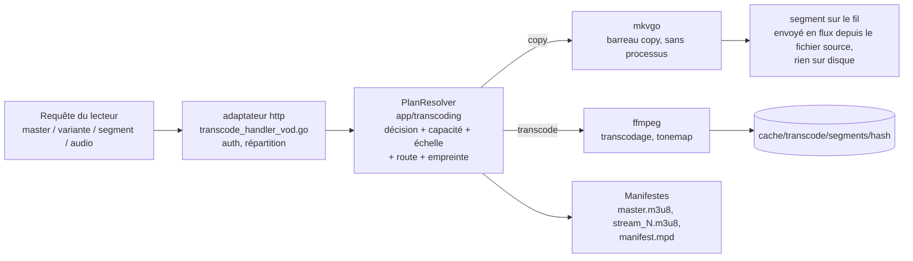

# Servir une vidéo : le chemin de lecture HLS

Ce qui se passe quand un lecteur demande une vidéo, de la première requête
`master.m3u8` jusqu'aux octets d'un segment : le chemin de lecture. Le code
est réparti entre l'adaptateur entrant `http`
(`internal/adapters/driving/http/transcode_*`), les services
`app/transcoding` et les adaptateurs sortants `ffmpeg` / `mkvgo` / `prober` ;
aucune fonction unique ne déroule tout le flux, cette page en est donc la
carte. Il est décidé par [ADR-0030](adr/0030-one-plan-one-decision.md) (un
plan, une décision), [ADR-0024](adr/0024-playback-plan-resolver.md) (le
résolveur de plan) et
[ADR-0029](adr/0029-transcoding-routes-are-measured-not-assumed.md) (des
capacités mesurées). C'est le pendant du pipeline de scan décrit dans
[Architecture](ARCHITECTURE.md) et l'explication détaillée du
« Golden path 4 » de la [Carte du code](CODEBASE_MAP.md). Pour la vue côté
utilisateur de la même négociation, lisez
[Comment la lecture est décidée](playback/how-playback-is-decided.md).

## Le modèle mental : 3 questions, 2 moteurs, 1 clé

Servir une vidéo revient à répondre à trois questions, puis à empaqueter la
réponse, le tout adressé par un seul hachage.

| Question | Répondue par | Où |
| --- | --- | --- |
| **Q1 : puis-je lire le fichier à bas coût ?** | la répartition des sondes par **extension de fichier** : `.mkv/.webm` et `.mp4/.mov` vont à [mkvgo](playback/mkvgo.md) (en-tête seulement, aucun processus) ; tout le reste, et tout échec de la voie rapide, va à ffprobe, l'autorité | `adapters/driven/prober/dispatcher.go` |
| **Q2 : le client peut-il le lire tel quel ?** | la **décision** de lecture, prise par piste : vidéo `copy` ou `transcode`, audio `copy`, `transcode` ou la voie wasm AC-3 ; vidéo et audio sont décidés indépendamment, et le cas courant est « copier la vidéo, ré-encoder l'audio en AAC » | `app/transcoding/decision.go` |
| **Q3 : combien cet hôte peut-il encoder ?** | la **capacité** calibrée (mesurée au premier moment calme) plus l'**admission** (quel barreau de l'échelle convient, reste-t-il une place) | `app/transcoding/calibration_service.go`, `admission_shaper.go` |

Deux moteurs interviennent dans tout cela :

- **mkvgo** lit et ré-empaquette (remux, à la demande) sans lancer de processus. Coût négligeable.
- **ffmpeg / ffprobe** décodent, ré-encodent et sondent en lançant un processus. Coûteux.

Une clé : tout (dossier de cache, session ffmpeg, URL des segments) est
adressé par l'**empreinte de décision**, un hachage de la décision. Mêmes
octets, même hachage, un seul encodage partagé. La justesse de tout le
système repose sur la **stabilité** de ce hachage entre le manifeste que
détient un lecteur et chaque segment qu'il récupère ensuite.

Les deux moteurs envoient leurs segments différemment : un segment mkvgo est
construit à la demande et écrit sur la connexion au fil de l'envoi, la voie
copy ne touche donc jamais le cache de segments ; un segment ffmpeg est un
fichier sous le répertoire de l'empreinte, écrit une fois et servi depuis là.

## Ordre de lecture : suivre une requête dans le code

Ouvrez ces fichiers dans l'ordre pour suivre une requête de lecture de bout en bout :

1. **Entrée** : `internal/adapters/driving/http/transcode_handler_vod.go` :
   `serveHTTP` authentifie, puis répartit vers master / variante / segment /
   audio.
2. **Le plan** : `http/transcode_vod_plan.go` transforme la `*http.Request`
   en une `PlaybackRequest` sans transport ;
   `app/transcoding/playback_plan_resolver.go` (`PlanResolver.Resolve`, le
   `PlaybackPlanResolver` concret dans `playback_plan.go`) renvoie un
   `PlaybackPlan` immuable : la décision (Q2), la classe d'échelle, l'échelle
   mise en forme, la route matérielle, l'empaqueteur et l'empreinte. Chaque
   manifeste et chaque segment de la session en sont servis : entrée des
   manifestes, sonde de délestage, scellé anti-URL périmée, choix du
   producteur et clé de segment lisent tous cette résolution unique, si bien
   qu'à l'intérieur d'une requête l'invariant du hachage de cache tient par
   construction (le chemin critique des segments est passé d'environ 5 lectures
   des préférences de profil à 1). Les assistants de faits sur la source
   (codec, HDR, SAR, dix bits...) se trouvent à côté, dans `source_facts.go`.
   `makeDecision` et `buildFingerprint` dans
   `http/transcode_vod_fingerprint.go` sont de fines enveloppes pour les
   appelants sans plan (préchauffage, master à la demande).
3. **Q2 : décision** : `internal/app/transcoding/decision.go` :
   `MakePlaybackDecisionWithPrefs` (pure) prend la décision copy/transcode
   par piste. Le résolveur y superpose les valeurs imposées par la requête (`vd=` /
   `ad=`), la surcharge de resynchronisation audio, etc.
4. **Q3 : capacité** : `internal/app/transcoding/calibration_service.go` :
   `Current()` renvoie `domain/transcoding.Derive(report, policy)`
   (`derive.go`), les plafonds de l'hôte dérivés de la dernière calibration.
5. **Échelle et admission** : le résolveur met l'échelle en forme (classe de
   complexité, profils de producteur, plafonds de la source et de la
   capacité, plafonds CMCD/AV1, route et plafond d'admission), puis la
   **fige** sur la valeur d'admission enregistrée (`admission_shaper.go`,
   `FreezeLadder`), relue telle quelle à chaque appel suivant : l'invariant
   du hachage de cache rendu structurel. `video_session_limiter.go` tient la
   place de capacité ; la route passe du matériel au logiciel quand il n'y
   a plus de place.
6. **Empreinte** : une `DecisionFingerprint` (type et `Hash()` dans
   `app/transcoding/segment_cache.go`), assemblée par le résolveur. Le
   hachage est la clé du cache.
7. **Production des octets** : copie : **mkvgo**,
   `app/transcoding/ondemand.go` (port) et
   `adapters/driven/mkvgo/ondemand.go` ; transcodage : **ffmpeg**,
   `adapters/driven/ffmpeg/hls_transcoder.go` (`BuildFFmpegArgs` est pure ;
   les segments sont écrits dans `/cache/transcode/segments/<hash>/`).
8. **Empaquetage** : `app/transcoding/manifest_generator.go` écrit
   `master.m3u8` / `stream_N.m3u8` ; `manifest_generator_dash.go` écrit
   `manifest.mpd`.

!!! warning "D'une requête à l'autre, l'invariant repose sur les URL"
    Chaque entrée de la décision doit être inscrite dans les URL enfants
    (`querySuffix` dans `manifest_generator.go`), sinon une relecture du
    manifeste en cours de lecture peut changer le plan à l'insu du
    lecteur. Les URL par session sont réécrites
    (`transcode_vod_manifest_rebake.go`) pour porter le jeton de flux, en
    HLS comme en DASH, y compris pour le Chromecast sans cookie.

## Les deux moteurs, par coût

Le **répartiteur de sondes** (`adapters/driven/prober/dispatcher.go`) est une
chaîne de responsabilité indexée sur l'extension : il essaie mkvgo et se
replie sur ffprobe au moindre doute (erreur d'analyse, panique, résultat
inexploitable, piste média MP4 abandonnée, DoVi profil 5, couleur illisible).
Les deux voies rapides sont toujours actives (portes à nil dans `wire.go`) ;
ffprobe est le repli de sécurité, jamais contourné. Un second répartiteur
identique (`keyframe_dispatcher.go`) gère l'index de lecture.

| Opération | mkvgo (coût négligeable) | ffprobe / ffmpeg (coûteux) |
|---|---|---|
| Sonde de métadonnées (codec, dimensions, HDR, débit, durée) | `.mkv/.webm/.mp4/.mov` en-tête seulement | tout le reste, ou repli |
| Mode de cadence (cfr/vfr) | `AnalyzeFrameRateMode` | - |
| Remux MKV vers MP4 (sans ré-encodage) | `RemuxToMP4` | - |
| HLS/DASH à la demande (barreau copy) | `OnDemandPackager` | - |
| Ré-encodage vidéo / tonemap HDR | - | `hls_transcoder.go` |
| Détection d'entrelacement (idet), point de seek, chromaprint, DoVi P5 | - (demande un décodage / des données annexes) | ffmpeg / ffprobe |

Trois lancements de ffprobe subsistent sur des sources MKV/MP4 dont mkvgo
expose déjà les données, tous dans l'adaptateur sortant `ffmpeg` : la durée
dans `trickplay.go`, le débit et les dimensions dans
`complexity_classifier.go`, le retard audio de lecture dans
`audio_delay.go`.

## L'audio est décidé séparément de la vidéo

`makeDecision` produit `VideoDecision` et `AudioDecision` indépendamment. Le
« barreau copy » (`isCopyRequest`) ne dépend que de la **vidéo** ; même une
vidéo copiée s'accompagne le plus souvent d'une piste AAC ré-encodée. La
décision audio a trois issues :

| Issue | Ce qui est servi |
| --- | --- |
| copie | la piste source telle quelle |
| transcodage en AAC | ffmpeg, léger |
| la **voie wasm**, pour l'AC-3 / E-AC-3 sur un navigateur qui ne sait pas le décoder nativement | le master devient vidéo seule avec une balise `#EVEY-AUDIO-URI`, l'AC-3 est **copié** (mkvgo `od_audio` si le plan se construit, sinon ffmpeg `-c:a copy`), et `ac3go.wasm` le décode en PCM dans le navigateur (`WasmAudioEngine.ts`), calé sur l'horloge de la vidéo |

Safari est exclu de la voie wasm par capacité, pas par nom :
`canWasmDecodeAC3()` (`frontend/packages/client/src/web/codec.ts`) ne renvoie
vrai que si le navigateur déclare qu'il *ne peut pas* lire l'AC-3
nativement, et Safari déclare qu'il le peut.

## Empaquetage : CMAF, HLS, DASH

Le conteneur est toujours **CMAF** (fMP4) : un `init.mp4` par variante plus
des segments `.m4s` (la branche MPEG-TS de `hls_transcoder.go` est du code mort :
`needsFMP4Segments` renvoie toujours vrai). Sur les *mêmes* segments :

- **HLS** (`master.m3u8`, `stream_N.m3u8`, init `EXT-X-MAP` + `.m4s`), les deux moteurs.
- **DASH** (`manifest.mpd`) : sur la voie copy de mkvgo, le manifeste de
  l'empaqueteur lui-même (`OnDemandPlan.HasDASH`, identique à l'octet, zéro
  stockage, désactivé sous AES-128) ; sur la voie ffmpeg, un manifeste
  **déclaré à partir du plan** sur les mêmes fragments que ceux qu'adressent
  les listes HLS (`ManifestGenerator.MPD`), écrit avant qu'aucun fragment
  n'existe.

Ce qui rend le manifeste DASH exact, c'est la **grille de segments**
(`domain/transcoding.SegmentGrid`) : chaque barreau transcodé est découpé
sur le même nombre entier d'images, `arrondi(3 s x fps)` (72 à 23,976 fps,
75 à 25, 90 à 29,97), donc un segment est exact dans les ticks de la piste
vidéo et identique dans tout le jeu de bascule ; le repli copy déclare son
plan d'images clés. Une source dont la cadence est inconnue ou variable
reste sur l'ancienne horloge de 3 s, garde HLS, et répond 404 sur
`manifest.mpd`. Aucun client n'est basculé en DASH : HLS reste le défaut
partout. Le `DASHFromCMAF` de mkvgo sur les fragments produits est l'oracle
de parité (`internal/pkg/cmafparity`, `TestDASHGridIntegration` à
23,976/25/29,97 fps : démarrage à froid, seek, jeu de bascule à deux
barreaux, audio séparé à une trame AAC près).

## Motifs de conception à l'œuvre

| Motif | Où |
| --- | --- |
| Ports et adaptateurs (hexagonal) | la couche applicative utilise `StreamProber`, `BenchmarkRunner`, `OnDemandPackager`, `StreamProducer` ; ffmpeg et mkvgo les implémentent, et un nouveau moteur est un nouvel adaptateur |
| Stratégie | `StreamProducer` (logiciel / matériel / copie), choisi par un `ProducerSelector` |
| Chaîne de responsabilité avec repli | les répartiteurs de sondes et d'images clés (mkvgo, puis ffprobe comme autorité) |
| Cache adressé par contenu | le hachage de la `DecisionFingerprint` indexe le cache et la session ffmpeg |
| Cœur pur, coquille impérative | `Derive`, `MakePlaybackDecision` et le modèle de coût sont purs, testés unitairement sans ffmpeg ni base de données |
| Objet-valeur immuable | `StreamPlan`, la décision d'admission, émise une fois et jamais modifiée, pour que l'invariant URL-octets tienne par construction |
| Dégradation gracieuse | un repli sûr à chaque étape : capacité 720p par défaut, passage du matériel au logiciel, de la copie vers le transcodage, de mkvgo vers ffprobe |

<!-- sources
entry and plan: internal/adapters/driving/http/transcode_handler_vod.go - serveHTTP ; internal/adapters/driving/http/transcode_vod_plan.go ; internal/adapters/driving/http/transcode_vod_fingerprint.go - makeDecision, buildFingerprint ; internal/adapters/driving/http/transcode_vod_manifest_rebake.go
resolver: internal/app/transcoding/playback_plan_resolver.go - PlanResolver.Resolve ; internal/app/transcoding/playback_plan.go - PlaybackRequest, PlaybackPlan ; internal/app/transcoding/source_facts.go
decision and capability: internal/app/transcoding/decision.go - MakePlaybackDecisionWithPrefs ; internal/app/transcoding/calibration_service.go - Current ; internal/domain/transcoding/derive.go - Derive
ladder, admission, fingerprint: internal/app/transcoding/admission_shaper.go - StreamPlan, FreezeLadder ; internal/app/transcoding/video_session_limiter.go ; internal/app/transcoding/segment_cache.go - DecisionFingerprint ; internal/app/transcoding/stream_producer.go - StreamProducer, ProducerSelector
engines: internal/adapters/driven/prober/dispatcher.go ; internal/adapters/driven/prober/keyframe_dispatcher.go ; internal/app/transcoding/ondemand.go - OnDemandPackager ; internal/adapters/driven/mkvgo/ondemand.go ; internal/adapters/driven/ffmpeg/hls_transcoder.go - BuildFFmpegArgs, needsFMP4Segments ; internal/adapters/driven/ffmpeg/trickplay.go, complexity_classifier.go, audio_delay.go
packaging: internal/app/transcoding/manifest_generator.go - querySuffix, EVEY-AUDIO-URI ; internal/app/transcoding/manifest_generator_dash.go ; internal/domain/transcoding/segment_grid.go - SegmentTargetSeconds, gridFor ; internal/pkg/cmafparity ; internal/adapters/driven/ffmpeg/dash_grid_integration_test.go - TestDASHGridIntegration
wasm: frontend/packages/client/src/web/codec.ts - canWasmDecodeAC3
-->
