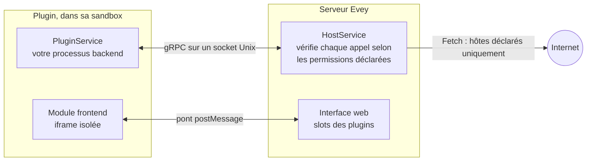

# Plugins

Les plugins ajoutent à Evey ce qu'il ne fait pas lui-même : sources de
métadonnées, canaux de notification, réception de webhooks, sections de page
d'accueil, surcouches du lecteur, et thèmes. Chaque plugin est un processus à
part, qui dialogue avec le serveur par un socket local, confiné par une
sandbox et limité aux permissions que déclare son manifeste. Son interface,
s'il en a une, s'exécute dans un cadre isolé de la page.

<figure class="evey-shot" markdown="span">
  { loading=lazy }
  <figcaption>Sans plugin.</figcaption>
</figure>

<figure class="evey-shot" markdown="span">
  { loading=lazy }
  <figcaption>Avec le plugin météo d'exemple : une section en haut, dessinée dans son propre cadre.</figcaption>
</figure>

## Installer et gérer les plugins

**Admin → Plugins** installe un plugin à partir de son fichier ZIP. Avant
toute installation, l'aperçu affiche :

<figure class="evey-shot" markdown="span">
  { loading=lazy }
  <figcaption><strong>Admin → Plugins</strong> : les environnements d'exécution disponibles, les limites de ressources, et une carte par plugin.</figcaption>
</figure>

- les permissions que déclare le plugin, les emplacements de l'interface où il
  veut apparaître, et les hôtes qu'il contactera ;
- ce que l'analyse statique a trouvé dans son code ;
- sa signature, quand le serveur vérifie les signatures.

Un plugin dont l'analyse relève un motif critique est refusé. La mise à jour
d'un plugin installé passe par le même aperçu ; quand elle demande de
nouvelles permissions, de nouveaux emplacements ou de nouveaux hôtes, vous
devez accepter explicitement la différence.

Chaque plugin dispose ensuite, sur sa carte, de l'activation, de la mise à
jour, des logs et de ses limites de ressources (mémoire, processus, disque,
priorité CPU). La ligne **Sandbox de l'hôte** du **Tableau de bord sécurité**
indique le mode de sandbox réellement appliqué sur cette machine : voir
[Mise en place de la sandbox des plugins](plugins/sandbox-deployment.md) s'il
affiche `basic`.

Les plugins sont activés par défaut. `EVEY_PLUGINS_ENABLED=false` désactive
entièrement le sous-système.

## Ce qu'un plugin peut faire, et ce qu'il ne peut pas

Un plugin voit son propre dossier et pas les données du serveur, n'a aucun
accès direct au réseau (un plugin autorisé à utiliser le réseau n'atteint que
les hôtes qu'il a déclarés, par l'intermédiaire du serveur), et ne peut pas
lancer de processus sans déclarer la permission `subprocess`. Les permissions
qu'un plugin peut demander sont listées dans
[Permissions et slots](plugins/security-model.md). Le fonctionnement de la
sandbox, et ce qu'elle ne peut toujours pas empêcher, sont décrits dans le
[Modèle de sécurité et sandbox des plugins](SECURITY.md).

Examinez un plugin tiers avant de l'installer, comme n'importe quel logiciel :
une fois qu'un hôte figure dans la liste d'un plugin, le serveur ne peut pas
inspecter ce que le plugin lui envoie.

## Écrire un plugin

Un plugin peut être écrit dans n'importe quel langage que son `entrypoint` sait
lancer. Des stubs gRPC générés sont fournis pour Python, Node.js, PHP, Ruby,
Dart, Java et Swift ; les stubs Go se génèrent avec `protoc-gen-go` ; les
binaires compilés nécessitent la permission `native-binary`.

| Page | Contenu |
| --- | --- |
| [Écrire un plugin](plugins/dev-setup.md) | Prérequis, premier plugin, la boucle d'installation, la signature, la distribution. À lire en premier. |
| [Référence de l'API des plugins](plugins/api-reference.md) | Le manifeste, les appels backend et le stockage de données, le pont frontend `evey.*`, les capacités. |
| [Permissions et slots](plugins/security-model.md) | Ce qu'un manifeste peut déclarer, ce qui est vérifié à l'installation, les règles d'accès externe, les slots. |
| [Thèmes](themes.md) | Modifier l'apparence de l'interface avec du CSS et un script isolé. |
| [Webhooks et clés d'API](webhooks-api-keys.md) | Relier Evey à d'autres outils sans écrire de plugin. |
