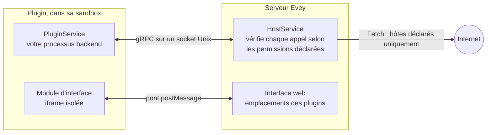

# Écrire un plugin

Cette page mène un développeur d'un clone d'Evey à un plugin qui tourne sur un
serveur local, puis à un paquet signé que d'autres administrateurs peuvent
installer. Le tutoriel de la [section 3](#3-your-first-plugin-step-by-step)
est le chemin principal ; le reste est de la référence à laquelle vous
reviendrez. Les appels et les champs eux-mêmes sont dans la
[Référence de l'API des plugins](api-reference.md).



Un plugin est un ZIP avec un `plugin.yaml` à sa racine et un processus
backend que le serveur démarre dans une sandbox. Le processus sert un petit
service gRPC sur un socket Unix et rappelle le serveur sur un autre. Il peut
aussi embarquer un module d'interface, affiché dans un cadre isolé de la page,
et ne communique avec l'extérieur que par l'intermédiaire du serveur, vers
les hôtes qu'il a déclarés.

## 1. Prérequis

| Outil | Pourquoi |
|---|---|
| Go 1.27, Node.js 22 avec pnpm, Docker avec Compose | La pile de développement (`make dev`) construit le serveur et l'application web. |
| `bubblewrap` (`bwrap`) | Seulement pour les modes de sandbox `bubblewrap` et `strict`. Le mode `auto` par défaut utilise Landlock et n'a besoin de rien sur un noyau 5.13 ou plus récent. |
| [cosign](https://docs.sigstore.dev/cosign/installation/) | Pour signer votre paquet avant de le distribuer ([section 7](#7-sign-your-plugin)). Inutile pour développer. |

Choisissez le langage de votre plugin parmi les environnements que le serveur
sait lancer : `python`, `nodejs`, `php`, `ruby`, `lua`, `bash` et `sh` ont
besoin de leur interpréteur dans l'image, `go` livre un binaire compilé et
demande la permission `native-binary`. L'image par défaut n'embarque que
Python ; l'image `-nodejs` ajoute Node.js et l'image `-full` ajoute PHP, Ruby
et Lua. Un manifeste qui nomme un environnement absent de l'image est refusé
à l'installation, avec la liste des environnements disponibles.

Le contrat gRPC tient dans un fichier, `proto/plugin/v1/plugin_api.proto`. Des
stubs sont générés pour Python, Node.js, PHP, Ruby, Dart, Java et Swift sous
`sdk/<langage>/`, et le serveur copie les stubs de votre langage à côté de
votre point d'entrée au démarrage du plugin : un plugin Node.js ou Python n'a
rien à embarquer, l'image fournit `@grpc/grpc-js` et `@grpc/proto-loader` aux
plugins Node.js et `grpcio` aux plugins Python. Pour un autre langage, générez
les stubs avec `protoc` et livrez-les dans le ZIP :

```bash
protoc --proto_path=proto \
       --<lang>_out=OUT_DIR --grpc_<lang>_out=OUT_DIR \
       proto/plugin/v1/plugin_api.proto
```

`make plugin-sdk` régénère les stubs fournis ; chaque `sdk/<lang>/README.md`
nomme le plugin gRPC dont son langage a besoin.

## 2. Lancer Evey en local

```sh
git clone git@github.com:Evey-project/evey.git
cd evey
cp .env.dev.example .env.dev   # puis renseignez MEDIA_DIR, EVEY_DB_PASSWORD, MEILI_MASTER_KEY
make setup                      # une fois : ajoute evey.test à /etc/hosts
make dev                        # postgres, meilisearch, le serveur (Air), l'application web (Vite)
```

Ouvrez `https://evey.test`. L'assistant d'installation crée le compte
administrateur au premier lancement, comme décrit dans
[Première configuration](../getting-started/first-setup.md). Les fichiers des
plugins arrivent dans `./evey-data/plugins/<id-du-plugin>/`, monté en
`/data/plugins` dans le conteneur.

## 3. Votre premier plugin, pas à pas

L'exemple `examples/plugins/nodejs-example` est le plus petit plugin complet :
il sert `PluginService`, se connecte à `HostService`, et écrit une ligne dans
son journal quand le serveur le démarre. Nous le copions, changeons une chose,
et l'installons.

1. **Copiez l'exemple.**

    ```sh
    cp -r examples/plugins/nodejs-example ~/hello-plugin
    cd ~/hello-plugin
    ```

2. **Donnez-lui un nom.** Modifiez `plugin.yaml` :

    ```yaml title="plugin.yaml"
    name: hello-plugin          # unique, en kebab-case
    kind: plugin
    version: 1.0.0              # semver : à incrémenter à chaque envoi
    description: Dit bonjour dans son journal
    author: vous
    language: nodejs            # l'environnement que le serveur doit avoir
    entrypoint: node main.js    # la ligne de commande que le serveur lance
    permissions:
      - api.library             # laisse le backend lire les médias
    ```

    `language` indique au serveur quel environnement vérifier et quels stubs
    copier ; `entrypoint` est ce qu'il lance, dans le dossier du plugin, avec
    l'environnement de l'étape suivante.

3. **Lisez `main.js`.** Le serveur passe trois variables au processus :
   `EVEY_PLUGIN_ID`, `EVEY_PLUGIN_SOCK` (le socket sur lequel *votre*
   processus doit écouter, en servant `PluginService`) et `EVEY_HOST_SOCK`
   (le socket auquel vous vous connectez pour appeler `HostService`).
   L'exemple charge `plugin_api.proto` depuis son propre dossier, où le
   serveur l'a copié, et implémente les cinq méthodes de `PluginService`.
   Changez le message dans `Initialize` :

    ```js title="main.js (extrait)"
    Initialize(call, callback) {
      hostLog("LOG_LEVEL_INFO", `bonjour de ${process.env.EVEY_PLUGIN_ID}`);
      callback(null, { success: true });
    },
    ```

4. **Compressez-le.** Le manifeste doit être à la racine de l'archive, pas
   dans un sous-dossier :

    ```sh
    zip -r ../hello-plugin.zip . -x ".*" "node_modules/*"
    ```

5. **Installez-le.** Dans **Administration → Plugins**, **Installer un plugin**,
   choisissez le ZIP puis **Aperçu et installation** : l'aperçu liste
   `api.library` et le résultat de l'analyse statique. Par l'API, le même
   envoi s'écrit :

    ```sh
    curl -F "plugin=@hello-plugin.zip" \
         -H "Authorization: Bearer $EVEY_TOKEN" \
         https://evey.test/api/v1/admin/plugins/upload
    ```

6. **Lisez le journal.** Sur la carte du plugin, **Logs** montre la ligne
   écrite par `Initialize`. `docker compose logs evey` montre le côté serveur du
   même démarrage, sous l'identifiant du plugin.

7. **Itérez.** Modifiez le code, incrémentez `version`, compressez de nouveau
   et utilisez **Mettre à jour depuis la source…** sur la carte. Un envoi avec
   la même version ou une version inférieure est refusé ; une nouvelle
   permission dans le manifeste déclenche l'étape de consentement que
   l'administrateur doit approuver.

Vous avez là tout le contrat backend. À partir d'ici, un plugin peut être
étendu de trois façons : appeler le serveur (`HostService`, section 4),
afficher une interface (section 5), et accéder à l'extérieur (section 6).

## 4. Appeler le serveur depuis le backend

Chaque appel à `HostService` porte l'identité du plugin : le serveur vérifie
le processus sur le socket par son PID, et un intercepteur refuse tout appel
dont le manifeste ne déclare pas la permission. Trois groupes n'ont besoin
d'aucune permission :

- `Log` écrit dans le journal du plugin, affiché sur sa carte ;
- `GetConfig` lit les valeurs que l'administrateur a saisies dans **Config**
  (déclarées dans `config_schema`), `SetConfig` laisse le plugin y conserver
  ses propres clés ;
- `GetData` / `SetData` / `DeleteData` / `ListDataKeys` est le stockage
  clé/valeur privé du plugin, effacé à la désinstallation.

`GetMediaItem` et `ListMediaItems` demandent `api.library` ou `media.read` ;
`Fetch` demande `network`. Le tableau complet, avec les méthodes déclarées
dans le contrat mais pas encore servies, est dans la
[référence de l'API](api-reference.md#hostservice-what-the-plugin-can-call).

## 5. Ajouter une interface

Une interface est un module JavaScript que la page charge dans un cadre isolé,
dans l'un des emplacements que le serveur autorise. Déclarez où sont les
fichiers et où va le module :

```yaml title="plugin.yaml"
web_root: dist               # le dossier servi comme ressources statiques
frontend:
  - slot: home.section       # voir la liste des emplacements
    src: dist/index.js       # doit être sous web_root
```

Le module reçoit un pont `window.evey` : `evey.onInit` lui remet la
configuration du plugin, la langue, le thème et la surface sur laquelle il
s'affiche ; `evey.resize`, `evey.toast` et `evey.navigate` agissent sur la
page dans des limites fixes ; et, quand le manifeste déclare `prefs` ou
`public`, `evey.prefs.*` et `evey.media.*` atteignent le serveur par un jeton
de courte durée que l'hôte détient pour le cadre.
`examples/plugins/weather` est un widget complet avec une étape de build ;
`examples/plugins/data-demo` montre `prefs`, `public` et l'emplacement
`admin.nav`. Le pont et les emplacements sont décrits dans la
[référence de l'API](api-reference.md#frontend-api).

## 6. Accéder à l'extérieur

Un processus de plugin ne peut ouvrir aucun socket vers Internet, quel que
soit le mode de sandbox. Le seul accès possible est l'appel `Fetch` de
`HostService` : le serveur vérifie la cible contre le manifeste, puis fait la
requête lui-même.

```yaml title="plugin.yaml"
permissions:
  - network
external_fetch:
  - api.open-meteo.com       # noms d'hôte nus : pas de schéma, pas de joker, pas d'IP
```

`network` sans `external_fetch` est refusé à l'installation. À l'exécution, le
courtier accepte `http` et `https`, `GET` et `HEAD`, répond jusqu'à 8 Mio en
20 secondes, et refuse les adresses privées ou réservées même derrière une
redirection. Le cadre de l'interface reçoit la même liste d'hôtes comme
`connect-src`, donc un widget peut appeler ces hôtes directement en `https`.
Les règles sont dans
[Permissions et emplacements](security-model.md#external-fetch-rules).

!!! note "Les hôtes sont un contrat avec l'administrateur"
    L'administrateur voit la liste des hôtes à l'installation et doit
    approuver tout ajout à la mise à jour. Limitez-la à ce dont le plugin a
    besoin, et indiquez dans votre README ce que chaque hôte reçoit.

## 7. Signer son plugin

!!! info "Ce que prouve une signature"
    Une signature atteste que le ZIP que l'administrateur installe est, octet
    pour octet, celui que **vous** avez publié, signé avec la clé en
    laquelle il a confiance. Elle n'indique rien de ce que fait le plugin : les
    permissions, les hôtes et l'analyse de l'aperçu s'appliquent toujours.
    Evey la vérifie hors ligne et dans son propre processus (ECDSA P-256 sur
    le SHA-256 du ZIP, le format que produit `cosign sign-blob --key`) : pas
    de binaire `cosign` sur le serveur, pas de réseau, pas de journal de
    transparence.

Vous n'avez besoin de [cosign](https://docs.sigstore.dev/cosign/installation/)
que sur votre machine.

1. **Une fois : générez une paire de clés.**

    ```sh
    # choisissez une vraie phrase de passe ; cosign.key reste privée, ne la committez jamais
    COSIGN_PASSWORD="votre-phrase-de-passe" cosign generate-key-pair
    # -> cosign.key (privée) et cosign.pub (le fichier que vous distribuez)
    ```

2. **À chaque version : compressez, puis signez** le fichier exact que vous
   distribuerez.

    ```sh
    cd hello-plugin && zip -r ../hello-plugin.zip . && cd ..

    COSIGN_PASSWORD="votre-phrase-de-passe" cosign sign-blob \
      --key cosign.key --tlog-upload=false --yes \
      --output-signature hello-plugin.zip.sig \
      hello-plugin.zip
    ```

3. **Vérifiez avant de livrer**, avec la même vérification que fait le
   serveur :

    ```sh
    cosign verify-blob --key cosign.pub --signature hello-plugin.zip.sig \
      --insecure-ignore-tlog hello-plugin.zip      # -> Verified OK
    ```

4. **Publiez les trois fichiers ensemble** : `hello-plugin.zip`,
   `hello-plugin.zip.sig` et `cosign.pub`. Mettez l'empreinte de la clé
   publique quelque part où vos utilisateurs peuvent la comparer (README,
   notes de version), pour qu'ils sachent que `cosign.pub` n'a pas été
   remplacée.

Sur l'instance qui l'installe, l'administrateur renseigne la clé et une
politique, puis redémarre le serveur :

```sh
EVEY_PLUGINS_COSIGN_PUBLIC_KEY=/etc/evey/cosign.pub
EVEY_PLUGINS_COSIGN_POLICY=warn   # ou "enforce" pour refuser ce qui ne se vérifie pas
```

Puis, dans **Administration → Plugins**, il choisit le ZIP et, dans **Fichier
signature (.zip.sig, optionnel)**, son `.zip.sig` ; par l'API, la signature
est le champ `sig` de l'envoi. L'aperçu affiche **Signé** ou une signature
invalide, et le Tableau de bord sécurité conserve le résultat.

Erreurs fréquentes :

- **Tout changement du ZIP invalide la signature**, même recompresser les mêmes
  fichiers. Signez le fichier que vous distribuez, et signez de nouveau à
  chaque version.
- **Seules les clés ECDSA P-256 sont acceptées**, ce que produit `cosign
  generate-key-pair`. La signature sans clé et les références KMS ne sont pas
  vérifiées.
- La clé est lue dans un fichier PEM au démarrage : un fichier manquant ou mal
  formé arrête le serveur au lieu de faire échouer la première installation.
  Avec `enforce` et sans clé, le serveur refuse de démarrer.
- Avec le `warn` par défaut et sans clé publique configurée, **rien n'est
  vérifié** ; le serveur se contente d'un avertissement au démarrage.
- Une mauvaise clé, un ZIP altéré et un `.sig` manquant sont tous traités comme
  une signature en échec : sous `enforce`, l'installation ou la mise à jour
  est refusée.

## 8. Ce que vérifie l'installateur, dans l'ordre

Chaque étape peut refuser le paquet ; l'administrateur voit la raison, et le
journal du serveur contient le détail.

1. **Manifeste.** `plugin.yaml` est lu directement dans le ZIP : champs
   obligatoires, semver, permissions et capacités connues, emplacements dans
   la liste autorisée, entrées `external_fetch` qui sont des noms d'hôte nus,
   `web_root` présent quand `frontend` est déclaré. Le `language` déclaré doit
   être un environnement de l'image.
2. **Version et escalade.** Pour un plugin déjà installé, la nouvelle version
   doit être supérieure, et toute nouvelle permission, capacité, emplacement
   ou hôte arrête l'installation ici tant que l'administrateur n'a pas
   approuvé la différence (`accept_permission_changes=true` sur la route
   d'envoi).
3. **Signature et empreinte.** La signature est vérifiée quand une clé
   publique est configurée ; un échec ne bloque que sous `enforce`.
   L'empreinte du ZIP est enregistrée, et vérifiée de nouveau quand une mise
   à jour prévisualisée plus tôt est appliquée.
4. **Extraction** dans un dossier de transit : au plus 5 000 entrées, 100 Mo
   par fichier, 500 Mo au total, un taux de compression de 100:1, aucun lien
   symbolique, aucun chemin qui sort de l'archive. Une mise à jour ne touche
   jamais la version en cours tant que toutes les étapes suivantes n'ont pas
   réussi.
5. **Thèmes seulement :** la feuille de style est assainie et réécrite, et un
   `theme.js` qui correspond à un motif interdit fait refuser le paquet.
6. **Analyse statique** de chaque fichier texte : un constat critique refuse
   le paquet ; les avertissements `deserialization` et `obfuscation` le
   refusent aussi, et `native_code`, les binaires compilés et les archives
   embarquées le refusent sauf si le manifeste déclare `native-binary`.
7. **Enregistrement et démarrage.** Le dossier de transit est mis en place,
   la ligne est écrite, et le processus est démarré.

Ce que cherche l'analyse est listé dans
[Sandbox des plugins et modèle de menace](../SECURITY.md#static-analysis).
Elle lit aussi les commentaires : une ligne `# pip install foo` dans un
commentaire est signalée comme du code.

## 9. Dans quelles conditions tourne votre processus

Le serveur démarre le processus avec une priorité processeur abaissée, un
plafond de mémoire, une limite de processus et de threads, et une taille
maximale pour son dossier ; un moniteur arrête un plugin qui les dépasse. Les
défauts sont 256 Mio, 64 processus et 100 Mio, ajustables par
l'administrateur dans **Administration → Plugins → Limites de ressources**. Sans la
permission `subprocess`, le processus ne peut pas créer d'enfants, quel que
soit le langage ; les threads fonctionnent.

La sandbox confine le système de fichiers au dossier du plugin et bloque tout
socket réseau, sans condition. Le mode en vigueur dépend de l'hôte, pas du
plugin : [Sandbox des plugins et modèle de menace](../SECURITY.md#sandbox-modes)
les décrit, et [Mise en place de la sandbox des plugins](sandbox-deployment.md)
indique à un administrateur lequel choisir.

## 10. Distribuer un plugin

Il n'y a pas de catalogue : un administrateur installe un plugin en envoyant
son ZIP ou en collant son URL dans le panneau d'administration, depuis
l'endroit où vous le publiez (une release sur une forge, votre propre site).

- Livrez le ZIP, son `.sig` et votre `cosign.pub` ensemble (section 7).
- Indiquez les permissions et les hôtes `external_fetch` dans votre README :
  l'administrateur les voit à l'installation et doit les approuver ; une
  surprise à cet endroit est la première cause de refus.
- Pour faire figurer votre plugin parmi les exemples fournis, ouvrez une pull
  request contre `examples/plugins/` avec la source et un README. Les exemples
  sont relus et construits depuis la source ; une inscription n'est pas une
  recommandation et ne porte aucune signature du projet.

## 11. Dépannage

| Symptôme | Cause | Solution |
|---|---|---|
| `plugin requires "nodejs" runtime which is not installed in this image` | La variante d'image n'a pas l'interpréteur. | Utilisez l'image `-nodejs` ou `-full`, ou écrivez le plugin en Python. |
| `manifest: external_fetch entry "*.tmdb.org" is a wildcard - use explicit hostnames` | Les jokers sont refusés à l'installation, sans exception. | Listez chaque nom d'hôte nécessaire (`api.tmdb.org`, `image.tmdb.org`). |
| `manifest: frontend slot "admin.section" not allowed` | L'emplacement est hors de la liste autorisée. | Prenez un emplacement de la [liste](api-reference.md#slots) ; `admin.nav` est le seul emplacement de la zone d'administration. |
| `manifest: network permission requires non-empty external_fetch` | `network` déclaré sans hôtes. | Ajoutez les hôtes, ou retirez la permission. |
| `plugin already installed at version 1.0.0, new version must be higher` | Le ZIP porte la version déjà installée. | Incrémentez `version`, ou désinstallez d'abord. |
| `signature does not match the plugin or the configured key` | Le `.sig` a été fait avec une autre clé, ou le ZIP a changé après la signature. | Re-signez le ZIP exact avec la bonne clé, ou corrigez `EVEY_PLUGINS_COSIGN_PUBLIC_KEY`. |
| `plugin blocked: theme.js contains forbidden pattern` | Le scanner du script de thème a trouvé une API interdite. | Un thème ne peut appeler que `evey.theme.*` : voir [Thèmes](../themes.md#what-the-scanner-refuses). |
| Le journal se termine par `memory quota exceeded (... MB > ... MB)` | Le moniteur a arrêté le plugin au-delà de sa limite de mémoire. | Réduisez la consommation, ou montez **Mémoire max (Mio)** dans **Limites de ressources**. |
| `bwrap: ... permission denied` | Mode `bubblewrap` dans Docker, bloqué par le profil seccomp ou AppArmor du conteneur. | Gardez le mode `auto` par défaut. Sinon, voir [Mise en place de la sandbox des plugins](sandbox-deployment.md). |
| Le module d'interface n'apparaît pas | Le plugin est désactivé, l'emplacement est mal orthographié, ou `src` n'est pas sous `web_root`. | Vérifiez l'état de la carte, le nom de l'emplacement, et les requêtes `/api/v1/plugins/<id>/assets/...` dans le panneau réseau du navigateur. |

<!-- sources
runtimes, image variants: internal/adapters/driven/pluginrunner/runtime_availability.go - runtimeBinaries, compiledLanguages ; internal/app/plugin/install.go - parseAndValidateManifest ; Dockerfile (RUNTIMES lean/nodejs/full)
stubs copied at start, NODE_PATH: internal/adapters/driven/filesystem/plugin_fs.go - CopySDKStubs ; internal/adapters/driven/pluginrunner/runner_start.go ; sdk/python/README.md ; examples/plugins/nodejs-example/package.json
dev stack: DEV.md (Quick Start) ; Makefile - setup, dev ; docker-compose.yml (evey-data/plugins:/data/plugins)
example: examples/plugins/nodejs-example/main.js, plugin.yaml
env vars: internal/adapters/driven/pluginrunner/runner_start.go (EVEY_PLUGIN_ID, EVEY_PLUGIN_SOCK, EVEY_HOST_SOCK)
upload route, fields: internal/adapters/driving/http/plugin_asset_handler.go (plugin, sig, accept_permission_changes)
host RPC permissions: internal/adapters/driving/grpcapi/plugin_interceptor.go ; peer auth: internal/adapters/driving/pluginhost/peer_creds.go
host RPCs: internal/adapters/driving/pluginhost/host_server.go - Log, GetConfig, SetConfig, GetData ; fetch.go - Fetch (GET/HEAD, maxFetchBytes, fetchTimeout)
frame connect-src: frontend/packages/client/src/plugins/hostProtocol.ts - buildConnectSrc ; internal/adapters/driving/http/plugin_frame_handler.go - pluginFramePolicy
bridge: frontend/packages/client/src/plugins/bridgeScript.ts - EveyBridge
cosign: internal/adapters/driven/pluginrunner/cosign.go - loadP256PublicKey ; internal/config/config.go - CosignPolicy validation
install order: internal/app/plugin/install.go - installLocalZip, parseAndValidateManifest, resolveExistingPlugin, verifyPluginIntegrity, extractPluginToStaging, validateStagedPlugin, checkEscalatedWarnings, swapAndPersistPlugin ; update.go - ApplyUpdate ; zip limits: docs/SECURITY.md (ZIP extraction)
resource limits: internal/config/config.go - Plugins ; internal/adapters/driven/pluginrunner/runner_resmon.go ; i18n admin.plugins.resourceLimits.*
error texts: internal/adapters/driven/pluginrunner/manifest.go ; internal/domain/plugin/model.go ; internal/app/plugin/install.go ; cosign.go ; runner_resmon.go
-->
