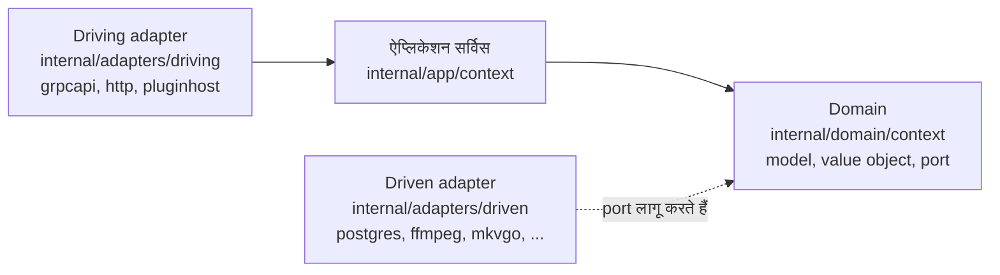
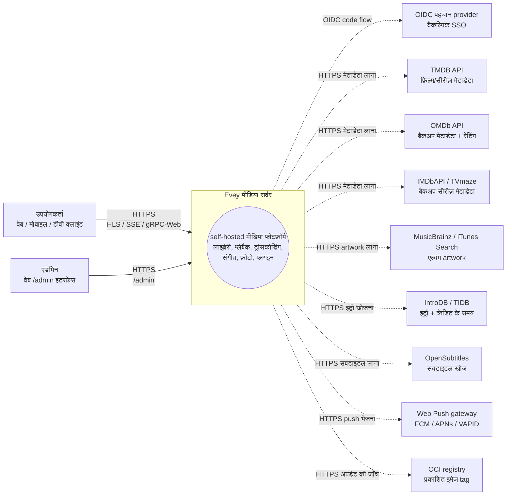
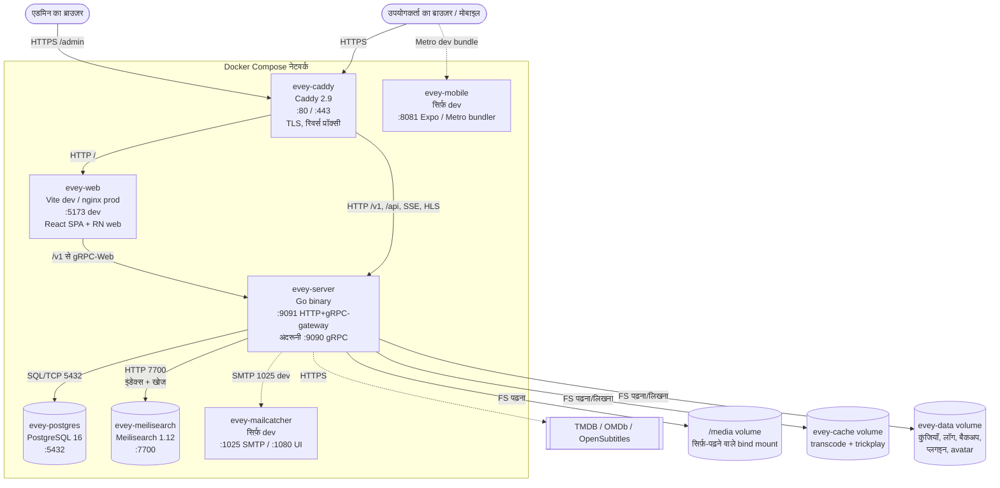
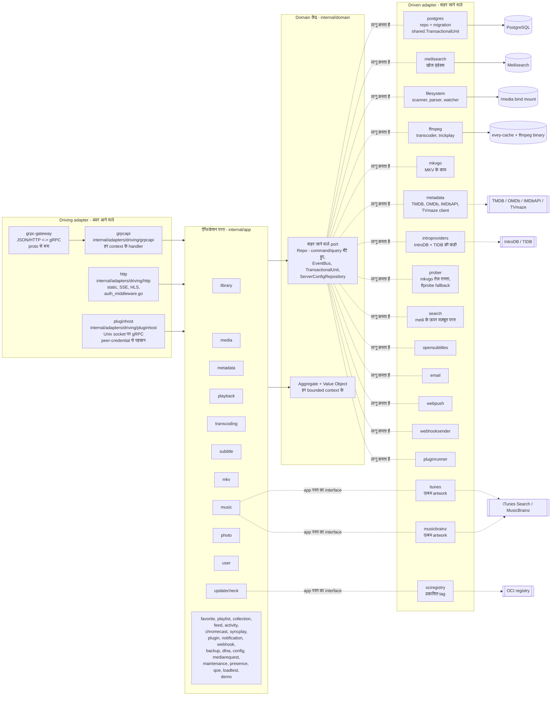
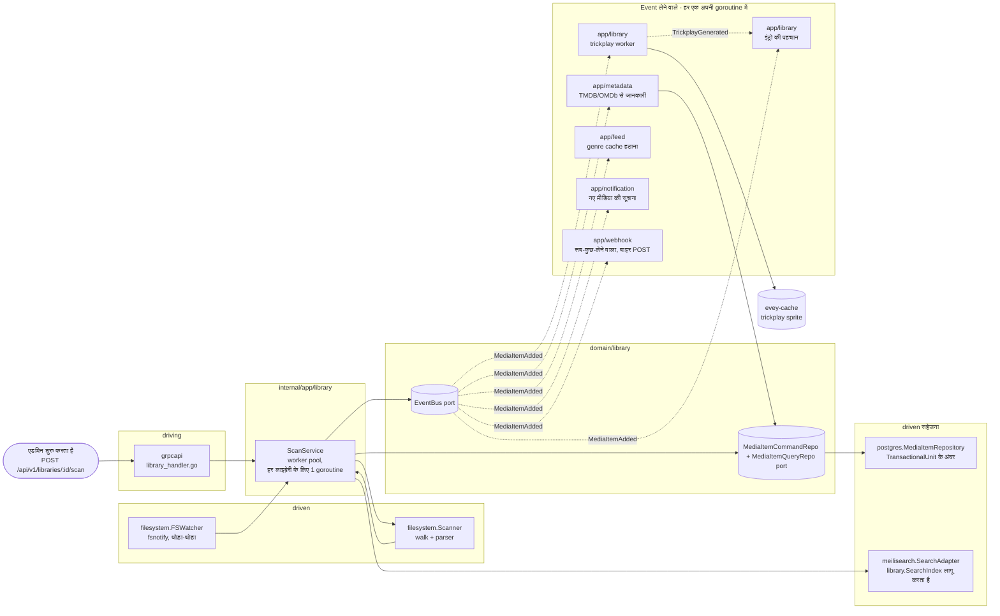

# आर्किटेक्चर

सर्वर की बनावट: `internal/` के नीचे hexagonal परतें, bounded context, उन्हें
जोड़ने वाले event, और वे static जाँचें जो कोड को इन नियमों के अनुसार बनाए रखती हैं। कोड
`internal/domain`, `internal/app`, `internal/adapters/{driving,driven}` में है
और `cmd/evey/wire*.go` में जोड़ा जाता है; बनावट [ADR-0001](adr/0001-hexagonal-architecture.md)
तय करता है, repository का बँटवारा [ADR-0009](adr/0009-cqrs-repo-split.md) और event
bus [ADR-0010](adr/0010-event-bus.md)। build करने और चलाने के लिए [DEV.md](../DEV.md)
पढ़ें; किसी बदलाव के लिए कौन सी फ़ाइलें छूनी हैं, यह जानने के लिए
[कोड का नक्शा](CODEBASE_MAP.md) पढ़ें।

बैकएंड Go में है; वेब, मोबाइल और टीवी क्लाइंट `frontend/` के नीचे एक TypeScript/React
monorepo हैं (मोबाइल और टीवी के लिए React Native / Expo)।

## परतें

| फ़ोल्डर | क्या रखता है | नियम |
| --- | --- | --- |
| `internal/domain/<context>/` | model, value object और **port** (interface) | किसी framework का import नहीं, किसी दूसरे context का import नहीं |
| `internal/app/<context>/` | ऐप्लिकेशन सर्विस जो port के ज़रिए काम का समन्वय करती हैं | IO एक port से होकर जाता है; `dlna` (SSDP / UPnP AVTransport) और `loadtest` (उसका अपना HTTP client) दो जानबूझकर रखे गए अपवाद हैं जो सीधे नेटवर्क तक जाते हैं |
| `internal/adapters/driven/` | बाहर जाने वाले adapter जो port लागू करते हैं: `postgres`, `meilisearch`, `ffmpeg`, `mkvgo`, `filesystem`, `prober`, `opensubtitles`, `email`, `webpush`, `webhooksender`, `pluginrunner`, `metadata`, `introproviders`, `search` | तीन और domain port की जगह app परत के किसी interface को पूरा करते हैं: `itunes` और `musicbrainz` (`app/music.AlbumArtFetcher`), `ociregistry` (`app/updatecheck`) |
| `internal/adapters/driving/` | अंदर आने वाले adapter: `grpcapi` (+ grpc-gateway HTTP), `http` (static, auth middleware, SSE, HLS, प्लगइन iframe की फ़ाइलें), `pluginhost` (Unix socket पर gRPC सर्वर, peer credentials से पहचान, वह होस्ट API जिसे सैंडबॉक्स वाले प्लगइन वापस कॉल करते हैं) | |
| `internal/pkg/` | साझा तकनीकी केंद्र: auth, logger, eventbus, i18n, metrics, tracing, ratelimit, procfork, ssrf, cache, ... | |
| `internal/config/` | सर्वर का कॉन्फ़िगरेशन | |
| `gen/` | बनाया गया proto कोड | |

निर्भरता का नियम: `adapters -> app -> domain`। domain कभी app या adapter को import
नहीं करता। जोड़ने का काम हाथ से लिखा गया है (google/wire नहीं), `cmd/evey/wire.go`
में और उसके साथ की फ़ाइलों `wire_infra.go`, `wire_services.go`, `wire_adapters.go`,
`wire_events.go`, `wire_helpers.go` में। टेस्ट adapter को छोड़कर fake implementation डालते
हैं जो वही domain port लागू करते हैं: 21 में से 20 domain package के साथ एक `fakes/`
sub-package आता है।

## Bounded context

बत्तीस context package `internal/domain/` और `internal/app/` के नीचे हैं: 19
दोनों परतों में हैं, 2 सिर्फ़ domain में (`ratings`, `shared`), 11 सिर्फ़ app में। ये
कुछ हद तक एक साझा bus पर domain event के ज़रिए साथ काम करते हैं; app परत पड़ोसी
context का domain package सीधे भी पढ़ती है (देखें [संबंध](#relations))।

| Context | ज़िम्मेदारी |
| --- | --- |
| `user` | खाते, पहचान, सेशन, पसंद |
| `library` | लाइब्रेरी, फ़ोल्डर, स्कैन के काम, मीडिया इंडेक्स, लोग, संग्रह, किसी प्रोफ़ाइल के पसंदीदा और thumbs (thumbs की कोई app सर्विस नहीं: रेटिंग वाला RPC `UserRatingRepository` को जैसा है वैसा सहेजता और पढ़ता है), trickplay, इंट्रो/क्रेडिट की पहचान |
| `media` (सिर्फ़ app) | शेयर लिंक और stream token |
| `mediarequest` | उपयोगकर्ताओं के भेजे मीडिया अनुरोध |
| `metadata` | TMDB / OMDb से जानकारी जोड़ना, artwork |
| `playback` | stream, प्रगति, रिमोट कंट्रोल, अभी क्या चल रहा है |
| `transcoding` | ffmpeg के काम, HLS segment |
| `subtitle` | अंदर के + बाहरी + opensubtitles |
| `mkv` | MKV container के काम ([mkvgo](playback/mkvgo.md) के ज़रिए) |
| `music` | ऑडियो के लिए ख़ास प्लेबैक + tagging |
| `photo` | फ़ोटो लाइब्रेरी |
| `favorite` (सिर्फ़ app) | हर प्रोफ़ाइल के पसंदीदा; model और `FavoriteRepository` `domain/library` में रहते हैं |
| `playlist` | उपयोगकर्ता की प्लेलिस्ट, स्मार्ट प्लेलिस्ट |
| `collection` (सिर्फ़ app) | एडमिन के चुने संग्रह; इसके port `domain/library` में रहते हैं |
| `ratings` (सिर्फ़ domain) | देशों के वर्गीकरण (CSA, FSK, MPAA, BBFC, ACB) को न्यूनतम उम्र की एक धुरी पर लाता है |
| `feed` | गतिविधि feed / खोजें |
| `activity` | उपयोगकर्ता की गतिविधि की समय-रेखा |
| `chromecast` | कास्ट सेशन का जीवन-चक्र |
| `syncplay` | कई डिवाइस वाले sync सेशन |
| `plugin` | प्लगइन रजिस्टर, सैंडबॉक्स token, जीवन-चक्र |
| `notification` | ऐप के अंदर + webpush सूचनाएँ |
| `webhook` | बाहर जाने वाले वेबहुक |
| `backup` | DB + कॉन्फ़िगरेशन का बैकअप/रीस्टोर |
| `config` (सिर्फ़ app) | सहेजी गई सर्वर सेटिंग्स, जिन्हें REST और gRPC दोनों रास्ते लिखते हैं |
| `dlna` (सिर्फ़ app) | SSDP से खोज और UPnP AVTransport नियंत्रण |
| `loadtest` (सिर्फ़ app) | सर्वर के अपने HTTP स्टैक पर दर्शकों की नकल करता है: HLS, या कच्ची फ़ाइल, जब क्लाइंट का फ़ैसला direct play हो |
| `maintenance` (सिर्फ़ app) | एडमिन के शुरू किए मीडिया रखरखाव: सीक इंडेक्स फिर से बनाना, मरम्मत का जर्नल, वापस लेना, ऑडियो की अखंडता |
| `presence` (सिर्फ़ app) | मेमोरी में रहने वाला, न सहेजा जाने वाला रजिस्टर कि अभी कौन जुड़ा है |
| `qoe` (सिर्फ़ app) | CMCD (CTA-5004) प्लेबैक telemetry लेना और जोड़ना |
| `demo` (सिर्फ़ app) | सार्वजनिक डेमो सर्वर (`EVEY_DEMO=1`): अपने खाते, लाइब्रेरी और मुफ़्त लाइसेंस वाला मीडिया प्रोडक्ट की अपनी सर्विस से भरता है, और खुद को रीसेट करता है |
| `updatecheck` (सिर्फ़ app) | चल रहे build की तुलना उससे करता है जो registry प्रकाशित करती है, और एडमिन को बताता है; यह कभी कुछ अपडेट नहीं करता |
| `shared` (सिर्फ़ domain) | सब पर लागू port (`EventBus`, `TransactionalUnit`, `ServerConfigRepository`, `ShareLinkRepository`), typed id, cursor, stream token |

### संबंध

| भेजने वाला | Event | कौन लेता है |
| --- | --- | --- |
| `library` | `LibraryCreated` / `LibraryDeleted`, `LibraryScanStarted` / `LibraryScanCompleted`, `MediaItemAdded`, `MediaItemRemoved`, `TrickplayGenerated` | `media.item.added`: `notification`, `metadata` (अपने-आप जानकारी जोड़ना), `library` खुद (trickplay worker + इंट्रो की पहचान), `feed` (genre cache अमान्य करना) |
| `playback` | `PlaybackStarted` / `PlaybackStopped` | आज कोई अलग subscriber नहीं; सिर्फ़ `webhook` का `"*"` catch-all subscriber इन्हें पाता है |
| `user` | `UserCreated`, `user.password.reset_requested` | पहले का कोई subscriber नहीं; दूसरे को `email` driven adapter लेता है |
| `pluginrunner` | `plugin.error` / `plugin.started` | `app/plugin` अपने सुरक्षा डैशबोर्ड के लिए, `notification` एडमिन के लिए |
| `shared` | `ServerConfigChanged` | वे सर्विस जो एडमिन पैनल में सहेजी गई सेटिंग बिना restart के लागू करती हैं (SMTP, समय-क्षेत्र, CPU बजट, ...) |

- खोज का इंडेक्स बनाना event से **नहीं** चलता: `library.ScanService` सीधे
  `library.SearchIndex` port को कॉल करता है।
- domain event को प्लगइन तक ले जाने वाली कोई व्यवस्था (bridge) नहीं है: प्लगइन सीमित दायरे वाले JWT
  से API तक पहुँचते हैं ([ADR-0003](adr/0003-plugin-scoped-tokens.md))। bus खुद
  [ADR-0010](adr/0010-event-bus.md) है।
- `shared.TransactionalUnit` कई aggregate वाले लेखन को एक transaction में रखता है
  ([ADR-0002](adr/0002-transactional-unit-port.md))।

`internal/domain` के नीचे का कोई package किसी दूसरे context का domain package import
नहीं करता; यह नियम `internal/contractguard/domain_imports_test.go` लागू करता है
(देखें [आर्किटेक्चर की जाँचें](#architecture-guards))। app परत इससे बँधी नहीं है: आज
15 app package किसी पड़ोसी context का domain package import करते हैं।

## आम डेटा का रास्ता - "उपयोगकर्ता एक मीडिया चलाता है"

1. मोबाइल/वेब क्लाइंट `POST /api/v1/playback/start` कॉल करता है (grpc-gateway route)।
2. `internal/adapters/driving/http` अपना auth middleware चलाता है (`auth_middleware.go`, `httpAuthMiddleware`), सेशन निकालता है।
3. `internal/adapters/driving/grpcapi` (`playback_handler.go`) proto जाँचता है, `app/playback.CommandService.StartStream` कॉल करता है (command/query का बँटवारा, देखें [ADR-0009](adr/0009-cqrs-repo-split.md))।
4. `app/playback.CommandService` domain port कॉल करता है: `user.UserRepository`, `playback.SessionQueryRepo` (idempotency + डिवाइस की सीमा), `playback.SessionCommandRepo`, फिर `shared.EventBus.Publish(PlaybackStarted)`।
5. driven adapter काम करते हैं: `postgres` सेशन को एक `shared.TransactionalUnit.Do` दायरे के अंदर सहेजता है; प्रोसेस के अंदर का bus (`internal/pkg/eventbus`) asynchronous रूप से आगे भेजता है।
6. `PlaybackStarted` का आज कोई अलग subscriber नहीं: सिर्फ़ `webhook` का `"*"` catch-all subscriber इसे पाता है।
7. जवाब grpc-gateway से JSON के रूप में वापस जाता है; प्रगति के अपडेट SSE / gRPC stream पर आते हैं।

प्लेयर के manifest और segment माँगने के बाद क्या होता है, यह
[प्लेबैक पाइपलाइन](playback-serving.md) का विषय है।

## आर्किटेक्चर की जाँचें

ऊपर के नियम सिर्फ़ दस्तावेज़ में नहीं हैं। `internal/contractguard/` में 30 फ़ाइलों में
58 static टेस्ट हैं, जो कोड के इनसे हटने पर build फ़ेल कर देते हैं।

hexagonal नियम खुद `TestDomainContextsDoNotImportEachOther` (ADR-0001) है,
`domain_imports_test.go` में। यह `internal/domain` की सारी फ़ाइलें जाँचता है और ठीक यही लागू करता
है: एक context `internal/domain/shared` और अपना package tree import कर सकता है,
`internal/domain` से और कुछ नहीं, और `internal/app` या `internal/adapters` कभी नहीं।
इसका दायरा `internal/domain` पर रुक जाता है: यह app परत के बारे में कुछ नहीं कहता।

बाकी जाँचें उन अनुबंधों को सुरक्षित रखती हैं जो किसी भाषा या प्रोसेस की सीमा पार करते
हैं, उनमें से कुछ:

| जाँच | यह क्या मना करती है |
| --- | --- |
| `TestNoClientReadOfAFieldTheServerNeverWrites` | proto जवाब का ऐसा फ़ील्ड जिसे कोई क्लाइंट पढ़ता है पर कोई सर्वर कोड नहीं लिखता |
| `TestRegisteredHandlersGetEveryPortTheyDeclare`, `TestBootInstallsItsSilentWirings` | ऐसी जोड़ जो वरना चुपचाप फ़ेल हो जाती |
| `TestPostgresRepositoriesBoundTheirQueries` | timeout के बिना Postgres repository की query |
| `TestProcfork_EveryForkGoesThroughCommand` | ऐसा subprocess fork जो `internal/pkg/procfork` को छोड़कर जाता है |
| `TestEverySortFieldTheAPIAcceptsHasASQLColumn`, `...CanBuildACursorValue` | ऐसा sort फ़ील्ड जो SQL कॉलम map या cursor encoder में नहीं है |
| `TestEveryWebSurfaceReachingAnAdminRPCIsClassified`, और मोबाइल और टीवी के लिए उसका native रूप | इंटरफ़ेस का ऐसा हिस्सा जो सिर्फ़-एडमिन RPC कॉल करता है, बिना तय किए कि उसे कौन देखता है |
| `TestEveryAllowedSlotIsMountedOnWebAndMobile`, `TestPluginBridgeParityWebMobile` | प्लगइन का ऐसा स्लॉट या bridge संदेश जो सिर्फ़ एक क्लाइंट पर है |
| `TestImageSubtitleCodecsAgreeAcrossServerAndClients` | किसी प्लेयर पर bitmap सबटाइटल codec की एक दूसरी सूची |
| `TestHandWrittenClientTypesMatchTheEndpointTheyCall` | मोबाइल/टीवी का हाथ से लिखा जवाब टाइप जो अपने endpoint से अलग हो जाए |
| `TestOnlyThePlanDecidesPlayback`, `TestNoCallerDerivesDownstreamOfThePlaybackPlan` | योजना तय करने वाले के बाहर लिया गया प्लेबैक का फ़ैसला ([ADR-0030](adr/0030-one-plan-one-decision.md)) |
| `TestRestartExitCodeAgreesWithTheEntrypoint` | Go का exit code और `docker/entrypoint.sh` restart के मतलब पर असहमत हों |
| `TestServerEmittedI18nKeysExistInCatalogue`, `TestI18nPlaceholdersAgreeAcrossLocales` | सर्वर से निकली ऐसी कुंजी जो अनुवाद सूची में नहीं, भाषाओं के बीच अलग placeholder |

## C4 आरेख

चार आरेख Evey को घटते zoom स्तरों पर दिखाते हैं, [C4 model](https://c4model.com/) के
हिसाब से। node के नाम `internal/` के नीचे के असली Go package नाम हैं। container के
नाम `evey-server`, `evey-postgres` और `evey-caddy` के लिए `docker-compose.yml` से आते
हैं; `evey-web`, `evey-meilisearch`, `evey-mobile` और `evey-mailcatcher`
`docker-compose.override.yml` में बताए गए हैं और सिर्फ़ डेवलपमेंट वाली बनावट में होते
हैं।

### स्तर 1 - सिस्टम का संदर्भ

Evey से कौन जुड़ता है, और Evey किन तीसरे पक्षों तक पहुँचता है।

### स्तर 2 - Container

`docker compose --env-file .env.dev up` से चालू होने वाली डिप्लॉय की जा सकने वाली
इकाइयाँ। ठोस तीर चलते समय का ट्रैफ़िक हैं; बिंदीदार तीर तीसरे पक्षों की ओर बाहर जाते
हैं।

!!! note "प्रोडक्शन इस डेवलपमेंट बनावट से अलग है"
    इंस्टॉल वाली compose फ़ाइल एक ही सर्विस बताती है, `evey`। कोई अलग `evey-web`
    container नहीं है (न ही सिर्फ़-dev वाले mailcatcher और Metro bundler): binary बना
    हुआ वेब इंटरफ़ेस `/srv` से देता है, इसलिए रिवर्स प्रॉक्सी *सब कुछ*, इंटरफ़ेस और
    API, उसे `:9091` पर भेजता है। Postgres और Meilisearch उसी container के अंदर चलते
    हैं, `docker/entrypoint.sh` की निगरानी में: PostgreSQL 17, जिसका डेटा
    `/data/postgres` में है, और Meilisearch binary (`Dockerfile`, `meili-download`
    stage, 1.12.8 पर तय), जिसका इंडेक्स `/data/meili` में है। repository की अपनी
    `docker-compose.yml` अलग `postgres` और `caddy` सर्विस रखती है, जो
    [एडवांस्ड डिप्लॉयमेंट](operations/advanced-deployments.md) में बताई गई हैं। देखें
    [इंस्टॉल](installation.md) और [रिवर्स प्रॉक्सी कॉन्फ़िगरेशन](reverse-proxy.md)।

### स्तर 3 - Component (`evey-server` पर zoom)

Go binary के अंदर hexagonal परतें। driving adapter ऐप्लिकेशन सर्विस को उनके
interface से कॉल करते हैं; ऐप्लिकेशन सर्विस सिर्फ़ domain port पर निर्भर हैं; driven
adapter उन port को लागू करते हैं।

Goroutine के बारे में:

- gRPC सर्वर (`grpc.Server.Serve`) और HTTP सर्वर (gateway + static), दोनों `cmd/evey` की मुख्य जोड़ से अलग अपनी-अपनी goroutine में चलते हैं।
- `app/library` के स्कैन काम एक worker pool पर चलते हैं (हर सक्रिय लाइब्रेरी स्कैन के लिए एक goroutine, देखें `library.ScanService`)।
- ffmpeg के काम driven `ffmpeg` adapter (`ffmpeg.Transcoder.Start`) `internal/pkg/procfork` के ज़रिए fork करता है, हर काम के लिए एक निगरानी वाली goroutine जो प्रोसेस का stderr खाली करती रहती है।
- `shared.EventBus` subscriber को asynchronous रूप से चलाता है: हर subscriber अपनी goroutine में चलता है, ताकि धीमा subscriber कभी publisher को न रोके। bus अपना कोई transaction नहीं खोलता; यह handler का काम है।
- `pluginrunner` हर प्लगइन के लिए एक subprocess शुरू करता है; iframe प्लगइन उपयोगकर्ता के ब्राउज़र के अंदर रहते हैं और `app/plugin` के दिए साइन किए गए token से सर्वर से संपर्क करते हैं।

### स्तर 3 (अतिरिक्त) - स्कैन pipeline पर component zoom

वह मुख्य रास्ता (hot path) जो डिस्क की फ़ाइलों को खोजने लायक, जानकारी से भरे मीडिया में बदलता है।
ठोस तीर सीधी कॉल हैं; बिंदीदार तीर bus पर domain event हैं। खोज का इंडेक्स बनाना
`ScanService` से एक सीधी port कॉल है, event नहीं।

इसे ऊपर के "आम डेटा का रास्ता" वाले हिस्से के साथ पढ़ें: प्लेबैक का रास्ता उसका
जोड़ीदार पढ़ने वाला रास्ता है; स्कैन pipeline लिखने वाला रास्ता है, जो वह मीडिया
इंडेक्स तैयार करता है जिससे पढ़ने वाला रास्ता डेटा भेजता है।

## आगे पढ़ें

- [DEV.md](../DEV.md) - build, चलाना, migration, proto बनाना
- [कोड का नक्शा](CODEBASE_MAP.md) - आम बदलावों के लिए कौन सी फ़ाइलें छूनी हैं
- [प्लेबैक पाइपलाइन](playback-serving.md) - HLS वीडियो भेजने का पढ़ने वाला रास्ता, गहराई से
- [सर्वर API](api/) - बनाया गया API रेफ़रेंस
- [फ़ैसलों के रिकॉर्ड](adr/) - आर्किटेक्चर के फ़ैसलों के रिकॉर्ड

<!-- sources
layering: internal/domain ; internal/app ; internal/adapters/driven ; internal/adapters/driving ; internal/pkg ; internal/config ; gen ; cmd/evey/wire.go, wire_infra.go, wire_services.go, wire_adapters.go, wire_events.go, wire_helpers.go
app-layer interfaces: internal/app/music/album_art_chain.go - AlbumArtFetcher ; internal/adapters/driven/ociregistry (app/updatecheck)
network exceptions: internal/app/dlna/service.go ; internal/app/loadtest/runner.go
events and subscribers: internal/app/notification/command_service.go ; internal/app/metadata/command_service_enrich.go ; internal/app/library/trickplay_service.go ; internal/app/library/intro_detection_service.go ; internal/app/feed/genre_cache.go ; internal/app/webhook/service.go ; internal/adapters/driven/email/password_reset_emailer.go ; internal/app/plugin/security_dashboard_service.go ; internal/app/config/smtp.go, timezone.go, cpu_budget.go
guards: internal/contractguard/*_test.go - TestDomainContextsDoNotImportEachOther, TestOnlyThePlanDecidesPlayback, TestNoCallerDerivesDownstreamOfThePlaybackPlan, TestServerEmittedI18nKeysExistInCatalogue, TestI18nPlaceholdersAgreeAcrossLocales
topology: docker-compose.yml ; docker-compose.override.yml ; Dockerfile - MEILI_VERSION, postgresql-17 ; docker/entrypoint.sh - PG_MAJOR
-->
