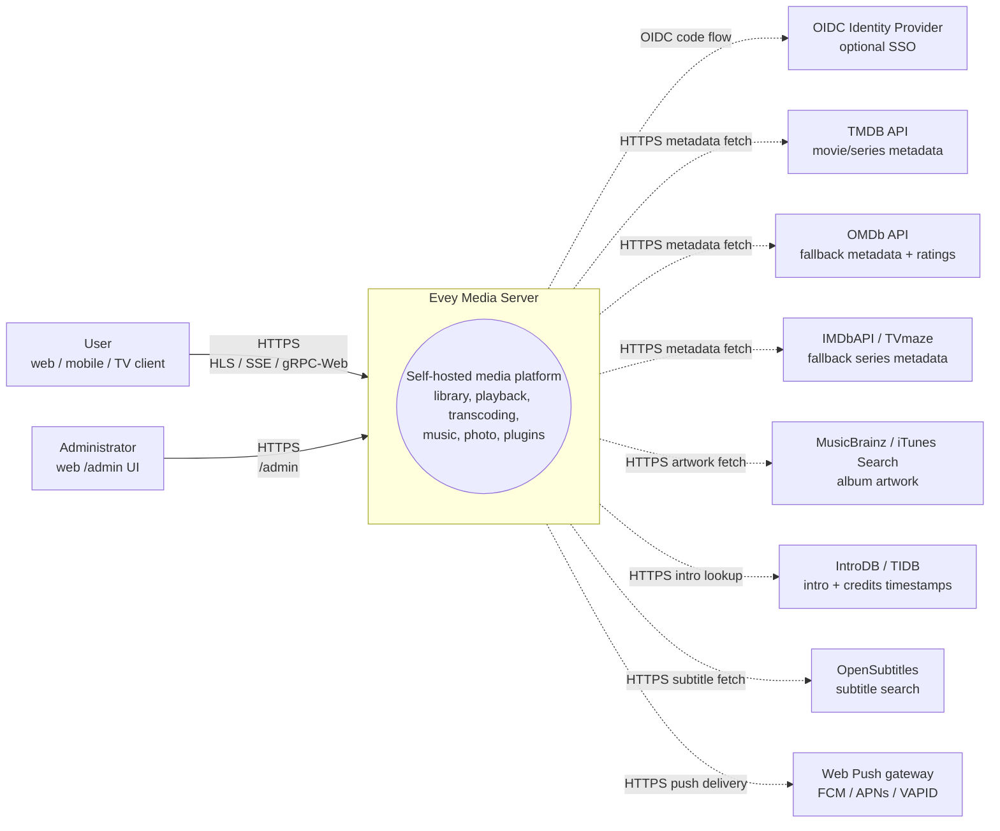
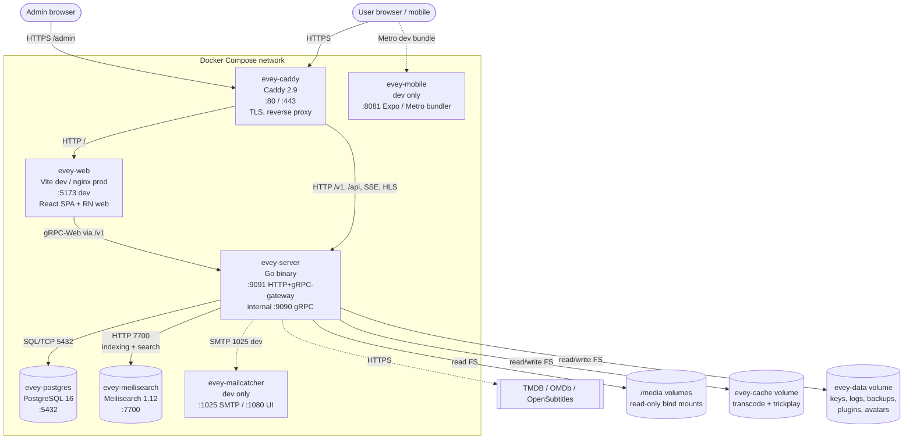
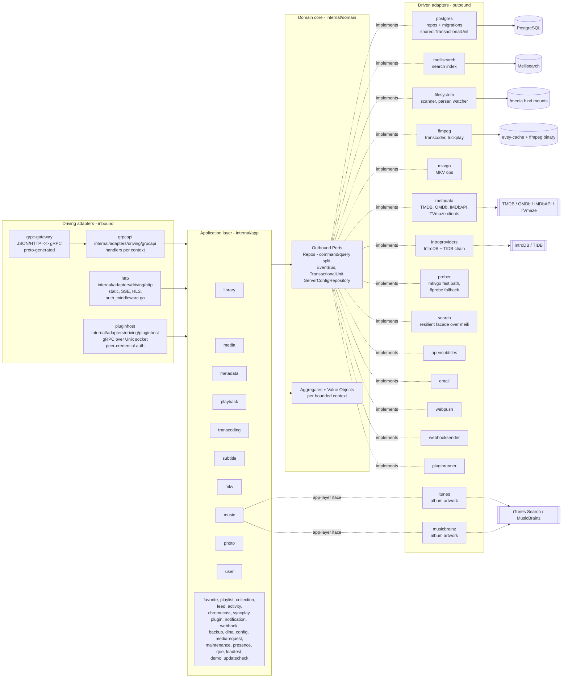

# आर्किटेक्चर

Evey एक सेल्फ़-होस्टेड मीडिया सर्वर है। बैकएंड Go है (हेक्सागोनल / DDD), फ़्रंटएंड एक TypeScript/React मोनोरेपो है, मोबाइल React Native / Expo है। सेटअप और गहरी आंतरिक जानकारी के लिए [DEV.md](../DEV.md) देखें।

## परतें

`internal/` के नीचे सख़्त पोर्ट-और-एडैप्टर लेआउट:

- `internal/domain/<context>/`: शुद्ध डोमेन: मॉडल, मान ऑब्जेक्ट, **पोर्ट** (इंटरफ़ेस)। कोई फ़्रेमवर्क इम्पोर्ट नहीं।
- `internal/app/<context>/`: एप्लिकेशन सर्विस। पोर्ट को व्यवस्थित करती हैं। IO सामान्यतः किसी पोर्ट से जाता है; दो संदर्भ जान-बूझकर अपवाद हैं और सीधे नेटवर्क तक पहुँचते हैं: `dlna` (SSDP / UPnP AVTransport) और `loadtest` (उसका अपना HTTP क्लाइंट)।
- `internal/adapters/driven/`: डोमेन पोर्ट लागू करने वाले बाहर जाने वाले एडैप्टर: `postgres`, `meilisearch`, `ffmpeg`, `mkvgo`, `filesystem`, `prober`, `opensubtitles`, `email`, `webpush`, `webhooksender`, `pluginrunner`, `metadata`, `introproviders`, `search`। दो और यहाँ रहते हैं पर डोमेन पोर्ट की बजाय ऐप-परत का इंटरफ़ेस पूरा करते हैं: `itunes` और `musicbrainz`, दोनों `app/music.AlbumArtFetcher`।
- `internal/adapters/driving/`: अंदर आने वाले एडैप्टर: `grpcapi` (+ grpc-gateway HTTP), `http` (स्थैतिक, ऑथ मिडलवेयर, SSE, HLS, प्लगइन iframe संसाधन), `pluginhost` (Unix सॉकेट पर gRPC सर्वर, पीयर क्रेडेंशियल से प्रमाणित: वह होस्ट API जिसे सैंडबॉक्स किए गए प्लगइन सबप्रोसेस वापस बुलाते हैं)।
- `internal/pkg/`: संदर्भों में दोबारा इस्तेमाल होने वाला साझा तकनीकी कर्नेल (auth, logger, eventbus, i18n, metrics, tracing, ratelimit, procfork, ssrf, cache, ...)। सर्वर कॉन्फ़िगरेशन `internal/config/` में रहता है; बना हुआ proto कोड `gen/` में रहता है।

निर्भरता नियम: `adapters -> app -> domain`। डोमेन कभी app या adapters इम्पोर्ट नहीं करता। जोड़ना `cmd/evey/wire*.go` में होता है, हाथ से लिखा जोड़, google/wire नहीं: `wire.go`, `wire_infra.go`, `wire_services.go`, `wire_adapters.go`, `wire_events.go`, `wire_helpers.go`।

## सीमित संदर्भ

`internal/domain/` और `internal/app/` के नीचे बत्तीस संदर्भ पैकेज रहते हैं: 19 दोनों परतों में मौजूद हैं, 2 केवल डोमेन में (`ratings`, `shared`), 11 केवल ऐप में। सहयोग आंशिक रूप से एक साझा बस पर प्रकाशित डोमेन इवेंट से होता है; ऐप परत किसी पड़ोसी संदर्भ का डोमेन पैकेज सीधे भी पढ़ती है (देखें [संबंध](#relations))।

| संदर्भ | ज़िम्मेदारी |
| --- | --- |
| `user` | खाते, प्रमाणीकरण, सेशन, पसंदें |
| `library` | लाइब्रेरी, फ़ोल्डर, स्कैन काम, मीडिया इंडेक्स, लोग, कलेक्शन, प्रोफ़ाइल के पसंदीदा और थम्स-अप/डाउन रेटिंग (इन रेटिंग की कोई ऐप सर्विस नहीं: रेटिंग RPC `UserRatingRepository` को सीधे सहेजता और पढ़ता है), trickplay, इंट्रो/क्रेडिट पहचान |
| `media` (केवल ऐप) | साझा लिंक और स्ट्रीम टोकन |
| `mediarequest` | उपयोगकर्ताओं द्वारा भेजे गए मीडिया अनुरोध |
| `metadata` | TMDB / OMDb समृद्धि, आर्टवर्क |
| `playback` | स्ट्रीम, प्रगति, रिमोट कंट्रोल, अभी चल रहा है |
| `transcoding` | ffmpeg काम, HLS सेगमेंट |
| `subtitle` | जड़े हुए + बाहरी + opensubtitles |
| `mkv` | MKV कंटेनर काम (`mkvgo` के ज़रिए) |
| `music` | ऑडियो-विशेष प्लेबैक + टैगिंग |
| `photo` | फ़ोटो लाइब्रेरी |
| `favorite` (केवल ऐप) | हर प्रोफ़ाइल के पसंदीदा; मॉडल और `FavoriteRepository` `domain/library` में रहते हैं |
| `playlist` | उपयोगकर्ता प्लेलिस्ट, स्मार्ट प्लेलिस्ट |
| `collection` (केवल ऐप) | एडमिन द्वारा चुने गए कलेक्शन; इसके पोर्ट `domain/library` में रहते हैं |
| `ratings` (केवल डोमेन) | देशों के वर्गीकरण (CSA, FSK, MPAA, BBFC, ACB) को एक न्यूनतम-आयु अक्ष पर मैप करता है |
| `feed` | गतिविधि फ़ीड / खोजें |
| `activity` | उपयोगकर्ता गतिविधि समयरेखा |
| `chromecast` | कास्ट सेशन का जीवनचक्र |
| `syncplay` | कई डिवाइस वाले तालमेल सेशन |
| `plugin` | प्लगइन रजिस्ट्री, सैंडबॉक्स टोकन, जीवनचक्र |
| `notification` | ऐप में + webpush सूचनाएँ |
| `webhook` | बाहर जाने वाले वेबहुक |
| `backup` | DB + कॉन्फ़िग बैकअप/पुनर्स्थापना |
| `config` (केवल ऐप) | सहेजी गई सर्वर सेटिंग्स, REST और gRPC दोनों प्रवेश बिंदुओं से लिखी गईं |
| `dlna` (केवल ऐप) | SSDP खोज और UPnP AVTransport नियंत्रण |
| `loadtest` (केवल ऐप) | सर्वर के अपने HTTP स्टैक के विरुद्ध HLS दर्शकों का अनुकरण करता है |
| `maintenance` (केवल ऐप) | एडमिन द्वारा शुरू किया गया मीडिया रखरखाव: सीक-इंडेक्स फिर से बनाना, मरम्मत जर्नल, पूर्ववत, ऑडियो अखंडता |
| `presence` (केवल ऐप) | अभी कौन जुड़ा है इसकी मेमोरी में, न सहेजी जाने वाली रजिस्ट्री |
| `qoe` (केवल ऐप) | CMCD (CTA-5004) प्लेबैक टेलीमेट्री का संग्रह और एकत्रीकरण |
| `demo` (केवल ऐप) | सार्वजनिक डेमो इंस्टेंस (`EVEY_DEMO=1`): उत्पाद की अपनी सेवाओं के ज़रिए अपने खाते, लाइब्रेरी और मुक्त लाइसेंस वाला मीडिया बनाता है, और ख़ुद को रीसेट करता है |
| `updatecheck` (केवल ऐप) | चल रहे बिल्ड की तुलना रजिस्ट्री द्वारा प्रकाशित से करता है और एडमिन को बताता है; यह कभी कुछ अपडेट नहीं करता |
| `shared` (केवल डोमेन) | क्रॉस-कटिंग पोर्ट (`EventBus`, `TransactionalUnit`, `ServerConfigRepository`, `ShareLinkRepository`), टाइप किए गए id, कर्सर, स्ट्रीम टोकन |

### संबंध

- `library` → `LibraryCreated` / `LibraryDeleted`, `LibraryScanStarted` / `LibraryScanCompleted`, `MediaItemAdded`, `MediaItemRemoved`, `TrickplayGenerated` भेजता है। `media.item.added` को `notification`, `metadata` (स्वतः समृद्धि), `library` ख़ुद (trickplay वर्कर + इंट्रो पहचान) और `feed` (शैली-कैश अमान्यता) इस्तेमाल करते हैं।
- सर्च इंडेक्सिंग इवेंट-चालित **नहीं** है: `library.ScanService` सीधे `library.SearchIndex` पोर्ट बुलाता है।
- `playback` → `PlaybackStarted` / `PlaybackStopped` भेजता है। आज किसी का कोई समर्पित सब्सक्राइबर नहीं; केवल `webhook` का `"*"` कैच-ऑल उन्हें पाता है।
- `user` → `UserCreated` भेजता है, जिसका कोई सब्सक्राइबर नहीं, और `user.password.reset_requested`, जिसे `email` ड्रिवन एडैप्टर इस्तेमाल करता है।
- `plugin` → `pluginrunner` `plugin.error` / `plugin.started` प्रकाशित करता है, और `app/plugin` उन्हें अपने सुरक्षा डैशबोर्ड के लिए इस्तेमाल करता है। डोमेन इवेंट को प्लगइन में भेजने वाला कोई पुल नहीं: प्लगइन दायरे वाले JWT से API तक पहुँचते हैं (देखें ADR-0003)। बस ख़ुद ADR-0010 है।
- `shared.TransactionalUnit` कई एग्रीगेट वाले लेखन को लपेटता है (देखें ADR-0002)।

`internal/domain` के नीचे कोई पैकेज किसी दूसरे संदर्भ का डोमेन पैकेज इम्पोर्ट नहीं करता, यह नियम `internal/contractguard/domain_imports_test.go` लागू करता है (देखें [आर्किटेक्चर गार्ड](#architecture-guards))। ऐप परत इससे बँधी नहीं: आज 15 ऐप पैकेज किसी पड़ोसी संदर्भ का डोमेन पैकेज इम्पोर्ट करते हैं।

## सामान्य डेटा प्रवाह: "उपयोगकर्ता एक मीडिया चलाता है"

1. मोबाइल/वेब क्लाइंट `POST /api/v1/playback/start` (grpc-gateway रूट) बुलाता है।
2. `internal/adapters/driving/http` अपना ऑथ मिडलवेयर चलाता है (`auth_middleware.go`, `httpAuthMiddleware`), सेशन निकालता है।
3. `internal/adapters/driving/grpcapi` (`playback_handler.go`) proto सत्यापित करता है, `app/playback.CommandService.StartStream` बुलाता है (कमांड/क्वेरी बँटवारा, देखें ADR-0009)।
4. `app/playback.CommandService` डोमेन पोर्ट बुलाता है: `user.UserRepository`, `playback.SessionQueryRepo` (idempotency + डिवाइस सीमा), `playback.SessionCommandRepo`, फिर `shared.EventBus.Publish(PlaybackStarted)`।
5. ड्रिवन एडैप्टर चलते हैं: `postgres` एक `shared.TransactionalUnit.Do` दायरे में सेशन सहेजता है; प्रोसेस के अंदर की बस (`internal/pkg/eventbus`) असिंक्रोनस रूप से बाँटती है।
6. `PlaybackStarted` का आज कोई समर्पित सब्सक्राइबर नहीं: केवल `webhook` का `"*"` कैच-ऑल इसे पाता है।
7. जवाब grpc-gateway से JSON के रूप में लौटता है; प्रगति अपडेट SSE / gRPC स्ट्रीम पर बहते हैं।

## कंपोज़िशन रूट

जोड़ने वाले ग्राफ़ `cmd/evey/wire.go` और उसके साथ वाली फ़ाइलों (`wire_infra.go`, `wire_services.go`, `wire_adapters.go`, `wire_events.go`, `wire_helpers.go`) में रहते हैं। परीक्षण वही डोमेन पोर्ट लागू करने वाले नक़ली ऑब्जेक्ट डालकर एडैप्टर को बायपास करते हैं: 21 में से 20 डोमेन पैकेज में एक `fakes/` उप-पैकेज है। देखें [ADR-0001](adr/0001-hexagonal-architecture.md)।

## आर्किटेक्चर गार्ड

ऊपर के नियम केवल दस्तावेज़ नहीं हैं। `internal/contractguard/` में 29 फ़ाइलों में 54 स्थैतिक परीक्षण हैं जो कोड के इनसे भटकने पर बिल्ड विफल करते हैं।

हेक्सागोनल नियम ख़ुद `domain_imports_test.go` में `TestDomainContextsDoNotImportEachOther` (ADR-0001) है। यह `internal/domain` से गुज़रता है और ठीक यही लागू करता है: कोई संदर्भ `internal/domain/shared` और अपना पैकेज पेड़ इम्पोर्ट कर सकता है, `internal/domain` से और कुछ नहीं, और कभी `internal/app` या `internal/adapters` नहीं। इसका दायरा `internal/domain` पर रुकता है: यह ऐप परत के बारे में कुछ नहीं कहता।

बाक़ी उन अनुबंधों की रक्षा करते हैं जो किसी भाषा या प्रोसेस की सीमा पार करते हैं, उनमें से:

- `TestNoClientReadOfAFieldTheServerNeverWrites`: क्लाइंट जो भी proto जवाब फ़ील्ड पढ़ता है उसे सर्वर पर कहीं लिखा जाना चाहिए।
- `TestRegisteredHandlersGetEveryPortTheyDeclare` और `TestBootInstallsItsSilentWirings`: ऐसा जोड़ जो वरना चुपचाप विफल होता।
- `TestPostgresRepositoriesBoundTheirQueries`: हर Postgres रिपॉज़िटरी अपनी क्वेरी को एक टाइमआउट से सीमित करती है।
- `TestProcfork_EveryForkGoesThroughCommand`: हर सबप्रोसेस fork `internal/pkg/procfork` से जाता है।
- `TestEverySortFieldTheAPIAcceptsHasASQLColumn` और `...CanBuildACursorValue`: सॉर्ट फ़ील्ड SQL कॉलम मैप और कर्सर एनकोडर दोनों में मौजूद हैं।
- `TestEveryWebSurfaceReachingAnAdminRPCIsClassified`, और मोबाइल व टीवी के लिए इसका नेटिव समकक्ष: केवल-एडमिन RPC बुलाने वाली कोई भी UI सतह तय करती है कि उसे कौन देखता है।
- `TestEveryAllowedSlotIsMountedOnWebAndMobile` और `TestPluginBridgeParityWebMobile`: क्लाइंट के बीच प्लगइन UI स्लॉट की बराबरी।
- `TestImageSubtitleCodecsAgreeAcrossServerAndClients`: बिटमैप सबटाइटल कोडेक की एक सूची, सर्वर और प्लेयर।
- `TestHandWrittenClientTypesMatchTheEndpointTheyCall`: हाथ से लिखे मोबाइल/टीवी जवाब प्रकार उस एंडपॉइंट से मेल खाते हैं जिसे वे बुलाते हैं।
- `TestRestartExitCodeAgreesWithTheEntrypoint`: Go exit कोड और `docker/entrypoint.sh` रीस्टार्ट के अर्थ पर सहमत हैं।
- i18n गार्ड: सर्वर द्वारा भेजी गई कुंजियाँ कैटलॉग में मौजूद हैं, प्लेसहोल्डर भाषाओं में मेल खाते हैं।

## आगे पढ़ें

- [DEV.md](../DEV.md): बिल्ड, रन, माइग्रेशन, proto बनाना
- [docs/CODEBASE_MAP.md](CODEBASE_MAP.md): आम बदलावों के लिए कौन-सी फ़ाइलें छूनी हैं
- [docs/playback-serving.md](playback-serving.md): HLS वीडियो परोसने का पढ़ने वाला रास्ता, गहराई से (निर्णय, सीढ़ी, फ़िंगरप्रिंट, CMAF/HLS/DASH, mkvgo बनाम ffmpeg)
- [docs/api/](api/): बना हुआ API संदर्भ
- [docs/adr/](adr/): आर्किटेक्चर निर्णय रिकॉर्ड

## C4 आरेख

ये चार आरेख [C4 मॉडल](https://c4model.com/) का पालन करते हुए घटते ज़ूम स्तरों पर Evey का दस्तावेज़ करते हैं। सभी आरेख Mermaid से बनते हैं; कोई बाइनरी संसाधन नहीं। नोड के नाम `internal/` के नीचे के असली Go पैकेज नाम हैं। कंटेनर के नाम `evey-server`, `evey-postgres` और `evey-caddy` के लिए `docker-compose.yml` से आते हैं; `evey-web`, `evey-meilisearch`, `evey-mobile` और `evey-mailcatcher` `docker-compose.override.yml` में घोषित हैं और केवल डेवलपमेंट टोपोलॉजी में मौजूद हैं।

### स्तर 1 - सिस्टम संदर्भ

Evey से कौन बात करता है, और Evey किन तीसरे पक्षों तक पहुँचता है।

### स्तर 2 - कंटेनर

`docker compose --env-file .env.dev up` द्वारा उठाई गई डिप्लॉय योग्य इकाइयाँ। ठोस तीर रनटाइम ट्रैफ़िक हैं; टूटी हुई रेखा वाले तीर तीसरे पक्षों की ओर बाहर जाते हैं।

> **प्रोडक्शन इस डेवलपमेंट टोपोलॉजी से अलग है।** इंस्टॉल compose एक सर्विस घोषित करता है, `evey`। कोई अलग `evey-web` कंटेनर नहीं (न केवल-डेवलपमेंट mailcatcher और Metro बंडलर): बाइनरी `/srv` से बना हुआ वेब UI परोसता है, इसलिए रिवर्स प्रॉक्सी *सब कुछ* (UI और API) उसे `:9091` पर भेजता है। Postgres और Meilisearch उसी कंटेनर के अंदर चलते हैं, `docker/entrypoint.sh` की निगरानी में: PostgreSQL 17 अपने डेटा के साथ `/data/postgres` के नीचे, और Meilisearch बाइनरी (`Dockerfile`, `meili-download` चरण, 1.12.8 पर तय) अपने इंडेक्स के साथ `/data/meili` के नीचे। रिपॉज़िटरी का अपना `docker-compose.yml` अलग `postgres` और `caddy` सर्विस रखता है, जो [उन्नत डिप्लॉयमेंट](operations/advanced-deployments.md) में बताई गई हैं। देखें [इंस्टॉल करें](installation.md) और [रिवर्स प्रॉक्सी](reverse-proxy.md)।

### स्तर 3 - घटक (`evey-server` पर ज़ूम)

Go बाइनरी के अंदर हेक्सागोनल परतें। ड्राइविंग एडैप्टर एप्लिकेशन सर्विस को उनके इंटरफ़ेस से बुलाते हैं; एप्लिकेशन सर्विस केवल डोमेन पोर्ट पर निर्भर करती हैं; ड्रिवन एडैप्टर उन पोर्ट को लागू करते हैं।

goroutine पर टिप्पणियाँ:
- gRPC सर्वर (`grpc.Server.Serve`) और HTTP सर्वर (gateway + स्थैतिक) हर एक `cmd/evey` के मुख्य जोड़ से अलग अपनी goroutine में चलते हैं।
- `app/library` के स्कैन काम एक वर्कर पूल पर चलते हैं (हर सक्रिय लाइब्रेरी स्कैन के लिए एक goroutine, देखें `library.ScanService`)।
- ffmpeg काम ड्रिवन `ffmpeg` एडैप्टर (`ffmpeg.Transcoder.Start`) `internal/pkg/procfork` के ज़रिए शुरू करता है, हर काम के लिए एक निगरानी goroutine जो प्रोसेस का stderr ख़ाली करती है।
- `shared.EventBus` सब्सक्राइबर को असिंक्रोनस रूप से बाँटता है: हर सब्सक्राइबर अपनी goroutine में चलता है ताकि धीमा उपभोक्ता कभी प्रकाशकों को न रोके। बस अपना कोई ट्रांज़ैक्शन नहीं खोलती: वह हैंडलर का काम है।
- `pluginrunner` हर प्लगइन के लिए एक सबप्रोसेस शुरू करता है; iframe प्लगइन उपयोगकर्ता के ब्राउज़र में रहते हैं और `app/plugin` द्वारा जारी हस्ताक्षरित टोकन से वापस बात करते हैं।

### स्तर 3 (अतिरिक्त) - स्कैन पाइपलाइन पर घटक ज़ूम

वह सबसे व्यस्त रास्ता (hot path) जो डिस्क पर की फ़ाइलों को खोजने योग्य, समृद्ध मीडिया में बदलता है। ठोस तीर सीधे कॉल हैं; टूटी हुई रेखा वाले तीर बस पर डोमेन इवेंट हैं। ध्यान दें कि सर्च इंडेक्सिंग `ScanService` से सीधा पोर्ट कॉल है, कोई इवेंट नहीं।

इसे ऊपर के "सामान्य डेटा प्रवाह" सेक्शन के साथ पढ़ें: प्लेबैक रास्ता समरूप पढ़ने का रास्ता है; स्कैन पाइपलाइन लिखने का रास्ता है जो वह मीडिया इंडेक्स तैयार करता है जिससे पढ़ने का रास्ता परोसता है।
