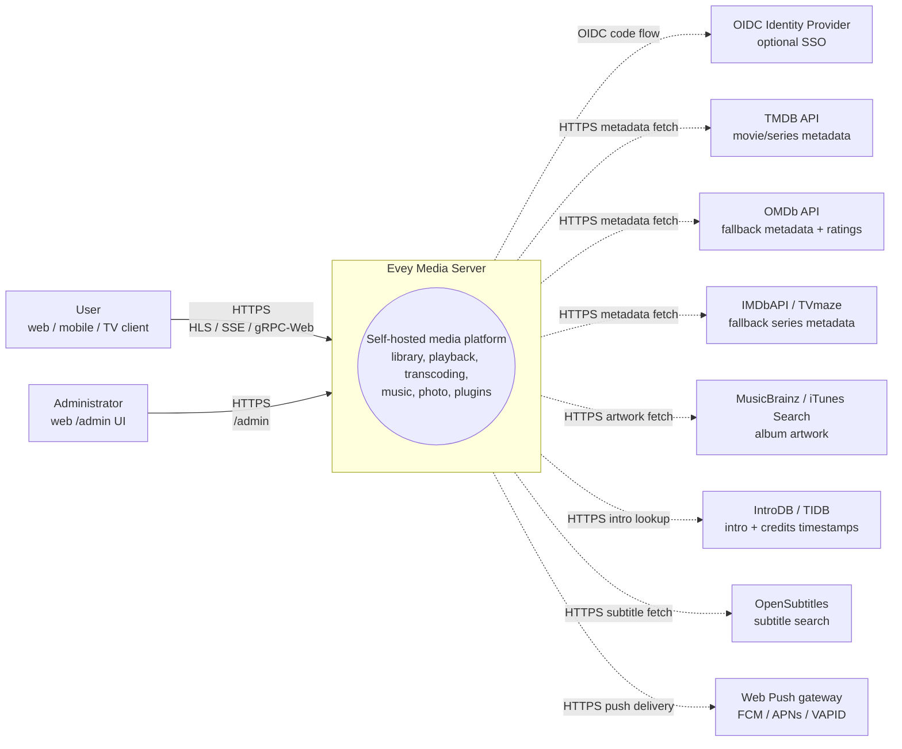
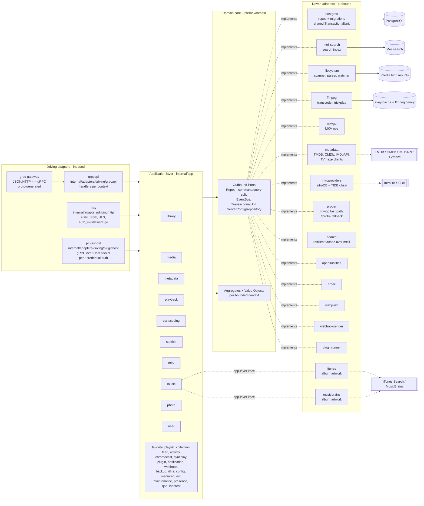
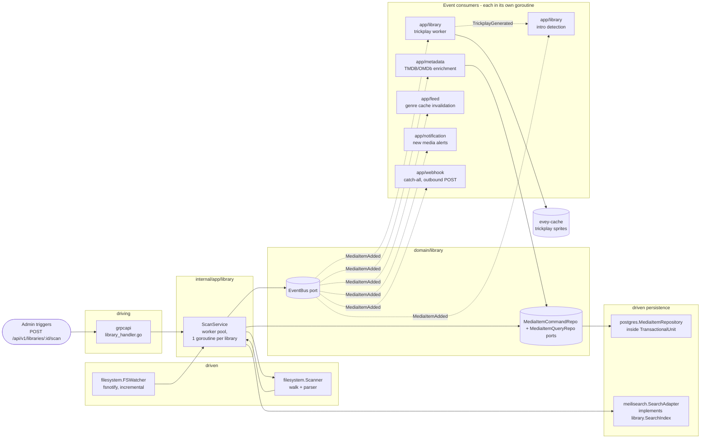

# आर्किटेक्चर

Evey एक सेल्फ़-होस्टेड मीडिया सर्वर है। Backend Go में है (hexagonal / DDD), frontend एक TypeScript/React monorepo है, मोबाइल React Native / Expo है। सेटअप और गहरे भीतरी ब्योरे के लिए [DEV.md](../DEV.md) देखें।

## परतें

`internal/` के तहत ports-and-adapters की सख़्त बनावट:

- `internal/domain/<context>/` - शुद्ध domain: models, value objects, **ports** (interfaces)। कोई framework import नहीं।
- `internal/app/<context>/` - application services। ports का संचालन करते हैं। IO आम तौर पर किसी port से होकर जाता है; दो संदर्भ जान-बूझकर अपवाद हैं और सीधे नेटवर्क तक पहुँचते हैं: `dlna` (SSDP / UPnP AVTransport) और `loadtest` (उसका अपना HTTP client)।
- `internal/adapters/driven/` - domain ports लागू करने वाले बाहर जाने वाले adapters: `postgres`, `meilisearch`, `ffmpeg`, `mkvgo`, `filesystem`, `prober`, `opensubtitles`, `email`, `webpush`, `webhooksender`, `pluginrunner`, `metadata`, `introproviders`, `search`। दो और यहीं रहते हैं पर domain port की जगह application-layer interface पूरा करते हैं: `itunes` और `musicbrainz`, दोनों `app/music.AlbumArtFetcher`।
- `internal/adapters/driving/` - भीतर आने वाले adapters: `grpcapi` (+ grpc-gateway HTTP), `http` (static, auth middleware, SSE, HLS, एक्सटेंशन iframe की assets), `pluginhost` (Unix socket पर gRPC सर्वर, peer credentials से प्रमाणित - वह होस्ट API जिसे सैंडबॉक्स में चलने वाली एक्सटेंशन उप-प्रक्रियाएँ वापस बुलाती हैं)।
- `internal/pkg/` - सभी संदर्भों में दोबारा इस्तेमाल होने वाला साझा तकनीकी केंद्र (auth, logger, eventbus, i18n, metrics, tracing, ratelimit, procfork, ssrf, cache, ...)। सर्वर कॉन्फ़िगरेशन `internal/config/` में रहता है; बना हुआ proto कोड `gen/` में।

निर्भरता का नियम: `adapters -> app -> domain`। Domain कभी app या adapters import नहीं करता। जोड़ने का काम `cmd/evey/wire*.go` में होता है - हाथ से लिखी wiring, google/wire नहीं: `wire.go`, `wire_infra.go`, `wire_services.go`, `wire_adapters.go`, `wire_events.go`, `wire_helpers.go`।

## सीमित संदर्भ

तीस संदर्भ-पैकेज `internal/domain/` और `internal/app/` के तहत हैं: 19 दोनों परतों में हैं, 2 सिर्फ़ domain में (`ratings`, `shared`), 9 सिर्फ़ app में। सहयोग कुछ हद तक एक साझा bus पर प्रकाशित domain events से होता है; app परत किसी पड़ोसी संदर्भ का domain पैकेज सीधे भी पढ़ती है (देखें [संबंध](#relations))।

| संदर्भ | ज़िम्मेदारी |
| --- | --- |
| `user` | खाते, प्रमाणीकरण, सत्र, पसंदें |
| `library` | लाइब्रेरी, फ़ोल्डर, स्कैन के काम, मीडिया सूचकांक, लोग, संग्रह, किसी प्रोफ़ाइल के पसंदीदा और thumbs (thumbs की कोई app service नहीं: rating RPC `UserRatingRepository` को जस का तस सहेजता और पढ़ता है), trickplay, इंट्रो/क्रेडिट पहचान |
| `media` (सिर्फ़ app) | साझा लिंक और स्ट्रीम टोकन |
| `mediarequest` | उपयोगकर्ताओं के भेजे मीडिया अनुरोध |
| `metadata` | TMDB / OMDb से संवर्धन, artwork |
| `playback` | स्ट्रीम, प्रगति, रिमोट नियंत्रण, अभी चल रहा है |
| `transcoding` | ffmpeg के काम, HLS segments |
| `subtitle` | भीतर जुड़े + बाहरी + opensubtitles |
| `mkv` | MKV कंटेनर पर क्रियाएँ (`mkvgo` से) |
| `music` | ऑडियो-विशेष प्लेबैक + टैगिंग |
| `photo` | फ़ोटो लाइब्रेरी |
| `favorite` (सिर्फ़ app) | हर प्रोफ़ाइल के पसंदीदा; model और `FavoriteRepository` `domain/library` में रहते हैं |
| `playlist` | उपयोगकर्ता प्लेलिस्ट, स्मार्ट प्लेलिस्ट |
| `collection` (सिर्फ़ app) | व्यवस्थापक के सँवारे संग्रह; इसके ports `domain/library` में रहते हैं |
| `ratings` (सिर्फ़ domain) | देशों के वर्गीकरण (CSA, FSK, MPAA, BBFC, ACB) को न्यूनतम उम्र की एक ही धुरी पर लाता है |
| `feed` | गतिविधि feed / खोजें |
| `activity` | उपयोगकर्ता गतिविधि की समयरेखा |
| `chromecast` | cast सत्र का जीवनचक्र |
| `syncplay` | कई डिवाइस पर तालमेल वाले सत्र |
| `plugin` | एक्सटेंशन रजिस्ट्री, सैंडबॉक्स टोकन, जीवनचक्र |
| `notification` | ऐप के भीतर + webpush सूचनाएँ |
| `webhook` | बाहर जाने वाले webhooks |
| `backup` | DB + कॉन्फ़िगरेशन का बैकअप/पुनर्स्थापना |
| `config` (सिर्फ़ app) | सहेजी गई सर्वर सेटिंग्स, REST और gRPC दोनों प्रवेश बिंदुओं से लिखी जाती हैं |
| `dlna` (सिर्फ़ app) | SSDP खोज और UPnP AVTransport नियंत्रण |
| `loadtest` (सिर्फ़ app) | सर्वर के अपने HTTP स्टैक पर HLS दर्शकों की नक़ल करता है |
| `maintenance` (सिर्फ़ app) | व्यवस्थापक का शुरू किया मीडिया रखरखाव: seek-index फिर से बनाना, मरम्मत जर्नल, पलटना, ऑडियो की अखंडता |
| `presence` (सिर्फ़ app) | मेमोरी में, बिना सहेजे, इस पल कौन जुड़ा है उसकी सूची |
| `qoe` (सिर्फ़ app) | CMCD (CTA-5004) प्लेबैक telemetry लेना और जोड़ना |
| `shared` (सिर्फ़ domain) | आर-पार ports (`EventBus`, `TransactionalUnit`, `ServerConfigRepository`, `ShareLinkRepository`), typed ids, cursors, स्ट्रीम टोकन |

### संबंध

- `library` → `LibraryCreated` / `LibraryDeleted`, `LibraryScanStarted` / `LibraryScanCompleted`, `MediaItemAdded`, `MediaItemRemoved`, `TrickplayGenerated` भेजता है। `media.item.added` को `notification`, `metadata` (अपने आप संवर्धन), ख़ुद `library` (trickplay worker + इंट्रो पहचान) और `feed` (शैली cache अमान्य करना) इस्तेमाल करते हैं।
- सर्च इंडेक्सिंग घटनाओं पर **नहीं** चलती: `library.ScanService` सीधे `library.SearchIndex` port बुलाता है।
- `playback` → `PlaybackStarted` / `PlaybackStopped` भेजता है। आज इनमें से किसी का अपना subscriber नहीं है; सिर्फ़ `webhook` का `"*"` सब-पकड़ने वाला उन्हें पाता है।
- `user` → `UserCreated` भेजता है, जिसका कोई subscriber नहीं, और `user.password.reset_requested`, जिसे driven adapter `email` इस्तेमाल करता है।
- `plugin` → `pluginrunner` `plugin.error` / `plugin.started` प्रकाशित करता है, और `app/plugin` अपने सुरक्षा डैशबोर्ड के लिए उन्हें इस्तेमाल करता है। domain events को एक्सटेंशन तक पहुँचाने वाला कोई पुल नहीं है: एक्सटेंशन सीमित दायरे वाले JWT से API तक पहुँचते हैं (देखें ADR-0003)। bus ख़ुद ADR-0010 है।
- `shared.TransactionalUnit` कई aggregates पर होने वाले लेखन को लपेटता है (देखें ADR-0002)।

`internal/domain` के तहत कोई पैकेज किसी दूसरे संदर्भ का domain पैकेज import नहीं करता - यह नियम `internal/contractguard/domain_imports_test.go` लागू करता है (देखें [आर्किटेक्चर के पहरेदार](#architecture-guards))। app परत इससे बँधी नहीं है: आज 14 app पैकेज किसी पड़ोसी संदर्भ का domain पैकेज import करते हैं।

## सामान्य डेटा प्रवाह - "उपयोगकर्ता कोई मीडिया चलाता है"

1. मोबाइल/वेब क्लाइंट `POST /api/v1/playback/start` बुलाता है (grpc-gateway रूट)।
2. `internal/adapters/driving/http` अपना auth middleware चलाता है (`auth_middleware.go`, `httpAuthMiddleware`), सत्र निकालता है।
3. `internal/adapters/driving/grpcapi` (`playback_handler.go`) proto जाँचता है और `app/playback.CommandService.StartStream` बुलाता है (command/query विभाजन, देखें ADR-0009)।
4. `app/playback.CommandService` domain ports बुलाता है: `user.UserRepository`, `playback.SessionQueryRepo` (idempotency + डिवाइस सीमा), `playback.SessionCommandRepo`, फिर `shared.EventBus.Publish(PlaybackStarted)`।
5. Driven adapters काम करते हैं: `postgres` सत्र को एक `shared.TransactionalUnit.Do` दायरे में सहेजता है; प्रक्रिया के भीतर का bus (`internal/pkg/eventbus`) असमकालिक रूप से बाँटता है।
6. आज `PlaybackStarted` का कोई अपना subscriber नहीं है: सिर्फ़ `webhook` का `"*"` सब-पकड़ने वाला उसे पाता है।
7. जवाब grpc-gateway से JSON के रूप में लौटता है; प्रगति के अपडेट SSE / gRPC streams पर बहते हैं।

## Composition root

Wiring के graph `cmd/evey/wire.go` और उसके भाई-बहनों (`wire_infra.go`, `wire_services.go`, `wire_adapters.go`, `wire_events.go`, `wire_helpers.go`) में हैं। Tests adapters को दरकिनार करके वही domain ports लागू करने वाले fakes डालते हैं - 22 में से 21 domain पैकेज एक `fakes/` उप-पैकेज के साथ आते हैं। देखें [ADR-0001](adr/0001-hexagonal-architecture.md)।

## आर्किटेक्चर के पहरेदार

ऊपर के नियम सिर्फ़ दस्तावेज़ नहीं हैं। `internal/contractguard/` में 20 फ़ाइलों में फैले 31 स्थिर tests हैं, जो कोड के इनसे भटकते ही build विफल कर देते हैं।

Hexagonal नियम ख़ुद `TestDomainContextsDoNotImportEachOther` (ADR-0001) है, `domain_imports_test.go` में। यह `internal/domain` से गुज़रकर ठीक यही लागू करता है: कोई संदर्भ `internal/domain/shared` और अपने पैकेज-पेड़ को import कर सकता है, `internal/domain` से और कुछ नहीं, और कभी `internal/app` या `internal/adapters` नहीं। इसका दायरा `internal/domain` पर रुक जाता है - app परत के बारे में यह कुछ नहीं कहता।

बाक़ी उन अनुबंधों की रखवाली करते हैं जो किसी भाषा या प्रक्रिया की सीमा पार करते हैं, जैसे:

- `TestNoClientReadOfAFieldTheServerNeverWrites` - क्लाइंट जो भी proto response फ़ील्ड पढ़ता है, उसे सर्वर पर कहीं लिखा जाना चाहिए।
- `TestRegisteredHandlersGetEveryPortTheyDeclare` और `TestBootInstallsItsSilentWirings` - वह wiring जो वरना चुपचाप विफल हो जाती।
- `TestPostgresRepositoriesBoundTheirQueries` - हर Postgres repository अपनी queries पर timeout की सीमा लगाती है।
- `TestProcfork_EveryForkGoesThroughCommand` - हर उप-प्रक्रिया fork `internal/pkg/procfork` से होकर जाता है।
- `TestEverySortFieldTheAPIAcceptsHasASQLColumn` और `...CanBuildACursorValue` - sort फ़ील्ड SQL column map और cursor encoder दोनों में मौजूद हैं।
- `TestEveryWebSurfaceReachingAnAdminRPCIsClassified`, और मोबाइल व TV के लिए उसका native साथी - सिर्फ़ व्यवस्थापक वाला RPC बुलाने वाली हर UI सतह तय करती है कि उसे कौन देखता है।
- `TestEveryAllowedSlotIsMountedOnWebAndMobile` और `TestPluginBridgeParityWebMobile` - क्लाइंटों के बीच एक्सटेंशन UI स्लॉट की बराबरी।
- `TestImageSubtitleCodecsAgreeAcrossServerAndClients` - bitmap उपशीर्षक कोडेक की एक ही सूची, सर्वर और प्लेयर दोनों के लिए।
- `TestHandWrittenClientTypesMatchTheEndpointTheyCall` - मोबाइल/TV के हाथ से लिखे response types उसी endpoint से मेल खाते हैं जिसे वे बुलाते हैं।
- `TestRestartExitCodeAgreesWithTheEntrypoint` - Go का exit code और `docker/entrypoint.sh` इस पर एकमत हैं कि restart का मतलब क्या है।
- i18n पहरेदार - सर्वर की भेजी keys catalogue में मौजूद हैं, placeholders सभी भाषाओं में मेल खाते हैं।

## और पढ़ें

- [DEV.md](../DEV.md) - build, चलाना, migrations, proto बनाना
- [docs/CODEBASE_MAP.md](CODEBASE_MAP.md) - आम बदलावों के लिए कौन सी फ़ाइलें छूनी हैं
- [docs/playback-serving.md](playback-serving.md) - HLS वीडियो परोसने का read path, गहराई से (फ़ैसला, सीढ़ी, fingerprint, CMAF/HLS/DASH, mkvgo बनाम ffmpeg)
- [docs/api/](api/) - बना हुआ API संदर्भ
- [docs/adr/](adr/) - आर्किटेक्चर निर्णय अभिलेख

## C4 चित्र

ये चार चित्र [C4 मॉडल](https://c4model.com/) के अनुसार घटते zoom स्तरों पर Evey का ब्योरा देते हैं। सभी चित्र Mermaid से बनते हैं; कोई binary asset नहीं। Node के नाम `internal/` के तहत के असली Go पैकेज नाम हैं। कंटेनरों के नाम `evey-server`, `evey-postgres` और `evey-caddy` के लिए `docker-compose.yml` से आते हैं; `evey-web`, `evey-meilisearch`, `evey-mobile` और `evey-mailcatcher` `docker-compose.override.yml` में घोषित हैं और सिर्फ़ डेवलपमेंट की बनावट में होते हैं।

### स्तर 1 - सिस्टम संदर्भ

Evey से कौन बात करता है, और Evey किन तीसरे पक्षों तक पहुँचता है।

### स्तर 2 - कंटेनर

`docker compose --env-file .env.dev up` से उठने वाली तैनाती की इकाइयाँ। ठोस तीर रनटाइम ट्रैफ़िक हैं; धराशायी तीर तीसरे पक्षों की ओर बाहर जाते हैं।

> **Production इस डेवलपमेंट बनावट से अलग है।** इंस्टॉल वाली compose फ़ाइल सिर्फ़
> तीन सेवाएँ घोषित करती है - `evey`, `postgres`, `caddy`। कोई अलग `evey-web` कंटेनर
> नहीं है (न सिर्फ़-डेवलपमेंट वाला mailcatcher और Metro bundler): `evey-server`
> बाइनरी बना हुआ वेब UI `/srv` से परोसती है, इसलिए रिवर्स प्रॉक्सी *सब कुछ* - UI और
> API - उसी को `:9091` पर भेजता है। अलग `evey-meilisearch` कंटेनर भी नहीं है:
> Meilisearch बाइनरी `evey` इमेज में ही पकी हुई है (`Dockerfile`, `meili-download`
> चरण, 1.12.8 पर तय) और अपना सूचकांक `/data/meili` के तहत रखती है। देखें
> [installation.md](installation.md) और [reverse-proxy.md](reverse-proxy.md)।

### स्तर 3 - घटक (`evey-server` पर zoom)

Go बाइनरी के भीतर hexagonal परतें। Driving adapters application services को उनके interfaces से बुलाते हैं; application services सिर्फ़ domain ports पर निर्भर हैं; driven adapters उन ports को लागू करते हैं।

Goroutine से जुड़ी टिप्पणियाँ:
- gRPC सर्वर (`grpc.Server.Serve`) और HTTP सर्वर (gateway + static) `cmd/evey` की मुख्य wiring से निकली अपनी-अपनी goroutines में चलते हैं।
- `app/library` के स्कैन काम एक worker pool पर चलते हैं (हर सक्रिय लाइब्रेरी स्कैन के लिए एक goroutine, देखें `library.ScanService`)।
- ffmpeg के काम driven `ffmpeg` adapter (`ffmpeg.Transcoder.Start`) `internal/pkg/procfork` से fork करता है, हर काम के लिए एक निगरानी goroutine जो प्रक्रिया का stderr ख़ाली करती रहती है।
- `shared.EventBus` subscribers को असमकालिक रूप से बाँटता है: हर subscriber अपनी goroutine में चलता है ताकि धीमा उपभोक्ता कभी प्रकाशकों को न रोके। bus ख़ुद कोई transaction नहीं खोलता - वह handler का काम है।
- `pluginrunner` हर एक्सटेंशन के लिए एक उप-प्रक्रिया चलाता है; iframe एक्सटेंशन उपयोगकर्ता के ब्राउज़र में रहते हैं और `app/plugin` के जारी किए हस्ताक्षरित टोकनों से वापस बात करते हैं।

### स्तर 3 (अतिरिक्त) - स्कैन pipeline पर घटक zoom

वह गरम रास्ता जो डिस्क की फ़ाइलों को खोजने लायक़, समृद्ध मीडिया में बदलता है। ठोस तीर सीधे कॉल हैं; धराशायी तीर bus पर domain events हैं। ध्यान दें कि सर्च इंडेक्सिंग `ScanService` से सीधा port कॉल है, कोई event नहीं।

इसे ऊपर के "सामान्य डेटा प्रवाह" खंड के साथ पढ़ें: प्लेबैक का रास्ता सममित read path है; स्कैन pipeline वह write path है जो उस मीडिया सूचकांक को भरता है जिससे read path परोसता है।
