# प्लगइन सैंडबॉक्स और ख़तरा मॉडल { #plugin-sandbox-and-threat-model }

सर्वर प्लगइन को सीमित रखने के लिए क्या करता है: इंस्टॉल के समय की जाँचें, चलते समय की
परतें, सैंडबॉक्स मोड, और हर एक अब भी क्या नहीं रोक सकता। कोड
`internal/adapters/driven/pluginrunner` (इंस्टॉल का विश्लेषण, सैंडबॉक्स),
`cmd/evey-plugin-launcher` (Landlock और kernel का seccomp फ़िल्टर), `sandbox/sandbox.c`
(`LD_PRELOAD` फ़िल्टर) और `internal/adapters/driving/pluginhost` (वह होस्ट API जिसे
प्लगइन कॉल करते हैं) में है; डिज़ाइन
[ADR-0012](https://github.com/eveyproject/evey/blob/master/docs/adr/0012-plugin-token-deny-by-default.md),
[ADR-0013](https://github.com/eveyproject/evey/blob/master/docs/adr/0013-userspace-plugin-resource-monitor.md) और
[ADR-0014](https://github.com/eveyproject/evey/blob/master/docs/adr/0014-landlock-plugin-sandbox.md) तय करते हैं। अगर आप प्लगइन लिख रहे
हैं और जानना चाहते हैं कि आप क्या बता सकते हैं और क्या मना होगा, तो
[अनुमतियाँ और स्लॉट](plugins/security-model.md) पढ़ें; आपकी मशीन को कौन सा सैंडबॉक्स
मिलता है, यह जानने के लिए [प्लगइन सैंडबॉक्स सेटअप](plugins/sandbox-deployment.md) पढ़ें।

## ख़तरा मॉडल { #threat-model }

प्लगइन अलग प्रोसेस के रूप में चलते हैं, जो Unix socket पर gRPC के ज़रिए सर्वर से संवाद
करते हैं। सर्वर डिफ़ॉल्ट रूप से किसी प्लगइन कोड पर भरोसा नहीं करता। जिन ख़तरों से वह बचाता
है, सबसे गंभीर से सबसे कम गंभीर तक:

1. **दूसरे की पहचान लेना** - कोई प्लगइन दूसरे प्लगइन होने का दिखावा करता है ताकि उसकी अनुमतियाँ इस्तेमाल कर सके।
2. **अधिकार बढ़ाना** - कोई प्लगइन अपने सैंडबॉक्स से बाहर निकल जाता है और सर्वर के अधिकारों से command चलाता है।
3. **फ़ाइल सिस्टम तक पहुँच** - कोई प्लगइन अपने फ़ोल्डर के बाहर पढ़ता या लिखता है, ख़ासकर सर्वर के secret।
4. **नेटवर्क से डेटा बाहर भेजना** - कोई प्लगइन अपनी पसंद के होस्ट को डेटा भेजता है।
5. **संसाधनों का दुरुपयोग** - mining, fork bomb, मेमोरी या डिस्क ख़त्म कर देना।
6. **सप्लाई चेन** - छिपाया गया या compiled कोड, जिसे विश्लेषण पढ़ नहीं सकता।

```mermaid
flowchart LR
    zip[पैकेज] --> ex[ZIP extraction<br/>सीमाएँ, symlink नहीं, setuid नहीं]
    ex --> man[Manifest<br/>अनुमतियाँ]
    man --> an[स्थैतिक विश्लेषण<br/>CRITICAL मना करता है]
    an --> sig[सिग्नेचर<br/>cosign नीति]
    sig --> prev[एडमिन का पूर्वावलोकन<br/>स्वीकार या मना]
    prev --> run[चलते समय]
    subgraph run[चलते समय - हर मोड में]
        fs[फ़ाइल सिस्टम<br/>सिर्फ़ अपना फ़ोल्डर]
        net[नेटवर्क<br/>कोई IP socket नहीं, Fetch broker]
        sys[सिस्टम कॉल<br/>seccomp मना-सूची]
        uid[अलग उपयोगकर्ता<br/>या user namespace]
        sock[होस्ट socket<br/>SO_PEERCRED से पहचान]
        res[संसाधनों की निगरानी<br/>मेमोरी, PID, डिस्क, nice]
    end
```

## इंस्टॉल के समय { #at-install }

### ZIP extraction { #zip-extraction }

कोई भी फ़ाइल लिखे जाने से पहले (`pluginrunner/zip.go`):

- ज़्यादा से ज़्यादा 5,000 एंट्री, हर फ़ाइल 100 MB, कुल 500 MB बिना compression के, और
  1 MB (बिना compression) से ऊपर 100:1 का compression ratio (decompression bomb से
  बचाव);
- जिन एंट्री का रास्ता आर्काइव से बाहर जाता है (`..`), वे मना हैं;
- symbolic link मना हैं;
- setuid, setgid और sticky bit हटा दिए जाते हैं।

### Manifest और अनुमतियाँ { #manifest-and-permissions }

manifest वे अनुमतियाँ बताता है जो प्लगइन माँगता है। कोई अनजानी अनुमति इंस्टॉल मना
करवा देती है। फिर इन्हें लागू किया जाता है:

- **`subprocess`** child process की अनुमति देती है। इसके बिना kernel प्रोसेस बनाना मना
  करता है (`-deny-fork`), और interpreter वाले प्लगइन के लिए `LD_PRELOAD` फ़िल्टर भी
  `execve` मना करता है।
- **`native-binary`** compiled कोड या आर्काइव साथ लाने देती है, जिन्हें विश्लेषण पढ़ नहीं
  सकता।
- **API अनुमतियाँ** (`api.library`, `api.user`, `api.metadata`, `media.read`,
  `media.write`, `notification.sender`...) होस्ट की हर कॉल पर
  [`PluginPermissionInterceptor`](https://github.com/eveyproject/evey/blob/master/internal/adapters/driving/grpcapi/plugin_interceptor.go)
  जाँचता है।

पूरी सूची [अनुमतियाँ और स्लॉट](plugins/security-model.md#permissions-catalog) में है।

### स्थैतिक विश्लेषण { #static-analysis }

पैकेज की हर फ़ाइल को
[`pluginrunner.AnalyzePlugin`](https://github.com/eveyproject/evey/blob/master/internal/adapters/driven/pluginrunner/analyzer.go)
जाँचता है, एक सामान्य बनाने वाले दौर के बाद जो आम तरह से छिपाए गए कोड को खोल देता है
(alias, string जोड़ना, f-string):

| श्रेणी | गंभीरता | उदाहरण |
|---|---|---|
| `shell_exec` | WARNING / CRITICAL | `os.system`, `subprocess.run`, `child_process.exec`, PHP `system()`/`shell_exec()`/`proc_open()`, `preg_replace /e`, Ruby `Kernel.exec`/`system`, `open('\|cmd')` (CRITICAL); Ruby backticks (WARNING) |
| `network` | WARNING / CRITICAL | `requests.get`, `fetch`, reverse और bind shell |
| `filesystem` | WARNING / CRITICAL | `/etc/passwd`, `.ssh/`, `rm -rf`, symlink के काम |
| `obfuscation` | WARNING / CRITICAL | `eval`, `__builtins__`, `base64 -d \| bash` और shell में भेजे जाने वाले दूसरे decode (CRITICAL); base64 decoding, hex sequence (WARNING) |
| `privilege` | CRITICAL | `setuid`, `chmod 4777`, `sudo`, PID 1 को signal भेजना |
| `cryptomining` | CRITICAL | `stratum+tcp`, `xmrig`, `cryptonight` |
| `runtime_install` | CRITICAL | `pip install`, `npm install`, `curl ... \| sh` |
| `dynamic_import` | CRITICAL | `__import__()`, `importlib.import_module` |
| `sandbox_escape` | CRITICAL | `vm.runIn*`, `process.binding`, `new Function`, `__subclasses__()`, `__mro__` |
| `deserialization` | CRITICAL / WARNING | `pickle.loads`, `marshal.loads`, `__reduce__`; WARNING: Loader के बिना `yaml.load()` |
| `native_code` | CRITICAL / WARNING | `ctypes.CDLL`, `ffi.Library`; WARNING: Go `unsafe` |
| `compiled_binary` | WARNING, फिर BLOCK | `.so`, `.dll`, `.exe`, `.wasm`, `.jar` |
| `embedded_archive` | WARNING, फिर BLOCK | `.zip`, `.tar.gz` |
| `mime_mismatch` | CRITICAL माना जाता है | ऐसा extension जो तस्वीर होने का दावा करे, पर अंदर कुछ और हो |
| `suspicious_url` | WARNING | URL में HTTP के अलावा कोई scheme |
| `unvendored_deps` | WARNING | साथ पैक किए modules के बिना `requirements.txt` या `package.json` |

कोई CRITICAL बात या `mime_mismatch` इंस्टॉल मना करवा देती है। `compiled_binary` और
`embedded_archive` इसे मना करवाते हैं, जब तक manifest `native-binary` न बताए।

!!! note "विश्लेषण क्या पक्का नहीं कर सकता"
    यह पैटर्न पर काम करता है। यह छिपाने के जाने-पहचाने तरीके खोल देता है (कई कदमों
    में string जोड़कर कुछ कॉल करने लायक बनाना, नाम से builtin ढूँढना,
    `Function.constructor` से बच निकलना), हर एक के लिए
    `tests/fixtures/plugins/malicious/` में एक regression fixture के साथ, पर यह चलते
    समय होने वाले हर बदलाव के पीछे नहीं जा सकता (`strrev("metsys")`, किसी फ़ाइल से पढ़ा
    payload decode करना)। विश्लेषण से पहले comment हटा दिए जाते हैं। **सुरक्षा चलते समय का सैंडबॉक्स लागू
    करता है, विश्लेषण नहीं**: जो प्लगइन किसी पैटर्न को विश्लेषण से बचाकर निकाल ले, वह फिर भी
    सर्वर का डेटा नहीं पढ़ सकता, मना किया सिस्टम कॉल नहीं कर सकता, अपनी संसाधन सीमाएँ
    पार नहीं कर सकता, या ऐसा होस्ट method कॉल नहीं कर सकता जिसकी उसके पास अनुमति
    नहीं।

### सिग्नेचर { #signature }

पैकेज पर cosign से सिग्नेचर किया जा सकता है (`cosign sign-blob --key`, ZIP के SHA-256
पर ECDSA P-256)। बनाने वाले की public key पैकेज के अंदर `cosign.pub` नाम से चलती है;
Evey उसी से अलग `.sig` को जाँचता है, अपने ही प्रोसेस में और offline
(`pluginrunner/cosign.go`), और कुंजी का fingerprint निकालता है (DER public key पर
`sha256:`)। इससे तीन बातें निकलती हैं:

- **भरोसा**: fingerprint इंस्टेंस की **भरोसेमंद प्रकाशक** सूची में है या नहीं
  (`एडमिन → प्लगइन`, या शुरू होते समय `EVEY_PLUGINS_COSIGN_PUBLIC_KEY` से भरी
  हुई)। भरोसेमंद कुंजी प्रकाशक का नाम दिखाती है; अनजानी कुंजी अपना fingerprint
  और **इस कुंजी पर भरोसा करें** कार्रवाई दिखाती है।
- **निरंतरता**: fingerprint इंस्टॉल के समय प्लगइन पर पिन हो जाता है। किसी और
  कुंजी से साइन किया (`publisher-changed`) या अब साइन न किया हुआ
  (`signature-lost`) अपडेट, नीति चाहे जो हो, तब तक मना रहता है जब तक एडमिन
  अपडेट डायलॉग में नया प्रकाशक स्वीकार नहीं करता (`accept_new_publisher`)।
- **नीति**: `EVEY_PLUGINS_COSIGN_POLICY` तय करती है कि फ़ैसले का क्या असर हो।

| नीति | असर |
|---|---|
| `off` | सिग्नेचर नहीं जाँचा जाता और कुछ दर्ज नहीं होता। |
| `warn` (डिफ़ॉल्ट) | फ़ैसला दर्ज होता है और दिखाया जाता है; बिना सिग्नेचर, भरोसे से बाहर और अमान्य पैकेज इंस्टॉल हो जाते हैं। |
| `enforce` | सिर्फ़ भरोसेमंद प्रकाशक का साइन किया पैकेज इंस्टॉल या अपडेट होता है। |

सिग्नेचर यह साबित करता है कि पैकेज वही है जो उसके प्रकाशक ने जारी किया, और कि
अपडेट उसी प्रकाशक से आया है। कोड के बारे में यह कुछ नहीं कहता; उसे विश्लेषण,
अनुमतियाँ और sandbox परखते हैं।

### एडमिन का पूर्वावलोकन { #administrator-preview }

`POST /api/v1/admin/plugins/preview` बिना इंस्टॉल किए विश्लेषण चलाता है। एडमिन माँगी
गई अनुमतियाँ, हर मिली बात उसकी फ़ाइल, लाइन और श्रेणी के साथ, कोड में मिले URL, और
पैकेज का SHA256 देखता है; एडमिन ने जिस hash को स्वीकार किया, वह अपडेट के समय जाँचा जाता है, और पहली बार का इंस्टॉल URL में `#sha256:` fragment से पक्का किया जा सकता है, इसलिए जिस
पैकेज का विश्लेषण हुआ, वही इंस्टॉल होता है। अपडेट अनुमतियों, स्लॉट और होस्ट का फ़र्क
दिखाता है, और नई अनुमति के लिए साफ़ स्वीकृति चाहिए।

ऊँची अनुमतियों के लिए भरोसे का निर्णय एडमिन का है: Evey दिखाता है कि प्लगइन किन
चीज़ों तक पहुँचेगा, एडमिन स्वीकार या मना करता है।

## चलते समय { #at-run-time }

छह परतें हर [सैंडबॉक्स मोड](#sandbox-modes) में लागू रहती हैं; पहली दो कैसे लागू होती
हैं, यह मोड पर निर्भर है।

### फ़ाइल सिस्टम { #filesystem }

प्लगइन अपना फ़ोल्डर और अपने socket का फ़ोल्डर देखता है, सर्वर का डेटा नहीं; यह एक
Landlock अनुमति सूची (`landlock`) या bubblewrap की mount अनुमति सूची (`bubblewrap`,
`strict`) से होता है। Landlock के बिना वाले kernel पर `basic` मोड में हर रास्ते के
हिसाब से कोई बंदिश नहीं होती: तब अलग उपयोगकर्ता और फ़ाइल की अनुमतियाँ ही सर्वर के
secret की रक्षा करती हैं।

### नेटवर्क { #network }

प्लगइन के पास **सीधा नेटवर्क नहीं होता**, वह कुछ भी बताए: हर IP socket मना होता है
(`landlock` और `basic` में `-deny-inet`, `bubblewrap` और `strict` में एक network
namespace)। `network` अनुमति वाला प्लगइन अपने Unix socket पर होस्ट का `Fetch` method
कॉल करता है। होस्ट, `internal/adapters/driving/pluginhost/fetch.go` में:

- लक्ष्य को प्लगइन की `external_fetch` सूची से मिलाता है (पूरे होस्ट नाम, बड़े-छोटे
  अक्षर का फ़र्क किए बिना; `*.example.com` wildcard इंस्टॉल पर मना हो जाता है; बिना port वाली एंट्री सिर्फ़ port 80 और 443 की अनुमति देती है, `host:port` सिर्फ़ उसी port की);
- सिर्फ़ `http` और `https`, और सिर्फ़ `GET` और `HEAD` की अनुमति देता है;
- एक SSRF से सुरक्षित client (`internal/pkg/ssrf`) से जुड़ता है, जो DNS से पता निकालने
  के बाद निजी, आरक्षित और link-local पते मना करता है, इसलिए DNS rebinding और redirect
  फिर से जाँचे जाते हैं (सूची के बाहर के होस्ट पर redirect मना है);
- सर्वर का कोई credential नहीं जोड़ता, जवाब की body 8 MiB और request के header 8 KiB
  तक सीमित रखता है, और 20 s के बाद अनुरोध रद्द कर देता है।

इससे वे रास्ते बंद होते हैं जो सीधे बाहर जाने पर खुले रहते (`169.254.169.254` जैसे IP,
प्लगइन का अपना resolver)। जो बचता है: broker यह तय करता है कि कॉल *कहाँ* जाती है, यह
नहीं कि उसमें *क्या* जाता है। देखें [जानी-पहचानी सीमाएँ](#known-limits)।

!!! tip "सर्वर चलाने वालों के लिए सुझाव"
    broker SSRF का ख़तरा होस्ट पर ले आता है। `evey-server` container पर बाहर जाने का
    एक नियम, जो कोड से अलग हो, सुरक्षा की दूसरी परत जोड़ता है: `169.254.0.0/16` बंद करें और
    अंदरूनी नेटवर्क को डेटाबेस और खोज के endpoint तक सीमित करें।

### सिस्टम कॉल { #system-calls }

दो seccomp फ़िल्टर उन्हीं ख़तरनाक सिस्टम कॉल को मना करते हैं:

1. **kernel फ़िल्टर**, जिसे [`evey-plugin-launcher`](https://github.com/eveyproject/evey/blob/master/cmd/evey-plugin-launcher)
   प्लगइन शुरू करने से ठीक पहले लगाता है
   ([`seccomp_linux.go`](https://github.com/eveyproject/evey/blob/master/cmd/evey-plugin-launcher/seccomp_linux.go))। यह प्लगइन और
   उसके children को विरासत में मिलता है और **compiled, static binary पर भी लागू होता
   है**। किसी सिस्टम कॉल में गलत architecture हो, तो प्रोसेस समाप्त कर दिया जाता है।
   `landlock` और `basic` में लागू।
2. **`LD_PRELOAD` फ़िल्टर**, [`sandbox/sandbox.c`](https://github.com/eveyproject/evey/blob/master/sandbox/sandbox.c), जो उन
   interpreter वाले प्लगइन में लोड होता है जो `subprocess` नहीं बताते। यह
   `execve`/`execveat` भी मना करता है, और प्लगइन को non-dumpable बनाता है। `landlock`,
   `basic` और `strict` में लागू। अगर library नहीं मिलती, तो ऐसे प्लगइन को शुरू होने से
   मना कर दिया जाता है (`plugin.error`)।

मना किए गए सिस्टम कॉल:

| श्रेणी | सिस्टम कॉल |
|---|---|
| Debugging | `ptrace`, `process_vm_readv`, `process_vm_writev` |
| Signal | `tgkill`, `rt_sigqueueinfo`, `rt_tgsigqueueinfo`, प्लगइन को छोड़कर किसी भी प्रोसेस की ओर (दोनों फ़िल्टर); `kill` भी इसी तरह kernel फ़िल्टर में, और `LD_PRELOAD` फ़िल्टर में किसी भी लक्ष्य की ओर; `tkill` kernel फ़िल्टर में (`LD_PRELOAD` फ़िल्टर इसे प्लगइन की खुद की ओर जाने देता है); `pidfd_send_signal`, `pidfd_getfd` (file descriptor चुराता है)। जो runtime कोई signal फिर से भेजता है या अपने ही thread को रोकता है, वह काम करता रहता है। Landlock ABI 6+ पर प्लगइन अपने सैंडबॉक्स के बाहर किसी प्रोसेस को signal भी नहीं भेज सकता |
| फ़ाइल डिस्क्रिप्टर के signal का मालिक (kernel filter) | प्लगइन के अलावा किसी भी दूसरे process की ओर `fcntl` `F_SETOWN`, डिफ़ॉल्ट `SIGIO` के अलावा किसी भी दूसरे signal की ओर `F_SETSIG`, `F_SETOWN_EX`, और `ioctl` `FIOSETOWN`/`SIOCSPGRP`: इसके बिना, ऐसा डिस्क्रिप्टर जिसका मालिक सर्वर हो और जिसका signal `SIGKILL` हो, अगली write पर सर्वर को बंद कर देता |
| Mount | `mount`, `umount2`, `pivot_root`, `chroot` |
| Namespace | `unshare`, `setns`, और `CLONE_NEW*` flag वाला `clone` (दूसरे नाम से unshare), हर प्लगइन के लिए |
| Kernel module | `init_module`, `finit_module`, `delete_module` |
| BPF, perf | `bpf`, `perf_event_open` |
| हार्डवेयर I/O | `ioperm`, `iopl` (सिर्फ़ x86-64, जहाँ ये होते हैं) |
| Swap | `swapon`, `swapoff` |
| सिस्टम नियंत्रण | `syslog`, `reboot`, `settimeofday`, `clock_settime`, `clock_adjtime`, `adjtimex` |
| Kexec | `kexec_load`, `kexec_file_load` |
| kernel exploit के औज़ार | `io_uring_setup`, `io_uring_enter`, `io_uring_register`, `userfaultfd` |
| पहचान | `setuid`, `setgid`, `setreuid`, `setregid`, `setresuid`, `setresgid`, `capset` |
| Keyring | `add_key`, `request_key`, `keyctl` |

`subprocess` के बिना वाले प्लगइन के लिए kernel प्रोसेस बनाना भी मना करता है (`fork`,
`vfork`, `CLONE_THREAD` के बिना `clone`; `clone3` `ENOSYS` लौटाता है ताकि C library
`clone` पर लौट आए); thread काम करते रहते हैं।

यह एक **मना-सूची** है: `open`, `read`, `write`, `mmap`, Unix `socket` और `connect` की
अनुमति बनी रहती है। रास्तों को फ़ाइल सिस्टम वाली परत सीमित करती है, seccomp नहीं।
`bubblewrap` में launcher इस्तेमाल नहीं होता: वहाँ static binary को कोई seccomp फ़िल्टर
नहीं मिलता, और उसे namespace और mount अनुमति सूची सीमित रखते हैं।

### एक अलग उपयोगकर्ता { #a-separate-user }

प्लगइन अपने खुद के उपयोगकर्ता के रूप में चल सकता है, जो सर्वर (1000) से अलग है, ताकि
सर्वर के secret सिर्फ़ फ़ाइल की अनुमतियों से ही उसके लिए न पढ़े जा सकें। हर प्लगइन अपना uid
अपनी id से लेता है, 40000 से 59999 की सीमा में, जो restart के बाद भी वही रहता है; वह सर्वर
का group रखता है, जो इंस्टॉल की गई फ़ाइलों को सिर्फ़ पढ़ता है। दो id एक ही uid पर आ सकती
हैं: तब वे दो प्लगइन उसे साझा करते हैं। `EVEY_PLUGINS_UID_SEPARATION` इसे नियंत्रित करता है:

| मान | बदलाव कब होता है |
|---|---|
| `auto` (डिफ़ॉल्ट) | सिर्फ़ तब जब सैंडबॉक्स `basic` पर पहुँचता है, वह अकेली स्थिति जहाँ फ़ाइल की अनुमतियाँ ही secret की एकमात्र सुरक्षा हैं |
| `on` | हमेशा, एक अतिरिक्त परत के रूप में |
| `off` | कभी नहीं |

बदलाव launcher करता है, जिसके पास `cap_setuid` है; सर्वर खुद बिना अधिकारों या
capabilities के चलता है। launcher 1000 से नीचे का कोई लक्ष्य मना करता है। अगर वह बदल
नहीं पाता, तो `basic` में प्लगइन मना होता है (वहाँ अलग उपयोगकर्ता ही एकमात्र सुरक्षा है), जबकि
`landlock` में वह एक चेतावनी के साथ सर्वर के उपयोगकर्ता के रूप में चलता है।
`bubblewrap` और `strict` में यह काम user namespace करता है।

चालू होने पर, साइन करने वाली कुंजी (`0600`) और बैकअप (`0700` फ़ोल्डर, `0600` फ़ाइलें)
चलते समय सिर्फ़ मालिक के लिए होते हैं, जो bind-mount किए गए `/data` पर भी बना रहता है।
प्लगइन एक-दूसरे से अपने uid से अलग रहते हैं, फ़ाइल सिस्टम वाली परत के अलावा। root के रूप
में चलने वाला सर्वर (सुझाया नहीं जाता) इसके बजाय हर प्लगइन को एक ही उपयोगकर्ता 1001 पर ले
जाता है: वहाँ प्लगइन को सिर्फ़ फ़ाइल सिस्टम वाली परत अलग रखती है।

### होस्ट socket पर पहचान { #host-socket-authentication }

हर प्लगइन का अपना socket होता है, `/tmp/evey/plugins/<plugin_id>/host.sock`, जिसे उसका
अपना gRPC सर्वर देता है। हर कॉल पर सर्वर kernel से कॉल करने वाले का PID पढ़ता है
(`SO_PEERCRED`, जिसे user space नकली नहीं बना सकता) और उसे प्लगइन शुरू होते समय दर्ज
किए PID से मिलाता है। प्लगइन की पहचान socket से आती है, कभी किसी header से नहीं।
इसलिए प्लगइन किसी दूसरे की पहचान नहीं ले सकता, किसी दूसरे प्लगइन के socket को कॉल नहीं
कर सकता, या किसी child process से कॉल नहीं भेज सकता। PID न मिलने पर एक चेतावनी लॉग
होती है।

दूसरी दिशा भी इसी तरह जाँची जाती है: सर्वर प्लगइन से उसी फ़ोल्डर के `plugin.sock` पर बात
करता है, और कनेक्शन ठुकरा देता है अगर उस पर सुनने वाला process खुद प्लगइन नहीं है (फिर से
`SO_PEERCRED`)। हर प्लगइन के अलग उपयोगकर्ता के साथ, फ़ोल्डर पर sticky bit होता है, ताकि
साझा group का कोई पड़ोसी प्लगइन उस socket को हटाकर अपना socket न बाँध सके।

### संसाधनों की सीमाएँ { #resource-limits }

user space में एक निगरानी प्रक्रिया (बिना अधिकार वाले container में cgroups उपलब्ध
नहीं होते) हर 2 सेकंड में `/proc/<pid>` पढ़ता है और सीमा पार करने वाले प्लगइन को रोक
देता है ([ADR-0013](https://github.com/eveyproject/evey/blob/master/docs/adr/0013-userspace-plugin-resource-monitor.md)):

| सीमा | डिफ़ॉल्ट | कब जाँची जाती है |
|---|---|---|
| मेमोरी (RSS) | 256 MiB | हर दौर में |
| प्रोसेस और thread | 64 | हर दौर में (सिर्फ़ मुख्य प्रोसेस के thread की गिनती) |
| उसके फ़ोल्डर की डिस्क | 100 MiB | हर 15वें दौर में, लगभग 30 s |
| CPU प्राथमिकता | `nice` 10, शुरू होते समय लागू | - |

वही दौर उस प्लगइन को चिह्नित करता है जो लगभग 30 s तक एक CPU का 90% से ज़्यादा उपयोग
करता रहता है, और `hardware.gpu` वाले उस प्लगइन को रोक देता है जो किसी ग्राफ़िक्स इंजन
का इसी तरह उपयोग करता रहता है। संसाधन सीमाओं का एक ही सेट, जो **एडमिन → प्लगइन → संसाधन सीमाएँ** में तय होता
है, हर प्लगइन पर लागू होता है; environment वेरिएबल `EVEY_PLUGINS_MEMORY_MB`, `EVEY_PLUGINS_PIDS_MAX`,
`EVEY_PLUGINS_DISK_MAX_MB` और `EVEY_PLUGINS_CPU_NICE` शुरुआती डिफ़ॉल्ट तय करते हैं।

### इंटरफ़ेस का अलगाव { #interface-isolation }

प्लगइन का इंटरफ़ेस एक `<iframe sandbox="allow-scripts">` में चलता है, बिना same-origin
पहुँच, फ़ॉर्म या popup के, एक ऐसी Content-Security-Policy के तहत जो सिर्फ़ उसके
`external_fetch` होस्ट से कनेक्शन की अनुमति देती है। bridge
(`frontend/packages/client/src/plugins/hostProtocol.ts`) सीमित करता है कि वह पेज से
क्या माँग सकता है: `toast` एक सेकंड में ज़्यादा से ज़्यादा 3, 200 अक्षर, कोई HTML नहीं;
`navigate` सिर्फ़ `/home`, `/library`, `/media`, `/player`, `/settings` और `/search`
मानता है; `resize` 50 px (मोबाइल और टीवी पर 60) और 800 px के बीच। स्लॉट इंस्टॉल के
समय जाँचे जाते हैं।

### सर्वर को मज़बूत बनाना { #server-hardening }

शुरू होते समय सर्वर खुद को non-dumpable बनाता है (`PR_SET_DUMPABLE=0`,
[`hardening_linux.go`](https://github.com/eveyproject/evey/blob/master/cmd/evey/hardening_linux.go)): उसी उपयोगकर्ता के रूप में चलने
वाला कोई प्रोसेस `/proc` से उसकी मेमोरी या environment नहीं पढ़ सकता, जिससे मेमोरी में
रखी साइन करने वाली कुंजी और डेटाबेस और खोज के पासवर्ड सुरक्षित रहते हैं, Landlock के
बिना वाले kernel पर भी।

### क्रैश की सूचना { #crash-notification }

runner एक `plugin.error` event प्रकाशित करता है जब किसी प्लगइन को सैंडबॉक्स library
चाहिए पर वह न मिले, या जब कोई प्लगइन त्रुटि के साथ बंद हो। सूचना सर्विस इसे सेट किए
गए चैनलों से एडमिन तक भेजती है, और **सुरक्षा डैशबोर्ड** इसे दर्ज करता है।

## सैंडबॉक्स मोड { #sandbox-modes }

मोड चुनता है कि फ़ाइल सिस्टम और नेटवर्क कैसे सीमित हों। `EVEY_PLUGINS_SANDBOX_MODE`
शुरुआती मान तय करता है (डिफ़ॉल्ट `auto`); इसे **एडमिन → प्लगइन → संसाधन सीमाएँ →
सैंडबॉक्स मोड** में बदला जा सकता है। runner इसे
[`applySandbox`](https://github.com/eveyproject/evey/blob/master/internal/adapters/driven/pluginrunner/runner_sandbox.go) में लागू करता
है। हर मोड में: कोई सीधा IP निकास नहीं, संसाधनों की निगरानी, और होस्ट socket पर पहचान।

| परत | landlock | basic | bubblewrap | strict |
|---|---|---|---|---|
| फ़ाइल सिस्टम | Landlock अनुमति सूची | Landlock के बिना कुछ नहीं (सिर्फ़ फ़ाइल की अनुमतियाँ) | mount अनुमति सूची | mount अनुमति सूची |
| नेटवर्क | `-restrict-net` + `-deny-inet` | `-deny-inet` | network namespace | network namespace |
| kernel seccomp (static binary भी) | हाँ | हाँ | नहीं | नहीं |
| `LD_PRELOAD` seccomp (`subprocess` के बिना interpreter वाले प्लगइन) | हाँ | हाँ | नहीं | हाँ |
| अलग उपयोगकर्ता | `on` के साथ | हाँ (`auto`) | user namespace | user namespace |
| संसाधनों की सीमाएँ | हाँ | हाँ | हाँ | हाँ |

### `auto` (डिफ़ॉल्ट) { #auto-default }

पहली बार कोई प्लगइन शुरू होने पर, एक बार, उस सबसे मज़बूत मोड पर पहुँचता है जो होस्ट
सपोर्ट करता है: **landlock**, जब kernel Landlock लागू करता है *और*
`evey-plugin-launcher` binary मिल जाती है (सर्वर binary के बगल में, `$PATH` पर, या
`EVEY_PLUGIN_LAUNCHER` पर); वरना **bubblewrap**, जब एक टेस्ट सैंडबॉक्स सच में बन जाता
है ([`ProbeSandbox`](https://github.com/eveyproject/evey/blob/master/internal/adapters/driven/pluginrunner/sandbox_probe.go)), जिसका
व्यवहार में मतलब है bare metal या अधिकार वाला container; वरना **basic**। Landlock पहले
आता है क्योंकि उसे किसी अधिकार की ज़रूरत नहीं और वह Docker की डिफ़ॉल्ट सुरक्षा प्रोफ़ाइल
में चलता है। चुना गया मोड लॉग होता है, और **एडमिन → प्लगइन → सुरक्षा डैशबोर्ड** की
**होस्ट सैंडबॉक्स** लाइन पर दिखता है।

| डिप्लॉयमेंट | `auto` क्या देता है |
|---|---|
| नए kernel पर Docker | `landlock`: हर रास्ते के हिसाब से बंदिश, कोई सीधा निकास नहीं, ख़तरनाक सिस्टम कॉल मना, static binary समेत। सामान्य स्थिति। |
| Landlock के बिना पुराने kernel पर Docker, जैसे कोई पुराना NAS | `basic`: secret सुरक्षित और नेटवर्क कटा हुआ, पर सबके पढ़ने लायक फ़ाइलें दिखती हैं। देखें [प्लगइन सैंडबॉक्स सेटअप](plugins/sandbox-deployment.md)। |
| Bare metal | `bubblewrap`: फ़ाइल सिस्टम और प्रोसेस का सबसे मज़बूत अलगाव, static binary के लिए seccomp फ़िल्टर के बिना। |

### `landlock` { #landlock }

- **फ़ाइल सिस्टम:** launcher की लगाई Landlock अनुमति सूची। सिस्टम फ़ोल्डर (`/usr`,
  `/lib`, `/lib64`, `/bin`, `/sbin`, `/etc`, `/app`) सिर्फ़ पढ़ने के लिए; `/dev` में से
  सिर्फ़ `null`, `zero`, `full`, `random` और `urandom`, ताकि ग्राफ़िक्स कार्ड के node और
  सर्वर का terminal पहुँच से बाहर रहें; प्लगइन का फ़ोल्डर और socket का फ़ोल्डर पढ़ने और
  लिखने के लिए; बाकी सब, `/data` और दूसरे प्लगइन समेत, मना। `hardware.gpu` वाले प्लगइन
  को अकेले अपवाद के रूप में अपना render node मिलता है।
- **नेटवर्क:** `-restrict-net` और `-deny-inet`; बाहर सिर्फ़ `Fetch` से।
- **सिस्टम कॉल:** kernel फ़िल्टर और `LD_PRELOAD` फ़िल्टर।
- **ज़रूरत:** kernel 5.13 या नया, जिसकी चालू LSM सूची में Landlock हो, और launcher (नए
  होस्ट पर आधिकारिक इमेज में दोनों होते हैं)। साफ़ तौर पर चुना गया `landlock` ऐसा
  प्लगइन शुरू करने से मना करता है जिसे वह सीमित न कर सके।

### `bubblewrap` { #bubblewrap }

- **फ़ाइल सिस्टम और प्रोसेस:** छह अलग namespace (`user`, `pid`, `uts`, `ipc`,
  `cgroup`, `net`) और एक mount अनुमति सूची; अंदर और कुछ मौजूद नहीं होता
  (`pluginrunner/runner_bwrap.go` में `buildBwrapCmd`)।

  | रास्ता | पहुँच |
  |---|---|
  | `/usr`, `/bin`, `/sbin`, `/lib`, `/lib64` | सिर्फ़ पढ़ना |
  | `/etc/ssl`, `/etc/ca-certificates`, `/etc/resolv.conf`, `/etc/nsswitch.conf`, `/etc/{alpine,os}-release` | सिर्फ़ पढ़ना (पूरा `/etc` कभी नहीं: न `passwd`, न `shadow`, न `ssh`) |
  | प्लगइन का फ़ोल्डर, उसके socket का फ़ोल्डर | पढ़ना और लिखना |
  | `/proc` | उसका अपना mount |
  | `/dev` | एक छोटा बनाया हुआ समूह (null, zero, random, urandom, tty, pts) |
  | `/tmp` | एक खाली tmpfs |

  `/data`, `/var`, `/home`, `/root`, `/run` और दूसरे प्लगइन के फ़ोल्डर अंदर मौजूद ही नहीं
  होते। एक canary प्लगइन (`tests/fixtures/plugins/canary-sandbox-runtime/`) चलते स्टैक
  पर इस बनावट की जाँच करता है।
- **नेटवर्क:** network namespace, हर प्लगइन के लिए।
- **सिस्टम कॉल:** कोई seccomp फ़िल्टर नहीं; अलगाव namespace देते हैं।
- **ज़रूरत:** `bwrap` binary और `mount`/`unshare` सिस्टम कॉल। Docker में इसके लिए ढीली
  सुरक्षा प्रोफ़ाइल चाहिए, इसलिए व्यवहार में यह bare metal वाला मोड है।

### `strict` { #strict }

`bubblewrap` और साथ में `LD_PRELOAD` फ़िल्टर (सिर्फ़ interpreter वाले प्लगइन)।

### `basic` { #basic }

`auto` का आख़िरी विकल्प: अलग उपयोगकर्ता, kernel फ़िल्टर, `LD_PRELOAD` फ़िल्टर,
`-deny-inet`, और Landlock अगर kernel में हो। Landlock के बिना वाले kernel पर हर रास्ते
के हिसाब से कोई बंदिश नहीं होती: प्लगइन सबके पढ़ने लायक गैर-संवेदनशील फ़ाइलें पढ़ सकता
है और प्रोसेस की सूची देख सकता है। सर्वर के secret अलग उपयोगकर्ता और
`PR_SET_DUMPABLE` से सुरक्षित रहते हैं, नेटवर्क कटा रहता है, और ख़तरनाक सिस्टम कॉल मना
रहते हैं, compiled binary समेत।

## कॉन्फ़िगरेशन { #configuration }

| वेरिएबल | डिफ़ॉल्ट | असर |
|---|---|---|
| `EVEY_PLUGINS_SANDBOX_MODE` | `auto` | `auto`, `landlock`, `bubblewrap`, `strict` या `basic`। **एडमिन → प्लगइन** में भी बदला जा सकता है। |
| `EVEY_PLUGINS_UID_SEPARATION` | `auto` | `auto`, `on` या `off`। container पर `no_new_privs` के साथ नहीं चलता। |
| `EVEY_PLUGINS_COSIGN_POLICY` | `warn` | `off`, `warn` या `enforce`। |
| `EVEY_PLUGINS_COSIGN_PUBLIC_KEY` | कोई नहीं | वैकल्पिक: एक PEM public key, जो शुरू होते समय भरोसेमंद प्रकाशकों में जुड़ जाती है। |
| `EVEY_PLUGINS_MEMORY_MB`, `EVEY_PLUGINS_PIDS_MAX`, `EVEY_PLUGINS_DISK_MAX_MB`, `EVEY_PLUGINS_CPU_NICE` | 256, 64, 100, 10 | संसाधन सीमाओं के शुरुआती डिफ़ॉल्ट; पैनल इन्हें सभी प्लगइन के लिए एक साथ बदल देता है। |

आधिकारिक इमेज में `evey-plugin-launcher` (Landlock और kernel फ़िल्टर) और `bubblewrap`
आते हैं। bubblewrap को होस्ट पर बिना अधिकार वाले user namespace भी चाहिए। कौन सा सेटअप
किस मशीन के लिए ठीक है, आसान शब्दों में:
[प्लगइन सैंडबॉक्स सेटअप](plugins/sandbox-deployment.md)।

## जानी-पहचानी सीमाएँ { #known-limits }

| सीमा | असर | आज इसे क्या सीमित करता है |
|---|---|---|
| Landlock के बिना वाले kernel पर `basic` में हर रास्ते के हिसाब से कोई बंदिश नहीं | प्लगइन सबके पढ़ने लायक गैर-संवेदनशील फ़ाइलें और दूसरे प्लगइन के फ़ोल्डर पढ़ सकता है | secret अलग उपयोगकर्ता और `PR_SET_DUMPABLE` से सुरक्षित; `auto` Landlock या bubblewrap को पहले चुनता है |
| प्लगइन के uid उनकी id के hash से आते हैं; root के रूप में चलने वाला सर्वर हर प्लगइन को उपयोगकर्ता 1001 पर ले जाता है | जिन दो प्लगइन की id टकराती हैं, या root सर्वर के नीचे सभी प्लगइन, एक uid साझा करते हैं: `basic` मोड में एक दूसरे की फ़ाइलें पढ़ सकता है | दूसरे प्रोसेस को signal भेजना बंद है (seccomp, `LD_PRELOAD` और bubblewrap तीनों इसे रोकते हैं); `PR_SET_DUMPABLE` `/proc` से दूसरे प्रोसेस पढ़ना रोकता है; Landlock और bubblewrap प्लगइन के फ़ोल्डर अलग रखते हैं |
| Seccomp एक मना-सूची है | फ़ाइल और Unix socket वाली कॉल की अनुमति रहती है | रास्ते Landlock या bubblewrap सीमित करते हैं; IP socket मना हैं |
| broker SSRF का ख़तरा होस्ट पर ले आता है | broker की जाँच में कोई कमी किसी अंदरूनी पते तक पहुँच सकती है | Go में अनुमति सूची और SSRF से सुरक्षित client; container पर बाहर जाने का नियम, एक अलग परत के रूप में |
| broker तय करता है कि कॉल कहाँ जाती है, यह नहीं कि उसमें क्या जाता है | डेटा प्लगइन की सूची के किसी होस्ट की ओर बाहर जा सकता है | सिर्फ़ उन होस्ट की अनुमति दें जिन पर आप उस डेटा के साथ भरोसा करते हैं |
| विश्लेषण पैटर्न पर काम करता है | जानबूझकर छिपाया गया कोड बच सकता है | एडमिन का पूर्वावलोकन; सीमा सैंडबॉक्स है, विश्लेषण नहीं |
| `LD_PRELOAD` सिर्फ़ dynamic, interpreter वाले प्लगइन पर लागू होता है | launcher के बिना `basic` में एक static binary इससे बच जाती है | आधिकारिक इमेज में launcher हमेशा आता है, जिसका kernel फ़िल्टर static binary पर लागू होता है |

## नेटवर्क पर खुलापन (प्लगइन ख़तरा मॉडल से बाहर) { #network-exposure-outside-the-plugin-threat-model }

दो पक्के नियम तय करते हैं कि सर्वर तक कौन पहुँच सकता है:

- **सिर्फ़ HTTP port ही खोलने के लिए है।** gRPC port (`EVEY_SERVER_PORT`, डिफ़ॉल्ट 9090)
  एक अंदरूनी रास्ता है, जिसका अकेला client उसी प्रोसेस का HTTP gateway है; HTTP API
  उस port से एक आगे वाला port है। gRPC डिफ़ॉल्ट रूप से loopback पर bind होता है
  (`EVEY_GRPC_BIND=127.0.0.1`), क्योंकि रिमोट एक्सेस की जाँच HTTP middleware है और
  इस पर लागू नहीं होती। bind का दायरा बढ़ाने पर एक चेतावनी लॉग होती है; तब उसे firewall से
  बंद करना सर्वर चलाने वाले का काम है।
- **रिमोट एक्सेस की जाँच उस एक client पते से निर्णय लेती है जो भरोसेमंद proxy की सीमा
  पर जाँचा गया हो**, कभी किसी request header से नहीं। कोई client `X-Forwarded-For` से
  `127.0.0.1` होने का दावा नहीं कर सकता, और जो request उस सीमा से कभी नहीं गुज़रा, वह
  रिमोट माना जाता है। यह डिप्लॉयमेंट का नियंत्रण है, पहचान नहीं।

देखें [रिमोट एक्सेस और HTTPS](administration/remote-access.md) और
[कॉन्फ़िगरेशन रेफ़रेंस](environment/server.md#remote-access)।

## लॉग में क्या हो सकता है { #what-the-logs-may-contain }

सर्वर का लॉग **लॉग और डीबग**, bug रिपोर्ट और बैकअप में जाता है, इसलिए लाइन लिखते समय
credentials साफ़ कर दिए जाते हैं (`internal/pkg/logger/redact.go`): जिस attribute की
कुंजी किसी secret का नाम लेती है (`authorization`, `token`, `api_key`, `password`,
`pin`, `secret`...), वह पूरा बदल दिया जाता है, और bearer token, JWT या `secret=value`
जोड़ा रखने वाली हर string साफ़ की जाती है। लॉग वाले route पुरानी लाइनों पर भी बाहर
जाते समय यही नियम लागू करते हैं। कोड के लिए: किसी गैर-secret मान को secret वाले कुंजी
नाम के तहत कभी लॉग न करें (वह छिप जाएगा), और किसी नए तरह के credential को लॉग होने से
पहले ही उस सूची में जोड़ दें।

## कमज़ोरी की रिपोर्ट करना { #reporting-a-vulnerability }

निजी तौर पर रिपोर्ट करें, किसी सार्वजनिक issue में कभी नहीं: `security@eveyproject.org`,
जो repository की [सुरक्षा नीति](https://github.com/eveyproject/evey/blob/master/SECURITY.md) का पता है। इसमें प्लगइन की पहचान,
अनुमतियाँ और सैंडबॉक्स से बच निकलना भी बाकी सब की तरह शामिल हैं। उन Evey सर्वरों पर
टेस्ट न करें जो आपके नहीं हैं।

<!-- sources
install checks: internal/adapters/driven/pluginrunner/zip.go ; internal/adapters/driven/pluginrunner/analyzer.go ; internal/adapters/driven/pluginrunner/cosign.go ; internal/app/plugin/install.go ; internal/adapters/driving/grpcapi/plugin_interceptor.go - PluginPermissionInterceptor
runtime: internal/adapters/driven/pluginrunner/runner_sandbox.go - applySandbox ; internal/adapters/driven/pluginrunner/runner_landlock.go - resolveAutoMode, launcherPath, systemReadOnlyDirs, safeDevNodes ; cmd/evey-plugin-launcher/seccomp_linux.go - deniedSyscalls, selfSignalSyscalls, cloneNamespaceFlags, appendDenyForkRules ; cmd/evey-plugin-launcher/droppriv_linux.go ; sandbox/sandbox.c ; internal/adapters/driven/pluginrunner/runner_bwrap.go - buildBwrapCmd ; internal/adapters/driven/pluginrunner/sandbox_probe.go - ProbeSandbox ; internal/adapters/driving/pluginhost/fetch.go - Fetch, maxFetchBytes, maxFetchHeaderBytes, fetchTimeout ; cmd/evey/hardening_linux.go
resource monitor: internal/adapters/driven/pluginrunner/runner_resmon.go - defaultMemBytes, defaultPIDsMax, resMonInterval, resMonDiskEveryN, resMonCPUPegPct, resMonGPUPegPct ; internal/app/plugin/resource_config.go - ResolveResourceConfig
bridge: frontend/packages/client/src/plugins/hostProtocol.ts - ALLOWED_NAV_PREFIXES, SLOT_MAX_HEIGHT, TOAST_MAX, TOAST_WINDOW_MS, TOAST_MAX_LENGTH ; frontend/packages/client/src/web/PluginIframe.tsx - MIN_SLOT_HEIGHT ; frontend/packages/client/src/native/PluginWebView.tsx
config: internal/config/config.go - EVEY_PLUGINS_SANDBOX_MODE, EVEY_PLUGINS_UID_SEPARATION, EVEY_PLUGINS_COSIGN_POLICY, EVEY_PLUGINS_COSIGN_PUBLIC_KEY, EVEY_PLUGINS_MEMORY_MB, EVEY_PLUGINS_PIDS_MAX, EVEY_PLUGINS_DISK_MAX_MB, EVEY_PLUGINS_CPU_NICE, EVEY_SERVER_PORT, EVEY_GRPC_BIND
logs: internal/pkg/logger/redact.go
i18n: admin.nav.plugins ; admin.plugins.resourceLimits.title, sandboxMode ; admin.plugins.security.title, sandboxHost ; admin.nav.logs
-->
