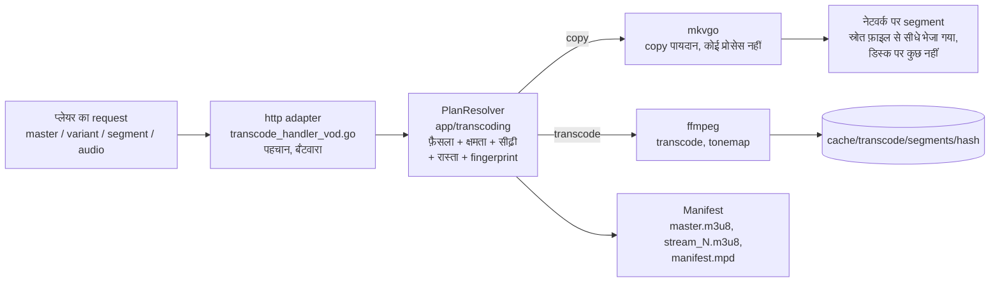

# एक वीडियो भेजना - HLS प्लेबैक का रास्ता

जब कोई प्लेयर एक वीडियो माँगता है तो क्या होता है, पहले `master.m3u8` request से
लेकर एक segment के बाइट तक: पढ़ने का रास्ता। कोड कई जगह फैला है: `http` driving
adapter (`internal/adapters/driving/http/transcode_*`), `app/transcoding` की सर्विस
और `ffmpeg` / `mkvgo` / `prober` driven adapter; कोई एक function पूरा रास्ता नहीं
चलाता, इसलिए यह पेज नक्शा है। इसे [ADR-0030](adr/0030-one-plan-one-decision.md)
(एक योजना, एक फ़ैसला), [ADR-0024](adr/0024-playback-plan-resolver.md) (योजना तय
करने वाला) और [ADR-0029](adr/0029-transcoding-routes-are-measured-not-assumed.md)
(मापी गई क्षमताएँ) तय करते हैं। यह [आर्किटेक्चर](ARCHITECTURE.md) में दी गई स्कैन
pipeline का जोड़ीदार है, और [कोड का नक्शा](CODEBASE_MAP.md) के "Golden path 4" के
पीछे की गहरी जानकारी। इसी प्रक्रिया को उपयोगकर्ता की नज़र से देखने के लिए
[Evey प्लेबैक का तरीका कैसे चुनता है](playback/how-playback-is-decided.md) पढ़ें।

## सोचने का ढाँचा: 3 सवाल, 2 इंजन, 1 कुंजी

वीडियो भेजना तीन सवालों के जवाब देने और फिर उस जवाब को पैक करने तक सिमट जाता है,
और सब कुछ एक hash से पहचाना जाता है।

| सवाल | जवाब कौन देता है | कहाँ |
| --- | --- | --- |
| **Q1 - क्या मैं फ़ाइल कम लागत में पढ़ सकता हूँ?** | **फ़ाइल extension** के हिसाब से probe का बँटवारा: `.mkv/.webm` और `.mp4/.mov` [mkvgo](playback/mkvgo.md) के पास जाते हैं (सिर्फ़ शुरुआती हिस्सा, कोई प्रोसेस नहीं); बाकी सब, और तेज़ रास्ते की कोई भी विफलता, ffprobe के पास जाती है, जो आख़िरी फ़ैसला करता है | `adapters/driven/prober/dispatcher.go` |
| **Q2 - क्या क्लाइंट इसे जैसा है वैसा चला सकता है?** | प्लेबैक का **फ़ैसला**, हर ट्रैक के लिए अलग: वीडियो `copy` या `transcode`, ऑडियो `copy` या `transcode` या wasm वाला AC-3 रास्ता; वीडियो और ऑडियो अलग-अलग तय होते हैं, और सबसे आम स्थिति है "वीडियो कॉपी करो, ऑडियो को AAC में फिर से encode करो" | `app/transcoding/decision.go` |
| **Q3 - यह होस्ट कितना encode कर सकता है?** | calibration से मापी गई **क्षमता** (कम लोड वाले पहले मौके पर मापी गई) और **प्रवेश** (ladder का कौन सा rung फ़िट होता है, क्या कोई slot खाली है) | `app/transcoding/calibration_service.go`, `admission_shaper.go` |

दो इंजन पूरे रास्ते में चलते हैं:

- **mkvgo** बिना कोई प्रोसेस शुरू किए पढ़ता है और फिर से पैक करता है (रीमक्स, ज़रूरत पर)। मुफ़्त।
- **ffmpeg / ffprobe** एक प्रोसेस शुरू करके decode, फिर से encode और probe करते हैं। महँगा।

एक कुंजी: सब कुछ (cache फ़ोल्डर, ffmpeg सेशन, segment के URL) **फ़ैसले के
fingerprint** से पहचाना जाता है, जो फ़ैसले का एक hash है। वही बाइट, वही hash, एक
साझा encode। पूरे सिस्टम का सही चलना इस बात पर टिका है कि यह hash उस manifest के
बीच, जो प्लेयर के पास है, और हर उस segment के बीच, जो वह बाद में माँगता है, **स्थिर**
रहे।

दोनों इंजन से निकला डेटा सर्वर से अलग-अलग तरह जाता है: mkvgo का segment माँगने पर
बनता है और बनते-बनते कनेक्शन पर लिखा जाता है, इसलिए copy वाला रास्ता segment cache
को कभी नहीं छूता; ffmpeg का segment fingerprint के फ़ोल्डर में एक फ़ाइल है, जो एक बार
लिखी जाती है और वहीं से दी जाती है।

## पढ़ने का क्रम - कोड में एक request के पीछे चलें

एक प्लेबैक request को शुरू से अंत तक देखने के लिए इन्हें इसी क्रम में खोलें:

1. **प्रवेश** - `internal/adapters/driving/http/transcode_handler_vod.go`:
   `serveHTTP` पहचान जाँचता है, फिर master / variant / segment / audio की ओर भेजता
   है।
2. **योजना** - `http/transcode_vod_plan.go` `*http.Request` को एक
   transport-मुक्त `PlaybackRequest` में बदलता है;
   `app/transcoding/playback_plan_resolver.go` (`PlanResolver.Resolve`, जिसका असली
   रूप `playback_plan.go` में `PlaybackPlanResolver` है) एक न बदलने वाला
   `PlaybackPlan` लौटाता है: फ़ैसला (Q2), ladder की श्रेणी, ढाला गया ladder, हार्डवेयर
   का रास्ता, packager और fingerprint। सेशन का हर manifest और segment इसी से दिया
   जाता है: manifest का input, लोड घटाने वाली जाँच, पुराने URL की जाँच (seal), producer का
   चुनाव और segment की कुंजी, सब इसी एक नतीजे को पढ़ते हैं, इसलिए एक request के
   अंदर cache-hash का नियम बनावट से ही पक्का रहता है (segment के hot path पर
   प्रोफ़ाइल-पसंद की लगभग 5 रीडिंग घटकर 1 रह गईं)। स्रोत के तथ्यों वाले helper
   (codec, HDR, SAR, ten-bit...) बगल में `source_facts.go` में हैं।
   `http/transcode_vod_fingerprint.go` में `makeDecision` और `buildFingerprint` उन
   जगहों के लिए पतले wrapper हैं जहाँ योजना नहीं होती (prewarm, ज़रूरत पर master)।
3. **Q2 - फ़ैसला** - `internal/app/transcoding/decision.go`:
   `MakePlaybackDecisionWithPrefs` (शुद्ध function) हर ट्रैक के लिए copy/transcode
   का फ़ैसला करने वाला मुख्य function है। resolver इसके ऊपर request के समय की पिन (`vd=` / `ad=`), ऑडियो
   resync वाला override, वगैरह जोड़ता है।
4. **Q3 - क्षमता** - `internal/app/transcoding/calibration_service.go`:
   `Current()` `domain/transcoding.Derive(report, policy)` (`derive.go`) लौटाता है,
   यानी होस्ट की ऊपरी सीमाएँ, जो आख़िरी calibration से निकाली गई हैं।
5. **Ladder और प्रवेश** - resolver ladder को ढालता है (जटिलता की श्रेणी, producer की
   प्रोफ़ाइल, स्रोत/क्षमता की सीमाएँ, CMCD/AV1 की सीमाएँ, प्रवेश का रास्ता और ऊपरी
   सीमा), फिर उसे प्रवेश की पिन पर **स्थिर (freeze) कर देता है** (`admission_shaper.go`,
   `FreezeLadder`), जिसे बाद की हर कॉल ज्यों का त्यों पढ़ती है: cache-hash का नियम
   बनावट का हिस्सा बन जाता है। `video_session_limiter.go` क्षमता का slot रखता है;
   slot भर जाने पर रास्ता हार्डवेयर से सॉफ़्टवेयर पर चला जाता है।
6. **Fingerprint** - एक `DecisionFingerprint` (टाइप और `Hash()`
   `app/transcoding/segment_cache.go` में), जिसे resolver जोड़ता है। hash ही cache की
   कुंजी है।
7. **बाइट बनाना** - copy: **mkvgo**, `app/transcoding/ondemand.go` (port) और
   `adapters/driven/mkvgo/ondemand.go`; transcode: **ffmpeg**,
   `adapters/driven/ffmpeg/hls_transcoder.go` (`BuildFFmpegArgs` शुद्ध है; segment
   `/cache/transcode/segments/<hash>/` में जाते हैं)।
8. **पैक करना** - `app/transcoding/manifest_generator.go` `master.m3u8` /
   `stream_N.m3u8` लिखता है; `manifest_generator_dash.go` `manifest.mpd` लिखता है।

!!! warning "अलग-अलग request के बीच, नियम URL में मान डालने पर टिका है"
    फ़ैसले का हर input child URL में डाला जाना चाहिए (`manifest_generator.go` में
    `querySuffix`), वरना चलते प्लेबैक के बीच कोई poll प्लेयर को बताए बिना योजना बदल
    सकता है। हर सेशन के URL फिर से बनाए जाते हैं
    (`transcode_vod_manifest_rebake.go`) ताकि उनमें stream token रहे, HLS और DASH
    दोनों के लिए, बिना कुकी वाले Chromecast समेत।

## दो इंजन, लागत के हिसाब से

**probe dispatcher** (`adapters/driven/prober/dispatcher.go`) extension के हिसाब से
चलने वाली ज़िम्मेदारी की एक कड़ी है: यह mkvgo आज़माता है, और ज़रा भी शक होने पर
ffprobe पर लौट आता है (parse की गड़बड़ी, panic, ऐसा नतीजा जो मैप न हो सके, MP4 का
छूटा हुआ मीडिया ट्रैक, DoVi profile 5, न पढ़े जा सकने वाले रंग)। दोनों तेज़ रास्ते
हमेशा चालू रहते हैं (`wire.go` में nil gate); ffprobe हमेशा उपलब्ध fallback है, जिसे कभी छोड़ा
नहीं जाता। दूसरा, बिल्कुल वैसा ही dispatcher (`keyframe_dispatcher.go`) सीक इंडेक्स
संभालता है।

| काम | mkvgo (मुफ़्त) | ffprobe / ffmpeg (महँगा) |
|---|---|---|
| मेटाडेटा probe (codec, आकार, HDR, bitrate, अवधि) | `.mkv/.webm/.mp4/.mov` सिर्फ़ शुरुआती हिस्सा | बाकी सब, या fallback |
| frame-rate मोड (cfr/vfr) | `AnalyzeFrameRateMode` | - |
| MKV से MP4 रीमक्स (बिना फिर से encode किए) | `RemuxToMP4` | - |
| ज़रूरत पर HLS/DASH (copy rung) | `OnDemandPackager` | - |
| वीडियो फिर से encode / HDR tonemap | - | `hls_transcoder.go` |
| interlace पहचान (idet), seek-landing, chromaprint, DoVi P5 | - (decode / side-data चाहिए) | ffmpeg / ffprobe |

तीन ffprobe प्रोसेस अब भी उन MKV/MP4 स्रोतों पर चलते हैं जिनका डेटा mkvgo पहले से
देता है, सब `ffmpeg` driven adapter में: `trickplay.go` में अवधि,
`complexity_classifier.go` में bitrate और आकार, `audio_delay.go` में प्लेबैक का ऑडियो
विलंब।

## ऑडियो वीडियो से अलग तय होता है

`makeDecision` `VideoDecision` और `AudioDecision` अलग-अलग बनाता है। "copy rung"
(`isCopyRequest`) सिर्फ़ **वीडियो** पर निर्भर है; कॉपी किए गए वीडियो के साथ भी आमतौर
पर फिर से encode किया गया AAC ट्रैक होता है। ऑडियो के फ़ैसले के तीन नतीजे हैं:

| नतीजा | क्या दिया जाता है |
| --- | --- |
| copy | स्रोत का ट्रैक, जैसा है |
| AAC में transcode | ffmpeg, हल्का |
| **wasm रास्ता**, ऐसे ब्राउज़र पर AC-3 / E-AC-3 के लिए जो इसे खुद decode नहीं कर सकता | master को सिर्फ़-वीडियो बनाया जाता है, एक `#EVEY-AUDIO-URI` tag के साथ; AC-3 **कॉपी** होता है (योजना बन जाए तो mkvgo `od_audio`, वरना ffmpeg `-c:a copy`), और `ac3go.wasm` उसे ब्राउज़र में PCM में decode करता है (`WasmAudioEngine.ts`), वीडियो की घड़ी से बँधा हुआ |

Safari wasm रास्ते से क्षमता के आधार पर बाहर है, नाम के आधार पर नहीं:
`canWasmDecodeAC3()` (`frontend/packages/client/src/web/codec.ts`) सिर्फ़ तब true
लौटाता है जब ब्राउज़र बताता है कि वह AC-3 खुद *नहीं* चला सकता, और Safari बताता है कि
वह चला सकता है।

## पैक करना: CMAF, HLS, DASH

container हमेशा **CMAF** (fMP4) होता है: हर variant का एक `init.mp4` और `.m4s`
segment (`hls_transcoder.go` में MPEG-TS वाली शाखा इस्तेमाल नहीं होती: `needsFMP4Segments`
हमेशा true लौटाता है)। *उन्हीं* segment के ऊपर:

- **HLS** (`master.m3u8`, `stream_N.m3u8`, `EXT-X-MAP` init + `.m4s`), दोनों इंजन।
- **DASH** (`manifest.mpd`): mkvgo के copy रास्ते पर packager का अपना manifest
  (`OnDemandPlan.HasDASH`, बाइट-दर-बाइट एक जैसा, बिना स्टोरेज के, AES-128 में बंद);
  ffmpeg के रास्ते पर **योजना से घोषित** एक manifest, उन्हीं टुकड़ों पर जिन्हें HLS
  playlist बताती हैं (`ManifestGenerator.MPD`), जो किसी भी टुकड़े के बनने से पहले लिखा
  जाता है।

DASH manifest को सही बनाता है **segment grid** (`domain/transcoding.SegmentGrid`):
हर ट्रांसकोड किया गया rung frame की एक ही पूरी संख्या पर काटा जाता है,
`round(3 s x fps)` (23.976 fps पर 72, 25 पर 75, 29.97 पर 90), ताकि segment वीडियो
ट्रैक की ticks में बिल्कुल सटीक हो और बदलने वाले पूरे समूह में एक जैसा हो; copy वाला
fallback अपनी keyframe योजना बताता है। जिस स्रोत का frame rate अनजाना या बदलता हुआ
है, वह पुरानी 3 s घड़ी पर रहता है, HLS रखता है, और `manifest.mpd` पर 404 लौटाता है।
किसी क्लाइंट को DASH पर नहीं ले जाया गया है: हर जगह HLS ही डिफ़ॉल्ट है। बनाए गए
टुकड़ों पर mkvgo का `DASHFromCMAF` बराबरी की कसौटी है (`internal/pkg/cmafparity`,
23.976/25/29.97 fps पर `TestDASHGridIntegration`: cold start, seek, दो rung वाला
बदलने का समूह, एक AAC frame के अंदर अलग ऑडियो)।

## इस्तेमाल हुए design pattern

| Pattern | कहाँ |
| --- | --- |
| Ports and adapters (hexagonal) | app परत `StreamProber`, `BenchmarkRunner`, `OnDemandPackager`, `StreamProducer` से बात करती है; ffmpeg और mkvgo इन्हें लागू करते हैं, और नया इंजन बस एक नया adapter है |
| Strategy | `StreamProducer` (सॉफ़्टवेयर / हार्डवेयर / copy), जिसे एक `ProducerSelector` चुनता है |
| fallback वाली chain of responsibility | probe और keyframe dispatcher (mkvgo, फिर आख़िरी फ़ैसले के लिए ffprobe) |
| कंटेंट से पहचाना जाने वाला cache | `DecisionFingerprint` hash cache और ffmpeg सेशन की कुंजी है |
| शुद्ध केंद्र, imperative खोल | `Derive`, `MakePlaybackDecision` और लागत का मॉडल शुद्ध हैं, ffmpeg या डेटाबेस के बिना unit-tested |
| न बदलने वाला value object | `StreamPlan`, प्रवेश का फ़ैसला, एक बार बनता है और कभी बदला नहीं जाता, इसलिए URL से बाइट तक का नियम बनावट से ही पक्का रहता है |
| क्रमिक गिरावट (graceful degradation) | हर कदम पर एक सुरक्षित fallback: 720p वाली डिफ़ॉल्ट क्षमता, हार्डवेयर से सॉफ़्टवेयर पर जाना, copy से transcode, mkvgo से ffprobe |

<!-- sources
entry and plan: internal/adapters/driving/http/transcode_handler_vod.go - serveHTTP ; internal/adapters/driving/http/transcode_vod_plan.go ; internal/adapters/driving/http/transcode_vod_fingerprint.go - makeDecision, buildFingerprint ; internal/adapters/driving/http/transcode_vod_manifest_rebake.go
resolver: internal/app/transcoding/playback_plan_resolver.go - PlanResolver.Resolve ; internal/app/transcoding/playback_plan.go - PlaybackRequest, PlaybackPlan ; internal/app/transcoding/source_facts.go
decision and capability: internal/app/transcoding/decision.go - MakePlaybackDecisionWithPrefs ; internal/app/transcoding/calibration_service.go - Current ; internal/domain/transcoding/derive.go - Derive
ladder, admission, fingerprint: internal/app/transcoding/admission_shaper.go - StreamPlan, FreezeLadder ; internal/app/transcoding/video_session_limiter.go ; internal/app/transcoding/segment_cache.go - DecisionFingerprint ; internal/app/transcoding/stream_producer.go - StreamProducer, ProducerSelector
engines: internal/adapters/driven/prober/dispatcher.go ; internal/adapters/driven/prober/keyframe_dispatcher.go ; internal/app/transcoding/ondemand.go - OnDemandPackager ; internal/adapters/driven/mkvgo/ondemand.go ; internal/adapters/driven/ffmpeg/hls_transcoder.go - BuildFFmpegArgs, needsFMP4Segments ; internal/adapters/driven/ffmpeg/trickplay.go, complexity_classifier.go, audio_delay.go
packaging: internal/app/transcoding/manifest_generator.go - querySuffix, EVEY-AUDIO-URI ; internal/app/transcoding/manifest_generator_dash.go ; internal/domain/transcoding/segment_grid.go - SegmentTargetSeconds, gridFor ; internal/pkg/cmafparity ; internal/adapters/driven/ffmpeg/dash_grid_integration_test.go - TestDASHGridIntegration
wasm: frontend/packages/client/src/web/codec.ts - canWasmDecodeAC3
-->
