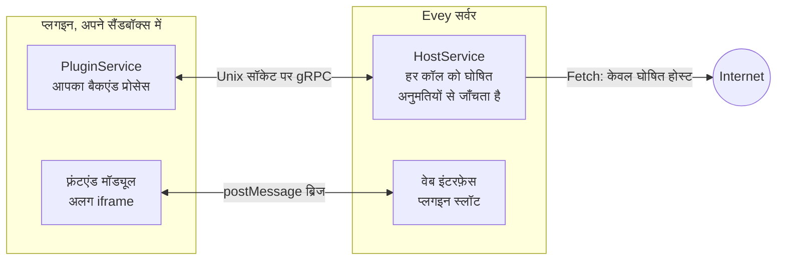

# प्लगइन

प्लगइन Evey में वह जोड़ते हैं जो वह ख़ुद नहीं करता: मेटाडेटा स्रोत, सूचना चैनल, वेबहुक रिसीवर, मुखपृष्ठ के सेक्शन, प्लेयर ओवरले, और थीम। हर प्लगइन एक अलग प्रोसेस है जो एक स्थानीय सॉकेट के ज़रिए सर्वर से बात करता है, एक सैंडबॉक्स में सीमित रहता है और अपने मैनिफ़ेस्ट में घोषित अनुमतियों तक सीमित रहता है। उसका इंटरफ़ेस, अगर हो, पेज के एक अलग फ़्रेम में चलता है।

<figure class="evey-shot" markdown="span">
  { loading=lazy }
  <figcaption>बिना प्लगइन।</figcaption>
</figure>

<figure class="evey-shot" markdown="span">
  { loading=lazy }
  <figcaption>उदाहरण मौसम प्लगइन के साथ: सबसे ऊपर एक सेक्शन, अपने फ़्रेम में बना हुआ (इंटरफ़ेस अंग्रेज़ी में)।</figcaption>
</figure>

## प्लगइन इंस्टॉल और प्रबंधित करना

**Admin → प्लगइन** प्लगइन को उसकी ZIP फ़ाइल से इंस्टॉल करता है। कुछ भी इंस्टॉल होने से पहले, पूर्वावलोकन दिखाता है:

<figure class="evey-shot" markdown="span">
  { loading=lazy }
  <figcaption><strong>Admin → प्लगइन</strong>: उपलब्ध रनटाइम, संसाधन सीमाएँ, और हर प्लगइन के लिए एक कार्ड (इंटरफ़ेस अंग्रेज़ी में)।</figcaption>
</figure>

- प्लगइन द्वारा घोषित अनुमतियाँ, इंटरफ़ेस के वे स्लॉट जिनमें वह दिखना चाहता है, और वे होस्ट जिनसे वह संपर्क करेगा;
- स्थैतिक विश्लेषण को उसके कोड में क्या मिला;
- उसका हस्ताक्षर, जब सर्वर हस्ताक्षर जाँचता है।

जिस प्लगइन के विश्लेषण में कोई गंभीर पैटर्न मिले वह मना कर दिया जाता है। इंस्टॉल किए गए प्लगइन का अपडेट भी उसी पूर्वावलोकन से गुज़रता है; जब वह नई अनुमतियाँ, स्लॉट या होस्ट माँगता है, तो आपको अंतर को स्पष्ट रूप से स्वीकार करना होता है।

फिर हर प्लगइन के कार्ड पर होता है: सक्षम या अक्षम करना, अपडेट, लॉग, और उसकी संसाधन सीमाएँ (मेमोरी, प्रोसेस, डिस्क, CPU प्राथमिकता)। **सुरक्षा डैशबोर्ड** की **होस्ट सैंडबॉक्स** लाइन इस होस्ट पर वास्तव में लागू सैंडबॉक्स मोड दिखाती है: अगर यह `basic` दिखाए तो [प्लगइन सैंडबॉक्स सेटअप](plugins/sandbox-deployment.md) देखें।

प्लगइन डिफ़ॉल्ट रूप से सक्षम हैं। `EVEY_PLUGINS_ENABLED=false` सबसिस्टम को पूरी तरह बंद करता है।

## प्लगइन क्या कर सकता है और क्या नहीं

प्लगइन अपनी डायरेक्टरी देखता है, सर्वर का डेटा नहीं, उसके पास कोई सीधी नेटवर्क पहुँच नहीं (नेटवर्क की अनुमति वाला प्लगइन केवल अपने घोषित होस्ट तक, सर्वर के ज़रिए, पहुँचता है), और जब तक वह `subprocess` अनुमति घोषित न करे, प्रोसेस शुरू नहीं कर सकता। प्लगइन जो अनुमतियाँ माँग सकता है वे [अनुमतियाँ और स्लॉट](plugins/security-model.md) में सूचीबद्ध हैं। सैंडबॉक्स कैसे काम करता है, और यह अब भी क्या नहीं रोक सकता, यह [सुरक्षा मॉडल और प्लगइन सैंडबॉक्स](SECURITY.md) में बताया गया है।

किसी तीसरे पक्ष के प्लगइन को इंस्टॉल करने से पहले उसकी समीक्षा करें, जैसे किसी भी सॉफ़्टवेयर की करते हैं: एक बार कोई होस्ट प्लगइन की सूची में आ जाए, तो सर्वर यह नहीं जाँच सकता कि प्लगइन उसे क्या भेजता है।

## प्लगइन लिखना

प्लगइन किसी भी भाषा में लिखा जा सकता है जिसे उसका `entrypoint` चला सके। Python, Node.js, PHP, Ruby, Dart, Java और Swift के लिए बने gRPC स्टब साथ आते हैं; Go स्टब `protoc-gen-go` से बनते हैं; कंपाइल किए गए बाइनरी को `native-binary` अनुमति चाहिए।

| पेज | सामग्री |
| --- | --- |
| [प्लगइन लिखना](plugins/dev-setup.md) | पूर्व-शर्तें, पहला प्लगइन, इंस्टॉल चक्र, हस्ताक्षर, वितरण। यहाँ से शुरू करें। |
| [प्लगइन API संदर्भ](plugins/api-reference.md) | मैनिफ़ेस्ट, बैकएंड कॉल और डेटा स्टोर, `evey.*` फ़्रंटएंड ब्रिज, क्षमताएँ। |
| [अनुमतियाँ और स्लॉट](plugins/security-model.md) | मैनिफ़ेस्ट क्या घोषित कर सकता है, इंस्टॉल पर क्या जाँचा जाता है, बाहरी पहुँच के नियम, स्लॉट। |
| [थीम](themes.md) | CSS और एक सैंडबॉक्स किए गए स्क्रिप्ट से इंटरफ़ेस का रूप बदलना। |
| [वेबहुक और API कुंजियाँ](webhooks-api-keys.md) | प्लगइन लिखे बिना Evey को दूसरे उपकरणों से जोड़ना। |
