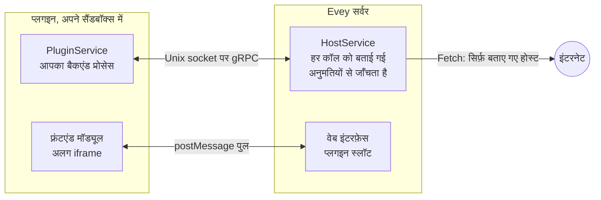

# प्लगइन लिखना { #writing-a-plugin }

यह पेज डेवलपर को Evey के clone से शुरू करके लोकल सर्वर पर चलते प्लगइन तक, और
फिर एक सिग्नेचर वाले पैकेज तक ले जाता है जिसे दूसरे एडमिन इंस्टॉल कर सकें।
[सेक्शन 3](#3-your-first-plugin-step-by-step) का ट्यूटोरियल बुनियादी उदाहरण है; बाकी
हिस्सा रेफ़रेंस है, जिस पर आप बार-बार लौटेंगे। कॉल और फ़ील्ड खुद
[प्लगइन API संदर्भ](api-reference.md) में हैं।



प्लगइन एक ZIP है, जिसके root फ़ोल्डर में एक `plugin.yaml` होता है, और एक बैकएंड प्रोसेस,
जिसे सर्वर एक सैंडबॉक्स में शुरू करता है। यह प्रोसेस एक Unix socket पर एक छोटी
gRPC सर्विस देता है और दूसरे socket पर सर्वर को वापस कॉल करता है। चाहे तो वह एक
इंटरफ़ेस मॉड्यूल भी साथ ला सकता है, जो पेज के एक सैंडबॉक्स वाले फ़्रेम में बनता
है। इंटरनेट से वह सिर्फ़ सर्वर के ज़रिए संपर्क करता है, और सिर्फ़ उन होस्ट से
जो उसने बताए हैं।

## 1. पहले से क्या चाहिए { #1-prerequisites }

| टूल | क्यों |
|---|---|
| Go 1.27, pnpm के साथ Node.js 22, Compose के साथ Docker | डेवलपमेंट स्टैक (`make dev`) सर्वर और वेब ऐप बनाता है। |
| `bubblewrap` (`bwrap`) | सिर्फ़ `bubblewrap` और `strict` सैंडबॉक्स मोड के लिए। डिफ़ॉल्ट `auto` मोड Landlock इस्तेमाल करता है और kernel 5.13 या नए पर उसे कुछ नहीं चाहिए। |
| [cosign](https://docs.sigstore.dev/cosign/installation/) | पैकेज बाँटने से पहले उस पर सिग्नेचर करने के लिए ([सेक्शन 7](#7-sign-your-plugin))। डेवलपमेंट के लिए ज़रूरी नहीं। |

अपने प्लगइन की भाषा उन runtime में से चुनें जिन्हें सर्वर शुरू कर सकता है:
`python`, `nodejs`, `php`, `ruby`, `lua`, `bash` और `sh` को इमेज में अपना
interpreter चाहिए; `go` एक compiled binary लाता है और उसे `native-binary`
अनुमति चाहिए। डिफ़ॉल्ट इमेज में Python, Node.js, PHP, Ruby और Lua हैं; `-nodejs` इमेज में
Python और Node.js रहते हैं और `-lean` इमेज में सिर्फ़ Python रहता है। जो manifest ऐसा runtime बताता है
जो इमेज में नहीं है, वह इंस्टॉल के समय मना कर दिया जाता है, और उपलब्ध runtime की
सूची दिखाई जाती है।

gRPC अनुबंध एक ही फ़ाइल है: `proto/plugin/v1/plugin_api.proto`। सिर्फ़ Python SDK
जनरेट किए हुए stub के साथ आता है; `sdk/<language>/` में बाकी भाषाओं के पास `.proto` है। प्लगइन
शुरू होने पर सर्वर आपकी भाषा की फ़ाइलें आपके entrypoint के बगल में कॉपी कर देता है।
इमेज Python प्लगइन को `grpcio` देती है, इसलिए उन्हें कुछ पैक नहीं करना पड़ता। Node.js
प्लगइन को अपना `node_modules` (`@grpc/grpc-js` और `@grpc/proto-loader`) पैकेज में
साथ रखना होगा। किसी और भाषा के लिए `protoc` से stub बनाएँ और उन्हें ZIP में रखें:

```bash
protoc --proto_path=proto \
       --<lang>_out=OUT_DIR --grpc_<lang>_out=OUT_DIR \
       proto/plugin/v1/plugin_api.proto
```

`make plugin-sdk` साथ आने वाले stub फिर से बनाता है; हर `sdk/<lang>/README.md`
बताता है कि उस भाषा को कौन सा gRPC प्लगइन चाहिए।

## 2. Evey को लोकल चलाएँ { #2-bring-up-evey-locally }

```sh
git clone git@github.com:eveyproject/evey.git
cd evey
cp .env.dev.example .env.dev   # फिर MEDIA_DIR, EVEY_DB_PASSWORD, MEILI_MASTER_KEY सेट करें
make setup                      # एक बार: /etc/hosts में evey.test जोड़ता है
make dev                        # postgres, meilisearch, सर्वर (Air), वेब ऐप (Vite)
```

`https://evey.test` खोलें। पहली बार चलाने पर सेटअप विज़ार्ड एडमिन खाता बनाता है,
जैसा [पहला सेटअप](../getting-started/first-setup.md) में बताया गया है। प्लगइन की
फ़ाइलें `./evey-data/plugins/<plugin-id>/` में जाती हैं, जो कंटेनर में
`/data/plugins` के रूप में mount होता है।

## 3. आपका पहला प्लगइन, कदम-दर-कदम { #3-your-first-plugin-step-by-step }

उदाहरण `examples/plugins/nodejs-example` सबसे छोटा पूरा प्लगइन है: यह
`PluginService` देता है, `HostService` से जुड़ता है, और सर्वर के शुरू करने पर
अपने लॉग में एक लाइन लिखता है। हम इसे कॉपी करते हैं, एक चीज़ बदलते हैं, और इसे
इंस्टॉल करते हैं।

1. **उदाहरण कॉपी करें।**

    ```sh
    cp -r examples/plugins/nodejs-example ~/hello-plugin
    cd ~/hello-plugin
    ```

2. **इसे एक नाम दें।** `plugin.yaml` बदलें:

    ```yaml title="plugin.yaml"
    name: hello-plugin          # अनोखा, kebab-case
    kind: plugin
    version: 1.0.0              # semver: हर अपलोड पर इसे बढ़ाएँ
    description: Says hello in its log
    author: you
    language: nodejs            # वह runtime जो सर्वर में होना चाहिए
    entrypoint: node main.js    # वह कमांड लाइन जो सर्वर चलाता है
    permissions:
      - api.library             # बैकएंड को मीडिया आइटम पढ़ने देता है
    ```

    `language` सर्वर को बताता है कि कौन सा runtime जाँचना है और कौन से stub
    कॉपी करने हैं; `entrypoint` वह है जो सर्वर प्लगइन के फ़ोल्डर में, अगले कदम
    वाले environment के साथ चलाता है।

3. **`main.js` पढ़ें।** सर्वर प्रोसेस को तीन वेरिएबल देता है:
   `EVEY_PLUGIN_ID`, `EVEY_PLUGIN_SOCK` (वह socket जिस पर *आपके* प्रोसेस को सुनना
   है, `PluginService` देते हुए) और `EVEY_HOST_SOCK` (वह socket जिससे आप
   `HostService` को कॉल करने के लिए जुड़ते हैं)। उदाहरण `plugin_api.proto` को
   अपने ही फ़ोल्डर से लोड करता है, जहाँ सर्वर ने उसे कॉपी किया, और
   `PluginService` के पाँच method लागू करता है। `Initialize` में संदेश बदलें:

    ```js title="main.js (excerpt)"
    Initialize(call, callback) {
      hostLog("LOG_LEVEL_INFO", `hello from ${process.env.EVEY_PLUGIN_ID}`);
      callback(null, { success: true });
    },
    ```

4. **ZIP बनाएँ।** manifest आर्काइव के root में होना चाहिए, किसी सब-फ़ोल्डर में
   नहीं:

    ```sh
    zip -r ../hello-plugin.zip . -x ".*"
    ```

5. **इंस्टॉल करें।** **एडमिन → प्लगइन** में **प्लगइन इंस्टॉल करें** खोलें, ZIP
   चुनें और **पूर्वावलोकन और इंस्टॉल** दबाएँ: पूर्वावलोकन `api.library` और
   स्थैतिक विश्लेषण का नतीजा दिखाता है। API से यही अपलोड ऐसे होता है:

    ```sh
    curl -F "plugin=@hello-plugin.zip" \
         -H "Authorization: Bearer $EVEY_TOKEN" \
         https://evey.test/api/v1/admin/plugins/upload
    ```

6. **लॉग पढ़ें।** प्लगइन के कार्ड पर **लॉग** वह लाइन दिखाता है जो `Initialize`
   ने लिखी। `docker compose logs evey` में उसी शुरुआत का सर्वर वाला हिस्सा
   प्लगइन की id के साथ मिलता है।

7. **बार-बार सुधारें।** कोड बदलें, `version` बढ़ाएँ, फिर से ZIP बनाएँ और कार्ड पर
   **स्रोत से अपडेट करें…** इस्तेमाल करें। उसी या कम वर्ज़न वाला अपलोड मना कर
   दिया जाता है; manifest में कोई नई अनुमति हो, तो मंज़ूरी का कदम आता है, जिसे
   एडमिन को स्वीकार करना होता है।

आपके पास अब बैकएंड का पूरा अनुबंध है। यहाँ से प्लगइन तीन दिशाओं में बढ़ता है:
सर्वर को कॉल करना (`HostService`, सेक्शन 4), इंटरफ़ेस बनाना (सेक्शन 5), और
इंटरनेट तक पहुँचना (सेक्शन 6)।

## 4. बैकएंड से सर्वर को कॉल करें { #4-call-the-server-from-the-backend }

हर `HostService` कॉल के साथ प्लगइन की पहचान जाती है: सर्वर socket से जुड़े
प्रोसेस को उसके PID से जाँचता है, और एक interceptor हर वह कॉल मना कर देता है
जिसकी अनुमति manifest में नहीं बताई गई। तीन समूहों को किसी अनुमति की ज़रूरत नहीं:

- `Log` प्लगइन के लॉग में लिखता है, जो उसके कार्ड पर दिखता है;
- `GetConfig` वे मान पढ़ता है जो एडमिन ने **कॉन्फ़िग** में सेट किए (जो
  `config_schema` में बताए गए हैं); `SetConfig` से प्लगइन वहाँ अपनी कुंजियाँ रख
  सकता है;
- `GetData` / `SetData` / `DeleteData` / `ListDataKeys` प्लगइन का निजी
  key/value स्टोर है, जो अनइंस्टॉल करने पर मिट जाता है।

`GetMediaItem` और `ListMediaItems` को `api.library` या `media.read` चाहिए;
`Fetch` को `network` चाहिए। पूरी तालिका, उन method के साथ जो अनुबंध में बताए गए
हैं पर अभी दिए नहीं जाते, [प्लगइन API संदर्भ](api-reference.md#hostservice-what-the-plugin-can-call)
में है।

## 5. इंटरफ़ेस जोड़ें { #5-add-an-interface }

इंटरफ़ेस एक JavaScript मॉड्यूल है जिसे पेज एक सैंडबॉक्स वाले फ़्रेम में लोड करता
है, उन स्लॉट में से किसी एक में जिनकी सर्वर अनुमति देता है। बताएँ कि फ़ाइलें कहाँ
हैं और मॉड्यूल कहाँ जाएगा:

```yaml title="plugin.yaml"
web_root: dist               # वह फ़ोल्डर जो static फ़ाइलों के रूप में दिया जाता है
frontend:
  - slot: home.section       # स्लॉट की सूची देखें
    src: dist/index.js       # web_root के अंदर होना चाहिए
```

मॉड्यूल को एक `window.evey` bridge मिलता है: `evey.onInit` उसे प्लगइन का
कॉन्फ़िगरेशन, भाषा, थीम और वह जगह देता है जहाँ वह दिखा है; `evey.resize`,
`evey.toast` और `evey.navigate` तय सीमाओं के अंदर पेज पर काम करते हैं; और जब
manifest `prefs` या `public` बताता है, तो `evey.prefs.*` और `evey.media.*` एक कम
समय वाले token से सर्वर तक पहुँचते हैं, जिसे होस्ट उस फ़्रेम के लिए रखता है।
`examples/plugins/weather` build step वाला एक पूरा विजेट है;
`examples/plugins/data-demo` `prefs`, `public` और `admin.nav` स्लॉट दिखाता है। bridge
और स्लॉट [प्लगइन API संदर्भ](api-reference.md#frontend-api) में बताए गए हैं।

## 6. इंटरनेट तक पहुँचें { #6-reach-the-outside-world }

प्लगइन का प्रोसेस हर उस मोड में इंटरनेट की ओर कोई socket नहीं खोल
सकता जिसमें लॉन्चर चलता है (लॉन्चर के बिना `basic` सिर्फ़ `execve` को रोकता है)। इंटरनेट तक पहुँचने का एकमात्र तरीका `HostService` का `Fetch` कॉल है: सर्वर लक्ष्य को
manifest से मिलाकर जाँचता है, फिर request खुद भेजता है।

```yaml title="plugin.yaml"
permissions:
  - network
external_fetch:
  - api.open-meteo.com       # सिर्फ़ होस्ट का नाम: न scheme, न wildcard, न IP
```

`external_fetch` के बिना `network` इंस्टॉल के समय मना कर दिया जाता है। चलते समय
broker `http` और `https`, `GET` और `HEAD` स्वीकार करता है, 20 सेकंड के अंदर 8 MiB
तक के जवाब लेता है, और निजी या आरक्षित पतों को मना करता है, redirect के ज़रिए भी।
इंटरफ़ेस के फ़्रेम को वही होस्ट सूची उसके `connect-src` के रूप में मिलती है,
इसलिए विजेट उन होस्ट को सीधे `https` पर कॉल कर सकता है। नियम
[अनुमतियाँ और स्लॉट](security-model.md#external-fetch-rules) में हैं।

!!! note "होस्ट एडमिन के साथ एक अनुबंध हैं"
    एडमिन अपडेट के समय और सुरक्षा डैशबोर्ड पर होस्ट की सूची देखता है, और अपडेट पर हर नए होस्ट को
    मंज़ूरी देनी होती है। सूची में सिर्फ़ वही रखें जिसकी प्लगइन को ज़रूरत है, और
    अपनी README में बताएँ कि हर होस्ट को क्या मिलता है।

## 7. अपने प्लगइन पर सिग्नेचर करें { #7-sign-your-plugin }

!!! info "सिग्नेचर क्या साबित करता है"
    सिग्नेचर बताता है कि एडमिन जो ZIP इंस्टॉल करता है, वह बाइट-दर-बाइट वही है
    जो **आपने** प्रकाशित किया। आपकी public key पैकेज के अंदर चलती है (ZIP की जड़ में
    `cosign.pub`), और Evey इंस्टॉल के समय उसका fingerprint प्लगइन पर पिन कर देता
    है: किसी और कुंजी से साइन किया हुआ, या अब साइन न किया हुआ अपडेट तब तक मना
    रहता है जब तक एडमिन बदलाव स्वीकार नहीं करता। यह इस बारे में कुछ नहीं कहता कि
    प्लगइन क्या करता है: अनुमतियाँ, होस्ट
    और पूर्वावलोकन का विश्लेषण फिर भी लागू होते हैं। Evey इसे offline और अपने
    प्रोसेस के अंदर जाँचता है (ZIP के SHA-256 पर ECDSA P-256, वही फ़ॉर्मैट जो
    `cosign sign-blob --key` बनाता है): सर्वर पर न `cosign` binary, न नेटवर्क, न
    transparency log।

[cosign](https://docs.sigstore.dev/cosign/installation/) सिर्फ़ आपकी मशीन पर
चाहिए।

1. **एक बार: कुंजी का जोड़ा बनाएँ।**

    ```sh
    # एक असली passphrase चुनें; cosign.key निजी रहती है, इसे कभी commit न करें
    COSIGN_PASSWORD="your-passphrase" cosign generate-key-pair
    # -> cosign.key (निजी) और cosign.pub (वह फ़ाइल जो आप बाँटते हैं)
    ```

2. **हर रिलीज़ पर: अपनी public key प्लगइन की जड़ में रखें, ZIP बनाएँ, फिर
   साइन करें**, ठीक उसी फ़ाइल पर जो आप बाँटेंगे।

    ```sh
    cp cosign.pub hello-plugin/cosign.pub
    cd hello-plugin && zip -r ../hello-plugin.zip . && cd ..

    COSIGN_PASSWORD="your-passphrase" cosign sign-blob \
      --key cosign.key --tlog-upload=false --yes \
      --output-signature hello-plugin.zip.sig \
      hello-plugin.zip
    ```

3. **भेजने से पहले जाँचें**, उसी जाँच से जो सर्वर करता है:

    ```sh
    cosign verify-blob --key cosign.pub --signature hello-plugin.zip.sig \
      --insecure-ignore-tlog hello-plugin.zip      # -> Verified OK
    ```

4. **दोनों फ़ाइलें एक साथ प्रकाशित करें**: `hello-plugin.zip` (आपकी public key
   उसके अंदर है) और `hello-plugin.zip.sig`, एक-दूसरे के बगल में, ताकि URL से
   इंस्टॉल करने पर सिग्नेचर `<url>.sig` पर मिल जाए। कुंजी का fingerprint
   (`sha256:...`, जिसे Evey प्लगइन के कार्ड पर दिखाता है) अपने README और रिलीज़
   नोट में रखें, ताकि एडमिन कुंजी पर भरोसा करने से पहले उसे मिला सकें।

जिस सर्वर पर प्लगइन इंस्टॉल होता है, वहाँ एडमिन **एडमिन → प्लगइन** में ZIP चुनता है
और **हस्ताक्षर फ़ाइल (.zip.sig, वैकल्पिक)** में उसकी `.zip.sig`; API से, सिग्नेचर
अपलोड का `sig` फ़ील्ड है। Evey पैकेज को उसी कुंजी से जाँचता है जो वह साथ लाता है
और इनमें से एक दिखाता है:

- **<प्रकाशक> द्वारा हस्ताक्षरित**: कुंजी इंस्टेंस की **भरोसेमंद प्रकाशक** सूची में
  है।
- **हस्ताक्षरित - अज्ञात कुंजी sha256:...**: सिग्नेचर सही है, पर कुंजी पर अभी
  भरोसा नहीं किया गया। एक क्लिक, **इस कुंजी पर भरोसा करें**, उसे एक नाम के साथ
  सूची में जोड़ देता है।
- **हस्ताक्षर रहित**, या **अमान्य हस्ताक्षर**।

आगे क्या हो, यह नीति तय करती है: `EVEY_PLUGINS_COSIGN_POLICY=warn` (डिफ़ॉल्ट)
फ़ैसला दर्ज करती है और हर इंस्टॉल को जाने देती है; `enforce` सिर्फ़ भरोसेमंद
कुंजियाँ मानती है। नीति चाहे जो हो, जिस अपडेट की कुंजी इंस्टॉल किए गए वर्ज़न से
अलग है, या जो सिग्नेचर छोड़ देता है, वह तब तक मना रहता है जब तक एडमिन अपडेट
डायलॉग में **प्रकाशक बदल गया है, मैं नई कुंजी स्वीकार करता हूँ** पर टिक नहीं
करता। `EVEY_PLUGINS_COSIGN_PUBLIC_KEY` वैकल्पिक है: वह शुरू होते समय भरोसे की सूची
में एक कुंजी जोड़ती है (सर्वर संचालक की कुंजी के रूप में चिह्नित)।

आम गलतियाँ:

- **ZIP में कोई भी बदलाव सिग्नेचर को अमान्य कर देता है**, वही फ़ाइलें दोबारा ZIP करने से
  भी। वही फ़ाइल साइन करें जो आप बाँटते हैं, और हर वर्ज़न पर फिर से साइन करें।
- **एक वर्ज़न से अगले तक वही कुंजी रखें।** नई कुंजी, आपको इंस्टॉल कर चुके हर
  एडमिन के लिए, एक नया प्रकाशक है: उससे उसे स्वीकार करने को कहा जाएगा। कुंजी
  जानबूझकर बदलें, और रिलीज़ नोट में बताएँ।
- **सिर्फ़ ECDSA P-256 कुंजियाँ मानी जाती हैं**, जो `cosign
  generate-key-pair` बनाता है। keyless signing और KMS reference नहीं जाँचे जाते।
- ZIP में `cosign.pub` के बिना `.sig`, या इसका उल्टा, **हस्ताक्षर रहित** गिना जाता है।
- गलत कुंजी, छेड़ा गया ZIP और न मिलने वाली `.sig`, तीनों फ़ेल सिग्नेचर माने जाते
  हैं: `enforce` में इंस्टॉल या अपडेट मना कर दिया जाता है।

## 8. इंस्टॉलर क्या जाँचता है, क्रम से { #8-what-the-installer-checks-in-order }

हर कदम पैकेज को मना कर सकता है; एडमिन को कारण दिखता है, और सर्वर के लॉग में
विस्तार होता है।

1. **Manifest।** `plugin.yaml` सीधे ZIP से पढ़ा जाता है: ज़रूरी फ़ील्ड, semver,
   जानी-पहचानी अनुमतियाँ और क्षमताएँ, अनुमति वाली सूची में मौजूद स्लॉट,
   `external_fetch` की एंट्री जो सिर्फ़ होस्ट के नाम हों, और `frontend` बताया हो
   तो `web_root` मौजूद हो। बताई गई `language` इमेज का कोई runtime होनी चाहिए।
2. **वर्ज़न और नई अनुमतियाँ।** पहले से इंस्टॉल प्लगइन के लिए नया वर्ज़न ऊँचा होना
   चाहिए, और कोई भी नई अनुमति, क्षमता, स्लॉट या होस्ट इंस्टॉल को यहीं रोक देता है,
   जब तक एडमिन फ़र्क को मंज़ूरी न दे (अपलोड route पर
   `accept_permission_changes=true`)।
3. **सिग्नेचर और hash।** public key सेट हो, तो सिग्नेचर जाँचा जाता है; फ़ेल होने
   पर रोक सिर्फ़ `enforce` में लगती है। ZIP का hash दर्ज किया जाता है, और पहले
   देखा गया अपडेट लागू करते समय फिर से जाँचा जाता है।
4. **Extraction**, एक अस्थायी फ़ोल्डर में: ज़्यादा से ज़्यादा 5,000 एंट्री, हर
   फ़ाइल 100 MB, कुल 500 MB, compression ratio 100:1, कोई symbolic link नहीं, कोई
   रास्ता जो आर्काइव से बाहर जाए नहीं। जब तक आगे के सारे कदम पास न हों, अपडेट
   चल रहे वर्ज़न को कभी नहीं छूता।
5. **सिर्फ़ थीम के लिए:** stylesheet साफ़ करके वापस लिखी जाती है, और कोई मना
   किया गया पैटर्न मिलने वाली `theme.js` पैकेज को मना करवा देती है।
6. हर टेक्स्ट फ़ाइल का **स्थैतिक विश्लेषण**: कोई गंभीर बात मिले तो पैकेज मना होता
   है; `deserialization` और `obfuscation` चेतावनियाँ भी उसे मना करवाती हैं, और
   `native_code`, compiled binary और अंदर रखे आर्काइव उसे मना करवाते हैं, जब तक
   manifest `native-binary` न बताए।
7. **सहेजना और शुरू करना।** अस्थायी फ़ोल्डर अपनी जगह पर रख दिया जाता है, डेटाबेस
   में लाइन लिखी जाती है, और प्रोसेस शुरू होता है।

विश्लेषण किन चीज़ों को खोजता है, इसकी सूची
[प्लगइन सैंडबॉक्स और ख़तरा मॉडल](../SECURITY.md#static-analysis) में है। विश्लेषण से
पहले comment हटा दिए जाते हैं, इसलिए comment में बंद की गई लाइन दर्ज नहीं होती।

## 9. आपका प्रोसेस किन सीमाओं में चलता है { #9-what-your-process-runs-under }

सर्वर प्रोसेस को कम CPU प्राथमिकता के साथ शुरू करता है, मेमोरी की सीमा, प्रोसेस
और thread की संख्या की सीमा, और उसके फ़ोल्डर के आकार की सीमा के साथ; एक
निगरानी करने वाला हिस्सा इन्हें पार करने वाले प्लगइन को रोक देता है। डिफ़ॉल्ट
256 MiB, 64 प्रोसेस और 100 MiB हैं, जिन्हें एडमिन **एडमिन → प्लगइन → संसाधन
सीमाएँ** में बदल सकता है। `subprocess` अनुमति के बिना प्रोसेस child process शुरू
नहीं कर सकता, भाषा कोई भी हो; thread काम करते हैं।

हर उस मोड में जिसमें लॉन्चर चलता है, सैंडबॉक्स फ़ाइल सिस्टम को प्लगइन के फ़ोल्डर तक सीमित रखता है और हर नेटवर्क socket
बंद रखता है (लॉन्चर के बिना `basic` सिर्फ़ `execve` को रोकता है)। कौन सा मोड लागू है, यह होस्ट पर निर्भर है, प्लगइन
पर नहीं: [प्लगइन सैंडबॉक्स और ख़तरा मॉडल](../SECURITY.md#sandbox-modes) इन्हें
बताता है, और [प्लगइन सैंडबॉक्स सेटअप](sandbox-deployment.md) एडमिन को बताता है कि
कौन सा चुनें।

## 10. प्लगइन का वितरण { #10-distribute-a-plugin }

कोई कैटलॉग नहीं है: एडमिन प्लगइन इंस्टॉल करने के लिए उसका ZIP अपलोड करता है या
एडमिन पैनल में उसका URL चिपकाता है, जहाँ भी आप उसे प्रकाशित करें (किसी forge पर
रिलीज़, आपकी अपनी साइट)।

- ZIP, उसकी `.sig` और अपनी `cosign.pub` एक साथ दें (सेक्शन 7)।
- अपनी README में अनुमतियाँ और `external_fetch` के होस्ट बताएँ: एडमिन अनुमतियाँ इंस्टॉल के समय और होस्ट अपडेट के समय व सुरक्षा डैशबोर्ड पर देखता है, और इन्हें मंज़ूर करना होता है; यहाँ कोई अनपेक्षित चीज़
  इंस्टॉल मना होने का सबसे पहला कारण है।
- अपने प्लगइन को साथ आने वाले उदाहरणों के साथ सूची में लाने के लिए,
  `examples/plugins/` पर स्रोत कोड और एक README के साथ pull request खोलें।
  उदाहरणों की समीक्षा होती है और वे स्रोत से build होते हैं; सूची में होना कोई
  सिफ़ारिश नहीं है और उस पर प्रोजेक्ट का कोई सिग्नेचर नहीं होता।

## 11. समस्या का हल { #11-troubleshooting }

| लक्षण | कारण | हल |
|---|---|---|
| `plugin requires "nodejs" runtime which is not installed in this image` | इमेज के इस रूप में interpreter नहीं है। | डिफ़ॉल्ट या `-nodejs` इमेज इस्तेमाल करें, या प्लगइन Python में लिखें। |
| `manifest: external_fetch entry "*.tmdb.org" is a wildcard - use explicit hostnames` | इंस्टॉल के समय wildcard मना हैं, कोई छूट नहीं। | हर ज़रूरी होस्ट का नाम लिखें (`api.tmdb.org`, `image.tmdb.org`)। |
| `manifest: frontend slot "admin.section" not allowed` | स्लॉट अनुमति वाली सूची से बाहर है। | [स्लॉट की सूची](api-reference.md#slots) से एक स्लॉट चुनें; एडमिन वाले हिस्से में `admin.nav` ही अकेला स्लॉट है। |
| `manifest: network permission requires non-empty external_fetch` | `network` बताया गया, पर होस्ट नहीं। | होस्ट जोड़ें, या अनुमति हटा दें। |
| `plugin already installed at version 1.0.0, new version must be higher` | ZIP में वही वर्ज़न है जो इंस्टॉल है। | `version` बढ़ाएँ, या पहले अनइंस्टॉल करें। |
| `signature does not match the plugin or the configured key` | `.sig` किसी और कुंजी से बनी, या साइन करने के बाद ZIP बदला। | ठीक उसी ZIP को सही कुंजी से फिर से साइन करें, या `EVEY_PLUGINS_COSIGN_PUBLIC_KEY` ठीक करें। |
| `plugin blocked: theme.js contains forbidden pattern` | थीम script की जाँच ने एक मना की गई API पकड़ी। | थीम सिर्फ़ `evey.theme.*` कॉल कर सकती है: देखें [थीम](../themes.md#what-the-scanner-refuses)। |
| लॉग `memory quota exceeded (... MB > ... MB)` पर ख़त्म होता है | निगरानी ने मेमोरी की सीमा पार होने पर प्लगइन रोक दिया। | मेमोरी का इस्तेमाल घटाएँ, या **संसाधन सीमाएँ** में **अधिकतम मेमोरी (MiB)** बढ़ाएँ। |
| `bwrap: ... permission denied` | Docker के अंदर `bubblewrap` मोड, जिसे कंटेनर की seccomp या AppArmor प्रोफ़ाइल रोकती है। | डिफ़ॉल्ट `auto` मोड रहने दें। वरना देखें [प्लगइन सैंडबॉक्स सेटअप](sandbox-deployment.md)। |
| इंटरफ़ेस मॉड्यूल नहीं दिखता | प्लगइन अक्षम है, स्लॉट की वर्तनी गलत है, या `src` `web_root` के अंदर नहीं है। | कार्ड की स्थिति, स्लॉट का नाम, और ब्राउज़र के नेटवर्क पैनल में `/api/v1/plugins/<id>/assets/...` request जाँचें। |

<!-- sources
runtimes, image variants: internal/adapters/driven/pluginrunner/runtime_availability.go - runtimeBinaries, compiledLanguages ; internal/app/plugin/install.go - parseAndValidateManifest ; Dockerfile (RUNTIMES lean/nodejs/full)
stubs copied at start, NODE_PATH: internal/adapters/driven/filesystem/plugin_fs.go - CopySDKStubs ; internal/adapters/driven/pluginrunner/runner_start.go ; sdk/python/README.md ; examples/plugins/nodejs-example/package.json
dev stack: DEV.md (Quick Start) ; Makefile - setup, dev ; docker-compose.yml (evey-data/plugins:/data/plugins)
example: examples/plugins/nodejs-example/main.js, plugin.yaml
env vars: internal/adapters/driven/pluginrunner/runner_start.go (EVEY_PLUGIN_ID, EVEY_PLUGIN_SOCK, EVEY_HOST_SOCK)
upload route, fields: internal/adapters/driving/http/plugin_asset_handler.go (plugin, sig, accept_permission_changes)
host RPC permissions: internal/adapters/driving/grpcapi/plugin_interceptor.go ; peer auth: internal/adapters/driving/pluginhost/peer_creds.go
host RPCs: internal/adapters/driving/pluginhost/host_server.go - Log, GetConfig, SetConfig, GetData ; fetch.go - Fetch (GET/HEAD, maxFetchBytes, fetchTimeout)
frame connect-src: frontend/packages/client/src/plugins/hostProtocol.ts - buildConnectSrc ; internal/adapters/driving/http/plugin_frame_handler.go - pluginFramePolicy
bridge: frontend/packages/client/src/plugins/bridgeScript.ts - EveyBridge
cosign: internal/adapters/driven/pluginrunner/cosign.go - loadP256PublicKey ; internal/config/config.go - CosignPolicy validation
install order: internal/app/plugin/install.go - installLocalZip, parseAndValidateManifest, resolveExistingPlugin, verifyPluginIntegrity, extractPluginToStaging, validateStagedPlugin, checkEscalatedWarnings, swapAndPersistPlugin ; update.go - ApplyUpdate ; zip limits: docs/SECURITY.md (ZIP extraction)
resource limits: internal/config/config.go - Plugins ; internal/adapters/driven/pluginrunner/runner_resmon.go ; i18n admin.plugins.resourceLimits.*
error texts: internal/adapters/driven/pluginrunner/manifest.go ; internal/domain/plugin/model.go ; internal/app/plugin/install.go ; cosign.go ; runner_resmon.go
-->
