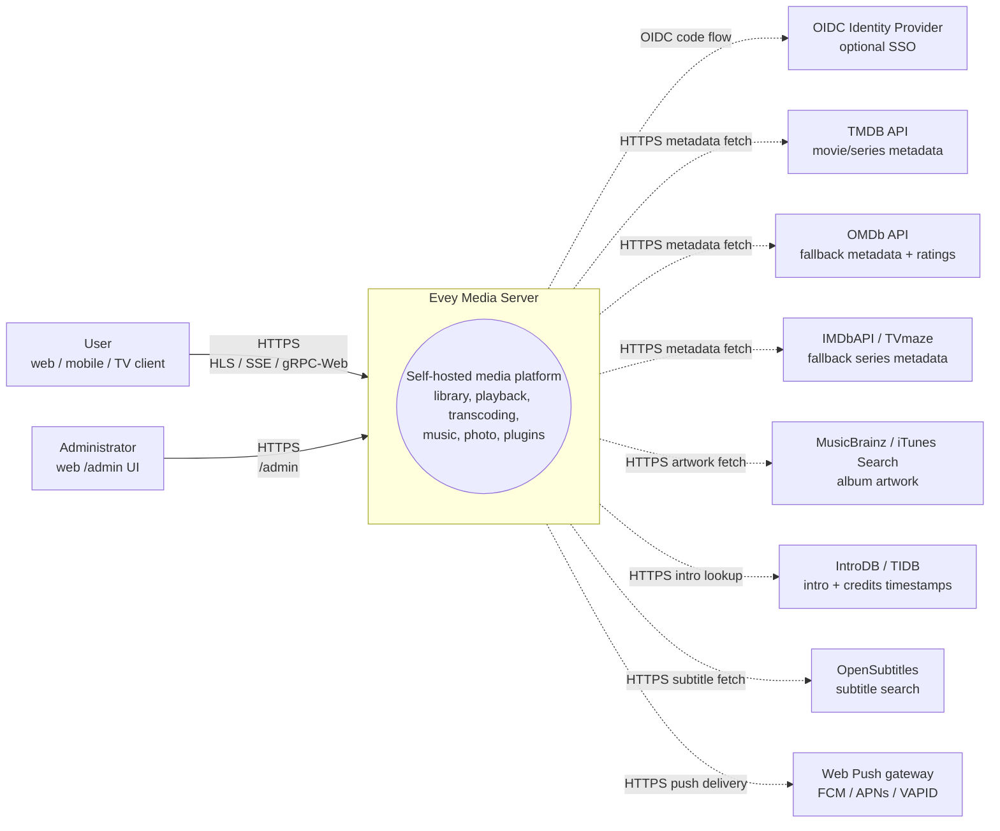
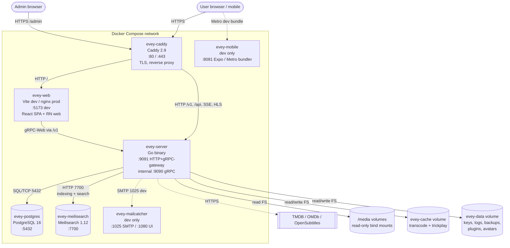
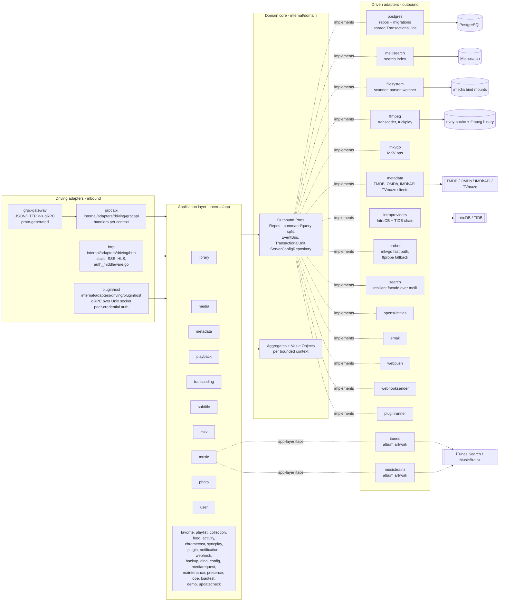
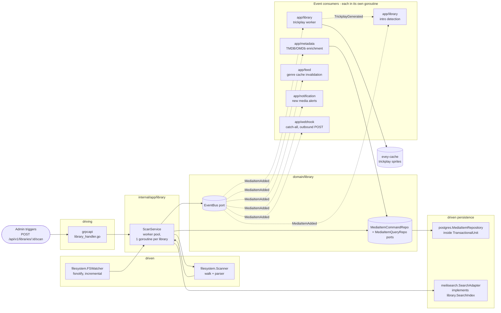

# 架构

Evey 是一个自托管的媒体服务器。后端是 Go（六边形 / DDD），前端是 TypeScript/React monorepo，移动端是 React Native / Expo。环境搭建和更深入的内部细节见 [DEV.md](../DEV.md)。

## 分层

`internal/` 下严格的端口与适配器布局：

- `internal/domain/<context>/`：纯领域：模型、值对象、**端口**（接口）。不导入任何框架。
- `internal/app/<context>/`：应用服务。编排端口。IO 通常经过端口；有两个上下文是有意的例外，直接访问网络：`dlna`（SSDP / UPnP AVTransport）和 `loadtest`（它自己的 HTTP 客户端）。
- `internal/adapters/driven/`：实现领域端口的出站适配器：`postgres`、`meilisearch`、`ffmpeg`、`mkvgo`、`filesystem`、`prober`、`opensubtitles`、`email`、`webpush`、`webhooksender`、`pluginrunner`、`metadata`、`introproviders`、`search`。还有两个也在这里，但它们满足的是应用层接口而不是领域端口：`itunes` 和 `musicbrainz`，两者都实现 `app/music.AlbumArtFetcher`。
- `internal/adapters/driving/`：入站适配器：`grpcapi`（+ grpc-gateway HTTP）、`http`（静态资源、认证中间件、SSE、HLS、插件 iframe 资源）、`pluginhost`（Unix socket 上的 gRPC 服务器，通过对端凭据认证：沙箱化的插件子进程回调的宿主 API）。
- `internal/pkg/`：跨上下文复用的共享技术内核（auth、logger、eventbus、i18n、metrics、tracing、ratelimit、procfork、ssrf、cache……）。服务器配置位于 `internal/config/`；生成的 proto 代码位于 `gen/`。

依赖规则：`adapters -> app -> domain`。领域从不导入 app 或 adapters。组装在 `cmd/evey/wire*.go` 中完成，是手写的连接代码，而不是 google/wire：`wire.go`、`wire_infra.go`、`wire_services.go`、`wire_adapters.go`、`wire_events.go`、`wire_helpers.go`。

## 限界上下文

`internal/domain/` 和 `internal/app/` 下共有三十二个上下文包：19 个在两层中都存在，2 个只在领域层（`ratings`、`shared`），11 个只在应用层。协作一部分通过在共享总线上发布的领域事件进行；应用层也会直接读取相邻上下文的领域包（见[关系](#relations)）。

| 上下文 | 职责 |
| --- | --- |
| `user` | 账户、认证、会话、偏好 |
| `library` | 媒体库、文件夹、扫描任务、媒体索引、人物、合集、个人资料的收藏和点赞（点赞没有应用服务：评分 RPC 直接存取 `UserRatingRepository`）、trickplay、片头/片尾检测 |
| `media`（仅应用层） | 分享链接和流令牌 |
| `mediarequest` | 用户提交的媒体请求 |
| `metadata` | TMDB / OMDb 元数据增强、图片 |
| `playback` | 流、进度、远程控制、正在播放 |
| `transcoding` | ffmpeg 任务、HLS 分段 |
| `subtitle` | 内嵌 + 外部 + opensubtitles |
| `mkv` | MKV 容器操作（通过 `mkvgo`） |
| `music` | 音频专用的播放和标签 |
| `photo` | 照片库 |
| `favorite`（仅应用层） | 按个人资料的收藏；模型和 `FavoriteRepository` 位于 `domain/library` |
| `playlist` | 用户播放列表、智能播放列表 |
| `collection`（仅应用层） | 管理员整理的合集；其端口位于 `domain/library` |
| `ratings`（仅领域层） | 把各国的分级（CSA、FSK、MPAA、BBFC、ACB）映射到同一条最低年龄轴上 |
| `feed` | 动态 / 发现 |
| `activity` | 用户活动时间线 |
| `chromecast` | 投放会话的生命周期 |
| `syncplay` | 多设备同步会话 |
| `plugin` | 插件注册表、沙箱令牌、生命周期 |
| `notification` | 应用内 + webpush 通知 |
| `webhook` | 外发 Webhook |
| `backup` | 数据库 + 配置的备份与恢复 |
| `config`（仅应用层） | 持久化的服务器设置，由 REST 和 gRPC 两个入口写入 |
| `dlna`（仅应用层） | SSDP 发现和 UPnP AVTransport 控制 |
| `loadtest`（仅应用层） | 针对服务器自己的 HTTP 栈模拟 HLS 观众 |
| `maintenance`（仅应用层） | 管理员触发的媒体维护：跳转索引重建、修复日志、撤销、音频完整性 |
| `presence`（仅应用层） | 内存中、不持久化的当前在线者登记表 |
| `qoe`（仅应用层） | CMCD（CTA-5004）播放遥测的接收和聚合 |
| `demo`（仅应用层） | 公开演示实例（`EVEY_DEMO=1`）：通过产品自己的服务创建其账户、媒体库和自由许可的媒体，并自行重置 |
| `updatecheck`（仅应用层） | 把正在运行的构建与镜像仓库发布的版本进行比较并告知管理员；它从不更新任何东西 |
| `shared`（仅领域层） | 横切的端口（`EventBus`、`TransactionalUnit`、`ServerConfigRepository`、`ShareLinkRepository`）、类型化 id、游标、流令牌 |

### 关系

- `library` → 发出 `LibraryCreated` / `LibraryDeleted`、`LibraryScanStarted` / `LibraryScanCompleted`、`MediaItemAdded`、`MediaItemRemoved`、`TrickplayGenerated`。`media.item.added` 由 `notification`、`metadata`（自动增强）、`library` 自身（trickplay 工作器 + 片头检测）和 `feed`（类型缓存失效）消费。
- 搜索索引**不是**事件驱动的：`library.ScanService` 直接调用 `library.SearchIndex` 端口。
- `playback` → 发出 `PlaybackStarted` / `PlaybackStopped`。目前两者都没有专门的订阅者；只有 `webhook` 的 `"*"` 通配订阅会收到它们。
- `user` → 发出 `UserCreated`（没有订阅者）和 `user.password.reset_requested`（由出站适配器 `email` 消费）。
- `plugin` → `pluginrunner` 发布 `plugin.error` / `plugin.started`，`app/plugin` 为其安全仪表板消费它们。没有把领域事件送入插件的桥梁：插件使用范围受限的 JWT 访问 API（见 ADR-0003）。总线本身见 ADR-0010。
- `shared.TransactionalUnit` 包装涉及多个聚合的写入（见 ADR-0002）。

`internal/domain` 下没有任何包导入另一个上下文的领域包，这条规则由 `internal/contractguard/domain_imports_test.go` 强制执行（见[架构守卫](#architecture-guards)）。应用层不受此约束：目前有 15 个应用包导入了相邻上下文的领域包。

## 典型数据流："用户播放一个媒体"

1. 移动端或网页客户端调用 `POST /api/v1/playback/start`（grpc-gateway 路由）。
2. `internal/adapters/driving/http` 运行它的认证中间件（`auth_middleware.go`，`httpAuthMiddleware`），提取会话。
3. `internal/adapters/driving/grpcapi`（`playback_handler.go`）验证 proto，调用 `app/playback.CommandService.StartStream`（命令/查询分离，见 ADR-0009）。
4. `app/playback.CommandService` 调用领域端口：`user.UserRepository`、`playback.SessionQueryRepo`（幂等性 + 设备上限）、`playback.SessionCommandRepo`，然后 `shared.EventBus.Publish(PlaybackStarted)`。
5. 出站适配器执行：`postgres` 在 `shared.TransactionalUnit.Do` 作用域内持久化会话；进程内总线（`internal/pkg/eventbus`）异步分发。
6. `PlaybackStarted` 目前没有专门的订阅者：只有 `webhook` 的 `"*"` 通配订阅会收到它。
7. 响应以 JSON 形式经 grpc-gateway 返回；进度更新通过 SSE / gRPC 流传递。

## 组装根

连接图位于 `cmd/evey/wire.go` 及其同级文件中（`wire_infra.go`、`wire_services.go`、`wire_adapters.go`、`wire_events.go`、`wire_helpers.go`）。测试通过注入实现相同领域端口的替身来绕过适配器：21 个领域包中有 20 个带有 `fakes/` 子包。见 [ADR-0001](adr/0001-hexagonal-architecture.md)。

## 架构守卫

上面的规则不只是文档。`internal/contractguard/` 包含分布在 29 个文件中的 54 个静态测试，当代码偏离这些规则时会让构建失败。

六边形规则本身是 `domain_imports_test.go` 中的 `TestDomainContextsDoNotImportEachOther`（ADR-0001）。它遍历 `internal/domain` 并严格执行：一个上下文可以导入 `internal/domain/shared` 和它自己的包树，不能导入 `internal/domain` 中的其他任何东西，也永远不能导入 `internal/app` 或 `internal/adapters`。它的范围止于 `internal/domain`：对应用层不作任何规定。

其余的守卫保护跨越语言或进程边界的契约，其中包括：

- `TestNoClientReadOfAFieldTheServerNeverWrites`：客户端读取的每个 proto 响应字段都必须在服务器的某处被写入。
- `TestRegisteredHandlersGetEveryPortTheyDeclare` 和 `TestBootInstallsItsSilentWirings`：否则会悄悄失败的连接。
- `TestPostgresRepositoriesBoundTheirQueries`：每个 Postgres 仓库都用超时限制它的查询。
- `TestProcfork_EveryForkGoesThroughCommand`：每次启动子进程都经过 `internal/pkg/procfork`。
- `TestEverySortFieldTheAPIAcceptsHasASQLColumn` 和 `...CanBuildACursorValue`：排序字段同时存在于 SQL 列映射和游标编码器中。
- `TestEveryWebSurfaceReachingAnAdminRPCIsClassified`，以及它针对移动端和电视的原生版本：任何调用仅限管理员的 RPC 的界面都要决定谁能看到它。
- `TestEveryAllowedSlotIsMountedOnWebAndMobile` 和 `TestPluginBridgeParityWebMobile`：各客户端之间插件界面插槽的一致性。
- `TestImageSubtitleCodecsAgreeAcrossServerAndClients`：服务器和播放器使用同一份图像字幕编码列表。
- `TestHandWrittenClientTypesMatchTheEndpointTheyCall`：手写的移动端/电视响应类型与它们调用的端点相符。
- `TestRestartExitCodeAgreesWithTheEntrypoint`：Go 的退出码与 `docker/entrypoint.sh` 对"重启"的含义一致。
- i18n 守卫：服务器发出的键存在于目录中，占位符在各语言之间一致。

## 延伸阅读

- [DEV.md](../DEV.md)：构建、运行、迁移、proto 生成
- [docs/CODEBASE_MAP.md](CODEBASE_MAP.md)：常见改动需要修改哪些文件
- [docs/playback-serving.md](playback-serving.md)：HLS 视频提供的读取路径，深入说明（决定、阶梯、指纹、CMAF/HLS/DASH、mkvgo 与 ffmpeg）
- [docs/api/](api/)：生成的 API 参考
- [docs/adr/](adr/)：架构决策记录

## C4 图

这四张图按照 [C4 模型](https://c4model.com/)，以逐级放大的方式描述 Evey。所有图都用 Mermaid 绘制；没有二进制资源。节点名称就是 `internal/` 下真实的 Go 包名。容器名称中，`evey-server`、`evey-postgres` 和 `evey-caddy` 来自 `docker-compose.yml`；`evey-web`、`evey-meilisearch`、`evey-mobile` 和 `evey-mailcatcher` 在 `docker-compose.override.yml` 中声明，只存在于开发拓扑中。

### 第 1 层 - 系统上下文

谁与 Evey 通信，以及 Evey 会访问哪些第三方。

### 第 2 层 - 容器

`docker compose --env-file .env.dev up` 启动的可部署单元。实线箭头是运行时流量；虚线箭头是对第三方的出站访问。

> **生产环境与这个开发拓扑不同。** 安装用的 compose 只声明一个服务 `evey`。没有单独的 `evey-web` 容器（也没有仅用于开发的 mailcatcher 和 Metro 打包器）：二进制文件从 `/srv` 提供构建好的网页界面，所以反向代理把*所有请求*（界面和 API）转发到它的 `:9091`。Postgres 和 Meilisearch 运行在同一个容器内，由 `docker/entrypoint.sh` 监管：PostgreSQL 17 的数据位于 `/data/postgres`，Meilisearch 二进制文件（`Dockerfile` 的 `meili-download` 阶段，固定为 1.12.8）的索引位于 `/data/meili`。仓库自己的 `docker-compose.yml` 保留了单独的 `postgres` 和 `caddy` 服务，在[高级部署](operations/advanced-deployments.md)中说明。见[安装](installation.md)和[反向代理](reverse-proxy.md)。

### 第 3 层 - 组件（放大 `evey-server`）

Go 二进制文件内部的六边形分层。入站适配器通过接口调用应用服务；应用服务只依赖领域端口；出站适配器实现这些端口。

关于 goroutine：
- gRPC 服务器（`grpc.Server.Serve`）和 HTTP 服务器（gateway + 静态资源）各自在 `cmd/evey` 主组装流程之外的 goroutine 中运行。
- `app/library` 的扫描任务在一个工作池中运行（每个活动的媒体库扫描一个 goroutine，见 `library.ScanService`）。
- ffmpeg 任务由出站适配器 `ffmpeg`（`ffmpeg.Transcoder.Start`）通过 `internal/pkg/procfork` 启动，每个任务有一个监管 goroutine 读取进程的 stderr。
- `shared.EventBus` 异步分发订阅者：每个订阅者在自己的 goroutine 中运行，所以慢的消费者永远不会阻塞发布者。总线本身不开启任何事务：那是处理函数的事。
- `pluginrunner` 为每个插件启动一个子进程；iframe 插件运行在用户的浏览器中，通过 `app/plugin` 签发的签名令牌回调。

### 第 3 层（附加）- 放大扫描流水线的组件

把磁盘上的文件变成可搜索、已增强的媒体的热路径。实线箭头是直接调用；虚线箭头是总线上的领域事件。注意，搜索索引是 `ScanService` 对端口的直接调用，而不是事件。

请结合上面的"典型数据流"一节阅读：播放路径是对称的读取路径；扫描流水线是写入路径，为读取路径所依赖的媒体索引准备数据。
