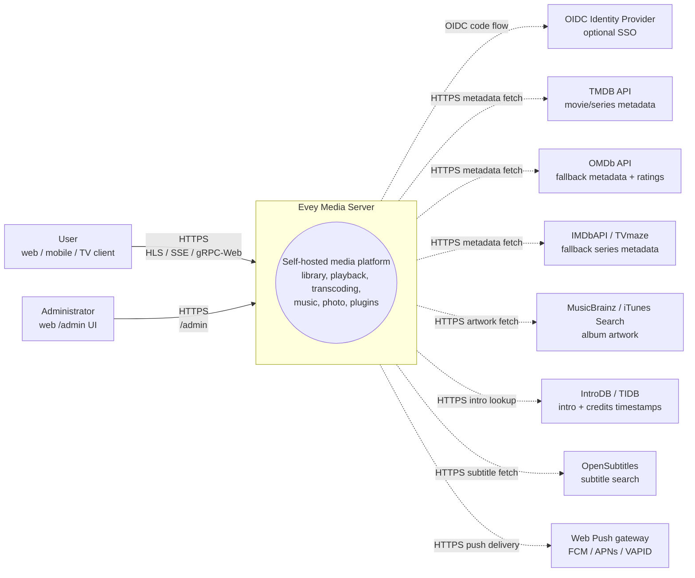
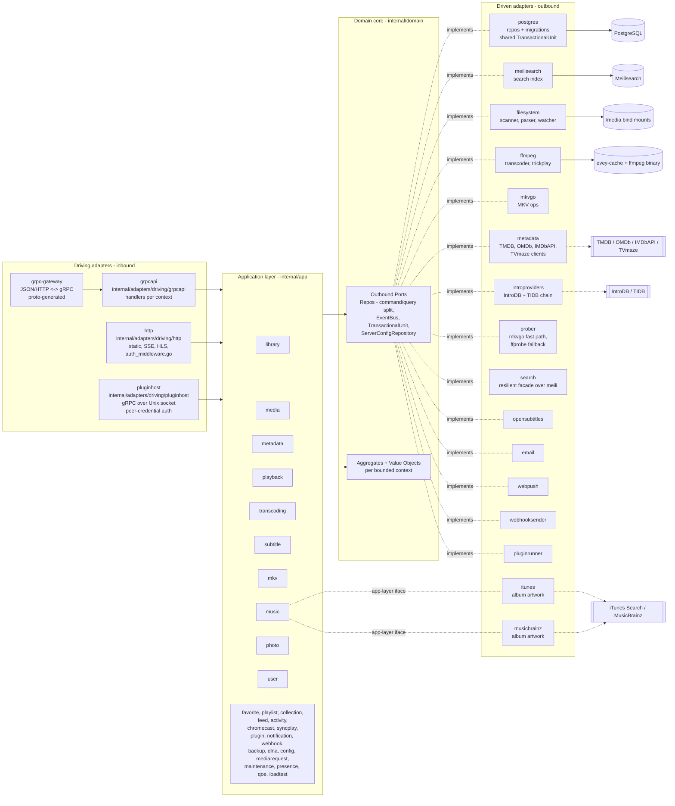

# 架构

Evey 是一个自托管的媒体服务器。后端用 Go（六边形 / DDD），前端是 TypeScript/React 单仓库，移动端是 React Native / Expo。搭建方法和更深入的内部细节见 [DEV.md](../DEV.md)。

## 分层

`internal/` 下采用严格的端口与适配器布局：

- `internal/domain/<context>/` - 纯领域：模型、值对象、**端口**（接口）。不引入任何框架。
- `internal/app/<context>/` - 应用服务。编排端口。IO 通常经过端口；有两个上下文是有意的例外，会直接访问网络：`dlna`（SSDP / UPnP AVTransport）和 `loadtest`（它自己的 HTTP 客户端）。
- `internal/adapters/driven/` - 实现领域端口的出站适配器：`postgres`、`meilisearch`、`ffmpeg`、`mkvgo`、`filesystem`、`prober`、`opensubtitles`、`email`、`webpush`、`webhooksender`、`pluginrunner`、`metadata`、`introproviders`、`search`。另有两个也在这里，但实现的是应用层接口而非领域端口：`itunes` 和 `musicbrainz`，都是 `app/music.AlbumArtFetcher`。
- `internal/adapters/driving/` - 入站适配器：`grpcapi`（+ grpc-gateway HTTP）、`http`（静态文件、认证中间件、SSE、HLS、扩展 iframe 资源）、`pluginhost`（Unix 套接字上的 gRPC 服务器，用对端凭据认证 - 这是沙箱中的扩展子进程回调的宿主 API）。
- `internal/pkg/` - 各上下文共用的技术内核（auth、logger、eventbus、i18n、metrics、tracing、ratelimit、procfork、ssrf、cache……）。服务器配置位于 `internal/config/`；生成的 proto 代码位于 `gen/`。

依赖规则：`adapters -> app -> domain`。领域层从不引入 app 或 adapters。组装在 `cmd/evey/wire*.go` 中完成 - 手写的装配代码，不是 google/wire：`wire.go`、`wire_infra.go`、`wire_services.go`、`wire_adapters.go`、`wire_events.go`、`wire_helpers.go`。

## 限界上下文

`internal/domain/` 和 `internal/app/` 下共有三十个上下文包：19 个在两层都有，2 个只在领域层（`ratings`、`shared`），9 个只在应用层。协作部分通过在共享总线上发布的领域事件完成；应用层也会直接读取相邻上下文的领域包（见[关系](#relations)）。

| 上下文 | 职责 |
| --- | --- |
| `user` | 账户、认证、会话、偏好 |
| `library` | 媒体库、文件夹、扫描任务、媒体索引、人物、合集、个人资料的收藏和点赞（点赞没有应用服务：评分 RPC 直接存取 `UserRatingRepository`）、trickplay、片头/片尾检测 |
| `media`（仅应用层） | 分享链接和流令牌 |
| `mediarequest` | 用户提交的媒体请求 |
| `metadata` | TMDB / OMDb 元数据增强、图片 |
| `playback` | 流、进度、远程控制、正在播放 |
| `transcoding` | ffmpeg 任务、HLS 分段 |
| `subtitle` | 内嵌 + 外挂 + opensubtitles |
| `mkv` | MKV 容器操作（通过 `mkvgo`） |
| `music` | 音频专属的播放 + 标签 |
| `photo` | 照片库 |
| `favorite`（仅应用层） | 按个人资料的收藏；模型和 `FavoriteRepository` 位于 `domain/library` |
| `playlist` | 用户播放列表、智能播放列表 |
| `collection`（仅应用层） | 管理员整理的合集；其端口位于 `domain/library` |
| `ratings`（仅领域层） | 把各国分级（CSA、FSK、MPAA、BBFC、ACB）映射到同一条最低年龄轴上 |
| `feed` | 动态信息流 / 发现 |
| `activity` | 用户活动时间线 |
| `chromecast` | 投屏会话的生命周期 |
| `syncplay` | 多设备同步会话 |
| `plugin` | 扩展注册表、沙箱令牌、生命周期 |
| `notification` | 应用内 + webpush 通知 |
| `webhook` | 出站 webhook |
| `backup` | 数据库 + 配置的备份/恢复 |
| `config`（仅应用层） | 持久化的服务器设置，由 REST 和 gRPC 两个入口写入 |
| `dlna`（仅应用层） | SSDP 发现与 UPnP AVTransport 控制 |
| `loadtest`（仅应用层） | 针对服务器自身的 HTTP 栈模拟 HLS 观众 |
| `maintenance`（仅应用层） | 管理员触发的媒体维护：重建跳转索引、修复日志、撤销、音频完整性 |
| `presence`（仅应用层） | 内存中、不持久化的"此刻谁在线"登记表 |
| `qoe`（仅应用层） | CMCD（CTA-5004）播放遥测的采集与聚合 |
| `shared`（仅领域层） | 横切端口（`EventBus`、`TransactionalUnit`、`ServerConfigRepository`、`ShareLinkRepository`）、类型化 id、游标、流令牌 |

### 关系

- `library` → 发出 `LibraryCreated` / `LibraryDeleted`、`LibraryScanStarted` / `LibraryScanCompleted`、`MediaItemAdded`、`MediaItemRemoved`、`TrickplayGenerated`。`media.item.added` 的消费者有 `notification`、`metadata`（自动增强）、`library` 自身（trickplay 工作器 + 片头检测）以及 `feed`（使类型缓存失效）。
- 搜索索引**不是**事件驱动的：`library.ScanService` 直接调用 `library.SearchIndex` 端口。
- `playback` → 发出 `PlaybackStarted` / `PlaybackStopped`。目前两者都没有专门的订阅者；只有 `webhook` 的 `"*"` 通配订阅会收到它们。
- `user` → 发出 `UserCreated`（没有订阅者）和 `user.password.reset_requested`（由出站适配器 `email` 消费）。
- `plugin` → `pluginrunner` 发布 `plugin.error` / `plugin.started`，`app/plugin` 消费它们用于安全面板。没有把领域事件送进扩展的桥：扩展用限定范围的 JWT 访问 API（见 ADR-0003）。总线本身见 ADR-0010。
- `shared.TransactionalUnit` 包裹跨多个聚合的写操作（见 ADR-0002）。

`internal/domain` 下的任何包都不引入其他上下文的领域包 - 这条规则由 `internal/contractguard/domain_imports_test.go` 强制执行（见[架构守卫](#architecture-guards)）。应用层不受此约束：目前有 14 个应用包引入了相邻上下文的领域包。

## 典型数据流 - "用户播放一个媒体"

1. 移动端/网页客户端调用 `POST /api/v1/playback/start`（grpc-gateway 路由）。
2. `internal/adapters/driving/http` 运行认证中间件（`auth_middleware.go`、`httpAuthMiddleware`），取出会话。
3. `internal/adapters/driving/grpcapi`（`playback_handler.go`）校验 proto，调用 `app/playback.CommandService.StartStream`（命令/查询分离，见 ADR-0009）。
4. `app/playback.CommandService` 调用领域端口：`user.UserRepository`、`playback.SessionQueryRepo`（幂等 + 设备上限）、`playback.SessionCommandRepo`，然后 `shared.EventBus.Publish(PlaybackStarted)`。
5. 出站适配器执行：`postgres` 在 `shared.TransactionalUnit.Do` 作用域内持久化会话；进程内总线（`internal/pkg/eventbus`）异步分发。
6. `PlaybackStarted` 目前没有专门的订阅者：只有 `webhook` 的 `"*"` 通配订阅会收到。
7. 响应通过 grpc-gateway 以 JSON 返回；进度更新通过 SSE / gRPC 流传递。

## 组合根

装配图位于 `cmd/evey/wire.go` 及其同级文件（`wire_infra.go`、`wire_services.go`、`wire_adapters.go`、`wire_events.go`、`wire_helpers.go`）。测试通过注入实现同样领域端口的 fake 来绕过适配器 - 22 个领域包中有 21 个附带 `fakes/` 子包。见 [ADR-0001](adr/0001-hexagonal-architecture.md)。

## 架构守卫

上述规则不只是写在文档里。`internal/contractguard/` 中有分布在 20 个文件里的 31 个静态测试，代码一旦偏离这些规则，构建就会失败。

六边形规则本身是 `domain_imports_test.go` 中的 `TestDomainContextsDoNotImportEachOther`（ADR-0001）。它遍历 `internal/domain`，严格执行：一个上下文可以引入 `internal/domain/shared` 和它自己的包树，`internal/domain` 中的其他一概不行，也永远不能引入 `internal/app` 或 `internal/adapters`。它的范围止于 `internal/domain` - 对应用层不作任何规定。

其余测试守护跨越语言或进程边界的契约，其中包括：

- `TestNoClientReadOfAFieldTheServerNeverWrites` - 客户端读取的每个 proto 响应字段，都必须在服务器某处被写入。
- `TestRegisteredHandlersGetEveryPortTheyDeclare` 和 `TestBootInstallsItsSilentWirings` - 否则会悄无声息失败的装配。
- `TestPostgresRepositoriesBoundTheirQueries` - 每个 Postgres 仓储都为查询设置了超时。
- `TestProcfork_EveryForkGoesThroughCommand` - 每次子进程 fork 都经过 `internal/pkg/procfork`。
- `TestEverySortFieldTheAPIAcceptsHasASQLColumn` 和 `...CanBuildACursorValue` - 排序字段同时存在于 SQL 列映射和游标编码器中。
- `TestEveryWebSurfaceReachingAnAdminRPCIsClassified`，以及它在移动端和电视端的原生对应测试 - 任何调用仅限管理员 RPC 的界面，都要决定谁能看到它。
- `TestEveryAllowedSlotIsMountedOnWebAndMobile` 和 `TestPluginBridgeParityWebMobile` - 各客户端之间扩展界面插槽的一致性。
- `TestImageSubtitleCodecsAgreeAcrossServerAndClients` - 服务器和播放器共用同一份图形字幕编码列表。
- `TestHandWrittenClientTypesMatchTheEndpointTheyCall` - 移动端/电视端手写的响应类型与其调用的接口一致。
- `TestRestartExitCodeAgreesWithTheEntrypoint` - Go 的退出码与 `docker/entrypoint.sh` 对"重启"的含义保持一致。
- i18n 守卫 - 服务器发出的键都存在于词条库中，各语言的占位符一致。

## 延伸阅读

- [DEV.md](../DEV.md) - 构建、运行、迁移、proto 生成
- [docs/CODEBASE_MAP.md](CODEBASE_MAP.md) - 常见改动该动哪些文件
- [docs/playback-serving.md](playback-serving.md) - HLS 视频服务的读路径详解（决策、阶梯、指纹、CMAF/HLS/DASH、mkvgo 与 ffmpeg 的对比）
- [docs/api/](api/) - 生成的 API 参考
- [docs/adr/](adr/) - 架构决策记录

## C4 图

这四张图按照 [C4 模型](https://c4model.com/)由远及近地描述 Evey。所有图都用 Mermaid 渲染，没有二进制文件。节点名就是 `internal/` 下真实的 Go 包名。容器名中，`evey-server`、`evey-postgres` 和 `evey-caddy` 来自 `docker-compose.yml`；`evey-web`、`evey-meilisearch`、`evey-mobile` 和 `evey-mailcatcher` 声明在 `docker-compose.override.yml` 中，只存在于开发拓扑里。

### 第 1 层 - 系统上下文

谁在与 Evey 通信，以及 Evey 会访问哪些第三方。

### 第 2 层 - 容器

`docker compose --env-file .env.dev up` 启动的可部署单元。实线箭头是运行时流量；虚线箭头是对第三方的出站访问。

> **生产环境与这个开发拓扑不同。**安装用的 compose 只声明三个服务 - `evey`、`postgres`、
> `caddy`。没有单独的 `evey-web` 容器（也没有仅开发用的 mailcatcher 和 Metro 打包器）：
> `evey-server` 二进制从 `/srv` 提供构建好的网页界面，所以反向代理把*所有*请求 - 界面和
> API - 都转发到它的 `:9091`。也没有单独的 `evey-meilisearch` 容器：Meilisearch 二进制
> 直接打进了 `evey` 镜像（`Dockerfile` 的 `meili-download` 阶段，固定为 1.12.8），索引保存在
> `/data/meili` 下。见 [installation.md](installation.md) 和 [reverse-proxy.md](reverse-proxy.md)。

### 第 3 层 - 组件（聚焦 `evey-server`）

Go 二进制内部的六边形分层。入站适配器通过接口调用应用服务；应用服务只依赖领域端口；出站适配器实现这些端口。

关于 goroutine：
- gRPC 服务器（`grpc.Server.Serve`）和 HTTP 服务器（网关 + 静态文件）各自在从 `cmd/evey` 主装配中派生出的 goroutine 里运行。
- `app/library` 的扫描任务在一个工作池上运行（每个进行中的媒体库扫描一个 goroutine，见 `library.ScanService`）。
- ffmpeg 任务由出站适配器 `ffmpeg`（`ffmpeg.Transcoder.Start`）通过 `internal/pkg/procfork` fork 出来，每个任务有一个监督 goroutine 负责读空进程的 stderr。
- `shared.EventBus` 异步分发给订阅者：每个订阅者在自己的 goroutine 中运行，慢消费者永远不会阻塞发布者。总线自己不开事务 - 那是处理器的事。
- `pluginrunner` 为每个扩展启动一个子进程；iframe 扩展运行在用户浏览器里，通过 `app/plugin` 签发的签名令牌回连。

### 第 3 层（附加）- 扫描流水线的组件视图

把磁盘上的文件变成可搜索、已增强的媒体的热路径。实线箭头是直接调用；虚线箭头是总线上的领域事件。注意，搜索索引是 `ScanService` 直接调用端口，而不是事件。

请结合上面的"典型数据流"一节来读：播放路径是对称的读路径；扫描流水线是写路径，为读路径所依赖的媒体索引填充数据。
