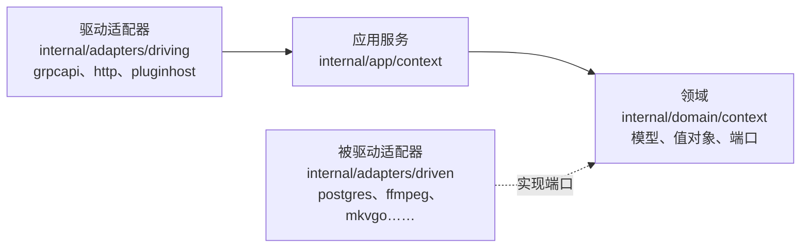
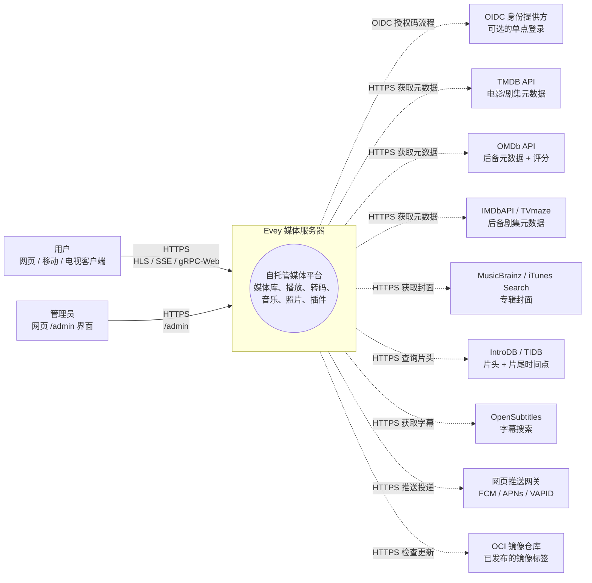
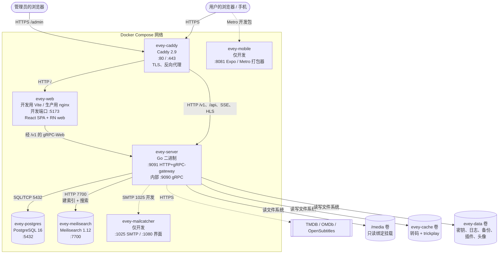
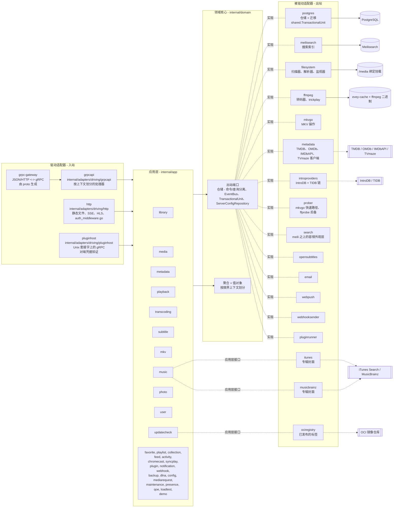
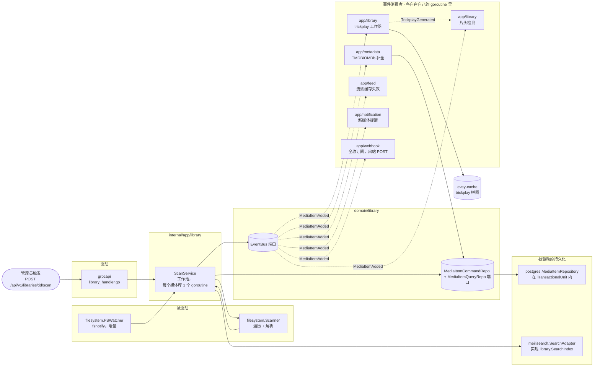

# 架构

服务器的组织结构：`internal/` 下的六边形分层、各个限界上下文、连接它们的事件，以及确保代码遵守这些规则的静态检查。
代码位于 `internal/domain`、`internal/app`、`internal/adapters/{driving,driven}`，在 `cmd/evey/wire*.go` 里组装起来；
分层方式由 [ADR-0001](adr/0001-hexagonal-architecture.md) 决定，仓储的拆分由 [ADR-0009](adr/0009-cqrs-repo-split.md) 决定，
事件总线由 [ADR-0010](adr/0010-event-bus.md) 决定。构建和运行请读 [DEV.md](../DEV.md)；某项改动需要修改哪些文件，请读[代码地图](CODEBASE_MAP.md)。

后端用 Go 编写；网页、移动和电视客户端是 `frontend/` 下的一个 TypeScript/React 统一代码仓库（monorepo）（移动和电视端用 React Native / Expo）。

## 分层

| 目录 | 内容 | 规则 |
| --- | --- | --- |
| `internal/domain/<context>/` | 模型、值对象和**端口**（接口） | 不导入任何框架，不导入其他上下文 |
| `internal/app/<context>/` | 编排各个端口的应用服务 | 输入输出都经过端口；`dlna`（SSDP / UPnP AVTransport）和 `loadtest`（有自己的 HTTP 客户端）是两个有意为之的例外，它们直接访问网络 |
| `internal/adapters/driven/` | 实现端口的出站适配器：`postgres`、`meilisearch`、`ffmpeg`、`mkvgo`、`filesystem`、`prober`、`opensubtitles`、`email`、`webpush`、`webhooksender`、`pluginrunner`、`metadata`、`introproviders`、`search` | 另外三个实现的是应用层的接口，而不是领域端口：`itunes` 和 `musicbrainz`（`app/music.AlbumArtFetcher`）、`ociregistry`（`app/updatecheck`） |
| `internal/adapters/driving/` | 入站适配器：`grpcapi`（+ grpc-gateway HTTP）、`http`（静态文件、身份验证中间件、SSE、HLS、插件 iframe 资源）、`pluginhost`（Unix 套接字上的 gRPC 服务器，按对端凭据验证身份，是沙箱里的插件回调用的宿主 API） | |
| `internal/pkg/` | 共享的技术内核：auth、logger、eventbus、i18n、metrics、tracing、ratelimit、procfork、ssrf、cache…… | |
| `internal/config/` | 服务器配置 | |
| `gen/` | 生成的 proto 代码 | |

依赖规则：`adapters -> app -> domain`。领域层从不导入应用层或适配器。组装代码是手写的（没有用 google/wire），在 `cmd/evey/wire.go`
以及同目录的 `wire_infra.go`、`wire_services.go`、`wire_adapters.go`、`wire_events.go`、`wire_helpers.go` 里。
测试绕过适配器，注入实现同样领域端口的假对象：21 个领域包里有 20 个带有 `fakes/` 子包。

## 限界上下文

`internal/domain/` 和 `internal/app/` 下共有三十二个上下文包：19 个在两层都有，2 个只在领域层（`ratings`、`shared`），11 个只在应用层。
它们部分通过共享总线上的领域事件协作；应用层也会直接读取相邻上下文的领域包（见[关系](#relations)）。

| 上下文 | 职责 |
| --- | --- |
| `user` | 账户、身份验证、会话、偏好 |
| `library` | 媒体库、文件夹、扫描任务、媒体索引、人物、合集、个人资料的收藏和点赞（点赞没有应用服务：评分 RPC 直接存取 `UserRatingRepository`）、trickplay、片头/片尾检测 |
| `media`（仅应用层） | 分享链接和串流令牌 |
| `mediarequest` | 用户提交的媒体请求 |
| `metadata` | TMDB / OMDb 元数据补全、图片 |
| `playback` | 串流、进度、远程控制、正在播放 |
| `transcoding` | ffmpeg 任务、HLS 分段 |
| `subtitle` | 内嵌字幕 + 外部字幕 + opensubtitles |
| `mkv` | MKV 容器操作（通过 [mkvgo](playback/mkvgo.md)） |
| `music` | 音频专用的播放 + 标签 |
| `photo` | 照片库 |
| `favorite`（仅应用层） | 按个人资料的收藏；模型和 `FavoriteRepository` 在 `domain/library` 里 |
| `playlist` | 用户播放列表、智能播放列表 |
| `collection`（仅应用层） | 管理员整理的合集；它的端口在 `domain/library` 里 |
| `ratings`（仅领域层） | 把各国的分级（CSA、FSK、MPAA、BBFC、ACB）映射到同一条最低年龄轴上 |
| `feed` | 动态 / 发现 |
| `activity` | 用户活动时间线 |
| `chromecast` | 投屏会话的生命周期 |
| `syncplay` | 多设备同步会话 |
| `plugin` | 插件注册表、沙箱令牌、生命周期 |
| `notification` | 应用内通知 + 网页推送通知 |
| `webhook` | 出站 Webhook |
| `backup` | 数据库 + 配置的备份和恢复 |
| `config`（仅应用层） | 持久化的服务器设置，REST 和 gRPC 两个入口都会写入 |
| `dlna`（仅应用层） | SSDP 发现和 UPnP AVTransport 控制 |
| `loadtest`（仅应用层） | 模拟观众访问服务器自己的 HTTP 栈：HLS，或者在客户端判定为直接播放时访问原始文件 |
| `maintenance`（仅应用层） | 由管理员触发的媒体维护：重建跳转索引、修复日志、撤销、音频完整性 |
| `presence`（仅应用层） | 内存里、不持久化的“此刻谁在线”登记表 |
| `qoe`（仅应用层） | 接收并汇总 CMCD（CTA-5004）播放遥测数据 |
| `demo`（仅应用层） | 公开演示实例（`EVEY_DEMO=1`）：通过产品自己的服务预置账户、媒体库和自由许可的媒体，并能自我重置 |
| `updatecheck`（仅应用层） | 把正在运行的版本和镜像仓库发布的版本对比，告诉管理员；它从不更新任何东西 |
| `shared`（仅领域层） | 横切的端口（`EventBus`、`TransactionalUnit`、`ServerConfigRepository`、`ShareLinkRepository`）、类型化的 id、游标、串流令牌 |

### 关系

| 发出方 | 事件 | 由谁消费 |
| --- | --- | --- |
| `library` | `LibraryCreated` / `LibraryDeleted`、`LibraryScanStarted` / `LibraryScanCompleted`、`MediaItemAdded`、`MediaItemRemoved`、`TrickplayGenerated` | `media.item.added`：`notification`、`metadata`（自动补全）、`library` 自己（trickplay 工作器 + 片头检测）、`feed`（使流派缓存失效） |
| `playback` | `PlaybackStarted` / `PlaybackStopped` | 目前没有专门的订阅者；只有 `webhook` 的 `"*"` 通配订阅会收到 |
| `user` | `UserCreated`、`user.password.reset_requested` | 前者没有订阅者；后者由 `email` 被驱动适配器消费 |
| `pluginrunner` | `plugin.error` / `plugin.started` | `app/plugin` 用于它的安全仪表板，`notification` 用于通知管理员 |
| `shared` | `ServerConfigChanged` | 那些无需重启就能应用管理面板中已保存设置的服务（SMTP、时区、CPU 预算……） |

- 搜索索引**不是**由事件驱动的：`library.ScanService` 直接调用 `library.SearchIndex` 端口。
- 没有把领域事件传给插件的机制：插件通过限定权限范围的 JWT 访问 API（[ADR-0003](adr/0003-plugin-scoped-tokens.md)）。
  总线本身见 [ADR-0010](adr/0010-event-bus.md)。
- `shared.TransactionalUnit` 包裹涉及多个聚合的写入（[ADR-0002](adr/0002-transactional-unit-port.md)）。

`internal/domain` 下的任何包都不会导入其他上下文的领域包，这条规则由 `internal/contractguard/domain_imports_test.go` 强制执行
（见[架构检查](#architecture-guards)）。应用层不受这条规则约束：目前有 15 个应用包导入了相邻上下文的领域包。

## 典型的数据流：“用户播放一个媒体”

1. 移动或网页客户端调用 `POST /api/v1/playback/start`（grpc-gateway 路由）。
2. `internal/adapters/driving/http` 运行它的身份验证中间件（`auth_middleware.go`，`httpAuthMiddleware`），取出会话。
3. `internal/adapters/driving/grpcapi`（`playback_handler.go`）校验 proto，调用 `app/playback.CommandService.StartStream`（命令和查询分离，见 [ADR-0009](adr/0009-cqrs-repo-split.md)）。
4. `app/playback.CommandService` 调用领域端口：`user.UserRepository`、`playback.SessionQueryRepo`（幂等 + 设备数量上限）、`playback.SessionCommandRepo`，然后 `shared.EventBus.Publish(PlaybackStarted)`。
5. 被驱动适配器执行：`postgres` 在一个 `shared.TransactionalUnit.Do` 范围内保存会话；进程内的总线（`internal/pkg/eventbus`）异步分发事件。
6. `PlaybackStarted` 目前没有专门的订阅者：只有 `webhook` 的 `"*"` 通配订阅会收到它。
7. 响应以 JSON 形式经 grpc-gateway 返回；进度更新通过 SSE / gRPC 流传输。

播放器请求清单文件和分段之后发生的事情，是[播放链路](playback-serving.md)的主题。

## 架构检查

上面这些规则不只是写在文档里。`internal/contractguard/` 里有分布在 30 个文件中的 58 个静态测试，代码一旦偏离这些规则，构建就会失败。

六边形规则本身是 `domain_imports_test.go` 里的 `TestDomainContextsDoNotImportEachOther`（ADR-0001）。它遍历 `internal/domain`，
严格执行这一点：一个上下文可以导入 `internal/domain/shared` 和它自己的包树，`internal/domain` 里的其他内容一律不能导入，
也永远不能导入 `internal/app` 或 `internal/adapters`。它的范围止于 `internal/domain`：对应用层不做任何约束。

其余的检查保护跨越语言或进程边界的约定，其中包括：

| 检查 | 它拒绝什么 |
| --- | --- |
| `TestNoClientReadOfAFieldTheServerNeverWrites` | 客户端读取、但服务器代码从不写入的 proto 响应字段 |
| `TestRegisteredHandlersGetEveryPortTheyDeclare`、`TestBootInstallsItsSilentWirings` | 否则会在没有任何提示的情况下失败的组装 |
| `TestPostgresRepositoriesBoundTheirQueries` | 没有超时的 Postgres 仓储查询 |
| `TestProcfork_EveryForkGoesThroughCommand` | 绕过 `internal/pkg/procfork` 创建的子进程 |
| `TestEverySortFieldTheAPIAcceptsHasASQLColumn`、`...CanBuildACursorValue` | 在 SQL 列映射或游标编码器里缺失的排序字段 |
| `TestEveryWebSurfaceReachingAnAdminRPCIsClassified`，以及它在移动和电视端的原生对应测试 | 调用仅限管理员的 RPC、却没有决定谁能看到的界面 |
| `TestEveryAllowedSlotIsMountedOnWebAndMobile`、`TestPluginBridgeParityWebMobile` | 只在一个客户端上存在的插件界面插槽或桥接消息 |
| `TestImageSubtitleCodecsAgreeAcrossServerAndClients` | 播放器上另起一份位图字幕编码列表 |
| `TestHandWrittenClientTypesMatchTheEndpointTheyCall` | 与其端点不一致的手写移动/电视响应类型 |
| `TestOnlyThePlanDecidesPlayback`、`TestNoCallerDerivesDownstreamOfThePlaybackPlan` | 在计划解析器之外做出的播放决定（[ADR-0030](adr/0030-one-plan-one-decision.md)） |
| `TestRestartExitCodeAgreesWithTheEntrypoint` | Go 的退出码和 `docker/entrypoint.sh` 对“重启”的含义理解不一致 |
| `TestServerEmittedI18nKeysExistInCatalogue`、`TestI18nPlaceholdersAgreeAcrossLocales` | 服务器发出的键在翻译目录里不存在，或者不同语言之间的占位符不一致 |

## C4 图

四张图按照 [C4 模型](https://c4model.com/)，从远到近逐级放大来描述 Evey。节点名称就是 `internal/` 下真实的 Go 包名。
`evey-server`、`evey-postgres` 和 `evey-caddy` 的容器名来自 `docker-compose.yml`；`evey-web`、`evey-meilisearch`、`evey-mobile` 和 `evey-mailcatcher`
是在 `docker-compose.override.yml` 里声明的，只存在于开发环境的拓扑中。

### 第 1 层：系统上下文

谁和 Evey 通信，以及 Evey 会访问哪些第三方。

### 第 2 层：容器

由 `docker compose --env-file .env.dev up` 启动的可部署单元。实线箭头是运行时的流量；虚线箭头是对外访问第三方。

!!! note "生产环境和这个开发拓扑不同"
    安装用的 compose 只声明一个服务：`evey`。没有单独的 `evey-web` 容器（也没有仅供开发的 mailcatcher 和 Metro 打包器）：
    二进制程序从 `/srv` 提供构建好的网页界面，所以反向代理把*所有东西*，界面和 API，都转发到它的 `:9091`。
    Postgres 和 Meilisearch 在同一个容器里运行，由 `docker/entrypoint.sh` 管理：PostgreSQL 17 的数据放在 `/data/postgres` 下，
    Meilisearch 二进制（`Dockerfile` 的 `meili-download` 阶段，固定为 1.12.8）的索引放在 `/data/meili` 下。
    仓库自带的 `docker-compose.yml` 保留了单独的 `postgres` 和 `caddy` 服务，在[高级部署](operations/advanced-deployments.md)里有说明。
    另见[安装](installation.md)和[反向代理配置](reverse-proxy.md)。

### 第 3 层：组件（放大 `evey-server`）

Go 二进制内部的六边形分层。驱动适配器通过接口调用应用服务；应用服务只依赖领域端口；被驱动适配器实现这些端口。

关于 goroutine：

- gRPC 服务器（`grpc.Server.Serve`）和 HTTP 服务器（网关 + 静态文件）各自在自己的 goroutine 里运行，由 `cmd/evey` 的主组装流程启动。
- `app/library` 的扫描任务在一个工作池里运行（每个正在扫描的媒体库一个 goroutine，见 `library.ScanService`）。
- ffmpeg 任务由 `ffmpeg` 被驱动适配器（`ffmpeg.Transcoder.Start`）通过 `internal/pkg/procfork` 创建子进程，每个任务有一个负责监督的 goroutine 读取进程的 stderr。
- `shared.EventBus` 异步分发给各个订阅者：每个订阅者在自己的 goroutine 里运行，所以慢的消费者永远不会阻塞发布者。总线自己不开启事务；事务由处理器负责。
- `pluginrunner` 为每个插件创建一个子进程；iframe 插件运行在用户的浏览器里，凭借 `app/plugin` 签发的签名令牌与服务器通信。

### 第 3 层（附加）：放大扫描流程

把磁盘上的文件变成可搜索、已补全信息的媒体的热路径。实线箭头是直接调用；虚线箭头是总线上的领域事件。
搜索索引是 `ScanService` 直接调用端口完成的，不是事件。

请结合上面的“典型的数据流”一节来读：播放路径是与之对称的读取路径；扫描流程则是写入路径，它预先填好读取路径所依赖的媒体索引。

## 延伸阅读

- [DEV.md](../DEV.md) - 构建、运行、数据库迁移、proto 生成
- [代码地图](CODEBASE_MAP.md) - 常见改动需要修改哪些文件
- [播放链路](playback-serving.md) - HLS 视频提供的读取路径，深入讲解
- [服务器 API](api/) - 生成的 API 参考
- [决策记录](adr/) - 架构决策记录

<!-- sources
layering: internal/domain ; internal/app ; internal/adapters/driven ; internal/adapters/driving ; internal/pkg ; internal/config ; gen ; cmd/evey/wire.go, wire_infra.go, wire_services.go, wire_adapters.go, wire_events.go, wire_helpers.go
app-layer interfaces: internal/app/music/album_art_chain.go - AlbumArtFetcher ; internal/adapters/driven/ociregistry (app/updatecheck)
network exceptions: internal/app/dlna/service.go ; internal/app/loadtest/runner.go
events and subscribers: internal/app/notification/command_service.go ; internal/app/metadata/command_service_enrich.go ; internal/app/library/trickplay_service.go ; internal/app/library/intro_detection_service.go ; internal/app/feed/genre_cache.go ; internal/app/webhook/service.go ; internal/adapters/driven/email/password_reset_emailer.go ; internal/app/plugin/security_dashboard_service.go ; internal/app/config/smtp.go, timezone.go, cpu_budget.go
guards: internal/contractguard/*_test.go - TestDomainContextsDoNotImportEachOther, TestOnlyThePlanDecidesPlayback, TestNoCallerDerivesDownstreamOfThePlaybackPlan, TestServerEmittedI18nKeysExistInCatalogue, TestI18nPlaceholdersAgreeAcrossLocales
topology: docker-compose.yml ; docker-compose.override.yml ; Dockerfile - MEILI_VERSION, postgresql-17 ; docker/entrypoint.sh - PG_MAJOR
-->
