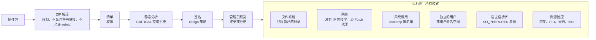

# 插件沙箱与威胁模型 { #plugin-sandbox-and-threat-model }

服务器为限制插件所采取的措施：安装时的检查、运行时的各层防护、各种沙箱模式，以及每一层仍然无法阻止的情况。
代码位于 `internal/adapters/driven/pluginrunner`（安装分析、沙箱）、`cmd/evey-plugin-launcher`（Landlock 和内核 seccomp 过滤器）、
`sandbox/sandbox.c`（`LD_PRELOAD` 过滤器）以及 `internal/adapters/driving/pluginhost`（插件调用的宿主 API）；
设计依据 [ADR-0012](https://github.com/eveyproject/evey/blob/master/docs/adr/0012-plugin-token-deny-by-default.md)、
[ADR-0013](https://github.com/eveyproject/evey/blob/master/docs/adr/0013-userspace-plugin-resource-monitor.md) 和
[ADR-0014](https://github.com/eveyproject/evey/blob/master/docs/adr/0014-landlock-plugin-sandbox.md)。如果您在编写插件，想知道可以声明什么、什么会被拒绝，请阅读
[权限与插槽](plugins/security-model.md)；想知道您的机器会使用哪种沙箱，请阅读[插件沙箱设置](plugins/sandbox-deployment.md)。

## 威胁模型 { #threat-model }

插件作为独立的进程运行，通过 Unix 套接字上的 gRPC 和服务器通信。服务器默认不信任任何插件代码。它要防范的风险，从最严重到最轻：

1. **冒充** - 插件假装成另一个插件，以使用对方的权限。
2. **权限提升** - 插件逃出沙箱，以服务器的身份执行命令。
3. **文件系统访问** - 插件读写自己目录之外的内容，尤其是服务器的机密。
4. **网络外泄** - 插件把数据发送到它自己挑选的主机。
5. **滥用资源** - 挖矿、fork 炸弹、耗尽内存或磁盘。
6. **供应链** - 分析无法读取的混淆代码或编译代码。

## 安装时 { #at-install }

### ZIP 解压 { #zip-extraction }

在写入任何文件之前（`pluginrunner/zip.go`）：

- 最多 5,000 个条目，单个文件最大 100 MB，解压后总共最多 500 MB；解压后超过 1 MB 时，压缩比不得超过 100:1（防止解压炸弹）；
- 路径跑出压缩包范围（`..`）的条目会被拒绝；
- 符号链接会被拒绝；
- setuid、setgid 和 sticky 位会被去掉。

### 清单和权限 { #manifest-and-permissions }

清单声明插件申请的权限。未知的权限会导致安装被拒绝。之后这些权限会被强制执行：

- **`subprocess`** 允许创建子进程。没有它时，内核会拒绝创建进程（`-deny-fork`），对于解释型插件，`LD_PRELOAD` 过滤器还会拒绝 `execve`。
- **`native-binary`** 允许包中包含编译好的代码或压缩包，分析无法读取这些内容。
- **API 权限**（`api.library`、`api.user`、`api.metadata`、`media.read`、`media.write`、`notification.sender`……）在每次调用宿主时都由
  [`PluginPermissionInterceptor`](https://github.com/eveyproject/evey/blob/master/internal/adapters/driving/grpcapi/plugin_interceptor.go) 检查。

完整列表见[权限与插槽](plugins/security-model.md#permissions-catalog)。

### 静态分析 { #static-analysis }

包里的每个文件都会由
[`pluginrunner.AnalyzePlugin`](https://github.com/eveyproject/evey/blob/master/internal/adapters/driven/pluginrunner/analyzer.go) 扫描，
扫描之前先做一遍规范化，还原常见的混淆手法（别名、字符串拼接、f-string）：

| 类别 | 严重程度 | 示例 |
|---|---|---|
| `shell_exec` | WARNING / CRITICAL | `os.system`、`subprocess.run`、`child_process.exec`、PHP 的 `system()`/`shell_exec()`/`proc_open()`、`preg_replace /e`、Ruby 的 `Kernel.exec`/`system`、`open('\|cmd')`（CRITICAL）；Ruby 的反引号（WARNING） |
| `network` | WARNING / CRITICAL | `requests.get`、`fetch`、反向 shell 和绑定 shell |
| `filesystem` | WARNING / CRITICAL | `/etc/passwd`、`.ssh/`、`rm -rf`、符号链接操作 |
| `obfuscation` | WARNING / CRITICAL | `eval`、`__builtins__`、`base64 -d \| bash` 和其他把解码结果送入 shell 的写法（CRITICAL）；base64 解码、十六进制序列（WARNING） |
| `privilege` | CRITICAL | `setuid`、`chmod 4777`、`sudo`、向 PID 1 发信号 |
| `cryptomining` | CRITICAL | `stratum+tcp`、`xmrig`、`cryptonight` |
| `runtime_install` | CRITICAL | `pip install`、`npm install`、`curl ... \| sh` |
| `dynamic_import` | CRITICAL | `__import__()`、`importlib.import_module` |
| `sandbox_escape` | CRITICAL | `vm.runIn*`、`process.binding`、`new Function`、`__subclasses__()`、`__mro__` |
| `deserialization` | CRITICAL / WARNING | `pickle.loads`、`marshal.loads`、`__reduce__`；WARNING：不带 Loader 的 `yaml.load()` |
| `native_code` | CRITICAL / WARNING | `ctypes.CDLL`、`ffi.Library`；WARNING：Go 的 `unsafe` |
| `compiled_binary` | WARNING，然后 BLOCK | `.so`、`.dll`、`.exe`、`.wasm`、`.jar` |
| `embedded_archive` | WARNING，然后 BLOCK | `.zip`、`.tar.gz` |
| `mime_mismatch` | 按 CRITICAL 处理 | 扩展名自称是图片，内容却是别的东西 |
| `suspicious_url` | WARNING | URL 字面量里出现非 HTTP 的协议 |
| `unvendored_deps` | WARNING | 有 `requirements.txt` 或 `package.json`，却没有随包附带依赖模块 |

出现 CRITICAL 发现或 `mime_mismatch` 时，安装会被拒绝。`compiled_binary` 和 `embedded_archive` 也会导致拒绝，除非清单声明了 `native-binary`。

!!! note "分析无法保证的事情"
    它是按模式工作的。它能还原已知的几类混淆（分好几步把字符串拼接成可调用对象、按名称查找内置函数、`Function.constructor` 逃逸），
    每一类在 `tests/fixtures/plugins/malicious/` 里都有一个回归测试样例；但它无法跟踪运行时进行的每一种变换
    （`strrev("metsys")`、解码从文件里读出的载荷）。分析之前会先去掉注释。
    **实际执行限制的是运行时的沙箱，而不是分析**：即使插件中的某个模式未被分析发现，该插件仍然无法读取服务器的数据，
    无法调用被拒绝的系统调用，无法超出资源限制，也无法调用它没有权限的宿主方法。

### 签名 { #signature }

插件包可以用 cosign 签名（`cosign sign-blob --key`，对 ZIP 的 SHA-256 做 ECDSA P-256）。作者的公钥以 `cosign.pub` 的名字随包一起分发；Evey 用它在进程内离线验证分离的 `.sig`（`pluginrunner/cosign.go`），并计算该密钥的指纹（对 DER 公钥取 `sha256:`）。由此得到三件事：

- **信任**：该指纹在不在本实例的**受信任的发布者**列表里（`管理 → 插件`，或由 `EVEY_PLUGINS_COSIGN_PUBLIC_KEY` 在启动时预置）。受信任的密钥会显示发布者的名字；未知的密钥显示它的指纹和**信任此密钥**操作。
- **连续性**：指纹在安装时固定在插件上。用另一把密钥签名的更新（`publisher-changed`）或不再签名的更新（`signature-lost`），无论策略如何都会被拒绝，直到管理员在更新对话框里接受新的发布者（`accept_new_publisher`）。
- **策略**：`EVEY_PLUGINS_COSIGN_POLICY` 决定这个结论会带来什么后果。

| 策略 | 效果 |
|---|---|
| `off` | 不检查签名，也不记录任何东西。 |
| `warn`（默认） | 记录并展示结论；未签名、不受信任和无效的包照常安装。 |
| `enforce` | 只有受信任的发布者签名的包才能安装或更新。 |

签名证明的是：这个包就是其发布者发布的那个包，并且更新来自同一个发布者。它不说明代码本身如何，那由分析、权限和沙箱来判断。

### 管理员预览 { #administrator-preview }

`POST /api/v1/admin/plugins/preview` 只运行分析，不安装。管理员会看到申请的权限、每一项发现及其文件、行号和类别、代码里找到的 URL，
以及包的 SHA256；管理员确认过的哈希会在更新时核对，首次安装也可以用 URL 里的 `#sha256:` 片段来固定，所以被分析的包就是被安装的包。更新会显示权限、插槽和主机方面的差异，
新增的权限需要明确确认。

对于较高的权限，管理员就是信任的边界：Evey 把暴露面展示出来，由管理员决定接受还是拒绝。

## 运行时 { #at-run-time }

在每一种[沙箱模式](#sandbox-modes)下，下面六层都会生效；前两层具体怎样实施，取决于模式。

### 文件系统 { #filesystem }

插件只看得到自己的目录和自己的套接字目录，看不到服务器的数据：靠的是 Landlock 允许列表（`landlock`），或者 bubblewrap 的挂载白名单
（`bubblewrap`、`strict`）。在不支持 Landlock 的内核上使用 `basic` 模式时，没有按路径的限制：这时保护服务器机密的，是独立的用户和文件权限。

### 网络 { #network }

无论声明了什么，插件都**没有直接的网络访问**：所有 IP 套接字都会被拒绝（`landlock` 和 `basic` 下用 `-deny-inet`，`bubblewrap` 和 `strict` 下用网络命名空间）。
带 `network` 权限的插件通过自己的 Unix 套接字调用宿主的 `Fetch` 方法。宿主在 `internal/adapters/driving/pluginhost/fetch.go` 里：

- 按插件的 `external_fetch` 列表检查目标（精确的主机名，不区分大小写；`*.example.com` 通配符在安装时会被拒绝；端口后缀会被忽略）；
- 只允许 `http` 和 `https`，只允许 `GET` 和 `HEAD`；
- 通过一个防 SSRF 的客户端（`internal/pkg/ssrf`）连接，它在 DNS 解析之后拒绝私有、保留和链路本地地址，
  所以 DNS 重绑定和重定向都会被再次检查（重定向到列表之外的主机会被拒绝）；
- 不附加服务器的任何凭据，响应体最大 8 MiB，请求头最大 8 KiB，20 秒后放弃。

这关闭了直接外连所留下的途径（像 `169.254.169.254` 这样的 IP 地址、插件自带的 DNS 解析器）。剩下的问题是：代理控制的是一次调用*去哪里*，
而不是它*带了什么*。见[已知限制](#known-limits)。

!!! tip "给运维人员的建议"
    代理把 SSRF 的暴露面转移到了宿主上。在 `evey-server` 容器上添加一条与代码无关的出站规则，可以提供第二层保护：
    丢弃 `169.254.0.0/16`，并把内部网络限制为只能访问数据库和搜索服务的端点。

### 系统调用 { #system-calls }

两个 seccomp 过滤器拒绝同样一批危险的系统调用：

1. **内核过滤器**，由 [`evey-plugin-launcher`](https://github.com/eveyproject/evey/blob/master/cmd/evey-plugin-launcher) 在启动插件之前安装
   （[`seccomp_linux.go`](https://github.com/eveyproject/evey/blob/master/cmd/evey-plugin-launcher/seccomp_linux.go)）。
   插件及其子进程都会继承它，它**也覆盖编译好的静态二进制文件**。系统调用的架构不匹配时，进程会被杀死。在 `landlock` 和 `basic` 下使用。
2. **`LD_PRELOAD` 过滤器**，[`sandbox/sandbox.c`](https://github.com/eveyproject/evey/blob/master/sandbox/sandbox.c)，加载到没有声明 `subprocess` 的解释型插件里。
   它还会拒绝 `execve`/`execveat`，并把插件标记为不可转储。在 `landlock`、`basic` 和 `strict` 下使用。
   如果这个库不存在，这类插件会被拒绝启动（`plugin.error`）。

被拒绝的系统调用：

| 类别 | 系统调用 |
|---|---|
| 调试 | `ptrace`、`process_vm_readv`、`process_vm_writev` |
| 信号 | `tgkill`、`rt_sigqueueinfo`、`rt_tgsigqueueinfo`，目标是插件自己以外的任何进程时（两个过滤器都拒绝）；`kill` 在内核过滤器里同样如此，在 `LD_PRELOAD` 过滤器里则无论目标是谁都拒绝；`tkill` 在内核过滤器里拒绝（`LD_PRELOAD` 过滤器允许它发给插件自己）；`pidfd_send_signal`、`pidfd_getfd`（窃取文件描述符）。运行时重新抛出信号、或抢占自己的线程，仍然可以正常工作。在 Landlock ABI 6 及以上，插件也无法向沙箱外的进程发信号 |
| 文件描述符的信号所有者（内核过滤器） | 指向插件自身以外任何进程的 `fcntl` `F_SETOWN`、指向默认 `SIGIO` 以外任何信号的 `F_SETSIG`、`F_SETOWN_EX`，以及 `ioctl` `FIOSETOWN`/`SIOCSPGRP`：没有这一条，一个所有者是服务器、信号是 `SIGKILL` 的描述符会在下一次写入时杀死服务器 |
| 挂载 | `mount`、`umount2`、`pivot_root`、`chroot` |
| 命名空间 | `unshare`、`setns`，以及带有 `CLONE_NEW*` 标志的 `clone`（换了个名字的 unshare），对所有插件都适用 |
| 内核模块 | `init_module`、`finit_module`、`delete_module` |
| BPF、perf | `bpf`、`perf_event_open` |
| 硬件 I/O | `ioperm`、`iopl`（仅 x86-64，只有那里有这两个调用） |
| 交换分区 | `swapon`、`swapoff` |
| 系统控制 | `syslog`、`reboot`、`settimeofday`、`clock_settime`、`clock_adjtime`、`adjtimex` |
| Kexec | `kexec_load`、`kexec_file_load` |
| 内核漏洞利用的基本手段 | `io_uring_setup`、`io_uring_enter`、`io_uring_register`、`userfaultfd` |
| 身份 | `setuid`、`setgid`、`setreuid`、`setregid`、`setresuid`、`setresgid`、`capset` |
| 密钥环 | `add_key`、`request_key`、`keyctl` |

对于没有 `subprocess` 权限的插件，内核还会拒绝创建进程（`fork`、`vfork`、不带 `CLONE_THREAD` 的 `clone`；`clone3` 返回 `ENOSYS`，
这样 C 库会退回使用 `clone`）；线程仍然可以正常工作。

这是一份**黑名单**：`open`、`read`、`write`、`mmap`、Unix `socket` 和 `connect` 仍然允许。路径由文件系统那一层限制，而不是靠 seccomp。
在 `bubblewrap` 下不使用启动器：静态二进制文件在那里没有 seccomp 过滤器，由命名空间和挂载白名单进行限制。

### 独立的用户 { #a-separate-user }

插件可以以它自己的用户运行，和服务器（1000）不同，这样仅凭文件权限，它就无法读取服务器的机密。
每个插件根据自己的 id 得到 uid，范围是 40000 到 59999，重启后保持不变；它保留服务器的组，这个组只读取已安装的文件。
两个 id 可能落到同一个 uid：这两个插件就共用它。由 `EVEY_PLUGINS_UID_SEPARATION` 控制：

| 值 | 什么时候切换用户 |
|---|---|
| `auto`（默认） | 只在沙箱最终解析为 `basic` 时，这是文件权限成为机密唯一保护的唯一情况 |
| `on` | 始终切换，作为额外的一层 |
| `off` | 从不切换 |

切换由启动器完成，它持有 `cap_setuid`；服务器本身不带任何特权或能力运行。启动器拒绝切换到 1000 以下的任何用户。
如果无法切换，`basic` 下的插件会被拒绝（在那里，用户是唯一的保护），而在 `landlock` 下，插件会以服务器的用户身份运行，并记录一条警告。
在 `bubblewrap` 和 `strict` 下，由用户命名空间承担这个角色。

启用时，签名密钥（`0600`）和备份（`0700` 目录、`0600` 文件）在运行时只有所有者能访问，即使 `/data` 是绑定挂载的也一样。
插件之间靠各自的 uid 隔离，外加文件系统那一层。以 root 运行的服务器（不推荐）则把所有插件都切换到同一个用户 1001：那时只有文件系统那一层把插件隔开。

### 宿主套接字的身份验证 { #host-socket-authentication }

每个插件都有自己的套接字 `/tmp/evey/plugins/<plugin_id>/host.sock`，由它自己的 gRPC 服务器提供服务。每次调用时，服务器从内核读取调用方的 PID
（`SO_PEERCRED`，用户空间无法伪造），并和插件启动时记录的 PID 比较。插件的身份来自套接字，从不来自请求头。
所以插件无法冒充另一个插件，无法调用另一个插件的套接字，也无法借子进程转发调用。PID 不匹配时会记录一条警告。

另一个方向也以同样的方式检查：服务器通过同一目录下的 `plugin.sock` 和插件通信，如果在上面监听的进程不是插件本身，就拒绝连接（同样靠 `SO_PEERCRED`）。
每个插件有独立用户时，该目录带有 sticky 位，共用组里的相邻插件无法删除这个套接字来绑定自己的套接字。

### 资源限制 { #resource-limits }

一个运行在用户空间的监控程序（在无特权的容器里用不了 cgroups）每 2 秒读取一次 `/proc/<pid>`，停止超出限制的插件
（[ADR-0013](https://github.com/eveyproject/evey/blob/master/docs/adr/0013-userspace-plugin-resource-monitor.md)）：

| 限制 | 默认值 | 检查频率 |
|---|---|---|
| 内存（RSS） | 256 MiB | 每轮检查 |
| 进程和线程 | 64 | 每轮检查（只统计主进程的线程数） |
| 插件目录占用的磁盘 | 100 MiB | 每 15 轮一次，大约 30 秒 |
| CPU 优先级 | `nice` 10，启动时设置 | - |

同一轮检查还会标记让 CPU 持续高于 90% 大约 30 秒的插件，并停止以同样方式让图形引擎持续满载的、获得了 `hardware.gpu` 权限的插件。
同一组资源限制在**管理 → 插件 → 资源限制**里设置，对每个插件都生效；环境变量 `EVEY_PLUGINS_MEMORY_MB`、`EVEY_PLUGINS_PIDS_MAX`、`EVEY_PLUGINS_DISK_MAX_MB`
和 `EVEY_PLUGINS_CPU_NICE` 设置启动时的默认值。

### 界面隔离 { #interface-isolation }

插件的界面运行在一个 `<iframe sandbox="allow-scripts">` 里，没有同源访问，不能用表单，不能弹出窗口，
其 Content-Security-Policy 只允许连接到它的 `external_fetch` 主机。桥接层（`frontend/packages/client/src/plugins/hostProtocol.ts`）
限制它能向页面提出的请求：`toast` 每秒最多 3 条，每条 200 个字符，不能含 HTML；`navigate` 只接受 `/home`、`/library`、`/media`、`/player`、
`/settings` 和 `/search`；`resize` 在 50 px（移动和电视端为 60）到 800 px 之间。插槽在安装时检查。

### 服务器加固 { #server-hardening }

服务器启动时把自己标记为不可转储（`PR_SET_DUMPABLE=0`，[`hardening_linux.go`](https://github.com/eveyproject/evey/blob/master/cmd/evey/hardening_linux.go)）：
以同一用户运行的进程无法通过 `/proc` 读取它的内存或环境变量，这样即使在没有 Landlock 的内核上，也能保护内存里的签名密钥以及数据库和搜索服务的密码。

### 崩溃通知 { #crash-notification }

当需要沙箱库的插件缺少这个库，或者插件出错退出时，运行器会发布一个 `plugin.error` 事件。
通知服务通过已配置的渠道把它转给管理员，**安全仪表板**也会记录下来。

## 沙箱模式 { #sandbox-modes }

模式决定文件系统和网络怎样被限制。`EVEY_PLUGINS_SANDBOX_MODE` 设置初始值（默认 `auto`）；也可以在**管理 → 插件 → 资源限制 → 沙箱模式**里修改。
运行器在 [`applySandbox`](https://github.com/eveyproject/evey/blob/master/internal/adapters/driven/pluginrunner/runner_sandbox.go) 里应用它。
在每一种模式下都有：没有直接的 IP 外连、资源监控，以及宿主套接字的身份验证。

| 层 | landlock | basic | bubblewrap | strict |
|---|---|---|---|---|
| 文件系统 | Landlock 允许列表 | 没有 Landlock 时无（只有文件权限） | 挂载白名单 | 挂载白名单 |
| 网络 | `-restrict-net` + `-deny-inet` | `-deny-inet` | 网络命名空间 | 网络命名空间 |
| 内核 seccomp（也覆盖静态二进制） | 是 | 是 | 否 | 否 |
| `LD_PRELOAD` seccomp（没有 `subprocess` 的解释型插件） | 是 | 是 | 否 | 是 |
| 独立的用户 | 设为 `on` 时 | 是（`auto`） | 用户命名空间 | 用户命名空间 |
| 资源限制 | 是 | 是 | 是 | 是 |

### `auto`（默认） { #auto-default }

在第一个插件启动时确定一次，选用宿主支持的最强模式：内核强制执行 Landlock，*并且*找得到 `evey-plugin-launcher` 二进制文件
（在服务器二进制旁边、在 `$PATH` 里，或在 `EVEY_PLUGIN_LAUNCHER` 指定的位置）时，选 **landlock**；否则，如果测试沙箱确实能够创建
（[`ProbeSandbox`](https://github.com/eveyproject/evey/blob/master/internal/adapters/driven/pluginrunner/sandbox_probe.go)），选 **bubblewrap**，实际上这意味着裸机或特权容器；
再否则，选 **basic**。Landlock 排在第一，是因为它不需要任何特权，而且能在 Docker 默认的安全配置下运行。
最终选定的模式会记录在日志里，并显示在**管理 → 插件 → 安全仪表板**的**主机沙箱**一行。

| 部署方式 | `auto` 得到什么 |
|---|---|
| 内核较新的 Docker | `landlock`：按路径限制，没有直接外连，危险的系统调用被拒绝，静态二进制也不例外。这是常见情况。 |
| 内核较旧、没有 Landlock 的 Docker，例如旧款 NAS | `basic`：机密受到保护，网络被切断，但所有人可读的文件仍然看得见。见[插件沙箱设置](plugins/sandbox-deployment.md)。 |
| 裸机 | `bubblewrap`：最强的文件系统和进程隔离，但没有针对静态二进制的 seccomp 过滤器。 |

### `landlock` { #landlock }

- **文件系统：** 由启动器应用的 Landlock 允许列表。系统目录（`/usr`、`/lib`、`/lib64`、`/bin`、`/sbin`、`/etc`、`/app`）只读；
  `/dev` 里只有 `null`、`zero`、`full`、`random` 和 `urandom`，所以显卡节点和服务器的终端都无法访问；插件的目录和套接字目录可读写；
  其他一切，包括 `/data` 和其他插件，一律拒绝。获得了 `hardware.gpu` 权限的插件，作为唯一的例外，可以访问它的渲染节点。
- **网络：** `-restrict-net` 和 `-deny-inet`；只能通过 `Fetch` 外连。
- **系统调用：** 内核过滤器和 `LD_PRELOAD` 过滤器。
- **要求：** 5.13 或更新的内核，且 Landlock 在已启用的 LSM 列表里，再加上启动器（在较新的宿主上使用官方镜像时，两者都满足）。
  明确设为 `landlock` 时，无法限制的插件会被拒绝启动。

### `bubblewrap` { #bubblewrap }

- **文件系统和进程：** 六个独立的命名空间（`user`、`pid`、`uts`、`ipc`、`cgroup`、`net`）和一份挂载白名单；里面没有别的东西
  （`pluginrunner/runner_bwrap.go` 里的 `buildBwrapCmd`）。

  | 路径 | 访问方式 |
  |---|---|
  | `/usr`、`/bin`、`/sbin`、`/lib`、`/lib64` | 只读 |
  | `/etc/ssl`、`/etc/ca-certificates`、`/etc/resolv.conf`、`/etc/nsswitch.conf`、`/etc/{alpine,os}-release` | 只读（从不挂载整个 `/etc`：没有 `passwd`、`shadow`、`ssh`） |
  | 插件的目录、它的套接字目录 | 读写 |
  | `/proc` | 它自己的挂载 |
  | `/dev` | 一组最小的合成设备（null、zero、random、urandom、tty、pts） |
  | `/tmp` | 一个空的 tmpfs |

  `/data`、`/var`、`/home`、`/root`、`/run` 以及其他插件的目录在里面都不存在。一个金丝雀插件
  （`tests/fixtures/plugins/canary-sandbox-runtime/`）会在运行中的环境里核对这个布局。
- **网络：** 网络命名空间，对所有插件都适用。
- **系统调用：** 没有 seccomp 过滤器；隔离由命名空间提供。
- **要求：** `bwrap` 二进制文件，以及 `mount`/`unshare` 系统调用。在 Docker 里这需要放宽安全配置，所以实际上这是一种裸机模式。

### `strict` { #strict }

`bubblewrap` 加上 `LD_PRELOAD` 过滤器（只对解释型插件）。

### `basic` { #basic }

`auto` 的最后选择：独立的用户、内核过滤器、`LD_PRELOAD` 过滤器、`-deny-inet`，内核支持时还有 Landlock。
在没有 Landlock 的内核上，没有按路径的限制：插件可以读取不敏感、所有人可读的文件，也能看到进程列表。
服务器的机密仍然由独立的用户和 `PR_SET_DUMPABLE` 保护，网络被切断，危险的系统调用被拒绝，编译好的二进制也不例外。

## 配置 { #configuration }

| 变量 | 默认值 | 作用 |
|---|---|---|
| `EVEY_PLUGINS_SANDBOX_MODE` | `auto` | `auto`、`landlock`、`bubblewrap`、`strict` 或 `basic`。也可以在**管理 → 插件**里修改。 |
| `EVEY_PLUGINS_UID_SEPARATION` | `auto` | `auto`、`on` 或 `off`。和容器上的 `no_new_privs` 不能同时使用。 |
| `EVEY_PLUGINS_COSIGN_POLICY` | `warn` | `off`、`warn` 或 `enforce`。 |
| `EVEY_PLUGINS_COSIGN_PUBLIC_KEY` | 无 | 可选：一把 PEM 公钥，启动时加入受信任的发布者。 |
| `EVEY_PLUGINS_MEMORY_MB`、`EVEY_PLUGINS_PIDS_MAX`、`EVEY_PLUGINS_DISK_MAX_MB`、`EVEY_PLUGINS_CPU_NICE` | 256、64、100、10 | 资源限制在启动时的默认值；面板里可以覆盖，对所有插件一起生效。 |

官方镜像自带 `evey-plugin-launcher`（Landlock 和内核过滤器）以及 `bubblewrap`。bubblewrap 还需要宿主支持无特权的用户命名空间。
哪种设置适合哪种机器，用简单的话说明在这里：[插件沙箱设置](plugins/sandbox-deployment.md)。

## 已知限制 { #known-limits }

| 限制 | 影响 | 目前靠什么缓解 |
|---|---|---|
| 在没有 Landlock 的内核上，`basic` 没有按路径的限制 | 插件可以读取不敏感、所有人可读的文件，以及其他插件的目录 | 机密由独立的用户和 `PR_SET_DUMPABLE` 保护；`auto` 优先选择 Landlock 或 bubblewrap |
| 插件的 uid 来自 id 的哈希；以 root 运行的服务器把所有插件切换到用户 1001 | id 冲突的两个插件，或 root 服务器下的所有插件，共用一个 uid：在 `basic` 模式下，一个插件可以读取另一个插件拥有的文件 | 向其他进程发信号会被阻止（seccomp、`LD_PRELOAD` 和 bubblewrap 都会阻止）；`PR_SET_DUMPABLE` 阻止通过 `/proc` 读取其他进程；Landlock 和 bubblewrap 隔离各个插件的目录 |
| seccomp 是黑名单 | 文件调用和 Unix 套接字调用仍然允许 | 路径由 Landlock 或 bubblewrap 限制；IP 套接字被拒绝 |
| 代理把 SSRF 暴露面转移到了宿主上 | 代理的校验一旦有漏洞，就可能访问到内部地址 | Go 写的允许列表和防 SSRF 客户端；容器上的出站规则作为独立的一层 |
| 代理控制调用去哪里，而不控制它带了什么 | 数据可以发往插件列表里的某个主机 | 只允许那些您放心交给它这些数据的主机 |
| 分析是按模式工作的 | 有意的混淆可以隐藏代码 | 管理员预览；安全边界是沙箱，而不是分析 |
| `LD_PRELOAD` 只覆盖动态链接的解释型插件 | 在没有启动器的 `basic` 下，静态二进制可以绕过它 | 官方镜像始终带有启动器，它的内核过滤器覆盖静态二进制 |

## 网络暴露（不属于插件威胁模型） { #network-exposure-outside-the-plugin-threat-model }

有两条不变的规则决定谁能访问到服务器：

- **只有 HTTP 端口是打算对外公开的。** gRPC 端口（`EVEY_SERVER_PORT`，默认 9090）是内部传输通道，唯一的客户端是同一进程里的 HTTP 网关；
  HTTP API 用的是这个端口加一。gRPC 默认只绑定在回环地址上（`EVEY_GRPC_BIND=127.0.0.1`），因为远程访问控制是 HTTP 中间件，不覆盖 gRPC。
  扩大绑定范围会记录一条警告；此时需要由运维人员用防火墙限制该端口。
- **远程访问控制依据的是在受信任代理边界上验证过的那一个客户端地址**，从不依据请求头。客户端无法通过 `X-Forwarded-For` 冒称 `127.0.0.1`，
  而没有经过该边界的请求，一律视为远程请求。这是部署层面的控制，不是身份验证。

见[远程访问和 HTTPS](administration/remote-access.md)以及[配置参考](environment/server.md#remote-access)。

## 日志里可能有什么 { #what-the-logs-may-contain }

服务器日志会进入**日志与调试**、缺陷报告和备份，所以在写入每一行时都会清除凭据（`internal/pkg/logger/redact.go`）：
键名表示机密的属性（`authorization`、`token`、`api_key`、`password`、`pin`、`secret`……）会被整个替换，
任何带有 bearer 令牌、JWT 或 `secret=value` 对的字符串都会被清除。日志路由在输出旧的日志行时也会套用同样的规则。
写代码时：永远不要用表示机密的键名记录不是机密的值（它会被遮盖），新增一种凭据时，要在它第一次被写进日志之前就把它加进那份列表。

## 报告漏洞 { #reporting-a-vulnerability }

请私下报告，绝不要发在公开的 issue 里：`security@eveyproject.org`，也就是仓库[安全策略](https://github.com/eveyproject/evey/blob/master/SECURITY.md)里的地址。
插件的身份验证、权限和沙箱逃逸，和其他问题一样都在范围之内。请不要对不属于您的 Evey 实例进行测试。

<!-- sources
install checks: internal/adapters/driven/pluginrunner/zip.go ; internal/adapters/driven/pluginrunner/analyzer.go ; internal/adapters/driven/pluginrunner/cosign.go ; internal/app/plugin/install.go ; internal/adapters/driving/grpcapi/plugin_interceptor.go - PluginPermissionInterceptor
runtime: internal/adapters/driven/pluginrunner/runner_sandbox.go - applySandbox ; internal/adapters/driven/pluginrunner/runner_landlock.go - resolveAutoMode, launcherPath, systemReadOnlyDirs, safeDevNodes ; cmd/evey-plugin-launcher/seccomp_linux.go - deniedSyscalls, selfSignalSyscalls, cloneNamespaceFlags, appendDenyForkRules ; cmd/evey-plugin-launcher/droppriv_linux.go ; sandbox/sandbox.c ; internal/adapters/driven/pluginrunner/runner_bwrap.go - buildBwrapCmd ; internal/adapters/driven/pluginrunner/sandbox_probe.go - ProbeSandbox ; internal/adapters/driving/pluginhost/fetch.go - Fetch, maxFetchBytes, maxFetchHeaderBytes, fetchTimeout ; cmd/evey/hardening_linux.go
resource monitor: internal/adapters/driven/pluginrunner/runner_resmon.go - defaultMemBytes, defaultPIDsMax, resMonInterval, resMonDiskEveryN, resMonCPUPegPct, resMonGPUPegPct ; internal/app/plugin/resource_config.go - ResolveResourceConfig
bridge: frontend/packages/client/src/plugins/hostProtocol.ts - ALLOWED_NAV_PREFIXES, SLOT_MAX_HEIGHT, TOAST_MAX, TOAST_WINDOW_MS, TOAST_MAX_LENGTH ; frontend/packages/client/src/web/PluginIframe.tsx - MIN_SLOT_HEIGHT ; frontend/packages/client/src/native/PluginWebView.tsx
config: internal/config/config.go - EVEY_PLUGINS_SANDBOX_MODE, EVEY_PLUGINS_UID_SEPARATION, EVEY_PLUGINS_COSIGN_POLICY, EVEY_PLUGINS_COSIGN_PUBLIC_KEY, EVEY_PLUGINS_MEMORY_MB, EVEY_PLUGINS_PIDS_MAX, EVEY_PLUGINS_DISK_MAX_MB, EVEY_PLUGINS_CPU_NICE, EVEY_SERVER_PORT, EVEY_GRPC_BIND
logs: internal/pkg/logger/redact.go
i18n: admin.nav.plugins ; admin.plugins.resourceLimits.title, sandboxMode ; admin.plugins.security.title, sandboxHost ; admin.nav.logs
-->
