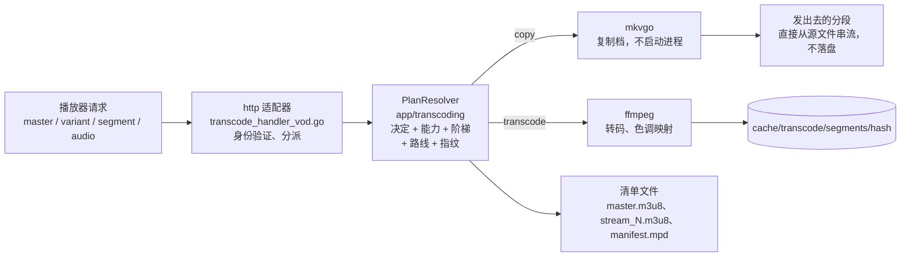

# 提供视频：HLS 播放路径

播放器请求一个视频时发生了什么：从第一个 `master.m3u8` 请求，一直到某个分段的字节，也就是读取路径。
相关代码分散在 `http` 驱动适配器（`internal/adapters/driving/http/transcode_*`）、`app/transcoding` 的各项服务，
以及 `ffmpeg` / `mkvgo` / `prober` 这几个被驱动适配器里；没有哪一个函数负责整条流程，所以本页就是这张地图。
它依据的决策是 [ADR-0030](adr/0030-one-plan-one-decision.md)（一个计划，一个决定）、
[ADR-0024](adr/0024-playback-plan-resolver.md)（计划解析器）和
[ADR-0029](adr/0029-transcoding-routes-are-measured-not-assumed.md)（经过测量的能力）。
它和[架构](ARCHITECTURE.md)里的扫描流程相对应，也是[代码地图](CODEBASE_MAP.md)里 "Golden path 4" 背后的详细说明。
同一套协商过程在用户眼里是什么样子，请读[Evey 如何选择播放方式](playback/how-playback-is-decided.md)。

## 思路：3 个问题，2 个引擎，1 把钥匙

提供一个视频，归结起来就是回答三个问题，再把答案打包，而一切都用同一个哈希值来定位。

| 问题 | 由谁回答 | 在哪里 |
| --- | --- | --- |
| **Q1 - 能不能低成本地读取这个文件？** | 按**文件扩展名**分派探测：`.mkv/.webm` 和 `.mp4/.mov` 交给 [mkvgo](playback/mkvgo.md)（只读文件头，不启动进程）；其他所有文件，以及快速路径的任何失败，都交给 ffprobe，它是最终权威 | `adapters/driven/prober/dispatcher.go` |
| **Q2 - 客户端能不能原样播放？** | 播放**决定**，按轨道分别做出：视频是 `copy` 还是 `transcode`，音频是 `copy`、`transcode` 还是 wasm AC-3 路径；视频和音频各自独立决定，最常见的情况是“复制视频，把音频重新编码为 AAC” | `app/transcoding/decision.go` |
| **Q3 - 这台机器能编码多少？** | 校准得到的**能力**（在第一个空闲时刻测量），加上**准入**（哪一档码率阶梯放得下，有没有空位） | `app/transcoding/calibration_service.go`、`admission_shaper.go` |

两个引擎贯穿始终：

- **mkvgo** 读取并重新打包（重封装、按需生成），不需要启动进程。没有成本。
- **ffmpeg / ffprobe** 通过启动进程来解码、重新编码和探测。成本高。

一把钥匙：一切（缓存目录、ffmpeg 会话、分段 URL）都用**决定指纹**来定位，它是决定的哈希值。
字节相同，哈希就相同，大家共用同一次编码。整个系统是否正确，取决于这个哈希在播放器手里的清单文件和它之后取的每一个分段之间保持**稳定**。

两个引擎的输出离开服务器的方式不同：mkvgo 的分段在收到请求时才生成，边生成边写到连接上，所以复制路径从不碰分段缓存；
ffmpeg 的分段是指纹目录下的一个文件，写一次，之后从那里提供。

## 阅读顺序：跟着一个请求走一遍代码

按这个顺序打开文件，就能从头到尾追踪一次播放请求：

1. **入口** - `internal/adapters/driving/http/transcode_handler_vod.go`：
   `serveHTTP` 先验证身份，再分派到 master / variant / segment / audio。
2. **计划任务** - `http/transcode_vod_plan.go` 把 `*http.Request` 整理成一个与传输层无关的 `PlaybackRequest`；
   `app/transcoding/playback_plan_resolver.go`（`PlanResolver.Resolve`，具体实现是 `playback_plan.go` 里的 `PlaybackPlanResolver`）
   返回一个不可变的 `PlaybackPlan`：决定（Q2）、阶梯类别、调整后的阶梯、硬件路线、打包器和指纹。
   这个会话的每个清单文件和每个分段都依据它来提供：清单的输入、降档探测、过期 URL 的封存、生产者的选择和分段的键，读的都是这同一次解析结果，
   所以在一个请求之内，缓存哈希的不变量天然成立（分段的热路径从大约 5 次读取配置偏好减少到 1 次）。
   关于源文件事实的辅助函数（编码、HDR、SAR、10 位……）放在旁边的 `source_facts.go` 里。
   `http/transcode_vod_fingerprint.go` 里的 `makeDecision` 和 `buildFingerprint` 是薄包装，供没有计划的调用处使用（预热、按需生成的 master）。
3. **Q2 - 决定** - `internal/app/transcoding/decision.go`：
   `MakePlaybackDecisionWithPrefs`（纯函数）是按轨道决定复制还是转码的大脑。解析器在它之上叠加请求时的固定参数（`vd=` / `ad=`）、
   音频重新同步的覆盖设置等。
4. **Q3 - 能力** - `internal/app/transcoding/calibration_service.go`：
   `Current()` 返回 `domain/transcoding.Derive(report, policy)`（`derive.go`），也就是根据最近一次校准推算出的这台机器的上限。
5. **阶梯和准入** - 解析器调整阶梯（复杂度类别、生产者配置、源文件和能力的上限、CMCD/AV1 上限、准入路线和上限），
   然后把它**冻结**在准入记录上（`admission_shaper.go`，`FreezeLadder`），之后每次调用都原样读取：
   缓存哈希的不变量由结构来保证。`video_session_limiter.go` 占住容量名额；名额满了，路线就从硬件溢出到软件。
6. **指纹** - 一个 `DecisionFingerprint`（类型和 `Hash()` 在 `app/transcoding/segment_cache.go` 里），由解析器组装。这个哈希就是缓存的键。
7. **生成字节** - 复制：**mkvgo**，`app/transcoding/ondemand.go`（端口）和 `adapters/driven/mkvgo/ondemand.go`；
   转码：**ffmpeg**，`adapters/driven/ffmpeg/hls_transcoder.go`（`BuildFFmpegArgs` 是纯函数；分段写到 `/cache/transcode/segments/<hash>/`）。
8. **打包** - `app/transcoding/manifest_generator.go` 写出 `master.m3u8` / `stream_N.m3u8`；`manifest_generator_dash.go` 写出 `manifest.mpd`。

!!! warning "跨请求时，不变量靠的是把参数写进 URL"
    决定的每一个输入都必须写进子 URL 里（`manifest_generator.go` 里的 `querySuffix`），否则播放中途的一次轮询就可能在播放器不知情的情况下改变计划。
    每个会话的 URL 会被重新写入（`transcode_vod_manifest_rebake.go`），带上串流令牌，HLS 和 DASH 都一样，包括不用 cookie 的 Chromecast。

## 两个引擎，按成本区分

**探测分派器**（`adapters/driven/prober/dispatcher.go`）是一条按扩展名区分的责任链：它先试 mkvgo，只要有任何疑问就退回 ffprobe
（解析错误、panic、结果无法映射、MP4 的某条媒体轨道丢失、DoVi profile 5、颜色信息读不出）。两条快速路径始终开启（`wire.go` 里的开关为 nil）；
ffprobe 是安全网，从不被绕过。另一个一模一样的分派器（`keyframe_dispatcher.go`）负责跳转索引。

| 操作 | mkvgo（无成本） | ffprobe / ffmpeg（成本高） |
|---|---|---|
| 元数据探测（编码、尺寸、HDR、码率、时长） | `.mkv/.webm/.mp4/.mov` 只读文件头 | 其他所有文件，或作为后备 |
| 帧率模式（cfr/vfr） | `AnalyzeFrameRateMode` | - |
| 把 MKV 重封装为 MP4（不重新编码） | `RemuxToMP4` | - |
| 按需生成 HLS/DASH（复制档） | `OnDemandPackager` | - |
| 视频重新编码 / HDR 色调映射 | - | `hls_transcoder.go` |
| 隔行检测（idet）、跳转落点、chromaprint、DoVi P5 | -（需要解码或附加数据） | ffmpeg / ffprobe |

还有三处会对 MKV/MP4 源文件调用 ffprobe 子进程，而这些数据 mkvgo 其实已经提供了，三处都在 `ffmpeg` 被驱动适配器里：
`trickplay.go` 里的时长、`complexity_classifier.go` 里的码率和尺寸，以及 `audio_delay.go` 里的播放音频延迟。

## 音频和视频分开决定

`makeDecision` 分别独立地生成 `VideoDecision` 和 `AudioDecision`。“复制档”（`isCopyRequest`）只看**视频**；
即使视频是复制的，旁边通常也带着一条重新编码的 AAC 音轨。音频决定有三种结果：

| 结果 | 提供什么 |
| --- | --- |
| 复制 | 原样的源音轨 |
| 转码为 AAC | ffmpeg，负担很轻 |
| **wasm 路径**，用于浏览器无法原生解码的 AC-3 / E-AC-3 | master 只包含视频，并带一个 `#EVEY-AUDIO-URI` 标签；AC-3 被**复制**（计划能建立时用 mkvgo 的 `od_audio`，否则用 ffmpeg `-c:a copy`），再由 `ac3go.wasm` 在浏览器里解码成 PCM（`WasmAudioEngine.ts`），时钟和视频锁定同步 |

Safari 被排除在 wasm 路径之外，依据的是能力，而不是名称：`canWasmDecodeAC3()`（`frontend/packages/client/src/web/codec.ts`）
只有在浏览器报告自己*不能*原生播放 AC-3 时才返回 true，而 Safari 报告的是能。

## 打包：CMAF、HLS、DASH

容器始终是 **CMAF**（fMP4）：每个变体一个 `init.mp4`，加上一串 `.m4s` 分段（`hls_transcoder.go` 里的 MPEG-TS 分支已经不会走到：
`needsFMP4Segments` 总是返回 true）。在*同一批*分段之上：

- **HLS**（`master.m3u8`、`stream_N.m3u8`、`EXT-X-MAP` 初始化段 + `.m4s`），两个引擎都支持。
- **DASH**（`manifest.mpd`）：在 mkvgo 复制路径上，用打包器自己生成的清单（`OnDemandPlan.HasDASH`，逐字节相同，不占存储，在 AES-128 下关闭）；
  在 ffmpeg 路径上，用一份**根据计划声明**的清单，指向 HLS 播放列表所用的同一批片段（`ManifestGenerator.MPD`），在任何片段生成之前就写好。

让 DASH 清单名副其实的，是**分段网格**（`domain/transcoding.SegmentGrid`）：每一档转码都按同样的整数帧数切分，即 `round(3 s x fps)`
（23.976 fps 时为 72，25 时为 75，29.97 时为 90），所以每个分段在视频轨道的时间刻度上都是精确的，并且在可切换的各档之间完全一致；
复制路径的后备方案则声明自己的关键帧计划。帧率未知或可变的源文件仍然使用旧的 3 秒时钟，保留 HLS，对 `manifest.mpd` 返回 404。
没有任何客户端被切换到 DASH：HLS 在所有地方仍是默认。在生成的片段上运行 mkvgo 的 `DASHFromCMAF`，作为一致性的参照
（`internal/pkg/cmafparity`，`TestDASHGridIntegration` 覆盖 23.976/25/29.97 fps：冷启动、跳转、两档切换组、误差在一个 AAC 帧以内的独立音频）。

## 用到的设计模式

| 模式 | 在哪里 |
| --- | --- |
| 端口与适配器（六边形架构） | 应用层只和 `StreamProber`、`BenchmarkRunner`、`OnDemandPackager`、`StreamProducer` 打交道；ffmpeg 和 mkvgo 实现它们，新增一个引擎就是新增一个适配器 |
| 策略模式 | `StreamProducer`（软件 / 硬件 / 复制），由一个 `ProducerSelector` 挑选 |
| 带后备的责任链 | 探测分派器和关键帧分派器（先 mkvgo，再由 ffprobe 作为权威） |
| 按内容寻址的缓存 | `DecisionFingerprint` 哈希作为缓存和 ffmpeg 会话的键 |
| 纯核心，命令式外壳 | `Derive`、`MakePlaybackDecision` 和成本模型都是纯函数，不需要 ffmpeg 或数据库就能做单元测试 |
| 不可变的值对象 | `StreamPlan`，也就是准入决定，只生成一次，从不修改，所以“URL 对应字节”的不变量天然成立 |
| 优雅降级 | 每一步都有安全的后备：默认能力 720p、硬件溢出到软件、复制退回转码、mkvgo 退回 ffprobe |

<!-- sources
entry and plan: internal/adapters/driving/http/transcode_handler_vod.go - serveHTTP ; internal/adapters/driving/http/transcode_vod_plan.go ; internal/adapters/driving/http/transcode_vod_fingerprint.go - makeDecision, buildFingerprint ; internal/adapters/driving/http/transcode_vod_manifest_rebake.go
resolver: internal/app/transcoding/playback_plan_resolver.go - PlanResolver.Resolve ; internal/app/transcoding/playback_plan.go - PlaybackRequest, PlaybackPlan ; internal/app/transcoding/source_facts.go
decision and capability: internal/app/transcoding/decision.go - MakePlaybackDecisionWithPrefs ; internal/app/transcoding/calibration_service.go - Current ; internal/domain/transcoding/derive.go - Derive
ladder, admission, fingerprint: internal/app/transcoding/admission_shaper.go - StreamPlan, FreezeLadder ; internal/app/transcoding/video_session_limiter.go ; internal/app/transcoding/segment_cache.go - DecisionFingerprint ; internal/app/transcoding/stream_producer.go - StreamProducer, ProducerSelector
engines: internal/adapters/driven/prober/dispatcher.go ; internal/adapters/driven/prober/keyframe_dispatcher.go ; internal/app/transcoding/ondemand.go - OnDemandPackager ; internal/adapters/driven/mkvgo/ondemand.go ; internal/adapters/driven/ffmpeg/hls_transcoder.go - BuildFFmpegArgs, needsFMP4Segments ; internal/adapters/driven/ffmpeg/trickplay.go, complexity_classifier.go, audio_delay.go
packaging: internal/app/transcoding/manifest_generator.go - querySuffix, EVEY-AUDIO-URI ; internal/app/transcoding/manifest_generator_dash.go ; internal/domain/transcoding/segment_grid.go - SegmentTargetSeconds, gridFor ; internal/pkg/cmafparity ; internal/adapters/driven/ffmpeg/dash_grid_integration_test.go - TestDASHGridIntegration
wasm: frontend/packages/client/src/web/codec.ts - canWasmDecodeAC3
-->
